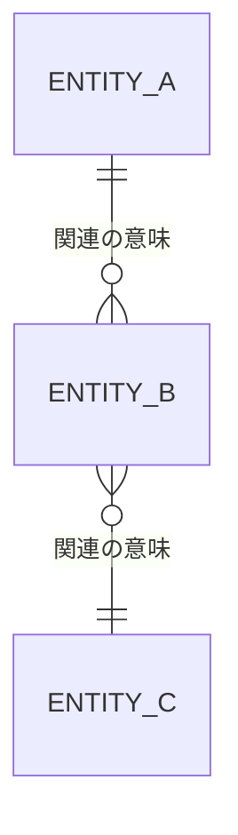

# データベース論理設計書

本書はArchitectureが作成する論理データモデルの正本とする。要件・提供済み仕様・有効な既存判断から確定できる内容を記載する。
重要な方式選択・正規化例外・履歴方式等が未確定なら18章へ記録し、manifestのunresolved_design_decisionsと対応させてADDRへ渡す。
新しい選択肢比較・採否理由・判断由来のDD/INV/ASMはADDRの正本に記録する。後続ADDRがモデル変更を求めた場合はArchitectureが差し戻しを受けて更新する。
参照だけの追加はADDR正本2章と派生handoffで接続し、将来ADDR IDの予約記入や通常FINALIZEを行わない。
既存のADR表記の欄には、有効な既存ADDRまたは旧Accepted ADRを記載できる。

<!--
目的:
- データ要件定義で定義された業務上のデータ、項目、関連、品質・保持等の要求を、
  実装可能な論理データモデルへ具体化する。
- エンティティ、属性、識別子、関連、多重度、整合性制約、正規化方針等を定義し、
  後続の物理データベース設計・実装の入力とする。

位置付け:
  データ要件定義
      ↓
  データベース論理設計 ← 本書
      ↓
  データベース物理設計 / 実装

重要:
- 本書は論理設計を対象とする。
- DBMS固有の物理データ型、テーブルスペース、インデックス、パーティション、
  ストレージ構成、物理配置、DDL等は記載しない。
- Requirement / Data Requirement / Accepted ADRをSource of Truthとして参照し、
  要件を独自に追加・変更しない。
- 不明な仕様を推測して確定しない。Open Questionsへ記録する。
- 物理実装上の都合のみを理由として、業務上異なる概念を同一エンティティへ統合しない。
-->

## 1. 文書情報

| 項目 | 内容 |
| --- | --- |
| Document ID | `<DOC-LDB-001>` |
| 対象システム | `<システム名>` |
| 対象サブシステム / Domain | `<対象範囲>` |
| Version | `<1.0>` |
| Status | `DRAFT / REVIEW / APPROVED / DEPRECATED` |
| Owner | `<Architecture担当>` |
| Last Updated | `<YYYY-MM-DD>` |

## 2. 目的と適用範囲

### 2.1 目的

`<本論理データモデルが対象とする業務・システム上の目的>`

### 2.2 対象範囲

| 区分 | 内容 |
| --- | --- |
| 対象Domain | `<Domain / Business Area>` |
| 対象データ | `<主要データ群>` |
| 対象機能 / Use Case | `<FR-xxx / UC-xxx 等>` |
| 対象Database | `<論理上のDatabase / Data Store名称>` |

### 2.3 本書で定義する事項

- 論理エンティティ
- 論理属性
- Primary Identifier / Alternate Identifier
- エンティティ間の関連と多重度
- 必須性・一意性等の論理制約
- 要件・既存判断に基づく正規化結果と、非正規化を適用する場合の判断参照
- 状態・履歴・有効期間等の論理モデル
- Code / Reference Dataの論理モデル
- Requirement / Data Requirement / ADRとの対応

### 2.4 本書で定義しない事項

- DBMS固有の物理データ型
- Table / Columnの物理名
- Index
- Partition
- Tablespace / Storage
- Replicationの物理方式
- DDL / SQL実装
- Connection Pool等のRuntime設定
- Backup製品・具体的な運用設定

## 3. 関連情報

| 種別 | ID / Path | 本書との関係 |
| --- | --- | --- |
| Business Requirement | `<BR-xxx / path>` | `<業務上の根拠>` |
| Functional Requirement | `<FR-xxx / path>` | `<機能からのデータ要求>` |
| Non-Functional Requirement | `<NFR-xxx / path>` | `<保持・性能・Security等>` |
| Data Requirement | `<DATA-xxx / path>` | `<論理モデル化する元データ>` |
| Use Case / AC | `<UC-xxx / AC-xxx>` | `<データ生成・参照・更新契機>` |
| ADR | `<ADDR-xxx / ADR-xxx / None>` | `<参照時点で有効なデータ方式の設計判断>` |
| Glossary | `<TERM-xxx / path>` | `<業務用語の定義>` |
| External IF Requirement | `<IF-xxx / None>` | `<外部データとの関係>` |

## 4. 論理データモデル方針

### 4.1 モデリング方針

| 項目 | 方針 |
| --- | --- |
| モデリング単位 | `<Domain / Aggregate / 業務概念等>` |
| 正規化方針 | `<原則第3正規形まで / PJ方針等>` |
| 履歴管理方針 | `<状態履歴 / 世代管理 / 有効期間 等>` |
| 削除の考え方 | `<業務上の削除 / 論理的な失効 / 保持等>` |
| Code / Master管理 | `<独立Entity / 外部Master参照等>` |
| 多言語データ | `<方針 / 該当なし>` |
| Time Zone | `<論理上の時刻基準 / Requirement参照>` |
| 金額・数量 | `<単位・精度の業務上の考え方>` |

### 4.2 Domain / Data Ownership

| Data Area | Owner Domain | 更新責任 | 参照するDomain | 備考 |
| --- | --- | --- | --- | --- |
| `<顧客>` | `<Customer>` | `<Customer Domain>` | `<Order等>` | `<...>` |

## 5. エンティティ一覧

<!--
記入ルール:
- 1エンティティ1行。
- 業務上の意味を持つデータのまとまりを定義する。
- Table名ではなく論理エンティティ名を使用する。
- 種別は必要に応じて MASTER / TRANSACTION / HISTORY / REFERENCE / ASSOCIATION / OTHER を使用する。
-->

| Entity ID | エンティティ名 | 種別 | 業務上の意味・責務 | 主な生成契機 | 主な利用機能 | 関連Data Requirement | Owner Domain |
| --- | --- | --- | --- | --- | --- | --- | --- |
| ENT-001 | `<エンティティ名>` | `MASTER / TRANSACTION / HISTORY / REFERENCE / ASSOCIATION / OTHER` | `<何を表すか>` | `<登録・外部取込等>` | `<FR/UC>` | `<DATA-xxx>` | `<Domain>` |

## 6. ER図

<!--
- Entity ID / 論理名を使用する。
- 属性を全量表示する必要はない。主要Identifierのみでもよい。
- 図と7章・8章の定義を一致させる。
-->

### 6.1 ER図補足

| ID | 対象Entity / Relationship | 補足 |
| --- | --- | --- |
| LDB-NOTE-001 | `<ENT-001 → ENT-002>` | `<図だけでは表現しづらい条件等>` |

## 7. エンティティ詳細

<!--
Entityごとに7.xブロックを複製する。
-->

### 7.1 `<ENT-001>` `<エンティティ名>`

#### 7.1.1 基本情報

| 項目 | 内容 |
| --- | --- |
| Entity ID | `ENT-001` |
| Entity Name | `<論理名>` |
| Business Definition | `<業務上の定義>` |
| Entity Type | `<MASTER / TRANSACTION / ...>` |
| Owner Domain | `<Domain>` |
| Related Data Requirement | `<DATA-xxx>` |
| Related Requirements | `<FR-xxx, NFR-xxx>` |
| Related ADR | `<ADDR-xxx / ADR-xxx / None>` |
| Lifecycle | `<生成 → 更新 → 完了/失効/削除>` |

#### 7.1.2 Identifier

| Identifier ID | 種別 | 構成Attribute | 業務上の意味 | 変更可否 | 備考 |
| --- | --- | --- | --- | --- | --- |
| IDF-ENT-001-001 | `PRIMARY` | `<ATTR-...>` | `<一意識別の意味>` | `IMMUTABLE / CHANGEABLE` | `<...>` |
| IDF-ENT-001-002 | `ALTERNATE` | `<ATTR-... + ATTR-...>` | `<業務Key等>` | `<...>` | `<...>` |

#### 7.1.3 属性定義

<!--
Logical Type例:
STRING / INTEGER / DECIMAL / BOOLEAN / DATE / DATETIME / TIME / CODE / IDENTIFIER / FILE_REFERENCE / OTHER

注意:
- VARCHAR / BIGINT 等のDBMS物理型は記載しない。
- Length / Precisionは業務上の制約として必要な場合のみ記載する。
-->

| Attribute ID | 属性名 | 意味・説明 | Logical Type | 必須 | 一意 | Length / Precision | 値域・Format | Default / Initial | Derived Rule | 機密区分 | Related Data Item |
| --- | --- | --- | --- | --- | --- | --- | --- | --- | --- | --- | --- |
| ATTR-ENT-001-001 | `<属性名>` | `<意味>` | `<STRING等>` | `REQUIRED / OPTIONAL / CONDITIONAL` | `YES / NO` | `<業務上必要な場合>` | `<値域・書式・Code参照>` | `<値 / None>` | `<導出式 / None>` | `<区分>` | `<DATA item ID>` |

#### 7.1.4 条件付き必須・属性間制約

| Constraint ID | 対象Attribute | 条件 | 制約内容 | 違反時の論理上の扱い | Related Requirement |
| --- | --- | --- | --- | --- | --- |
| LDC-ENT-001-001 | `<ATTR-...>` | `<条件>` | `<必須・相互排他・大小関係等>` | `<受付不可等>` | `<FR/DATA-xxx>` |

#### 7.1.5 状態・Lifecycle

<!--
状態を持たないEntityは「該当なし」。
-->

| State ID | 状態名 | 意味 | 遷移元 | 遷移契機 | 遷移先 | 遷移条件 |
| --- | --- | --- | --- | --- | --- | --- |
| STATE-001 | `<状態>` | `<意味>` | `<状態>` | `<イベント>` | `<状態>` | `<条件>` |

#### 7.1.6 履歴・有効期間

| 項目 | 内容 |
| --- | --- |
| 履歴保持 | `<要 / 不要>` |
| 保持対象 | `<変更履歴 / 状態履歴 / 業務履歴 等>` |
| 業務上の有効期間 | `<開始/終了の考え方 / 該当なし>` |
| 過去時点参照 | `<必要 / 不要>` |
| Requirement | `<NFR/DATA-xxx>` |

## 8. Relationship定義

<!--
物理的な外部Key名ではなく、論理上の関連を定義する。
-->

| Relationship ID | From Entity | To Entity | 関連の意味 | From→To多重度 | To→From多重度 | 必須性 | 識別関係 | Related Requirement |
| --- | --- | --- | --- | --- | --- | --- | --- | --- |
| REL-001 | `<ENT-001>` | `<ENT-002>` | `<顧客は注文を行う等>` | `1 / 0..1 / 1..N / 0..N` | `<...>` | `<MANDATORY / OPTIONAL>` | `IDENTIFYING / NON_IDENTIFYING` | `<FR/DATA-xxx>` |

### 8.1 Relationship制約

| Constraint ID | Relationship ID | 条件 | 論理制約 | 親が失効・削除された場合の業務上の扱い |
| --- | --- | --- | --- | --- |
| LDC-REL-001 | REL-001 | `<条件>` | `<孤児データを許可しない等>` | `<削除不可 / 子も失効 / 履歴保持 等>` |

## 9. 正規化・モデル分割判断

要件・既存有効判断から導出したモデル化結果と出典を記録する。新しい重要判断の比較・採否理由はADDRを正本とし、本章では複製しない。
未確定の重要判断は18章へ記録する。参照できる既存判断がなければ将来IDを記入しない。

<!--
正規化の結果や例外的な非正規化判断を記録する。
重要なArchitecture Decisionが未確定の場合はADDRへ委譲し、Architectureが判断記録を新規作成しない。
-->

| Decision ID | 対象 | 課題 / 元構造 | 判断 | 理由 | Related ADR |
| --- | --- | --- | --- | --- | --- |
| LDM-DEC-001 | `<ENT-xxx>` | `<繰返し属性、部分関数従属等>` | `<根拠から確定した分割 / 維持 / 非正規化 / 未決>` | `<要件・既存判断に基づく根拠>` | `<ADDR-xxx / ADR-xxx / None>` |

### 9.1 正規化確認

| Check | Result | Evidence / Note |
| --- | --- | --- |
| 繰返し属性・多値属性が適切にモデル化されている | `PASS / N/A / REVIEW` | `<...>` |
| Identifierの一部への部分関数従属が解消されている | `PASS / N/A / REVIEW` | `<...>` |
| 非Key属性間の推移的依存が適切に扱われている | `PASS / N/A / REVIEW` | `<...>` |
| N:M関連が必要に応じてAssociation Entityで表現されている | `PASS / N/A / REVIEW` | `<...>` |
| 非正規化がある場合、理由とADRが明示されている | `PASS / N/A / REVIEW` | `<...>` |

## 10. Code / Reference Data

| Code Set ID | Code Set Name | 用途 | 管理主体 | 変更頻度 | 有効期間管理 | 参照Entity / Attribute | External Source |
| --- | --- | --- | --- | --- | --- | --- | --- |
| CODE-001 | `<コード名>` | `<用途>` | `<業務 / System / 外部>` | `<随時等>` | `<要 / 不要>` | `<ENT/ATTR>` | `<IF / None>` |

### 10.1 Code値

<!--
値の全量を設計成果物で管理する必要がない場合は、Authoritative Sourceへの参照のみとする。
-->

| Code Set ID | Code | 表示名 / 意味 | 有効開始 | 有効終了 | 備考 |
| --- | --- | --- | --- | --- | --- |
| CODE-001 | `<value>` | `<意味>` | `<YYYY-MM-DD / None>` | `<YYYY-MM-DD / None>` | `<...>` |

## 11. データ整合性ルール

| Rule ID | 対象Entity / Attribute | Rule Type | 条件・制約 | Related Requirement | Verification Hint |
| --- | --- | --- | --- | --- | --- |
| LDR-001 | `<ENT/ATTR>` | `UNIQUENESS / RANGE / CONSISTENCY / TEMPORAL / CROSS_ENTITY / OTHER` | `<論理整合性ルール>` | `<FR/DATA-xxx>` | `<確認方法>` |

## 12. データ生成・更新・参照Matrix

<!--
CRUDの物理実装ではなく、どの機能/Use Caseがどの論理Entityを扱うかを確認する。
-->

| Function / Use Case | Entity | Create | Read | Update | Logical Delete / Invalidate | 備考 |
| --- | --- | :---: | :---: | :---: | :---: | --- |
| `<FR-001 / UC-001>` | `<ENT-001>` | `○/-` | `○/-` | `○/-` | `○/-` | `<条件>` |

## 13. Security / Privacy

| Entity / Attribute | Data Classification | Personal / Sensitive | Access Requirement | Masking Requirement | Retention Reference |
| --- | --- | --- | --- | --- | --- |
| `<ENT/ATTR>` | `<PUBLIC / INTERNAL / CONFIDENTIAL 等>` | `<YES / NO>` | `<Role / Requirement>` | `<要件 / None>` | `<NFR/DATA-xxx>` |

## 14. データ量・Lifecycle前提

<!--
物理Sizingは物理設計側で行う。
ここでは論理モデルへ影響する規模・増加・保持の前提のみ記載する。
-->

| Entity | Initial Volume | Growth | Peak Creation / Update | Retention | Purge / Archive Requirement | Source |
| --- | --- | --- | --- | --- | --- | --- |
| `<ENT-001>` | `<件数>` | `<件/年>` | `<件/時間等>` | `<期間>` | `<Requirement>` | `<DATA/NFR-xxx>` |

## 15. 外部データとのMapping

<!--
外部IFがない場合は「該当なし」。
物理電文レイアウトは外部IF設計 / File Definitionへ委譲する。
-->

| Mapping ID | External IF | External Data | Logical Entity / Attribute | Direction | Transformation Rule | 備考 |
| --- | --- | --- | --- | --- | --- | --- |
| MAP-001 | `<IF-001>` | `<外部項目>` | `<ENT/ATTR>` | `IN / OUT / BOTH` | `<論理変換 / None>` | `<...>` |

## 16. 論理設計検証

| Verification ID | 観点 | 確認内容 | Result | Evidence |
| --- | --- | --- | --- | --- |
| LDB-V-001 | Coverage | Data Requirementが必要なEntity / Attributeへ反映されている | `PASS / FAIL / BLOCKED` | `<ID>` |
| LDB-V-002 | Consistency | GlossaryとEntity / Attributeの意味が矛盾しない | `<...>` | `<...>` |
| LDB-V-003 | Integrity | Identifier / Relationship / Constraintで業務整合性を表現できる | `<...>` | `<...>` |
| LDB-V-004 | Normalization | 重複・更新不整合を生む構造が必要な範囲で解消されている | `<...>` | `<...>` |
| LDB-V-005 | Lifecycle | 状態・履歴・保持要求をモデルが表現できる | `<...>` | `<...>` |
| LDB-V-006 | Security | 機密区分・アクセス要件が論理モデルへ反映されている | `<...>` | `<...>` |
| LDB-V-007 | External Data | 外部データと論理モデルの対応が定義されている | `<...>` | `<...>` |

## 17. 物理設計への引継ぎ事項

<!--
論理設計では決めず、物理設計で具体化すべき事項を明示する。
-->

| Handoff ID | 対象 | 物理設計で決定する事項 | 論理上の制約 / 前提 | Related Requirement / ADR |
| --- | --- | --- | --- | --- |
| PHY-HO-001 | `<ENT/ATTR>` | `<物理型、Index、Partition等>` | `<論理制約>` | `<NFR/ADR>` |

## 18. Open Questions

| Question ID | 内容 | 影響Entity / Attribute | 影響 | 解決先 | 状態 |
| --- | --- | --- | --- | --- | --- |
| OQ-LDB-001 | `<未確定事項>` | `<ENT/ATTR>` | `<実装・移行・試験等>` | `<Requirements / ADR / Owner>` | `OPEN / RESOLVED` |

## 19. Change History

| Version | Date | Change | Reason | Related ID |
| --- | --- | --- | --- | --- |
| `<1.0>` | `<YYYY-MM-DD>` | `<変更内容>` | `<理由>` | `<DATA/FR/ADR等>` |
