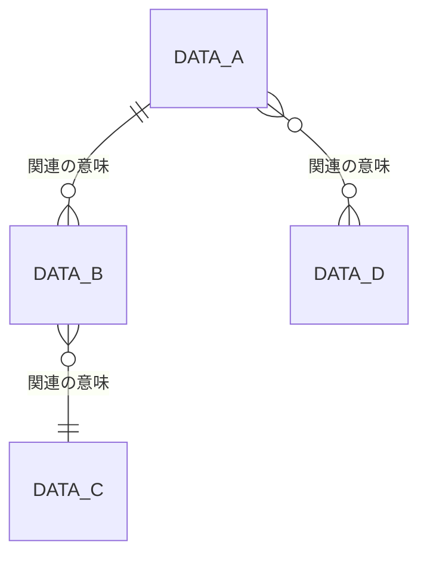

# データ要件定義書：{{システム名}}

<!--
【本テンプレートの使い方】
- {{ }} で囲まれた箇所を記入内容に置き換える。
- 記入ガイドコメント等のコメントは記入時の補助であり、完成版では削除してよい。
- 該当しない欄は空欄にせず「該当なし」と記入する。決まっていない事項は「未決」と記入し、「未決事項・確認事項」に登録する。
- ID は本書内で一意となるよう付与する（本テンプレートでは採番規則を定めない）。
- 「速やかに」「適切に」等の曖昧な表現は避け、数値・単位・条件で記述する。
- 優先度は「必須（リリースに不可欠）／推奨（可能な限り実現）／任意（余裕があれば実現）」の3区分で記入する。
- 表の行は必要に応じて追加・削除する。繰り返しブロックは必要数だけ複製する。

【本書固有の注意】
- 本書はデータの「要件」（何を・どの意味で・どの品質で・どれだけ・いつまで持つか、誰が更新・参照できるか）を定義する。テーブル定義、インデックス、物理データ型（VARCHAR、NUMBER 等）、正規化の方針は本書では記載しない。
- データ形式は論理型（文字列／整数／小数／日付／日時／時刻／真偽／コード／ファイル）で記入する。
- 「データID」「項目ID」は本書内の各表で共通して使用する。2章で付与したデータIDを3章以降でも同じ値で参照する。
- 利用者区分は、本書内のすべての表で同一の区分名を用いる。
-->

## 0. 文書管理

### 0.1 改訂履歴

| 版数 | 日付 | 改訂内容 | 作成・改訂者 |
|---|---|---|---|
| {{版数}} | {{YYYY-MM-DD}} | {{改訂内容}} | {{作成・改訂者}} |

## 1. 本書の目的と適用範囲

<!-- 記入ガイド：本書が定義するデータの範囲（対象システムが保持・管理するデータ、外部から取り込んで保持するデータ等）と、定義しない範囲を明記する。対象外の項目は削除せず、必要に応じて追記する。 -->

### 1.1 目的

本書は、{{システム名}} が保持・管理するデータについて、データ項目、意味、形式、品質、保存期間、件数、機密区分、更新・参照ルールを定義することを目的とする。

### 1.2 適用範囲

| 区分 | 内容 |
|---|---|
| 本書で定義する | {{対象とするデータの範囲}} |
| 本書で定義しない | 論理データモデルの詳細化（正規化）および物理設計（テーブル定義、インデックス、物理データ型、パーティション、ストレージ構成） |
| 本書で定義しない | 内部的な採番方式、データの取扱い要件の実現方式（暗号化方式、マスク処理の実装方法等） |
| {{区分}} | {{その他の事項}} |

## 2. データ全体像

### 2.1 データ（エンティティ）一覧

<!-- 記入ガイド：対象システムが保持する業務上のデータのまとまり（エンティティ）を1行1データで列挙する。
- 種別：マスタ／トランザクション／履歴／ログ／外部取込／その他（内容を意味・説明に記入）から選択する。
- 発生源：利用者入力／外部取込／初期投入／システム生成 から選択し（複数可）、括弧内に具体的な内容（入力する利用者区分と操作、取込元の名称、生成の契機等）を記入する。
- 主な利用者：そのデータを登録・更新・参照する利用者区分名を記入する。システムのみが扱う場合は「システム」と記入する。
- 件数見込み参照：6章の該当行を参照する旨を記入する。
例：{{ID}}｜申請｜利用者が提出する申請の内容と状態｜トランザクション｜利用者入力（申請者が申請を登録）｜申請者、承認者｜6章参照
-->

| データID | データ名 | 意味・説明 | 種別 | 発生源 | 主な利用者 | 件数見込み参照 |
|---|---|---|---|---|---|---|
| {{ID}} | {{データ名}} | {{意味・説明}} | {{マスタ／トランザクション／履歴／ログ／外部取込／その他}} | {{利用者入力／外部取込／初期投入／システム生成（具体的な内容）}} | {{利用者区分}} | 6章参照 |

### 2.2 データ間の関連

<!-- 記入ガイド：データ間の関連を1行1関連で記入する。概念レベルの関連のみを記入し、外部キー等の物理的な実現方法は記入しない。
- 多重度：1:1／1:N／N:M のいずれかを記入する。関連先が0件を許容する場合は「1:0..N」のように記入してよい。
例：{{ID}}｜利用者｜申請｜利用者は複数の申請を提出する｜1:N
-->

| ID | 関連元データ | 関連先データ | 関連の意味 | 多重度 |
|---|---|---|---|---|
| {{ID}} | {{関連元データ名}} | {{関連先データ名}} | {{関連の意味}} | {{1:1／1:N／N:M}} |

<!-- 記入ガイド：上表を図示する場合は、以下の Mermaid erDiagram 雛形を編集する。エンティティ名は2.1のデータ名（Mermaidで扱えない文字を含む場合は英数字の別名）に置き換える。属性は記載せず、関連と多重度のみを示す（概念レベル）。
記号の意味：||--|| は1対1、||--o{ は1対0以上、}o--o{ は多対多。 -->

## 3. データ項目定義

<!-- 記入ガイド：2.1のデータごとに以下の「3.x」ブロックを1つ作成する。必要数だけ複製し、節番号を連番にする。
- 識別子：そのデータの1件を一意に識別する項目（複数項目の組合せの場合はすべて列挙）を記入する。内部的な採番方式（連番の生成方法等）は記入しない。利用者に表示する番号等で業務上の書式・付番ルールがある場合は、値域・書式または導出・計算ルールに記入する。
- データ形式：論理型（文字列／整数／小数／日付／日時／時刻／真偽／コード／ファイル）で記入する。物理型は記入しない。
- 桁・長さ：文字列は最大文字数（最小がある場合は「最小〜最大」）、整数は最大桁数、小数は「整数部n桁・小数部m桁」、日付・日時・真偽は「該当なし」と記入する。
- 必須：必須／任意／条件付き必須 から選択する。条件付き必須の場合は条件を備考に記入する。
- 一意：単独で一意となる項目は「一意」、それ以外は「－」と記入する。複数項目の組合せで一意となる場合はブロック冒頭の「複合一意条件」に記入する。
- 値域・書式：数値範囲（例：0以上9999以下）、文字種、正規表現、コード参照（4章のコードID）のいずれかで記入する。
- 導出・計算ルール：他の項目から算出・自動設定する場合に計算式・設定契機を記入する。利用者が入力する項目は「該当なし」と記入する。
- 機密区分：8.1で定義した区分名を記入する。
例：{{ID}}｜申請日時｜申請が提出された日時｜日時｜該当なし｜必須｜－｜該当なし｜該当なし｜提出操作時のシステム日時を設定｜社外秘｜該当なし
-->

### 3.1 {{データ名}}

| 項目 | 内容 |
|---|---|
| データID | {{2.1のデータID}} |
| データ名 | {{データ名}} |
| 識別子 | {{一意に識別する項目名（複数の場合はすべて列挙）}} |
| 複合一意条件 | {{複数項目の組合せで一意となる条件／該当なし}} |
| 状態を表す項目 | {{状態項目名と参照するコードID／該当なし}} |
| 備考 | {{備考}} |

| 項目ID | 項目名 | 意味・説明 | データ形式 | 桁・長さ | 必須 | 一意 | 値域・書式 | 初期値 | 導出・計算ルール | 機密区分 | 備考 |
|---|---|---|---|---|---|---|---|---|---|---|---|
| {{ID}} | {{項目名}} | {{意味・説明}} | {{論理型}} | {{桁・長さ}} | {{必須／任意／条件付き必須}} | {{一意／－}} | {{値域・書式}} | {{初期値}} | {{導出・計算ルール}} | {{機密区分}} | {{備考}} |

<!-- 記入ガイド：状態を表す項目がある場合、取りうる状態値を4章のコード値として定義し、状態値と他項目の値の整合条件（例：状態が「承認済」のとき承認日時が必須）を5章の状態整合ルールとして記入する。状態の遷移条件（どの操作でどの状態に変わるか）は本書では記載しない。 -->

## 4. コード値定義

<!-- 記入ガイド：3章の「値域・書式」でコード参照としたコードを、1行1コード値で記入する。同じコードIDの値は連続する行にまとめる。
- 値：データとして保持する値を記入する。
- 表示名：利用者に表示する名称を記入する。
- 有効/廃止：有効／廃止 から選択する。廃止の場合は、廃止日と廃止前に登録済みのデータの扱いを備考に記入する。
例：{{ID}}｜申請状態｜1｜申請中｜承認待ちの状態｜有効｜該当なし
-->

| コードID | コード名 | 値 | 表示名 | 意味 | 有効/廃止 | 備考 |
|---|---|---|---|---|---|---|
| {{ID}} | {{コード名}} | {{値}} | {{表示名}} | {{意味}} | {{有効／廃止}} | {{備考}} |

## 5. データ品質・整合性ルール

<!-- 記入ガイド：3章の項目単位の制約（必須・桁・値域）では表現できない、データ単位・データ間のルールを1行1ルールで記入する。業務上のルールに由来する制約も、ルール内容として本表に直接記入する。
- ルール種別：一意性／参照整合性／項目間整合／状態整合／鮮度／正確性／その他 から選択する。
  - 一意性：複数項目の組合せや条件付きの一意制約。
  - 参照整合性：関連先データの存在条件、関連先削除時の扱い。
  - 項目間整合：同一データ内の項目間の大小・組合せ条件。
  - 状態整合：状態項目の値と他項目の値の整合条件。
  - 鮮度：外部取込データ等の最新性の許容範囲（取込からの経過時間等）。
  - 正確性：外部の正となる情報源との一致条件。
- ルール内容：判定可能な条件として記入する（例：「終了日は開始日以降であること」）。
- 違反時の扱い：登録拒否（エラー）／警告のうえ登録可／事後検知して通知／その他 を選択し、通知先等を補足する。
例：{{ID}}｜申請：開始日、終了日｜項目間整合｜終了日は開始日以降であること｜登録拒否（エラー）
-->

| ID | 対象データ・項目 | ルール種別 | ルール内容 | 違反時の扱い |
|---|---|---|---|---|
| {{ID}} | {{データ名：項目名}} | {{ルール種別}} | {{ルール内容}} | {{違反時の扱い}} |

## 6. データ量

<!-- 記入ガイド：2.1のデータごとに件数見込みを記入する。
- 初期件数：稼働開始時点の件数（10章の初期・移行データ件数と一致させる）。
- 増加件数：日・月・年のうち根拠のある単位で記入し、他の単位は換算値を記入する。季節変動・ピークがある場合は備考に最大値と時期を記入する。
- 保存期間経過時点の最大件数：初期件数＋増加件数×保存期間（7章）から削除・アーカイブ分を差し引いた、保持件数の最大値を記入する。
- 1件あたり概算サイズ：任意記入。添付ファイル等で大きくなる場合は記入する。記入しない場合は「該当なし」と記入する。
- 根拠：現行システムの実績値、想定利用者数×1人あたりの件数等、算出の根拠を記入する。
例：{{データID}}｜申請｜1,000件｜20件/日、400件/月、4,800件/年｜25,000件（保存期間5年）｜2KB｜現行システムの直近1年の月平均実績
-->

| データID | データ名 | 初期件数 | 増加件数（日/月/年） | 保存期間経過時点の最大件数 | 1件あたり概算サイズ（任意） | 根拠 | 備考 |
|---|---|---|---|---|---|---|---|
| {{ID}} | {{データ名}} | {{件数}} | {{件数/日、件数/月、件数/年}} | {{件数}} | {{サイズ／該当なし}} | {{根拠}} | {{備考}} |

## 7. 保存期間・廃棄・アーカイブ

<!-- 記入ガイド：2.1のデータごとに保存期間と期間経過後の扱いを記入する。
- 保存期間：年・月・日の単位で記入する。無期限の場合は「無期限」と記入し、理由を根拠欄に記入する。
- 起算日：保存期間の起点となる日（例：登録日、完了日、最終更新日、契約終了日）を3章の項目名で記入する。
- 期間経過後の扱い：削除／アーカイブ／匿名化 から選択する。アーカイブの場合はアーカイブ後の保存期間を備考に記入する。
- 経過後の参照可否：期間経過後（アーカイブ後）に参照できる利用者区分と参照方法を記入する。参照不可の場合は「参照不可」と記入する。
- 実施契機：自動（定期処理）／手動 を記入する。自動の場合は実施の頻度・時期（例：毎月1日）を備考に記入する。
- 根拠：法令名・条項、社内規程名、契約等を記入する。
- システムの運用ログ（アプリケーションログ・アクセスログ・監査ログ等）の保管期間は本書では記載しない。
例：{{データID}}｜申請｜5年｜完了日｜アーカイブ｜参照不可｜自動（定期処理）｜{{規程名}}
-->

| データID | データ名 | 保存期間 | 起算日 | 期間経過後の扱い | 経過後の参照可否 | 実施契機 | 根拠（法令/規程） | 備考 |
|---|---|---|---|---|---|---|---|---|
| {{ID}} | {{データ名}} | {{保存期間}} | {{起算日}} | {{削除／アーカイブ／匿名化}} | {{参照可否}} | {{自動／手動}} | {{根拠}} | {{備考}} |

## 8. 機密区分・個人情報

### 8.1 機密区分の定義

<!-- 記入ガイド：プロジェクトまたは組織の情報管理規程に基づく機密区分を定義する。規程がある場合は区分名・定義を規程どおりに記入し、規程名を11章の前提条件に記入する。
- 取扱い要件：表示マスク／暗号化（保存時・通信時）／アクセス制限／出力制限（ダウンロード・印刷・外部送信）について、区分ごとに要否と条件を記入する。暗号化方式等の実現方法は本書では記載しない。
例：{{ID}}｜社外秘｜関係者以外への開示を禁止する情報｜表示マスク：不要、暗号化：通信時必須、アクセス制限：利用者区分で制限、出力制限：承認者のみ出力可
-->

| ID | 区分 | 定義 | 表示マスク | 暗号化 | アクセス制限 | 出力制限 |
|---|---|---|---|---|---|---|
| {{ID}} | {{区分名}} | {{定義}} | {{要否・条件}} | {{要否・条件}} | {{要否・条件}} | {{要否・条件}} |

### 8.2 個人情報・機微情報を含むデータと項目

<!-- 記入ガイド：個人情報、要配慮個人情報、その他機微情報（認証情報、決済情報等）を含む項目を1行1項目で記入する。該当する項目がない場合は表に「該当なし」と1行記入する。
- 情報種別：個人情報／要配慮個人情報／認証情報／その他機微情報 から選択し、その他の場合は内容を個別の取扱い要件欄に補足する。
- 利用目的：その項目を保持する業務上の目的を記入する。
- 本人からの開示・訂正・削除請求への対応：対応要否と対応方法（本人によるシステム上の操作、管理者による運用手順等）を記入する。
例：{{データID}}｜利用者｜{{項目ID}}｜氏名｜個人情報｜社外秘｜本人確認および連絡｜一覧表示では姓のみ表示｜開示・訂正：対応要（本人が登録情報を照会・変更する）
-->

| データID | データ名 | 項目ID | 項目名 | 情報種別 | 機密区分 | 利用目的 | 個別の取扱い要件 | 開示・訂正・削除請求への対応 |
|---|---|---|---|---|---|---|---|---|
| {{ID}} | {{データ名}} | {{ID}} | {{項目名}} | {{情報種別}} | {{8.1の区分名}} | {{利用目的}} | {{個別の取扱い要件／該当なし}} | {{対応要否・方法}} |

## 9. 更新・参照ルール

### 9.1 更新ルール

<!-- 記入ガイド：2.1のデータごとに、登録・更新・削除の操作を1行1ルールで記入する。初期投入のみで稼働後に登録・更新・削除が行われないデータは本表に記入せず、10章に記入する。
- 操作：登録／更新／削除 から選択する。
- 実行者：操作を行う利用者区分名、またはシステム（定期処理・外部取込）を記入する。
- 契機：操作が行われるきっかけを文章で記入する（例：申請者が申請内容を提出したとき、毎日0時の定期処理、外部からのデータ受信時、状態が「承認済」に変わったとき）。
- 実行条件：操作を許可する条件（状態、本人分のみ、期限内等）を判定可能な形で記入する。
- 削除方式：論理削除／物理削除 から選択する。操作が削除以外の場合は「該当なし」と記入する。
- 履歴保持：要／不要 を記入し、要の場合は保持する内容（変更前後の値、変更者、変更日時等）を記入する。
- 同時更新時の扱い：複数の利用者が同じデータを同時に更新した場合の扱い（後勝ち／先勝ちで後続はエラー／排他して待機）を記入する。
例：{{ID}}｜申請｜更新｜申請者｜申請者が提出済みの申請内容を修正したとき｜状態が「申請中」かつ本人の申請であること｜該当なし｜要（変更前後の値、変更者、変更日時）｜先勝ちで後続はエラー
-->

| ID | 対象データ | 操作 | 実行者 | 契機 | 実行条件 | 削除方式 | 履歴保持 | 同時更新時の扱い |
|---|---|---|---|---|---|---|---|---|
| {{ID}} | {{データ名}} | {{登録／更新／削除}} | {{利用者区分名／システム}} | {{契機}} | {{実行条件}} | {{論理削除／物理削除／該当なし}} | {{要否・保持内容}} | {{同時更新時の扱い}} |

<!-- 記入ガイド：上表で論理削除としたデータについて、論理削除後に通常の検索・一覧に表示するか、復元を可能とするかを下表に記入する。論理削除を採用しない場合は表に「該当なし」と1行記入する。 -->

| ID | 対象データ | 論理削除後の通常参照 | 復元の可否・実行者 | 物理削除までの期間 |
|---|---|---|---|---|
| {{ID}} | {{データ名}} | {{表示する／表示しない}} | {{可否・実行者}} | {{期間／7章に従う}} |

### 9.2 参照ルール

<!-- 記入ガイド：データの参照について、利用者区分ごとに1行1ルールで記入する。
- 利用者区分：参照を行う利用者区分名を記入する。
- 参照範囲：全件／所属組織分／本人分／担当分 等、行の範囲を判定可能な条件で記入する。
- 参照条件：期間・状態等による追加の制限を記入する。
- 項目制限：参照できない項目、マスク表示する項目を記入する。制限がない場合は「該当なし」と記入する。
- 関連ID：本書内の関連する項目のID（例：8.1の機密区分ID、8.2の対象項目ID）を記入する。該当しない場合は「該当なし」と記入する。
例：{{ID}}｜申請｜承認者｜所属組織の申請のみ｜状態が「下書き」以外｜該当なし｜{{関連ID}}
-->

| ID | 対象データ | 利用者区分 | 参照範囲 | 参照条件 | 項目制限 | 関連ID |
|---|---|---|---|---|---|---|
| {{ID}} | {{データ名}} | {{利用者区分}} | {{参照範囲}} | {{参照条件}} | {{項目制限}} | {{関連ID}} |

## 10. 初期データ・移行データ

<!-- 記入ガイド：稼働開始時に投入するデータを1行1投入単位で記入する。投入するデータがない場合は表に「該当なし」と1行記入する。
- 投入方法：初期投入（新規に作成して投入）／移行（現行システム等から移す）／外部取込（外部から受信して取り込む） から選択する。
- 移行元：現行システム名、ファイル名、提供元組織等を記入する。初期投入の場合は「該当なし」と記入する。
- 件数：6章の初期件数と一致させる。
- データ変換・クレンジング要件：コード値の変換、重複の統合、欠損値の補完、形式の統一、5章の品質ルールに違反するデータの扱いを記入する。
- 投入後の確認方法：件数照合、サンプル照合、品質ルール違反件数の確認等、投入結果の確認方法と合格条件を記入する。
- 投入時期：稼働開始日を基準とした時期（例：稼働開始の{{n}}日前）または日付を記入する。
例：{{ID}}｜{{データID}}｜区分マスタ｜初期投入｜該当なし｜50件｜該当なし｜件数照合で全件一致｜稼働開始の7日前
-->

| ID | データID | データ名 | 投入方法 | 移行元 | 件数 | データ変換・クレンジング要件 | 投入後の確認方法 | 投入時期 |
|---|---|---|---|---|---|---|---|---|
| {{ID}} | {{データID}} | {{データ名}} | {{初期投入／移行／外部取込}} | {{移行元}} | {{件数}} | {{変換・クレンジング要件}} | {{確認方法・合格条件}} | {{投入時期}} |

## 11. 前提条件・制約事項

<!-- 記入ガイド：本書の内容が成立するための前提（例：件数見込みの前提となる業務量、準拠する情報管理規程、移行元データの提供時期）と、データに関する制約（例：法令による保存義務、外部提供元の仕様による桁・形式の制約）を1行1件で記入する。
- 関連ID：本書内の関連する項目のID（データID、項目ID、ルールID等）を記入する。該当しない場合は「該当なし」と記入する。
-->

| ID | 区分 | 内容 | 影響範囲 | 関連ID |
|---|---|---|---|---|
| {{ID}} | {{前提条件／制約事項}} | {{内容}} | {{影響範囲}} | {{関連ID}} |

## 12. 未決事項・確認事項

<!-- 記入ガイド：本書の各欄で「未決」と記入した事項、および確認が必要な事項を1行1件で登録する。
- 影響範囲：影響する章・データID・項目ID を記入する。
- 状態：未着手／確認中／解決済 から選択する。解決済の場合は解決内容を内容欄に追記する。
-->

| ID | 内容 | 影響範囲 | 担当 | 期限 | 状態 |
|---|---|---|---|---|---|
| {{ID}} | {{内容}} | {{影響範囲}} | {{担当}} | {{YYYY-MM-DD}} | {{未着手／確認中／解決済}} |

<!--
【記入完了チェック】
- 2.1のすべてのデータについて、3章（項目定義）、6章（データ量）、7章（保存期間）、9.2（参照ルール）に対応する記載がある。
- 2.1のすべてのデータについて、9.1に登録の更新ルールがある、または10章に初期投入・移行の記載がある（発生源のないデータがない）。
- 2.1の発生源と主な利用者が、9.1の実行者・9.2の利用者区分と矛盾していない。
- 3章の各データに識別子が記入され、各項目のデータ形式が論理型（物理型でない）で記入されている。
- 3章の「値域・書式」でコード参照とした項目のコードIDが、すべて4章に定義されている。
- 3章で状態を表す項目としたものについて、状態値が4章に、状態整合ルールが5章に記入されている。
- 3章の機密区分の値が、すべて8.1で定義した区分名である。
- 個人情報・機微情報を含む項目が、すべて8.2に列挙されている（該当がない場合は「該当なし」と記入されている）。
- 2.2の関連について、参照整合性のルール（関連先の存在条件・削除時の扱い）が5章に記入されている。
- 5章の各ルールが判定可能な条件で書かれ、違反時の扱いが記入されている。
- 9.1で削除操作のあるデータについて、削除方式（論理/物理）と履歴保持の要否が記入されている。
- 9.2で、データを参照する全利用者区分の参照範囲が記入されている。
- 本書内で用いる利用者区分名が、すべての表で統一されている。
- 6章の初期件数と10章の件数が一致している。
- 6章の最大件数が7章の保存期間と整合している。
- テーブル定義、インデックス、物理データ型、内部的な採番方式を記入していない。
- 空欄がなく、「該当なし」または「未決」が記入されている。「未決」はすべて12章に登録されている。
- 「速やかに」「適切に」「など」等の曖昧な表現が残っていない。
-->
