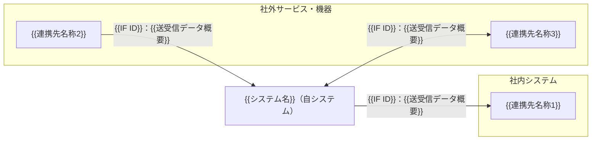

# 外部インターフェース要件一覧：{{システム名}}

<!--
【本テンプレートの使い方】
- {{ }} で囲まれた箇所を記入内容に置き換える。
- 記入ガイドコメント等のコメントは記入時の補助であり、完成版では削除してよい。
- 該当しない欄は空欄にせず「該当なし」と記入する。決まっていない事項は「未決」と記入し、「未決事項・確認事項」に登録する。
- ID は本書内で一意となるよう付与する（本テンプレートでは採番規則を定めない）。
- 「速やかに」「適切に」等の曖昧な表現は避け、数値・単位・条件で記述する。
- 優先度は「必須（リリースに不可欠）／推奨（可能な限り実現）／任意（余裕があれば実現）」の3区分で記入する。
- 表の行は必要に応じて追加・削除する。繰り返しブロックは必要数だけ複製する。

【本書固有の注意】
- 本書は、自システムと外部（他システム・外部サービス・機器）との連携について、「何を・誰と・なぜ・どの方式で・いつ・どれだけ・誰の責任で」やり取りするかの要求を定義する。
- 外部連携が存在しない場合：1.3 の「外部連携の有無」に「なし」と記入し、その判断根拠を記載する。2〜7章は見出しを残したまま、各表の1行目に「該当なし」と記入し、5章の繰り返しブロックは削除する。
- 送受信データは業務上の意味で記載する。データ項目ごとの型・桁・形式は本書では記載しない。
- 本書では電文・ファイルの物理フォーマット（レイアウト、項目位置等）・API 詳細仕様は記載しない。本書は要件レベルにとどめる。
- 3章（連携先一覧）→4章（IF一覧）→5章（IF別要件）→6章（責任分界）の順に記入し、各章の ID を相互に一致させる。
-->

## 0. 文書管理

### 0.1 改訂履歴

| 版数 | 日付 | 改訂内容 | 作成・改訂者 |
|---|---|---|---|
| {{版数}} | {{YYYY-MM-DD}} | {{改訂内容}} | {{作成・改訂者}} |

## 1. 本書の目的と適用範囲

### 1.1 目的

<!-- 記入ガイド：本書で外部連携の要求を定義する目的を1〜3文で記載する。
例：{{システム名}} が外部と行うすべての連携について、連携先・目的・送受信データ・方式・頻度・タイミング・責任分界の要求を定義する。 -->

{{本書の目的}}

### 1.2 適用範囲

<!-- 記入ガイド：本書で定義する対象・定義しない対象を明記する。定義しない対象には、本書の記載粒度の上限（本書では記載しない詳細）を記載する。 -->

| 区分 | 内容 |
|---|---|
| 本書で定義する | 連携先、連携目的、送受信データの概要、方式、頻度、タイミング、データ量、エラー時の扱い、セキュリティ要件、性能・量の要件、責任分界、試験時の扱い、連携スケジュール・運用 |
| 本書で定義しない | 電文・ファイルの物理フォーマット、API の詳細仕様（エンドポイント、パラメータ定義等） |
| 本書で定義しない | 送受信データ項目ごとの型・桁・形式、コード値の定義 |
| {{区分}} | {{内容}} |

### 1.3 外部連携の有無

<!-- 記入ガイド：外部連携が1件もない場合は「なし」と記入し、根拠（例：単独で完結する業務範囲であるため）を記載する。 -->

| 項目 | 内容 |
|---|---|
| 外部連携の有無 | {{あり／なし}} |
| 連携先数 | {{件数}} |
| IF数 | {{件数}} |
| 判断根拠・補足 | {{根拠・補足}} |

## 2. 連携全体像

### 2.1 連携関係図

<!-- 記入ガイド：自システムを中心に、3章の連携先と4章の IF を矢印で示す。矢印の向きはデータの流れる方向とし、ラベルに IF ID と送受信データ概要を書く。双方向の IF は双方向矢印で示す（下記雛形の EXT3 の記法を参照）。
連携先の種別（社内システム/社外サービス 等）ごとに subgraph でまとめてもよい。図と3章・4章の内容を一致させる。 -->

### 2.2 全体像の補足

<!-- 記入ガイド：図で表しきれない事項（ネットワーク区分、経由する中継基盤、連携の前後関係等）を記載する。ない場合は「該当なし」と記入する。関連ID には本書内の関連する項目のID（IF ID 等）を記載する。 -->

| ID | 補足事項 | 関連ID |
|---|---|---|
| {{ID}} | {{補足事項}} | {{IF ID}} |

## 3. 連携先一覧

<!-- 記入ガイド：自システムと連携するすべての相手を1行1連携先で記載する。
- 種別：社内システム／社外システム・サービス（SaaS・外部API等）／機器・端末 から選択する。
- 管理組織・窓口：仕様確認・障害連絡の相手となる組織名・部署名・連絡手段を記載する。
- 提供環境：本番／検証／サンドボックスそれぞれの有無を記載する（試験計画に影響するため必須）。
- 利用条件・制約：API 利用回数制限、契約条件、利用費用（従量課金の有無）、利用可能時間帯等を数値で記載する。
例：{{ID}}｜外部認証サービス｜社外システム・サービス（SaaS・外部API等）｜利用者の本人認証を行う｜提供事業者 サポート窓口（メール）｜本番：有、検証：有、サンドボックス：無｜1分あたり最大100リクエスト、従量課金 -->

| ID | 連携先名称 | 種別 | 概要 | 管理組織・窓口 | 提供環境（本番/検証/サンドボックス） | 利用条件・制約（API利用制限、契約、費用） |
|---|---|---|---|---|---|---|
| {{ID}} | {{連携先名称}} | {{社内システム／社外システム・サービス（SaaS・外部API等）／機器・端末}} | {{概要}} | {{組織名・部署名・連絡手段}} | 本番：{{有／無}}、検証：{{有／無}}、サンドボックス：{{有／無}} | {{利用条件・制約}} |

## 4. 外部インターフェース一覧

<!-- 記入ガイド：連携先ごとに、やり取りの単位（目的・方向・方式が異なるもの）を1行1IFとして記載する。
- 方向：自システムから見て 送信／受信／双方向 のいずれかを記入する。
- 方式：API（REST 等）／ファイル／DB 連携／メッセージキュー／メール／画面遷移（リダイレクト）等から記入する。
- 同期・非同期：処理結果を待ってから自システムの処理を継続する場合は「同期」、待たない場合は「非同期」とする。
- 頻度：随時（イベント発生ごと）、1日1回、1時間ごと 等、回数と単位で記入する。
- タイミング：起動契機（利用者操作、時刻、他処理の完了 等）と時刻を記入する。
- データ量：1回あたりの件数と日次件数を、平均とピークに分けて記入する（例：平均100件／ピーク500件）。
例：{{ID}}｜対象データ送信｜{{連携先ID}}｜送信｜承認済みデータを連携先へ反映する｜承認済みデータ｜ファイル｜非同期｜1日1回｜日次締め処理の完了後（毎日 02:00）｜平均1,000件／ピーク5,000件｜平均1,000件／ピーク5,000件｜必須 -->

| ID | IF名称 | 連携先ID | 方向 | 連携目的 | 送受信データ概要 | 方式 | 同期・非同期 | 頻度 | タイミング（起動契機・時刻） | データ量（1回あたり） | データ量（日次） | 優先度 |
|---|---|---|---|---|---|---|---|---|---|---|---|---|
| {{ID}} | {{IF名称}} | {{連携先ID}} | {{送信／受信／双方向}} | {{連携目的}} | {{送受信データ概要}} | {{方式}} | {{同期／非同期}} | {{頻度}} | {{起動契機・時刻}} | {{平均件数／ピーク件数}} | {{平均件数／ピーク件数}} | {{必須／推奨／任意}} |

## 5. インターフェース別要件

<!-- 記入ガイド：4章の IF 1件につき、以下の「5.1」ブロックを1つ作成する。IF の数だけブロックを複製し、節番号（5.1、5.2 …）を振り直す。
各表の「ID」列は、IF 内の個別要件を一意に識別するために付与する。 -->

### 5.1 {{IF ID}}：{{IF名称}}

#### 5.1.1 基本情報

| 項目 | 内容 |
|---|---|
| IF ID | {{IF ID}} |
| IF名称 | {{IF名称}} |
| 連携先ID・名称 | {{連携先ID}}：{{連携先名称}} |
| 方向 | {{送信／受信／双方向}} |
| 方式 | {{方式}} |
| 同期・非同期 | {{同期／非同期}} |
| 優先度 | {{必須／推奨／任意}} |

#### 5.1.2 連携目的と業務上の位置づけ

<!-- 記入ガイド：この連携が「なぜ必要か」「連携しない／失敗した場合に業務上何が起きるか」を記載する。
例：承認済みデータを連携先へ反映し、連携先での後続業務を開始可能にする。連携が失敗すると後続業務が当日中に開始できない。 -->

| 項目 | 内容 |
|---|---|
| 連携目的 | {{連携目的}} |
| 業務上の位置づけ（前後の業務・処理） | {{位置づけ}} |
| 連携失敗時の業務影響 | {{業務影響}} |

#### 5.1.3 起動契機・タイミング・頻度

<!-- 記入ガイド：起動契機は「利用者操作」「時刻起動」「他処理の完了」「連携先からの要求受信」等の別を明記する。時刻起動の場合は時刻と休日の扱いを、イベント起動の場合はイベントの定義を記載する。
例：{{ID}}｜時刻起動｜毎日 02:00｜1日1回｜03:00 までに完了｜日次締め処理の完了 -->

| ID | 起動契機 | 起動時刻・条件 | 頻度 | 完了期限 | 前提となる先行処理 |
|---|---|---|---|---|---|
| {{ID}} | {{利用者操作／時刻起動／他処理の完了／連携先からの要求受信 等}} | {{時刻・条件}} | {{頻度}} | {{完了期限}} | {{先行処理／該当なし}} |

#### 5.1.4 送受信データ

<!-- 記入ガイド：送受信するデータ項目を業務上の意味で記載する。データ項目ごとの型・桁・形式は本書では記載しない。
- 区分：送信／受信、または 要求／応答 の別を記入する（双方向・同期 API の場合は要求と応答を分けて記載する）。
- 必須：必須／任意／条件付き必須 のいずれかを記入する。条件付き必須の場合は条件を備考に記載する。
例：{{ID}}｜送信｜対象データ識別子｜連携先で対象データを一意に特定する値｜必須｜該当なし -->

| ID | 区分 | データ項目 | 意味 | 必須 | 備考 |
|---|---|---|---|---|---|
| {{ID}} | {{送信／受信／要求／応答}} | {{データ項目名}} | {{業務上の意味}} | {{必須／任意／条件付き必須}} | {{備考}} |

#### 5.1.5 方式・プロトコル要件

<!-- 記入ガイド：連携の手段に関する要件を記載する。製品名・ライブラリ名の指定は、連携先からの制約がある場合のみ記載する。
例：{{ID}}｜通信経路｜インターネット経由で接続する｜連携先の指定による -->

| ID | 項目 | 要件 | 根拠・備考 |
|---|---|---|---|
| {{ID}} | 方式 | {{API（REST 等）／ファイル／DB 連携／メッセージキュー／メール／画面遷移（リダイレクト） 等}} | {{根拠}} |
| {{ID}} | プロトコル | {{HTTPS／SFTP／SMTP 等}} | {{根拠}} |
| {{ID}} | 通信経路 | {{インターネット／専用線／閉域網／社内ネットワーク}} | {{根拠}} |
| {{ID}} | 処理単位 | {{1件ずつ／一括（1回あたりの件数上限）}} | {{根拠}} |
| {{ID}} | 接続の開始側 | {{自システム／連携先}} | {{根拠}} |
| {{ID}} | 連携先側の制約 | {{利用回数制限、利用可能時間帯 等}} | {{根拠}} |

#### 5.1.6 データ形式・文字コード

<!-- 記入ガイド：要件レベルの形式を記載する。項目の並び・レイアウト等の物理フォーマットは本書では記載しない。
例：{{ID}}｜日付・時刻の表現｜日本標準時（UTC+9）で表現する｜連携先の仕様に従う -->

| ID | 項目 | 要件 | 根拠・備考 |
|---|---|---|---|
| {{ID}} | データ形式 | {{JSON／CSV／XML／固定長 等}} | {{根拠}} |
| {{ID}} | 文字コード | {{UTF-8／Shift_JIS 等}} | {{根拠}} |
| {{ID}} | 改行コード | {{LF／CRLF／該当なし}} | {{根拠}} |
| {{ID}} | 日付・時刻の表現とタイムゾーン | {{表現方法・タイムゾーン}} | {{根拠}} |
| {{ID}} | 外字・使用可能文字の制約 | {{制約／該当なし}} | {{根拠}} |
| {{ID}} | ファイル名・圧縮（ファイル連携の場合） | {{要件／該当なし}} | {{根拠}} |

#### 5.1.7 認証・セキュリティ要件

<!-- 記入ガイド：この IF のセキュリティ要件を本書内で直接記載する。
例：{{ID}}｜接続元制限｜連携先が指定する IP アドレスからの接続のみ受け付ける -->

| ID | 項目 | 要件 |
|---|---|---|
| {{ID}} | 認証方式 | {{APIキー／クライアント証明書／トークン認証／ID・パスワード 等}} |
| {{ID}} | 認可（アクセス可能な範囲） | {{要件}} |
| {{ID}} | 通信の暗号化 | {{要件}} |
| {{ID}} | データ自体の暗号化・マスキング | {{要件／該当なし}} |
| {{ID}} | 接続元制限（IP制限 等） | {{要件／該当なし}} |
| {{ID}} | 改ざん検知（署名・ハッシュ照合 等） | {{要件／該当なし}} |
| {{ID}} | 認証情報の管理（保管場所、更新周期、有効期限） | {{要件}} |
| {{ID}} | 連携記録（ログ）の取得項目 | {{要件}} |

#### 5.1.8 性能・量の要件

<!-- 記入ガイド：この IF の性能・量の目標値を本書内で直接記載する。目標値は数値と単位で記載し、測定条件（平均/ピーク、測定区間）を明記する。
例：{{ID}}｜応答時間｜95パーセンタイルで2秒以内｜ピーク時、要求送信から応答受信まで -->

| ID | 指標 | 目標値 | 測定条件 |
|---|---|---|---|
| {{ID}} | 1回あたりの件数 | {{平均件数／最大件数}} | {{条件}} |
| {{ID}} | 日次件数 | {{平均件数／ピーク件数}} | {{条件}} |
| {{ID}} | ピーク時の処理量 | {{件数／単位時間}} | {{ピークの時間帯・時期}} |
| {{ID}} | 応答時間・処理時間 | {{数値・単位}} | {{測定区間}} |
| {{ID}} | タイムアウト時間 | {{数値・単位}} | {{適用区間（接続／応答）}} |
| {{ID}} | 同時接続数・同時要求数 | {{数値／該当なし}} | {{条件}} |

#### 5.1.9 エラー時の扱い

<!-- 記入ガイド：想定するエラーを1行1種別で記載する。少なくとも「接続不可」「タイムアウト」「連携先からのエラー応答（業務エラー/システムエラー）」「データ不正（形式・必須項目）」「件数不一致・欠落」の要否を検討する。
- 自システムの振る舞い：処理の中断／継続、利用者への表示、データの状態（未連携のまま保持 等）を記載する。表示文言の詳細は本書では記載しない。
- 再送・リカバリ：自動再送の有無、再送回数・間隔、手動再送の手順の要否を数値で記載する。
例：{{ID}}｜タイムアウト｜応答待ち30秒超過｜処理を中断し対象データを「未連携」状態で保持する｜30秒間隔で最大3回自動再送、以降は手動再送｜運用担当者（メール） -->

| ID | エラー種別 | 検知方法 | 自システムの振る舞い | 再送・リカバリ | 通知先 |
|---|---|---|---|---|---|
| {{ID}} | {{エラー種別}} | {{検知方法}} | {{振る舞い}} | {{再送回数・間隔・手動手順}} | {{通知先・通知手段}} |

#### 5.1.10 整合性

<!-- 記入ガイド：二重送信・再送時にデータが重複・欠落しないための要件を記載する。
例：{{ID}}｜二重送信・冪等性｜同一識別子のデータを再送した場合、連携先で重複登録されないこと｜連携先が識別子で重複を判定する -->

| ID | 項目 | 要件 | 備考 |
|---|---|---|---|
| {{ID}} | 二重送信・冪等性 | {{要件}} | {{備考}} |
| {{ID}} | 順序保証 | {{要件／該当なし}} | {{備考}} |
| {{ID}} | トランザクション境界（自システムの更新と連携の成否の関係） | {{要件}} | {{備考}} |
| {{ID}} | 一部失敗時の扱い（一括処理の場合） | {{全件取消／失敗分のみ再処理／該当なし}} | {{備考}} |
| {{ID}} | 連携結果の照合（件数・合計値の突合等） | {{要件／該当なし}} | {{備考}} |

#### 5.1.11 責任分界

<!-- 記入ガイド：本 IF の責任分界は6章に記載する。ここには6章の項目に収まらない本 IF 固有の補足のみ記載し、ない場合は「該当なし」と記入する。6章と矛盾させない。 -->

| ID | 補足事項 | 自システム側 | 連携先側 |
|---|---|---|---|
| {{ID}} | {{補足事項／該当なし}} | {{内容}} | {{内容}} |

#### 5.1.12 試験時の扱い

<!-- 記入ガイド：各試験工程で、連携先の検証環境に接続するか、スタブ・モックで代替するかを記載する。代替する場合は、代替手段が返す応答と、それによって確認する自システムの振る舞いを定義する。
連携先の検証環境で再現できないケース（エラー応答、タイムアウト等）は代替手段で確認する前提で記載する。 -->

**(1) 試験工程ごとの接続先**

<!-- 例：{{ID}}｜結合テスト｜スタブ・モック｜検証環境の利用期間が限られるため｜連携先側での実際の反映結果は確認できない -->

| ID | 試験工程 | 接続先 | 選定理由・利用条件 | 代替時に確認できない事項 |
|---|---|---|---|---|
| {{ID}} | {{結合テスト／システムテスト／受入テスト}} | {{連携先の検証環境／スタブ・モック／本番環境}} | {{理由・利用条件（利用期間、事前申請 等）}} | {{事項／該当なし}} |

**(2) スタブ・モックで代替する場合の振る舞い**

<!-- 記入ガイド：スタブ・モックで代替しない場合は「該当なし」と記入する。正常系に加え、5.1.9 のエラー種別に対応する応答を定義する。
例：{{ID}}｜タイムアウト｜応答を返さない（60秒以上待機）｜5.1.9 のタイムアウト時の振る舞い -->

| ID | 想定ケース | スタブ・モックの応答内容 | 確認する自システムの振る舞い |
|---|---|---|---|
| {{ID}} | {{正常／業務エラー／システムエラー／タイムアウト／接続不可 等}} | {{応答内容}} | {{確認する振る舞い・関連ID}} |

**(3) 試験データ**

| ID | 項目 | 内容 |
|---|---|---|
| {{ID}} | 試験データの準備主体 | {{自システム側／連携先側}} |
| {{ID}} | 試験データの条件・件数 | {{条件・件数}} |
| {{ID}} | 試験後のデータの扱い（削除・初期化の要否） | {{要件}} |

## 6. 責任分界

<!-- 記入ガイド：IF ごとに、下表の8項目について自システム側と連携先側の責任（担当組織・担当作業）を記載する。どちらも担当しない場合は「該当なし」とする。双方が担当する場合は、それぞれの作業範囲を明記する。IF の数だけ8行を複製する。
例：{{ID}}｜{{IF ID}}｜再送判断｜自システム運用担当が再送要否を判断し再送する｜再送データの受付のみ行う｜再送は当日 06:00 まで -->

| ID | IF ID | 項目 | 自システム側 | 連携先側 | 備考 |
|---|---|---|---|---|---|
| {{ID}} | {{IF ID}} | データ作成 | {{担当・作業}} | {{担当・作業}} | {{備考}} |
| {{ID}} | {{IF ID}} | 送信 | {{担当・作業}} | {{担当・作業}} | {{備考}} |
| {{ID}} | {{IF ID}} | 受信確認 | {{担当・作業}} | {{担当・作業}} | {{備考}} |
| {{ID}} | {{IF ID}} | エラー検知 | {{担当・作業}} | {{担当・作業}} | {{備考}} |
| {{ID}} | {{IF ID}} | 再送判断 | {{担当・作業}} | {{担当・作業}} | {{備考}} |
| {{ID}} | {{IF ID}} | 障害連絡 | {{担当・連絡手段}} | {{担当・連絡手段}} | {{連絡期限}} |
| {{ID}} | {{IF ID}} | データ保管 | {{保管対象・保管期間}} | {{保管対象・保管期間}} | {{備考}} |
| {{ID}} | {{IF ID}} | 仕様変更連絡 | {{担当・事前通知期間}} | {{担当・事前通知期間}} | {{備考}} |

## 7. 連携スケジュール・運用

### 7.1 定期連携のカレンダー

<!-- 記入ガイド：時刻起動・定期実行の IF を1行1IFで記載する。随時連携のみの場合は「該当なし」と記入する。休日・祝日・月末・年末年始等の扱いを明記する。
例：{{ID}}｜{{IF ID}}｜毎日｜02:00｜休日も実行する｜03:00｜日次締め処理の完了後 -->

| ID | IF ID | 実行日・曜日 | 実行時刻 | 休日・祝日・特定日の扱い | 完了期限 | 先行・後続処理 |
|---|---|---|---|---|---|---|
| {{ID}} | {{IF ID}} | {{実行日・曜日}} | {{HH:MM}} | {{扱い}} | {{HH:MM}} | {{先行・後続処理／該当なし}} |

### 7.2 連携停止時の運用

<!-- 記入ガイド：障害等で連携が予定外に停止した場合の業務・運用上の対応を記載する。個々のエラー処理は 5.1.9 に記載し、ここでは停止が継続した場合の業務継続策を記載する。
例：{{ID}}｜{{IF ID}}｜連携が2時間以上停止｜監視による検知｜後続業務が開始できない｜対象データを保持し、復旧後に一括再送する｜運用責任者 -->

| ID | IF ID | 想定事象（停止の継続時間等） | 検知方法 | 業務への影響 | 停止中の暫定運用 | 復旧後の処理（再連携・照合） | 判断者 |
|---|---|---|---|---|---|---|---|
| {{ID}} | {{IF ID}} | {{想定事象}} | {{検知方法}} | {{業務影響}} | {{暫定運用}} | {{復旧後の処理}} | {{判断者}} |

### 7.3 連携先の計画停止の扱い

<!-- 記入ガイド：連携先の定期保守・計画停止時の扱いを連携先ごとに記載する。
例：{{ID}}｜{{連携先ID}}｜月1回 日曜 00:00〜06:00｜14日前までにメールで通知｜停止中は送信を保留し、利用者に利用不可を表示する｜再開後に保留分を送信する -->

| ID | 連携先ID | 停止の周期・時間帯 | 通知方法・通知時期 | 停止中の自システムの振る舞い | 再開後の処理 |
|---|---|---|---|---|---|
| {{ID}} | {{連携先ID}} | {{周期・時間帯／不定期}} | {{通知方法・通知時期}} | {{振る舞い}} | {{再開後の処理}} |

### 7.4 連携状況の監視・確認

<!-- 記入ガイド：連携の成否を日常的に確認する方法を記載する。
例：{{ID}}｜{{IF ID}}｜連携処理の終了結果と処理件数｜毎日 03:00 に確認｜異常時は運用担当者へメール通知 -->

| ID | IF ID | 監視・確認の対象 | 確認のタイミング | 異常時の通知 |
|---|---|---|---|---|
| {{ID}} | {{IF ID}} | {{対象}} | {{タイミング}} | {{通知先・通知手段}} |

## 8. 前提条件・制約事項

<!-- 記入ガイド：本書の要件が成立するための前提（連携先の仕様・環境が提供されること等）と、外部から課される制約（契約、利用規約、法令、連携先の技術仕様等）を記載する。
例：{{ID}}｜前提条件｜連携先の検証環境が結合テスト開始までに利用可能であること｜5.1.12 の結合テスト｜{{連携先ID}} -->

| ID | 区分 | 内容 | 影響範囲 | 関連ID |
|---|---|---|---|---|
| {{ID}} | {{前提条件／制約事項}} | {{内容}} | {{影響範囲}} | {{関連ID}} |

## 9. 未決事項・確認事項

<!-- 記入ガイド：「未決」と記入した欄、および連携先への確認が必要な事項を登録する。影響範囲には影響する IF ID・章番号を記載する。
例：{{ID}}｜連携先の利用回数上限の確認｜{{IF ID}}、5.1.8｜{{担当}}｜{{YYYY-MM-DD}}｜未着手 -->

| ID | 内容 | 影響範囲 | 担当 | 期限 | 状態 |
|---|---|---|---|---|---|
| {{ID}} | {{内容}} | {{影響範囲}} | {{担当}} | {{YYYY-MM-DD}} | {{未着手／確認中／解決済}} |

<!--
【記入完了チェック】
- 1.3 の外部連携の有無が記入されている（「なし」の場合、2〜7章の各表に「該当なし」が記入されている）。
- 2章の連携関係図、3章の連携先一覧、4章の IF 一覧の連携先・IF が過不足なく一致している。
- 3章の全連携先について、管理組織・窓口、提供環境（本番/検証/サンドボックス）、利用条件・制約が記入されている。
- 4章の全 IF について、連携目的・送受信データ概要・方式・同期/非同期・頻度・タイミング・データ量・優先度が記入されている。
- 4章の全 IF に対応する5章のブロックが1つずつ存在し、IF ID・名称が一致している。
- 5章の送受信データが業務上の意味で記載され、データ項目ごとの型・桁・形式を本書に記載していない。
- 5章の性能・量の要件、セキュリティ要件が全 IF について本書内に記入されている。
- 5章の性能・量の要件、エラー時の扱いが数値・単位（件数、秒、回数、間隔）で記載されている。
- 5章のエラー時の扱いで、接続不可・タイムアウト・エラー応答・データ不正・件数不一致の要否が検討されている。
- 全 IF について、試験工程ごとの接続先が記載され、スタブ・モック代替時の応答内容と確認する振る舞いが定義されている。
- 6章で全 IF の8項目（データ作成〜仕様変更連絡）について、自システム側・連携先側の責任が記入されている。
- 定期連携の IF が7.1に、全連携先の計画停止の扱いが7.3に記載されている。
- 「速やかに」「適切に」「など」等の曖昧語が残っていない。
- 「未決」と記入した欄がすべて9章に登録されている。
- 電文・ファイルの物理フォーマットや API 詳細仕様を本書に記載していない。
-->
