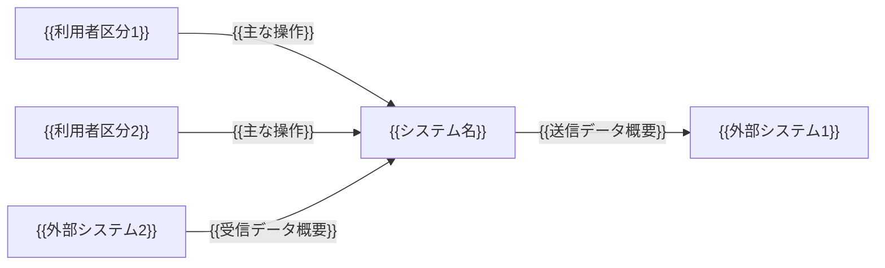
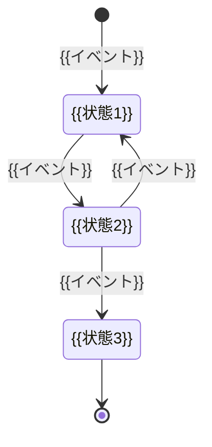

# 機能要件定義書：{{システム名}}

<!--
【本テンプレートの使い方】
- {{ }} で囲まれた箇所を記入内容に置き換える。
- 記入ガイドコメント等のコメントは記入時の補助であり、完成版では削除してよい。
- 該当しない欄は空欄にせず「該当なし」と記入する。決まっていない事項は「未決」と記入し、「未決事項・確認事項」に登録する。
- ID は本書内で一意となるよう付与する（本テンプレートでは採番規則を定めない）。
- 「速やかに」「適切に」等の曖昧な表現は避け、数値・単位・条件で記述する。
- 優先度は「必須（リリースに不可欠）／推奨（可能な限り実現）／任意（余裕があれば実現）」の3区分で記入する。
- 表の行は必要に応じて追加・削除する。繰り返しブロックは必要数だけ複製する。

【本書固有の注意】
- 本書は、システムが利用者や外部システムに提供する機能と、その振る舞い（入力・処理・出力・状態変化・例外）を定義する。
- 「どう作るか」（画面デザイン、テーブル構造、プログラム構成、電文の物理形式）は書かない。「何をし、どうなれば完了か」を書く。
- データ項目の型・桁・形式、画面・帳票のレイアウト詳細は本書では記載しない。
- 業務ルール（計算式・判定基準・制約条件）は、適用する処理手順の処理内容または条件として本書内に直接記述する。
- 振る舞いを決める値（認証失敗の許容回数、無操作タイムアウト時間、再送回数等）は、本書の該当欄に数値・単位で記入する。
- 処理内容・事後条件・例外は、第三者が記入内容だけを根拠に正常系・異常系の結果を判定できる粒度で書く。
-->

## 0. 文書管理

### 0.1 改訂履歴

| 版数 | 日付 | 改訂内容 | 作成・改訂者 |
|---|---|---|---|
| {{版数}} | {{YYYY-MM-DD}} | {{改訂内容}} | {{作成・改訂者}} |

## 1. 本書の目的と適用範囲

### 1.1 目的

{{本書の目的}}

<!-- 記入ガイド：本書で何を定義するかを1〜3文で記入する。
例：本書は{{システム名}}が利用者および外部システムに提供する機能と振る舞いを定義する。 -->

### 1.2 適用範囲

<!-- 記入ガイド：対象とするサブシステム・リリース範囲を限定する場合は行を追加して明記する。 -->

| 区分 | 内容 |
|---|---|
| 本書で定義する | 機能一覧、利用者区分×機能の権限、機能詳細（事前条件／入力／処理／出力／事後条件／例外）、共通機能、状態遷移、バッチ・定期処理、メッセージ・エラー通知方針 |
| 本書で定義しない | データ項目の型・桁・形式、コード値の割当て、画面・帳票のレイアウト・デザイン、外部連携電文の物理形式 |
| {{区分}} | {{内容}} |

## 2. システム化範囲の概要

### 2.1 提供機能の全体像

<!-- 記入ガイド：4章の機能一覧の「大分類」単位で、システムが提供する機能群を俯瞰できるように記入する。大分類名は4章と一致させる。
例：申請管理｜利用者が申請を登録・修正・取下げし、承認者が承認・差戻しを行う｜申請者、承認者 -->

| 大分類 | 提供する機能の概要 | 主な利用者区分 |
|---|---|---|
| {{大分類}} | {{概要}} | {{利用者区分}} |

### 2.2 システム境界

<!-- 記入ガイド：本システムと、利用者区分（3.1）・外部システムアクター（3.2）との境界と主なやり取りを図示する。矢印の向きは主たるデータ・要求の流れとする。ノード名は3章の名称と一致させる。 -->

### 2.3 対象外機能

<!-- 記入ガイド：利用者が期待しうるが本システムでは提供しない機能、他システムや人手で代替する機能を機能単位で記入する。
例：{{ID}}｜対象データの一括取込｜初期リリースでは件数が少ないため｜担当者が1件ずつ登録する -->

| ID | 対象外とする機能 | 理由 | 代替手段・担当 |
|---|---|---|---|
| {{ID}} | {{機能}} | {{理由}} | {{代替手段・担当}} |

## 3. 利用者区分（アクター）

### 3.1 利用者区分

<!-- 記入ガイド：権限や利用できる機能が異なる単位で区分する。認証要否は「要／不要」で記入する。登録者数・同時利用者数は本書に直接、数値で記入する（不特定多数で登録がない場合は登録者数を「該当なし」とする）。
例：{{ID}}｜申請者｜申請を登録し、自分の申請状況を照会する｜要｜500人｜50人 -->

| ID | 利用者区分 | 説明 | 認証要否 | 登録者数 | 同時利用者数 |
|---|---|---|---|---|---|
| {{ID}} | {{利用者区分}} | {{説明}} | {{要／不要}} | {{人数}} 人 | {{人数}} 人 |

### 3.2 外部システムアクター

<!-- 記入ガイド：本システムの機能を起動する、または本システムから呼び出される外部システムを記入する。連携方向は本システムから見て「受信／送信／双方向」で記入する。 -->

| ID | 外部システム名 | 本システムとの関係 | 連携方向 |
|---|---|---|---|
| {{ID}} | {{外部システム名}} | {{関係}} | {{受信／送信／双方向}} |

## 4. 機能一覧

<!-- 記入ガイド：
- 1行1機能とする。1行に複数の機能を詰め込まない。
- 機能種別は「登録／更新／削除／照会・検索／出力／計算・判定／連携／バッチ」から1つ選ぶ。該当しない場合は具体的な種別名を記入する。
- 利用者区分は3章のIDまたは名称で記入する。外部システムが起動する機能は外部システムアクターを記入する。
- 起動方式は「画面操作／外部IF受信／定期実行／イベント契機」から選ぶ。
例：{{ID}}｜申請管理｜申請｜申請登録｜申請内容を入力し登録する｜登録｜申請者｜画面操作｜必須 -->

| ID | 大分類 | 中分類 | 機能名 | 概要 | 機能種別 | 利用者区分 | 起動方式 | 優先度 |
|---|---|---|---|---|---|---|---|---|
| {{ID}} | {{大分類}} | {{中分類}} | {{機能名}} | {{概要}} | {{機能種別}} | {{利用者区分}} | {{起動方式}} | {{必須／推奨／任意}} |

## 5. 利用者区分×機能の権限

### 5.1 権限表

<!-- 記入ガイド：
- 列は3.1の利用者区分を並べる（列を追加・削除してよい）。4章の全機能を行に並べる。
- 値は「○（利用可）／×（利用不可）／条件付き」のいずれかとする。「条件付き」の場合は5.2に条件を記入する。
- 認証不要の利用者区分も列に含める。 -->

| 機能ID | 機能名 | {{利用者区分1}} | {{利用者区分2}} | {{利用者区分3}} |
|---|---|---|---|---|
| {{機能ID}} | {{機能名}} | {{○／×／条件付き}} | {{○／×／条件付き}} | {{○／×／条件付き}} |

### 5.2 条件付き権限の条件

<!-- 記入ガイド：5.1で「条件付き」とした組合せごとに1行記入する。データの範囲・状態による制限（例：自分が登録したデータのみ）は、対象となるデータの範囲と状態を条件欄に具体的に記入する。条件不成立時の振る舞いは画面上の非表示・操作不可・エラー通知のいずれかを明記する。
例：{{ID}}｜{{機能ID}}｜申請者｜自分が登録し、状態が「下書き」の対象データに限る｜操作ボタンを表示しない。直接要求された場合は権限エラーとする -->

| ID | 機能ID | 利用者区分 | 条件 | 条件不成立時の振る舞い |
|---|---|---|---|---|
| {{ID}} | {{機能ID}} | {{利用者区分}} | {{条件}} | {{振る舞い}} |

## 6. 機能詳細

<!-- 記入ガイド：
- 4章の機能ごとに、以下の 6.1 ブロック（6.1.1〜6.1.9）を1つ作成する。必要数だけ複製し、6.2、6.3…と番号を振る。
- 該当しない項目（例：検索でない機能の6.1.8）は削除せず「該当なし」と記入する。
- 7章の共通機能要件に従う事項は、本ブロックでは「7章に従う」と記入し、差異がある場合のみ記入する。 -->

### 6.1 {{機能ID}}：{{機能名}}

#### 6.1.1 基本情報

<!-- 記入ガイド：起動契機は「どの画面のどの操作」「どの外部システムからの受信」「何時・何の発生」まで特定して記入する。
例：起動契機：申請一覧画面で利用者が「新規申請」を選択したとき -->

| 項目 | 内容 |
|---|---|
| 機能ID | {{機能ID}} |
| 機能名 | {{機能名}} |
| 目的 | {{本機能により利用者・業務が達成すること}} |
| 利用者区分 | {{利用者区分}} |
| 起動契機 | {{起動する操作・受信・時刻・イベント}} |
| 機能種別 | {{機能種別}} |
| 優先度 | {{必須／推奨／任意}} |

#### 6.1.2 事前条件

<!-- 記入ガイド：本機能を開始するために成立していなければならない条件を記入する。区分は「利用者／データ状態／システム状態」から選ぶ。不成立時の扱いは6.1.7の例外IDで参照する。
例：データ状態｜対象データの状態が「下書き」である｜{{例外ID}} -->

| 区分 | 条件 | 不成立時の扱い（例外ID） |
|---|---|---|
| {{利用者／データ状態／システム状態}} | {{条件}} | {{例外ID}} |

#### 6.1.3 入力

<!-- 記入ガイド：
- 本機能が受け取る項目を記入する。型・桁・形式は本書では記載しない。
- 必須は「必須／任意／条件付き必須」で記入し、条件付きの場合は内容・条件欄に条件を記入する。
- 内容・条件欄には、項目の意味と業務上の制約（相関チェック、他項目との関係、選択肢の範囲）を記入する。
- 入力元は「画面入力／外部システム／ファイル／システム自動設定」から選ぶ。
例：申請日｜必須｜申請を行う日。当日以降の日付に限る｜画面入力 -->

| 項目名 | 必須 | 内容・条件 | 入力元 |
|---|---|---|---|
| {{項目名}} | {{必須／任意／条件付き必須}} | {{内容・条件}} | {{入力元}} |

#### 6.1.4 処理内容

<!-- 記入ガイド：
- 処理を実行順に手順番号を付けて記入する。1手順に1つの処理を書く。
- 分岐がある場合は条件・分岐欄に「〜の場合は手順Nへ」「〜の場合は例外{{例外ID}}」の形で、すべての分岐先を記入する。
- 適用する業務ルール（計算式・判定基準・制約条件）は省略せず、該当手順の処理内容または条件・分岐欄に直接記入する。
例：2｜入力値と登録済データを照合し、同一の申請者・申請日の対象データの有無を判定する｜同一データありの場合は例外{{例外ID}}、なしの場合は手順3へ -->

| 手順 | 処理内容 | 条件・分岐 |
|---|---|---|
| 1 | {{処理内容}} | {{条件・分岐}} |
| 2 | {{処理内容}} | {{条件・分岐}} |

#### 6.1.5 出力・結果

<!-- 記入ガイド：出力区分は「画面表示／帳票／データ更新／外部送信／通知」から選ぶ。出力内容には、出力する主なデータ・項目と出力先を記入する。データ更新は対象データと操作（登録・更新・削除）を記入する。表示・帳票のレイアウト詳細、送信電文の物理形式は本書では記載しない。
例：データ更新｜対象データを登録し、状態を「申請中」に設定する -->

| 出力区分 | 出力内容 |
|---|---|
| {{出力区分}} | {{出力内容}} |

#### 6.1.6 事後条件

<!-- 記入ガイド：処理終了後に成立している状態を、データの値・状態・件数・送信有無など第三者が確認できる形で記入する。異常終了時に「何も変更されていない」等の状態も記入する。
例：正常終了｜対象データが1件登録され、状態が「申請中」、申請日時に処理時刻が記録されている
例：異常終了｜対象データは登録されず、処理前の状態から変化していない -->

| 区分 | 成立している状態 |
|---|---|
| 正常終了 | {{状態}} |
| 異常終了 | {{状態}} |

#### 6.1.7 例外・エラー

<!-- 記入ガイド：事前条件不成立、入力エラー、業務ルール違反、競合、外部連携失敗等、本機能で発生しうる例外を1行1件で記入する。エラー種別は10章の種別から選ぶ。システムの振る舞いには、処理の中断・継続、データの巻き戻し有無、再試行有無を記入する。
例：{{ID}}｜対象データが他の利用者により更新済み｜処理を中断し、更新内容を破棄する｜他の利用者が更新した旨と再表示を促す内容｜排他・競合エラー -->

| ID | 発生条件 | システムの振る舞い | 利用者への通知内容 | エラー種別 |
|---|---|---|---|---|
| {{ID}} | {{発生条件}} | {{振る舞い}} | {{通知内容}} | {{エラー種別}} |

#### 6.1.8 検索仕様

<!-- 記入ガイド：機能種別が「照会・検索」の場合に記入する。それ以外は各表に「該当なし」と記入する。一致方法は「完全一致／前方一致／部分一致／範囲指定／複数選択」から選ぶ。複数条件の組合せ（AND／OR）は検索条件の組合せ欄に記入する。 -->

| 検索条件項目 | 必須 | 一致方法 |
|---|---|---|
| {{項目名}} | {{必須／任意}} | {{一致方法}} |

| 項目 | 内容 |
|---|---|
| 検索条件の組合せ | {{AND／OR 等}} |
| 検索対象の範囲 | {{権限・状態等による絞り込み}} |
| 初期表示 | {{検索前の表示内容}} |
| 並び順 | {{第1キー 昇順／降順、第2キー…}} |
| 件数上限 | {{件数}} 件 |
| 上限超過時の振る舞い | {{振る舞い}} |
| ページング | {{1ページあたり件数、ページ移動方法、該当なし}} |
| 該当0件時の振る舞い | {{振る舞い}} |

#### 6.1.9 排他・同時実行

<!-- 記入ガイド：7.4の共通方針に従う場合は「7章に従う」と記入し、差異がある項目のみ記入する。二重実行防止は、同一要求の連続送信・再送信を受けたときの振る舞いを記入する。 -->

| 項目 | 内容 |
|---|---|
| 同時実行の想定 | {{同一データに対する同時操作の有無・組合せ}} |
| 排他の方式 | {{7章に従う／個別方式}} |
| 競合時の振る舞い | {{例外ID または振る舞い}} |
| 二重実行防止 | {{振る舞い}} |

## 7. 共通機能要件

<!-- 記入ガイド：
- 複数の機能に共通して適用する機能要件を記入する。各節は1行1要件とし、適用対象には「全機能」または機能IDを記入する。
- 振る舞いを決める値（回数・時間等）は、要件内容または各節の設定値表に数値・単位で記入する。
- 関連IDには、本書内の関連する項目のID（例外ID、10.1のエラー種別のID等）を記入する。ない場合は「該当なし」と記入する。
- 提供しない共通機能は、節を削除せず「該当なし」と記入する。 -->

### 7.1 認証・ログイン

<!-- 記入ガイド：ログイン・ログアウト、認証失敗時の振る舞い、アカウントロックと解除、パスワード変更・再設定、初回ログイン時の扱いを記入する。ロック回数・解除方法・パスワードの条件は下の設定値表に記入する。
例：{{ID}}｜認証の連続失敗が設定値表のロック回数に達した場合、当該アカウントをロックし、解除されるまでログインを受け付けない｜全機能｜{{関連ID}} -->

| ID | 要件内容 | 適用対象 | 関連ID |
|---|---|---|---|
| {{ID}} | {{要件内容}} | {{全機能／機能ID}} | {{関連ID}} |

| 設定項目 | 値 |
|---|---|
| アカウントをロックする認証連続失敗回数 | {{回数}} 回 |
| ロックの解除方法 | {{管理者による解除／ロックから一定時間経過後に自動解除（経過時間を記入）}} |
| パスワードの条件（文字種・最小桁数等） | {{条件}} |

### 7.2 セッション管理

<!-- 記入ガイド：セッション切れ時の振る舞い（入力中データの扱い、セッション切れ後に表示する内容、再ログイン後の扱い）、同一利用者の多重ログインの可否と多重ログイン時の振る舞いを記入する。無操作でセッションを切断するまでの時間は下の設定値表に記入する。 -->

| ID | 要件内容 | 適用対象 | 関連ID |
|---|---|---|---|
| {{ID}} | {{要件内容}} | {{全機能／機能ID}} | {{関連ID}} |

| 設定項目 | 値 |
|---|---|
| 無操作でセッションを切断するまでの時間 | {{時間}} 分 |

### 7.3 入力チェック共通方針

<!-- 記入ガイド：チェックの実施タイミング（入力時／確定時）、エラー時の入力値の保持、全角半角・前後空白の扱い、複数エラー時の通知方法を記入する。項目ごとの型・桁は本書では記載しない。 -->

| ID | 要件内容 | 適用対象 | 関連ID |
|---|---|---|---|
| {{ID}} | {{要件内容}} | {{全機能／機能ID}} | {{関連ID}} |

### 7.4 排他制御方針

<!-- 記入ガイド：同一データの同時更新時の基本方式（後勝ち禁止、先に確定した更新を優先する等）、競合検出時の振る舞い、二重送信の防止方針を記入する。
例：{{ID}}｜参照後に他の利用者が同一データを更新していた場合、更新を受け付けず排他・競合エラーとする｜全更新機能｜{{関連ID}} -->

| ID | 要件内容 | 適用対象 | 関連ID |
|---|---|---|---|
| {{ID}} | {{要件内容}} | {{全機能／機能ID}} | {{関連ID}} |

### 7.5 操作ログ・監査ログ

<!-- 記入ガイド：記録対象の操作（ログイン、登録・更新・削除、出力、権限変更等）、記録する内容（日時、利用者、操作、対象データ、結果）、ログの照会機能の有無を記入する。ログの保管期間・改ざん防止は本書では記載しない。 -->

| ID | 要件内容 | 適用対象 | 関連ID |
|---|---|---|---|
| {{ID}} | {{要件内容}} | {{全機能／機能ID}} | {{関連ID}} |

### 7.6 通知（メール等）

<!-- 記入ガイド：通知の送信処理の振る舞い（送信失敗時の再送有無・再送回数・再送間隔、失敗の記録）を1行1要件で記入する。個々の通知の契機・宛先は各機能の6.1.5に記入する。通知文面のレイアウトは本書では記載しない。
例：{{ID}}｜通知の送信に失敗した場合は再送せず、失敗した通知と日時を操作ログに記録する｜全機能｜{{関連ID}} -->

| ID | 要件内容 | 適用対象 | 関連ID |
|---|---|---|---|
| {{ID}} | {{要件内容}} | {{全機能／機能ID}} | {{関連ID}} |

### 7.7 日付・時刻・数値・通貨の扱い

<!-- 記入ガイド：基準とするタイムゾーン、「当日」「月末」等の判定基準時刻、端数処理（切り捨て／切り上げ／四捨五入）と適用桁、通貨単位、税計算の方式など、計算結果に影響する規則を記入する。 -->

| ID | 要件内容 | 適用対象 | 関連ID |
|---|---|---|---|
| {{ID}} | {{要件内容}} | {{全機能／機能ID}} | {{関連ID}} |

### 7.8 多言語対応

<!-- 記入ガイド：対応言語、言語の切替方法、言語ごとに切り替える対象（表示文言、メッセージ、通知、帳票）を記入する。対応しない場合は「該当なし」と記入する。 -->

| ID | 要件内容 | 適用対象 | 関連ID |
|---|---|---|---|
| {{ID}} | {{要件内容}} | {{全機能／機能ID}} | {{関連ID}} |

### 7.9 その他の共通機能

<!-- 記入ガイド：上記以外の共通機能（ファイルアップロード・ダウンロード、印刷、ヘルプ、マスタ参照等）を記入する。 -->

| ID | 要件内容 | 適用対象 | 関連ID |
|---|---|---|---|
| {{ID}} | {{要件内容}} | {{全機能／機能ID}} | {{関連ID}} |

## 8. 状態遷移

<!-- 記入ガイド：
- 状態を持つデータ（例：申請、対象データの処理状況）ごとに、以下の 8.1 ブロック（8.1.1〜8.1.3）を1つ作成する。必要数だけ複製し、8.2、8.3…と番号を振る。
- 遷移表に記載のない遷移は許可しないものとする。許可しない遷移が要求された場合の振る舞いは8.1.2の下の欄に記入する。
- 状態値のコード値の割当ては本書では記載しない。
- 状態を持つデータがない場合は、本章に「該当なし」と記入する。 -->

### 8.1 {{対象データ名}}

#### 8.1.1 状態一覧

<!-- 記入ガイド：区分は「初期／中間／終端」から選ぶ。
例：申請中｜申請者が申請を確定し、承認者の判断を待っている状態｜中間 -->

| 状態 | 意味 | 区分 |
|---|---|---|
| {{状態}} | {{意味}} | {{初期／中間／終端}} |

#### 8.1.2 遷移表

<!-- 記入ガイド：イベントは利用者操作・外部受信・時刻到来等の契機を記入する。条件は遷移が成立するための条件を記入し、無条件の場合は「該当なし」と記入する。実行機能IDは4章の機能IDを記入する。
例：{{ID}}｜申請中｜承認者が承認する｜承認者が当該申請の担当である｜承認済｜{{機能ID}} -->

| ID | 遷移元 | イベント | 条件 | 遷移先 | 実行機能ID |
|---|---|---|---|---|---|
| {{ID}} | {{遷移元}} | {{イベント}} | {{条件}} | {{遷移先}} | {{機能ID}} |

| 項目 | 内容 |
|---|---|
| 許可しない遷移が要求された場合の振る舞い | {{振る舞い（例外ID）}} |

#### 8.1.3 状態遷移図

<!-- 記入ガイド：8.1.1・8.1.2と同じ内容を図示する。表と図が食い違う場合は表を正とする。 -->

## 9. バッチ・定期処理

<!-- 記入ガイド：
- 4章で起動方式を「定期実行」等とした機能を1行1処理で記入する。ID欄には4章の機能IDを記入する。
- 実行タイミング・周期は「毎日{{時刻}}」「毎月末日の翌営業日」等、日時を特定できる形で記入する。先行処理・後続処理がある場合は処理概要に記入する。
- 異常時の扱いには、処理の中断・継続、処理済データの扱い、通知先を記入する。
- 再実行可否は「可／不可」と、可の場合の再実行時の結果（二重処理されない等）を記入する。
- 処理時間の上限は本書では記載しない。
- バッチ・定期処理がない場合は「該当なし」と記入する。
例：{{機能ID}}｜期限切れ処理｜期限を過ぎた対象データを無効にする｜毎日{{時刻}}｜状態が「有効」の対象データ｜期限日が処理日より前のデータの状態を「無効」に更新する｜更新件数を処理結果として記録｜処理を中断し管理者に通知、更新済分は保持｜可（処理済データは再更新しない） -->

| ID | 処理名 | 目的 | 実行タイミング・周期 | 入力 | 処理概要 | 出力 | 異常時の扱い | 再実行可否 |
|---|---|---|---|---|---|---|---|---|
| {{機能ID}} | {{処理名}} | {{目的}} | {{タイミング・周期}} | {{入力}} | {{処理概要}} | {{出力}} | {{異常時の扱い}} | {{可／不可}} |

## 10. メッセージ・エラー通知方針

### 10.1 エラー種別ごとの通知方針

<!-- 記入ガイド：
- エラー種別ごとに、利用者への伝え方の方針を記入する。下表のエラー種別は標準的な区分であり、追加・削除してよい。6.1.7のエラー種別はこの表から選ぶ。
- 表示方法には、表示場所（該当項目の近傍、画面上部、別画面等）と表示形式を記入する。
- 利用者に求める操作には、利用者が次に取るべき行動（再入力、再表示、時間をおいて再実行、問合せ等）を記入する。
- メッセージ文言の全量は本書では記載しない。 -->

| ID | エラー種別 | 表示方法 | 通知に含める内容 | 利用者に求める操作 | ログ記録 |
|---|---|---|---|---|---|
| {{ID}} | 入力エラー | {{表示方法}} | {{内容}} | {{操作}} | {{要／不要}} |
| {{ID}} | 業務エラー（業務ルール違反） | {{表示方法}} | {{内容}} | {{操作}} | {{要／不要}} |
| {{ID}} | 権限エラー | {{表示方法}} | {{内容}} | {{操作}} | {{要／不要}} |
| {{ID}} | 排他・競合エラー | {{表示方法}} | {{内容}} | {{操作}} | {{要／不要}} |
| {{ID}} | セッション切れ | {{表示方法}} | {{内容}} | {{操作}} | {{要／不要}} |
| {{ID}} | 外部連携エラー | {{表示方法}} | {{内容}} | {{操作}} | {{要／不要}} |
| {{ID}} | システムエラー | {{表示方法}} | {{内容}} | {{操作}} | {{要／不要}} |

### 10.2 メッセージ共通方針

<!-- 記入ガイド：エラー以外も含むメッセージ全般の方針を1行1方針で記入する。確認メッセージを表示する操作（削除、確定等の取り消せない操作）、完了メッセージの表示有無、利用者に表示しない情報（内部エラー詳細、他の利用者の情報等）を記入する。
例：{{ID}}｜削除・確定など取り消せない操作の前に確認メッセージを表示し、利用者が承諾した場合のみ実行する -->

| ID | 方針 |
|---|---|
| {{ID}} | {{方針}} |

## 11. 前提条件・制約事項

<!-- 記入ガイド：本書の機能要件が成立する前提（利用する外部サービス、利用環境、他システムの提供機能等）と、機能の実現方法を制約する事項を記入する。区分は「前提条件／制約事項」から選ぶ。影響範囲には影響する章・機能IDを記入する。関連IDには本書内の関連する項目のIDを記入する。 -->

| ID | 区分 | 内容 | 影響範囲 | 関連ID |
|---|---|---|---|---|
| {{ID}} | {{前提条件／制約事項}} | {{内容}} | {{影響範囲}} | {{関連ID}} |

## 12. 未決事項・確認事項

<!-- 記入ガイド：本文中で「未決」と記入した事項、関係者への確認が必要な事項を記入する。影響範囲には影響する章・機能IDを記入する。状態は「未着手／確認中／解決済」から選ぶ。 -->

| ID | 内容 | 影響範囲 | 担当 | 期限 | 状態 |
|---|---|---|---|---|---|
| {{ID}} | {{内容}} | {{影響範囲}} | {{担当}} | {{YYYY-MM-DD}} | {{未着手／確認中／解決済}} |

<!--
【記入完了チェック】
- 4章の全機能について、6章の機能詳細ブロックが作成されている。
- 4章の全機能が5.1の権限表に行として存在し、「条件付き」の組合せはすべて5.2に条件が記入されている。
- 4章の利用者区分・起動方式・優先度が、6章の基本情報と一致している。
- 各機能の処理内容の分岐先がすべて手順番号または例外IDで示され、行き先のない分岐がない。
- 適用する業務ルール（計算式・判定基準・制約条件）が、処理内容または条件・分岐欄に省略なく記入されている。
- 各機能の事前条件の不成立時の扱いが、6.1.7の例外IDに対応している。
- 事後条件が、正常終了・異常終了ともにデータの値・状態・件数等で確認できる形で記入されている。
- 6.1.7のエラー種別が、すべて10.1のエラー種別に含まれている。
- 照会・検索機能では、並び順・件数上限・ページング・該当0件時の振る舞いが記入されている。
- 7.1・7.2の設定値（ロック回数、解除方法、無操作切断時間等）が数値・単位で記入されている。
- 8章の遷移表の実行機能IDが4章に存在し、状態を変更する機能が遷移表に漏れなく現れている。
- 9章のバッチ・定期処理のIDが4章の機能IDと一致し、再実行可否が記入されている。
- 型・桁・形式、画面・帳票のレイアウト詳細、電文の物理形式を本書に記入していない。
- 「速やかに」「適切に」「など」等の曖昧な表現が残っていない。
- 空欄がなく、「該当なし」「未決」が区別され、「未決」はすべて12章に登録されている。
-->
