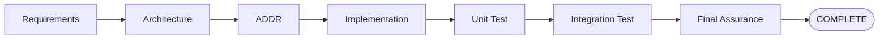
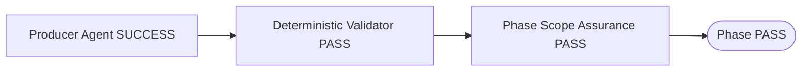
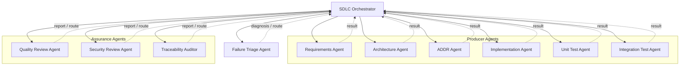
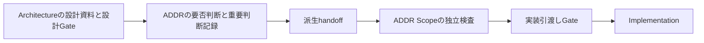
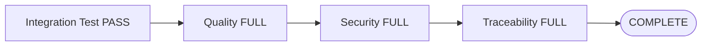
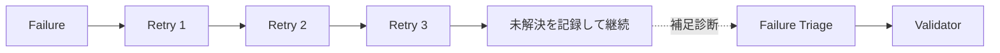

# AI SDLC Agent Framework

通常工程は **Requirements → Architecture（設計資料）→ ADDR（重要判断）→ Implementation** です。
ArchitectureとADDRは独立したAgentですが、データはこの順に引き渡します。
「独立」とは親子関係ではなく責務が別という意味で、無関係に動くという意味ではありません。

- Architectureは、準備済み仕様を既存テンプレートへ再構成します。
- ADDRは、その資料で一意に定まらない重要判断だけを記録します。
- 両Agentを呼ぶのはSDLC Orchestratorです。Agent同士は直接起動しません。
- Implementationは設計資料とADDRの両方を読みます。どちらか片方で代用しません。

実行契約は [ArchitectureとADDRの独立工程](docs/ai-sdlc/independent-architecture-addr.md)、
実験の時間・手戻り等は [実験計測ガイド](docs/ai-sdlc/experiment-measurement.md) を参照してください。

## 受入試験表からの実行

開発完了後にAcceptanceTestExecutorへ受入表（XLSX/CSV/試験定義JSON）の保存先を指定できます。
外部テスト準備担当が確定条件を実行コードへ翻訳し、人の承認後に凍結・実行・結果検証します。
表を配置するだけの自動起動ではありません。開発中は非公開にし、未実行をPASSにしません。
手順・依頼例は [受入試験表の入力](docs/ai-sdlc/acceptance-sheet-input.md) を参照してください。

## 実験結果のGit保存

`reports/`もGit管理対象です。実験ブランチへコード・要件・結果を保存し、実験後のデータはmainへマージしません。
設定変更だけを共通基準版へ反映してから実験を始めます。保存・切替・受入データの隔離は
[実験ブランチと結果の保存](docs/ai-sdlc/experiment-git-workflow.md) を参照してください。

GitHub CopilotのCustom Agent / Skillを利用し、
RequirementsからArchitecture、ADDR、Implementation、Unit Test、Integration Test、Final Assuranceまでを
一気通貫で実行するためのAI SDLC Frameworkです。

本Frameworkでは、各工程を担当する専門Agentと、
工程全体を制御するSDLC Orchestrator、
品質・Security・Traceabilityを独立監査するAssurance Agentを分離しています。

また、AIによる自己評価だけに依存せず、
機械的に判定可能な内容についてはDeterministic ValidatorをGateとして利用します。

---

## Overview

標準Lifecycleは以下です。



各Phaseは原則として以下の順序で進みます。



専門Agentが`SUCCESS`を返しただけでは、
工程全体のPASSとはみなしません。

---

## 設計AgentとADDR Agentのつながり

### 何を渡すのか

```text
Requirements
  要件本文・UC/AC・Steering・準備済み仕様
       ↓
Architecture Agent（設計資料を作る）
  ファイル定義（該当時）
  成果物間整合性分析
  実装タスク一覧
  上記の出典・版・対象・未確定判断をまとめたdesign-manifest
       ↓ Orchestratorが資料と設計Gateを渡す
ADDR Agent（重要判断だけを記録する）
  判断の要否、選択肢、採否理由、設計差分・実装拘束
  影響する実在FILE/TASKへの明示参照
       ↓ Orchestratorが検証・独立検査し、handoffと実装引渡しGateを作る
Implementation Agent
  Architectureの設計資料 ＋ ADDRの判断 ＋ 実装タスクを読む
```

| 成果物・作業 | 担当 | 他方との境界 |
| --- | --- | --- |
| file-definition | Architecture | ADDRは項目表を再作成しない |
| cross-artifact-consistency-analysis | Architecture | 入力時点の自己分析。独立Qualityの合格証拠ではない |
| implementation-task-list | Architecture | ADDRはTask・依存・Waveを再定義しない |
| 重要判断の比較・採否・理由 | ADDR | Architectureは判断が必要な場所と根拠だけ渡す |
| 判断から生じた差分・不変条件・実装拘束 | ADDR | 確定済みの設計本文全体は複製せずID/Pathで参照する |
| 最終的な内容整合・品質検査 | 独立Quality / Security / Traceability | Producerの分析だけで品質PASSにしない |

### Architectureが先でも重要判断を先取りしない

例えば受領済み仕様でファイルの列・形式が確定していれば、Architectureがその内容を定義書へ整理します。
二重取込防止や再試行方式に重要な選択が残る場合は、Architectureが勝手に比較・決定せずADDRへ渡します。
ADDRはその選択と理由だけを記録し、列定義表やTask一覧をもう一度作りません。
ADDR前の整合性分析では未実施判断を明示し、実装Readinessを先取りしてREADYにしません。

### ADDRの後にArchitectureへ毎回戻るのか

**戻りません。通常のFINALIZE再呼出しはありません。**

- 新しいADDRとの参照追加だけなら、ADDR正本2章のFILE/TASK参照と派生handoffで接続します。
  凍結済みの設計書に将来IDを自動追記するための再起動はしません。
- ADDRの決定で、ファイル定義の再送条件やTask本体などを本当に変える必要がある場合だけ、
  ADDRが具体的なdesign_change_requestsを返し、OrchestratorがArchitectureへ差し戻します。
- 判断そのものの不足・誤りはADDRへ、資料本文の不備はArchitectureへ戻します。
  互換Status名ADR_REQUIREDの戻り先もADDRです。

### どのファイルがつながりを担うのか

| ファイル | 作成者 / 意味 |
| --- | --- |
| docs/architecture/files/FILE-xxx.md | Architecture。ファイル連携がある場合 |
| docs/architecture/implementation-task-list.md | Architecture。実装作業と依存 |
| reports/architecture/cross-artifact-consistency.md | Architecture。入力時点の分析 |
| reports/architecture/design-manifest.json | Architecture。version=2 / FINALの資料一覧・出典・判断候補 |
| reports/architecture/design-gate.json | 親のValidator。ADDRへ渡す設計資料を固定 |
| docs/addr/ADDR-xxx.md | ADDR。重要判断の正本 |
| reports/architecture/addr-request.json / addr-result.json | ADDRの受領契約と機械可読結果。保存場所は旧版互換名 |
| reports/addr/implementation-handoff.json | 親のScript。設計とADDRのハッシュ・明示参照を束ねる派生データ |
| reports/architecture/architecture-gate.json | 親のValidator。ADDR後の実装引渡しGate。version=2ではphase=ADDR |

reports/architecture配下にADDR関連ファイルがあるのは保存先の互換性のためです。
**ADDRがArchitectureの子工程であることを意味しません。**
manifestやhandoffは別の設計書・判断文書ではなく、実ファイルの版と関連を機械確認するための情報です。

## Agentの起動関係

Agent間の遷移はすべてSDLC Orchestratorが制御します。

Producer AgentやAssurance Agent同士が、
別Agentを直接起動することはありません。



---

## Agent Roles

| Agent | Role |
| --- | --- |
| SDLC Orchestrator | Agent起動、Phase遷移、Validator、Assurance、Routing、Invalidation、Final Assuranceを制御 |
| Requirements Agent | Requirementを定義・更新 |
| Architecture Agent | 既存仕様からファイル定義・整合性分析・実装タスク等の設計資料を作成 |
| ADDR Agent | 設計資料を参照し、重要判断の要否・比較・採否理由・差分・実装拘束を記録 |
| Implementation Agent | 要件・設計資料・ADDR・実装タスクに従ってProduction Codeを実装 |
| Unit Test Agent | Requirements / Accepted ADRからExpected Resultを導出しUnit Testを作成・実行 |
| Integration Test Agent | Integration BehaviorとExternal Test Caseを含むIntegration Testを作成・実行 |
| Quality Review Agent | SDLC成果物の意味的品質を独立レビュー |
| Security Review Agent | Security品質を独立監査 |
| Traceability Auditor | Source ArtifactからDerived Trace Mapを生成し、RequirementからTestまでのTraceabilityを監査 |
| Failure Triage Agent | 同一Root CauseのFailureが収束しない場合に原因と戻り先を診断 |

---

## Framework Components

本Frameworkでは、責務を以下のように分離しています。

| Component | Responsibility |
| --- | --- |
| Agent | **WHO**：誰が責務を持つか |
| Skill | **HOW**：具体的にどう作業するか |
| Template | **WHAT**：成果物をどの構造で作るか |
| Policy | PASS / FAIL条件、Severity、Routingなどの判定基準 |
| Criterion | AIが意味的に評価する個別観点 |
| Validator | 機械的に判定可能なGate |
| Orchestrator | Agent起動、工程遷移、差し戻し、再実行 |
| Report | Agent / ValidatorのRuntime結果 |

### Key Principles

- 専門Agentの`SUCCESS`だけではPhase PASSにしない
- Validatorが存在する工程ではValidator PASSを必須とする
- Assurance Agentは成果物を修正しない
- Agent間遷移は必ずSDLC Orchestratorを経由する
- 後工程の都合でRequirementやAccepted ADRを変更しない
- Test Expected ResultをProduction Codeから逆算しない
- 上流成果物変更後に古い後続PASSを再利用しない
- Runtime ReportをRequirementやADRのSource of Truthとして扱わない

---

## ADDR Decision Lifecycle

新規の重要判断はADDR工程で作成します。テンプレート状態はACTIVE / SUPERSEDEDです。
ACTIVEは文書の状態であって、実装開始許可ではありません。



新規判断を旧ADRへ二重生成したり、Proposed→Acceptedへ変換したりしません。
既存docs/adrのAccepted ADRは履歴・制約として読み取れますが、新規Runの標準手順とは分けます。

---

## Assurance

Assurance Agentは、Producer Agentとは独立して成果物を監査します。

### Quality Review

主な観点:

- Requirement内部整合性
- Architecture妥当性
- Requirement / ADR / Implementation整合
- Scope Expansion
- 不必要なComplexity
- Unit Test / Integration Testの有効性
- Cross Phase Consistency

### Security Review

主な観点:

- Authentication / Authorization
- Secret / Credential
- Input Validation / Injection
- Data Protection
- Error / Logging
- Dependency / Configuration
- Security Test Coverage
- Cross Phase Security Consistency

Secretを検出しても、
Secret値そのものをReportへ出力してはいけません。

### Traceability Audit

成果物に記入したID参照・trace注釈を正本として、C01〜C11を決定論的に検査します。
作成Agentが参照を記入し、AuditorがTrace Map v3と要件対応表・確認結果表・ADDR別一覧を生成します。
AST/FQN・呼出し解析によるリンク生成は廃止しました。
意味的レビューは助言へ分離し、既存Quality/Security/Test Gateは維持します。
設計資料作成とADDRは別工程です。各Scopeで独立検査し、ADDR後に実装引渡しを確認します。
3回修正後も残る不合格は未解決として記録し、工程継続判定で次へ進めます。

詳細・移行・コマンドは [注釈方式トレーサビリティ](docs/ai-sdlc/inline-traceability.md) を参照してください。

## Phase Scope Assurance and Final Assurance

各Phase完了時には、
現在までに存在するArtifactを対象としてPhase Scope Assuranceを実行します。

例:

```text
Requirements      → audit_scope=REQUIREMENTS
Architecture      → audit_scope=ARCHITECTURE
ADDR              → audit_scope=ADDR
Implementation    → audit_scope=IMPLEMENTATION
Unit Test         → audit_scope=UNIT_TEST
Integration Test  → audit_scope=INTEGRATION_TEST
```

Integration Test Phase PASS後は、
SDLC全体を`audit_scope=FULL`で再監査します。



Phase単位のAssurance PASSを
Final Assurance PASSの代わりに利用してはいけません。

---

## Failure Routing

Failureは発生した工程ではなく、
Root Causeに基づいてRoutingします。

| Classification | Route |
| --- | --- |
| REQUIREMENT_ERROR | Requirements |
| ADR_REQUIRED | ADDR |
| ARCHITECTURE_QUALITY_ISSUE | Architecture（設計資料/TASKの不備） |
| IMPLEMENTATION_ERROR | Implementation |
| TEST_ERROR | Unit Test / Integration Test |
| ENVIRONMENT_ERROR | Environment / Orchestrator |
| TEST_SPEC_CONFLICT | User Decision |
| AUTOMATION_BLOCKED | User Decision |

たとえばIntegration TestでFAILしても、
原因がProduction CodeであればImplementationへ戻します。

---

## Failure Triage

通常Routingによる修正・再実行を行っても、
同一Root CauseのFailureが繰り返される場合はFailure Triageを実行します。

初回失敗はcycle=0、その後に実修正・再検査を最大3回行います。
3回後も残れば未解決を記録して継続します。Failure Triageは任意の補足診断で、4回目の修正命令ではありません。



Failure Triageの主なResult:

- `TRIAGED`
- `BLOCKED`
- `INVALID_INVOCATION`

Failure Triage自身は成果物を修正しません。

---

## Integration Test and External Cases

Integration Testでは、
AI生成CaseとExternal Test Caseの独立性を維持します。

Case種別:

- `AI_GENERATED / INITIAL`
- `AI_GENERATED / GAP_FILL`
- `EXTERNAL`

AI INITIAL Caseは、
External Caseを確認する前に生成・固定します。

External Case確認後に、
AI INITIAL Caseを変更してはいけません。

External Caseが未配置の場合は、
AI自身の判断で「External Caseなし」として処理を継続せず、
ユーザーの明示的な選択を必要とします。

---

## Invalidation

上流Artifactが変更された場合、
変更前の後続PASSをそのまま利用しません。

| Changed Artifact | Re-validation |
| --- | --- |
| Requirements | Architecture以降 |
| 設計資料 / Task | Architectureの検証・設計Gate、ADDRと影響下流 |
| ADDR / 参照中の旧Accepted ADR | ADDRの検証・handoff・実装引渡しGateと影響下流 |
| Production Code | 影響するUnit Test / Integration Test |
| Unit Test Codeのみ | Unit Test |
| Integration Test Codeのみ | Integration Test |

Assurance対象Artifactが変更された場合は、
Quality / Security / Traceabilityの既存PASSも再利用せず再監査します。

Requirements、ADR、Production Code、Unit Test Code、
Integration Test Codeが変更された場合は、
変更前の`trace-map.json`も再利用せず、
現在のSource Artifactから再生成します。

---

## Repository Structure

以下はFrameworkと生成される成果物の主な配置です。

```text
.github/
  copilot-instructions.md
  agents/
    sdlc-orchestrator.agent.md
    architecture.agent.md
    addr.agent.md
    implementation.agent.md
    ...（Requirements、テスト、独立監査）
  skills/
    requirements/
    architecture/
    addr/
    implementation/
    ...（テスト、監査、復旧、計測・評価）
docs/
  requirements/                  要件本文・UC/AC
  architecture/                  設計資料・実装タスク
  addr/                          新規の重要判断
  adr/                           既存ADR（互換読取り）
  ai-sdlc/                       利用・実行契約の説明
reports/
  architecture/                  設計manifest、設計Gate、互換ADDR契約、実装引渡しGate
  addr/                          派生handoff
  loop-control/                  実修正回数・未解決結果・継続判定
  experiments/<run-id>/           工程時間・手戻り・試験証跡
  ...（テスト・独立監査の実行結果）
```

---

## Where to Customize

変更したい内容に応じて、変更先を分けます。

| 変更したい内容 | 主な変更先 |
| --- | --- |
| Project全体の不変ルール | `.github/copilot-instructions.md` |
| SDLC順序 / Routing / Invalidation | `.github/agents/sdlc-orchestrator.agent.md` |
| Agentの責務・Input・Output | `.github/agents/**/<agent>.agent.md` |
| Agentの具体的な作業手順 | `.github/skills/<skill>/SKILL.md` |
| PASS / FAIL / Severity / Routing基準 | `.github/skills/<skill>/policy/` |
| Assuranceの意味的観点 | `.github/skills/<assurance-skill>/criteria/` |
| 機械的なGate | `.github/skills/<skill>/scripts/validate_*.py` |
| ValidatorのUnit Test | `.github/skills/<skill>/scripts/test_validate_*.py` |

Validatorへ意味的判断を移さず、
機械的に判定可能な内容だけをValidatorで確認してください。

---

## Getting Started

本Frameworkを利用するときは、
SDLC OrchestratorをSDLC全体のエントリポイントとして扱います。

Orchestratorが、

1. 対象Phaseの専門Agentを起動
2. Validatorを実行
3. 必要なAssuranceを実行
4. PASS時に次Phaseへ遷移
5. FAIL時にRoot Cause工程へRouting
6. 必要に応じて後続PhaseをInvalidate
7. Integration Test完了後にFinal Assuranceを実行
8. 全品質PASSならCOMPLETE、未解決持越しならCOMPLETE_WITH_UNRESOLVEDとして区別

という流れを制御します。

実際のAgent実行ルールは、
各Agent / Skill / Policyを参照してください。

---

## Documentation

Frameworkの詳細設計、
Agent間関係、
Failure Triage、
カスタマイズ方法、
新Agent追加方法、
Troubleshootingについては以下を参照してください。

```text
docs/ai-sdlc/agent-framework-guide.md
```

実行時のRuleのSource of Truthは、
READMEではなく以下です。

```text
.github/copilot-instructions.md
.github/agents/
.github/skills/
```

---

## Maintenance

Frameworkを変更した場合は、
関連するAgent / Skill / Policy / Criterion / Validatorだけでなく、
必要に応じて以下も更新してください。

```text
README.md
docs/ai-sdlc/agent-framework-guide.md
```

特に以下を変更した場合はDocumentation更新を推奨します。

- Agent追加・削除
- Phase追加・変更
- Routing変更
- Assurance観点変更
- Failure Triage Rule変更
- External Test Case Rule変更
- Final Assurance Rule変更

---

## Summary

```text
SDLC Orchestrator
  ├─ Producer Agents
  │    ├─ Requirements
  │    ├─ Architecture
  │    ├─ ADDR
  │    ├─ Implementation
  │    ├─ Unit Test
  │    └─ Integration Test
  │
  ├─ Assurance Agents
  │    ├─ Quality Review
  │    ├─ Security Review
  │    └─ Traceability Audit
  │
  └─ Failure Triage
```

本Frameworkは、

```text
Agent       = 責務
Skill       = 手順
Policy      = 判定基準
Criterion   = 意味的監査観点
Validator   = 決定論的Gate
Orchestrator= SDLC制御
```

として責務を分離し、
RequirementsからFinal AssuranceまでのAI SDLCを
一貫したGateとRouting Ruleのもとで実行することを目的としています。

## 工程継続の基本方針（2026-10-21更新）

全工程は、初回失敗とは別に修正・再検査を最大3回行い、残れば未解決を記録して次へ進めます。
旧来の停止条件は品質PASSの判定として維持し、工程継続では共通3回方針を優先します。
検査FAILは変更しません。最終結果もCOMPLETE_WITH_UNRESOLVEDとして正常完了と区別します。
詳細は [共通3回ループ](docs/ai-sdlc/bounded-repair-loop.md) を参照してください。
