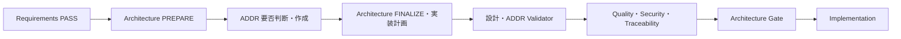

# 設計書とADDRの分離

2026-10-20更新。設計工程の新しい実行契約です。Architectureという外部工程名は維持します。
旧資料の「設計成果物はADRのみ」「Accepted ADRのみ」という説明は、この文書と共通Instructionsの
設計判断契約で読み替えます。旧ADRの内容・履歴・Validatorは引き続き保持します。



| Agent | 担当 | 担当外 |
| --- | --- | --- |
| Architecture | テンプレートによる設計書、未確定判断の抽出、ADDR反映、実装タスク | 重要判断のADDR作成、自己Assurance |
| ADDR | 重要判断の要否・比較・決定、設計差分・不変条件・仮定、LINK_ADDR要求 | 前工程設計書の直接編集、実装タスク |
| Orchestrator | 予約ID、Agent間の受渡し、Validator、Assurance、復旧・Gate・遷移 | 設計内容の独自変更 |

## 正本

正本テンプレートは変更していません。

- `.github/skills/architecture/templates/file-definition.template.md` → 条件付きのファイル定義
- `.github/skills/architecture/templates/implementation-task-list.template.md` → 実装タスク一覧
- `.github/skills/architecture/templates/cross-artifact-consistency-analysis.template.md` → Assuranceの派生Report
- `.github/skills/addr/templates/addr.md` → Architecture Decision & Design Record

構成図・データモデル・画面設計・API設計等の専用テンプレートは今回のZIPにありません。
存在する入力・外部仕様を参照し、必要な仕様や正本がなければ不足として返します。
Agent判断で架空の標準設計テンプレートを追加しません。
テンプレート内のADR参照欄はADDR IDにも利用します。見出し・表列を改名しません。

## 実行と機械可読成果物

1. Architecture PREPAREが `reports/architecture/design-input.json` を作ります。
   全要件リンク・Steering・参照した入力のSHA-256、DRAFT設計、対象重要度、未確定判断を固定します。
2. OrchestratorがADDR requestを準備します。予約IDは全既存・過去予約と衝突させません。
3. ADDRが `docs/addr/ADDR-xxx.md` と `reports/architecture/addr-result.json` を作ります。
   不要な判断にはIDを消費しません。全対象の要否・理由、全入力候補への応答を記録します。
4. Architecture FINALIZEが設計へ参照・差分を反映し、実装計画とFINAL manifestを作ります。
5. ValidatorとAssuranceを経て、Gateを保存した後に実装へ渡します。

```text
python .github/skills/architecture/scripts/validate_design.py --stage draft
python .github/skills/addr/scripts/validate_addr.py --prepare-request
python .github/skills/addr/scripts/validate_addr.py
python .github/skills/architecture/scripts/validate_design.py --stage final
python .github/skills/addr/scripts/validate_addr.py --final
```

この間にAgentの実行が必要です。コマンドだけで文章や設計判断を生成するものではありません。
不足・矛盾を推測で補完せず、親が指定上限内で復旧を試みます。3回後も残れば結果と影響を未解決として返し、共通継続判定へ進みます。
要件・受入条件を変える縮退やMANDATORY隔離は行いません。PARTIAL_SUCCESSは全体Gateを通しません。

## AssuranceとGate

Quality/Security/Traceabilityの全AgentとValidatorは `audit_scope=ARCHITECTURE` で実行します。
各JSON Reportの `source_baseline_sha256` はFINAL manifestのSHA-256です。
対応するValidatorはこれを結果へ引き継ぎます。Quality Reviewは既存テンプレートで
`reports/architecture/cross-artifact-consistency.md` も作成します。

```text
python .github/skills/addr/scripts/validate_addr.py --write-gate
python .github/skills/architecture/scripts/validate_design.py --check-gate
```

Gateは出典・設計・計画・ADDR・テンプレートのハッシュと、Architecture Assuranceの固定コピーを保持します。
後工程の通常のReport更新では固定コピーを上書きしません。
実装コードの生成は設計Gateを無効化しませんが、設計・計画・根拠・ADDRを変更した場合は再Gateが必要です。
Task計画の実行中の進捗は別Reportへ保存します。

ADDR正本の状態はACTIVE / SUPERSEDEDです。ACTIVEだけではGate通過を意味しません。
ARCHITECTURE監査ではACTIVEを候補として読み、実装以降の注釈方式ValidatorはGateの現在性も検証します。
Trace Map v3はelements/sourcesを使い、設計書・Integration Planのadr_id等は互換名として残します。
旧ADRへの重複投影は行いません。詳細は [注釈方式トレーサビリティ](inline-traceability.md) を参照します。

## 変更・復旧

入力変更はPREPARE、重要判断はADDR、設計反映・Task不備はFINALIZEへ戻します。
requestの再予約は `--prepare-request --renew-request`、予約数の変更は `--reserve-count N` です。
未Gateの旧候補は履歴へ退避し、旧結果を無効化してから再予約します。
既存判断の置換は新IDで記録し、古いADDRをSUPERSEDEDにした後、設計反映とAssuranceを再実行します。

旧ADRのみのプロジェクトは従来の読取りに対応します。新設計manifestまたはADDRが存在するプロジェクトでは
Gateを省略できません。新規判断はADDRに記録し、旧ADRの一律変換は行いません。

## テスト

```text
python .github/skills/architecture/scripts/test_design_split.py
```

実テンプレートを使った構造検証、ADDR不要/必要、IDプール、未使用ID、重要度、復旧上限、
LINK_ADDR、Task依存・Wave、古い入力・Gate・Assurance、旧ADR混在を確認します。
これらはFrameworkの検証です。設計判断の意味的な妥当性は既存Assuranceが評価します。

## 工程継続の基本方針（2026-10-21更新）

全工程は、初回失敗とは別に修正・再検査を最大3回行い、残れば未解決を記録して次へ進めます。
旧来の停止条件は品質PASSの判定として維持し、工程継続では共通3回方針を優先します。
検査FAILは変更しません。最終結果もCOMPLETE_WITH_UNRESOLVEDとして正常完了と区別します。
詳細は [共通3回ループ](bounded-repair-loop.md) を参照してください。
