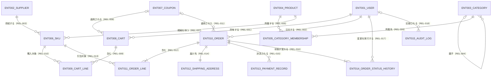

# データベース論理設計書

本書はArchitectureが作成する論理データモデルの正本とする。要件・提供済み仕様・有効な既存判断から確定できる内容を記載する。
重要な方式選択・正規化例外・履歴方式等が未確定なら18章へ記録し、manifestのunresolved_design_decisionsと対応させてADDRへ渡す。
新しい選択肢比較・採否理由・判断由来のDD/INV/ASMはADDRの正本に記録する。後続ADDRがモデル変更を求めた場合はArchitectureが差し戻しを受けて更新する。
参照だけの追加はADDR正本2章と派生handoffで接続し、将来ADDR IDの予約記入や通常FINALIZEを行わない。
既存のADR表記の欄には、有効な既存ADDRまたは旧Accepted ADRを記載できる。

## 1. 文書情報

| 項目 | 内容 |
| --- | --- |
| Document ID | DOC-LDB-001 |
| 対象システム | MiniCommerce（株式会社あおば雑貨 会員向け自社ECサイト） |
| 対象サブシステム / Domain | 初期リリース（第1期）の全業務データ（会員・認証、商品カタログ、販促、カート、注文、運用記録） |
| Version | 1.1 |
| Status | REVIEW |
| Owner | Architecture Agent（RUN-AOBA-EC-1118） |
| Last Updated | 2026-11-19 |

## 2. 目的と適用範囲

### 2.1 目的

データ要件定義書（DR-001〜DR-015）で定義された業務データ・項目・関連・品質ルール・保存期間・機密区分を、Entity・属性・識別子・関連・多重度・論理制約へ再構成し、後続の物理設計・実装（Django/PostgreSQL 16、Steering 3章）の入力とする。要件に記載のない業務データ・項目・数値は追加しない。

### 2.2 対象範囲

| 区分 | 内容 |
| --- | --- |
| 対象Domain | 会員・認証、商品カタログ、販促（クーポン）、カート、注文（決済・状態履歴を含む）、運用記録（監査ログ） |
| 対象データ | DR-001 利用者〜DR-015 監査ログの15データ（ENT-001〜ENT-015） |
| 対象機能 / Use Case | FR-001〜FR-004、FR-010〜FR-012、FR-020〜FR-026、FR-030〜FR-034、FR-040〜FR-045、FR-060 / UC-001〜UC-013 |
| 対象Database | MiniCommerce 主データストア（論理上1つ。製品は NFR-EN-02 の PostgreSQL 16） |

### 2.3 本書で定義する事項

- 論理エンティティ
- 論理属性
- Primary Identifier / Alternate Identifier
- エンティティ間の関連と多重度
- 必須性・一意性等の論理制約
- 要件・既存判断に基づく正規化結果と、非正規化を適用する場合の判断参照
- 状態・履歴・有効期間等の論理モデル
- Code / Reference Dataの論理モデル
- Requirement / Data Requirement / ADRとの対応

### 2.4 本書で定義しない事項

- DBMS固有の物理データ型
- Table / Columnの物理名
- Index
- Partition
- Tablespace / Storage
- Replicationの物理方式
- DDL / SQL実装
- Connection Pool等のRuntime設定
- Backup製品・具体的な運用設定

## 3. 関連情報

| 種別 | ID / Path | 本書との関係 |
| --- | --- | --- |
| Business Requirement | docs/requirements/business_requirements.md（BR-01〜BR-19、BOQ-08、BOQ-09） | 数量上限・クーポン・送料・消費税・在庫引当・状態遷移の業務規則。BOQ-08 は未決（18章 OQ-LDB-010） |
| Functional Requirement | FR-001〜FR-060 / docs/requirements/functional_requirements.md（6章、7章 CMN-01〜CMN-39、8章 ST-PO-01〜ST-PO-06・ST-CART-01〜ST-CART-02） | 機能ごとのデータ生成・更新・参照契機、状態遷移、同時実行時の扱い |
| Non-Functional Requirement | NFR-SC-01、NFR-SC-03、NFR-SC-08、NFR-SC-15、NFR-SC-22、NFR-SC-23、NFR-SC-24、NFR-PF-06、NFR-PF-07、NFR-PF-08、NFR-OM-03、NFR-OM-04、NFR-EN-02、NFR-EN-04、NFR-LG-03 / docs/requirements/non_functional_requirements.md | パスワード保存方式、アクセス制御、改ざん防止、保存期間、データ量、時刻・文字コード |
| Data Requirement | DR-001〜DR-015 / docs/requirements/data_requirements.md（2〜12章） | 論理モデル化する元データ・項目（D-nn-mm）・コード（CD-01〜CD-08）・品質ルール（DQ-01〜DQ-50） |
| Use Case / AC | UC-001〜UC-013 / docs/requirements/use-cases/（9章の AC） | データ生成・参照・更新契機と受入条件 |
| ADR | None（docs/addr・docs/adr に既存判断なし。後続ADDRは本書をパス・版・Entity IDで参照する） | 参照時点で有効なデータ方式の設計判断はない |
| Glossary | docs/requirements/glossary.md | 利用者・在庫単位・注文状態等の業務用語の定義 |
| External IF Requirement | IFR-001 / docs/requirements/external_interface_requirements.md（5.1.4、5.1.9、5.1.10） | 決済記録（ENT-013）へ記録する決済結果の項目と整合性 |

## 4. 論理データモデル方針

### 4.1 モデリング方針

| 項目 | 方針 |
| --- | --- |
| モデリング単位 | データ要件のデータ（DR-nnn）1件を1 Entity とする（ENT-nnn の連番は DR-nnn と同順）。業務上異なる概念は統合しない |
| 正規化方針 | 原則第3正規形。例外は要件が確定時点の値の保持を指定する複写項目（DQ-38）と確定金額（DR-010 備考）に限り、9章に根拠を記録する |
| 履歴管理方針 | 注文状態の変更は注文状態履歴（ENT-014）、支払の試行は決済記録（ENT-013）に1件ずつ追記し、登録後は変更しない（NFR-SC-23、DR-013・DR-014 備考）。マスタの変更履歴・世代管理は要件にないため持たない |
| 削除の考え方 | 論理削除フラグは持たない。削除は要件で定めた契機に限る：カート明細の削除（UPD-18）、保存期間経過データの削除（UPD-19・UPD-30・UPD-32）、初期データ一括投入の削除指定による監査ログ以外の全削除（UPD-33）。利用者・マスタの個別削除は行わない（DQ-49） |
| Code / Master管理 | コード値（CD-01〜CD-08）は10章の Code Set として保持する。外部に出る値の割当ては未確定（OQ-LDB-003）。マスタ（仕入先・商品分類・商品・在庫単位・クーポン）は初期データ一括投入でのみ登録する（CMN-38） |
| 多言語データ | 該当なし（日本語のみ。FR-OUT-06） |
| Time Zone | 日本時間（JST）。日時は秒単位まで保持し、ミリ秒以下は切り捨てる（NFR-EN-04、DCN-12、CMN-29） |
| 金額・数量 | 金額は日本円の整数（円）。端数は各計算段階で1円未満切り捨て（CMN-30、DCN-12）。数量は整数 |

### 4.2 Domain / Data Ownership

| Data Area | Owner Domain | 更新責任 | 参照するDomain | 備考 |
| --- | --- | --- | --- | --- |
| 利用者（ENT-001） | 会員・認証 | 会員・認証（FR-001）、運用（FR-060） | カート、注文、運用記録 | 管理者は初期データ一括投入でのみ作成（CMN-08、NFR-SC-15） |
| 監査ログ（ENT-015） | 運用記録 | 会員・認証（FR-002、FR-003）、運用（FR-060） | なし（照会機能なし：CMN-27） | 追記のみ（NFR-SC-23） |
| 仕入先・商品分類・商品・商品分類所属・在庫単位（ENT-002〜ENT-006） | 商品カタログ | 運用（FR-060）。在庫数量のみ注文（FR-030、FR-034、FR-045） | カート、注文、管理 | 在庫数量は初期投入・注文確定・注文キャンセルでのみ変化（CMN-38、DCN-05） |
| クーポン（ENT-007） | 販促 | 運用（FR-060） | カート、注文 | 画面・APIからの保守なし（FR-OUT-02） |
| カート・カート明細（ENT-008、ENT-009） | カート | カート（FR-020〜FR-025）、注文（FR-030 で注文済へ変更） | 注文 | 購入者本人のみ参照（REF-14、REF-15） |
| 注文・注文明細・配送先・決済記録・注文状態履歴（ENT-010〜ENT-014） | 注文 | 注文（FR-030、FR-031、FR-034）、管理（FR-043〜FR-045） | 管理 | 保存期間7年（RET-10〜RET-14、NFR-LG-03） |

## 5. エンティティ一覧

| Entity ID | エンティティ名 | 種別 | 業務上の意味・責務 | 主な生成契機 | 主な利用機能 | 関連Data Requirement | Owner Domain |
| --- | --- | --- | --- | --- | --- | --- | --- |
| ENT-001 | 利用者 | MASTER | ログインする購入者・管理者のメールアドレス・パスワード（照合用）・氏名・利用者区分 | 会員登録、初期データ一括投入 | FR-001、FR-002、FR-004、FR-041、FR-042、FR-060 | DR-001 | 会員・認証 |
| ENT-002 | 仕入先 | MASTER | 在庫単位の仕入元の事業者 | 初期データ一括投入 | FR-040、FR-060 | DR-002 | 商品カタログ |
| ENT-003 | 商品分類 | MASTER | 最大3階層の木構造の商品分類 | 初期データ一括投入 | FR-010、FR-011、FR-012、FR-060 | DR-003 | 商品カタログ |
| ENT-004 | 商品 | MASTER | 販売する商品の名称・説明・公開状態 | 初期データ一括投入 | FR-011、FR-012、FR-021、FR-030、FR-040、FR-060 | DR-004 | 商品カタログ |
| ENT-005 | 商品分類所属 | ASSOCIATION | 商品と商品分類の所属関係 | 初期データ一括投入 | FR-011、FR-012、FR-060 | DR-005 | 商品カタログ |
| ENT-006 | 在庫単位 | MASTER | 商品の規格ごとの販売単位（SKU）・税抜価格・在庫数量 | 初期データ一括投入（在庫数量は注文確定・キャンセルで変化） | FR-011、FR-012、FR-020、FR-021、FR-022、FR-030、FR-034、FR-040、FR-045、FR-060 | DR-006 | 商品カタログ |
| ENT-007 | クーポン | MASTER | カートに1枚まで適用できる割引の定義 | 初期データ一括投入 | FR-024、FR-025、FR-026、FR-030、FR-060 | DR-007 | 販促 |
| ENT-008 | カート | TRANSACTION | 購入者が注文確定前に在庫単位を集める入れ物と適用中のクーポン | カート照会・明細追加・クーポン解除時に利用中カートがない場合 | FR-020、FR-021、FR-022、FR-023、FR-024、FR-025、FR-026、FR-030 | DR-008 | カート |
| ENT-009 | カート明細 | TRANSACTION | カート内の在庫単位ごとの数量 | カート明細追加 | FR-020、FR-021、FR-022、FR-023、FR-026、FR-030 | DR-009 | カート |
| ENT-010 | 注文 | TRANSACTION | 注文確定で作成される注文番号・状態・金額・日時 | 注文確定 | FR-030、FR-031、FR-032、FR-033、FR-034、FR-041、FR-042、FR-043、FR-044、FR-045 | DR-010 | 注文 |
| ENT-011 | 注文明細 | TRANSACTION | 注文確定時点の在庫単位ごとの複写値と数量 | 注文確定 | FR-030、FR-033、FR-034、FR-042、FR-045 | DR-011 | 注文 |
| ENT-012 | 配送先 | TRANSACTION | 注文の届け先（受取人氏名・住所・電話番号） | 注文確定 | FR-030、FR-033、FR-042 | DR-012 | 注文 |
| ENT-013 | 決済記録 | HISTORY | 支払の実行1回ごとの決済サービス（模擬）の結果・金額・取引参照番号 | 支払（承認・否認・連携エラー） | FR-031、FR-042 | DR-013 | 注文 |
| ENT-014 | 注文状態履歴 | HISTORY | 注文状態の変更1回ごとの変更前後の状態・日時・実行者 | 注文状態の変更（注文確定を含む） | FR-030、FR-031、FR-033、FR-034、FR-042、FR-043、FR-044、FR-045 | DR-014 | 注文 |
| ENT-015 | 監査ログ | OTHER | ログイン成功・失敗・ログアウト・初期データ一括投入の実行記録（業務記録） | ログイン、ログアウト、初期データ一括投入 | FR-002、FR-003、FR-060 | DR-015 | 運用記録 |

## 6. ER図

### 6.1 ER図補足

| ID | 対象Entity / Relationship | 補足 |
| --- | --- | --- |
| LDB-NOTE-001 | 図中の英字名 | 図の英字名は描画用の別名であり、Table名・物理名ではない。ENT001_USER＝ENT-001 利用者、ENT002_SUPPLIER＝ENT-002 仕入先、ENT003_CATEGORY＝ENT-003 商品分類、ENT004_PRODUCT＝ENT-004 商品、ENT005_CATEGORY_MEMBERSHIP＝ENT-005 商品分類所属、ENT006_SKU＝ENT-006 在庫単位、ENT007_COUPON＝ENT-007 クーポン、ENT008_CART＝ENT-008 カート、ENT009_CART_LINE＝ENT-009 カート明細、ENT010_ORDER＝ENT-010 注文、ENT011_ORDER_LINE＝ENT-011 注文明細、ENT012_SHIPPING_ADDRESS＝ENT-012 配送先、ENT013_PAYMENT_RECORD＝ENT-013 決済記録、ENT014_ORDER_STATUS_HISTORY＝ENT-014 注文状態履歴、ENT015_AUDIT_LOG＝ENT-015 監査ログ |
| LDB-NOTE-002 | REL-001（ENT-001 → ENT-008） | カート状態が利用中のカートは購入者1名につき最大1件、注文済のカートは複数件（DQ-09）。所有者は利用者区分が購入者に限る（DQ-43） |
| LDB-NOTE-003 | REL-004（ENT-003 → ENT-003） | 最大3階層。親子関係は循環しない（DQ-17） |
| LDB-NOTE-004 | REL-018（ENT-001 → ENT-015） | 初期データ一括投入の削除指定（UPD-33）で削除された利用者を指す監査ログを保持する。関連先が存在しない値を許容する（DQ-48） |
| LDB-NOTE-005 | ログイン状態 | ログイン状態の保持に関する情報はデータ要件の対象外（data_requirements.md 1.2）のため、本図に含めない。保持方式は 18章 OQ-LDB-005 |

## 7. エンティティ詳細

### 7.1 `ENT-001` `利用者`

#### 7.1.1 基本情報

| 項目 | 内容 |
| --- | --- |
| Entity ID | ENT-001 |
| Entity Name | 利用者 |
| Business Definition | 本システムにログインする利用者（購入者・管理者）。購入者と管理者を同一Entityで保持し、利用者区分で区別する（DR-001 備考） |
| Entity Type | MASTER |
| Owner Domain | 会員・認証 |
| Related Data Requirement | DR-001（D-01-01〜D-01-06、DQ-01、UPD-01、UPD-02、REF-01〜REF-03、CLS-03、CLS-04、PI-01、PI-02、PI-10） |
| Related Requirements | FR-001、FR-002、FR-004、FR-041、FR-042、FR-060、NFR-SC-01、NFR-SC-12、NFR-SC-15、NFR-SC-24 |
| Related ADR | None（既存判断なし。パスワード（照合用）の保持方式は OQ-LDB-001） |
| Lifecycle | 登録（会員登録で購入者、初期データ一括投入で購入者・管理者）→ 本リリースでは変更・個別削除なし（FR-OUT-09、DQ-49）。初期データ一括投入の削除指定時のみ全件削除（UPD-33） |

#### 7.1.2 Identifier

| Identifier ID | 種別 | 構成Attribute | 業務上の意味 | 変更可否 | 備考 |
| --- | --- | --- | --- | --- | --- |
| IDF-ENT-001-001 | PRIMARY | ATTR-ENT-001-001 | 利用者を一意に識別するシステム付与の値 | IMMUTABLE | 採番方式は OQ-LDB-002 |
| IDF-ENT-001-002 | ALTERNATE | ATTR-ENT-001-002 | ログインに用いる業務キー（正規化後のメールアドレス）。初期データ一括投入の業務キー | IMMUTABLE | 本リリースに変更機能なし（FR-OUT-09）。DQ-01 |

#### 7.1.3 属性定義

| Attribute ID | 属性名 | 意味・説明 | Logical Type | 必須 | 一意 | Length / Precision | 値域・Format | Default / Initial | Derived Rule | 機密区分 | Related Data Item |
| --- | --- | --- | --- | --- | --- | --- | --- | --- | --- | --- | --- |
| ATTR-ENT-001-001 | 利用者ID | 利用者を一意に識別する値 | IDENTIFIER | REQUIRED | YES | 該当なし | 1以上の整数 | 登録時にシステムが付与 | None | 社外秘（CLS-02） | D-01-01 |
| ATTR-ENT-001-002 | メールアドレス | ログインに用いるメールアドレス | STRING | REQUIRED | YES | 1〜254文字 | 「ローカル部@ドメイン部」、空白を含まない。英字は小文字のみ | None | 入力値の前後の空白を除去し全体を英小文字に変換した値 | 機密（CLS-03） | D-01-02 |
| ATTR-ENT-001-003 | パスワード（照合用） | ログイン時にパスワードを照合するための情報 | OTHER | REQUIRED | NO | 該当なし | パスワードを平文・復号可能な形式で保持しない。同じパスワードの利用者どうしでも保持値が異なること（NFR-SC-01）。具体方式は OQ-LDB-001 | None | 会員登録・初期データ一括投入で受け取ったパスワードから設定 | 厳秘（CLS-04） | D-01-03 |
| ATTR-ENT-001-004 | 氏名 | 利用者の氏名 | STRING | REQUIRED | NO | 1〜50文字 | 前後の空白除去後に1〜50文字 | None | 入力値の前後の空白を除去した値 | 機密（CLS-03） | D-01-04 |
| ATTR-ENT-001-005 | 利用者区分 | 購入者・管理者の別 | CODE | REQUIRED | NO | 該当なし | CODE-001（CD-01） | 購入者（会員登録時） | 会員登録は購入者固定。初期データ一括投入は指定値 | 社外秘（CLS-02） | D-01-05 |
| ATTR-ENT-001-006 | 登録日時 | 利用者を登録した日時 | DATETIME | REQUIRED | NO | 秒単位 | 日本時間 | None | 会員登録は処理時刻、初期データ一括投入は投入時刻 | 社外秘（CLS-02） | D-01-06 |

#### 7.1.4 条件付き必須・属性間制約

| Constraint ID | 対象Attribute | 条件 | 制約内容 | 違反時の論理上の扱い | Related Requirement |
| --- | --- | --- | --- | --- | --- |
| LDC-ENT-001-001 | ATTR-ENT-001-002 | 常時 | 正規化後の値が購入者・管理者の全利用者で一意（同時登録でも1件のみ） | 会員登録は E-001-02、初期データ一括投入は E-060-05 | FR-001、FR-060、DR-001（DQ-01） |
| LDC-ENT-001-002 | ATTR-ENT-001-005 | 会員登録で作成する場合 | 利用者区分は購入者に限る。管理者は初期データ一括投入でのみ作成 | 要求に利用者区分が含まれても購入者として登録 | FR-001、FR-060、NFR-SC-15（CMN-08） |
| LDC-ENT-001-003 | ATTR-ENT-001-003 | 登録時 | 元のパスワードは8〜64文字、英字・数字を各1文字以上含み、英小文字化した値が正規化後のメールアドレスと一致しない（前後の空白は除去しない） | E-001-01、E-060-04 | FR-001、FR-060 |

#### 7.1.5 状態・Lifecycle

| State ID | 状態名 | 意味 | 遷移元 | 遷移契機 | 遷移先 | 遷移条件 |
| --- | --- | --- | --- | --- | --- | --- |
| 該当なし | 該当なし | 状態を表す項目を持たない（DR-001） | 該当なし | 該当なし | 該当なし | 該当なし |

#### 7.1.6 履歴・有効期間

| 項目 | 内容 |
| --- | --- |
| 履歴保持 | 不要 |
| 保持対象 | 該当なし（変更機能なし） |
| 業務上の有効期間 | 該当なし（無期限保持：RET-01） |
| 過去時点参照 | 不要 |
| Requirement | DR-001（RET-01、DOQ-01） |

### 7.2 `ENT-002` `仕入先`

#### 7.2.1 基本情報

| 項目 | 内容 |
| --- | --- |
| Entity ID | ENT-002 |
| Entity Name | 仕入先 |
| Business Definition | 在庫単位の仕入元の事業者。来訪者・購入者には提供しない |
| Entity Type | MASTER |
| Owner Domain | 商品カタログ |
| Related Data Requirement | DR-002（D-02-01〜D-02-03、DQ-02、UPD-03、REF-04、REF-05） |
| Related Requirements | FR-040、FR-060、NFR-SC-24 |
| Related ADR | None |
| Lifecycle | 初期データ一括投入で登録 → 変更・個別削除なし（DQ-49） |

#### 7.2.2 Identifier

| Identifier ID | 種別 | 構成Attribute | 業務上の意味 | 変更可否 | 備考 |
| --- | --- | --- | --- | --- | --- |
| IDF-ENT-002-001 | PRIMARY | ATTR-ENT-002-001 | 仕入先を一意に識別するシステム付与の値 | IMMUTABLE | FR-040 の仕入先指定に用いる。採番方式は OQ-LDB-002 |
| IDF-ENT-002-002 | ALTERNATE | ATTR-ENT-002-002 | 業務キー（初期データ一括投入の参照キー） | IMMUTABLE | DQ-02 |

#### 7.2.3 属性定義

| Attribute ID | 属性名 | 意味・説明 | Logical Type | 必須 | 一意 | Length / Precision | 値域・Format | Default / Initial | Derived Rule | 機密区分 | Related Data Item |
| --- | --- | --- | --- | --- | --- | --- | --- | --- | --- | --- | --- |
| ATTR-ENT-002-001 | 仕入先ID | 仕入先を一意に識別する値 | IDENTIFIER | REQUIRED | YES | 該当なし | 1以上の整数 | 登録時にシステムが付与 | None | 社外秘（CLS-02） | D-02-01 |
| ATTR-ENT-002-002 | 仕入先コード | 仕入先を業務上識別するコード | STRING | REQUIRED | YES | 1〜20文字 | 半角英大文字・半角数字・ハイフンのみ | None | None | 社外秘（CLS-02） | D-02-02 |
| ATTR-ENT-002-003 | 仕入先名 | 仕入先の名称 | STRING | REQUIRED | NO | 1〜100文字 | 1〜100文字 | None | None | 社外秘（CLS-02） | D-02-03 |

#### 7.2.4 条件付き必須・属性間制約

| Constraint ID | 対象Attribute | 条件 | 制約内容 | 違反時の論理上の扱い | Related Requirement |
| --- | --- | --- | --- | --- | --- |
| LDC-ENT-002-001 | ATTR-ENT-002-002 | 常時 | 既存データと定義ファイル内の両方で一意 | E-060-05（全件投入しない） | FR-060、DR-002（DQ-02） |

#### 7.2.5 状態・Lifecycle

| State ID | 状態名 | 意味 | 遷移元 | 遷移契機 | 遷移先 | 遷移条件 |
| --- | --- | --- | --- | --- | --- | --- |
| 該当なし | 該当なし | 状態を表す項目を持たない（DR-002） | 該当なし | 該当なし | 該当なし | 該当なし |

#### 7.2.6 履歴・有効期間

| 項目 | 内容 |
| --- | --- |
| 履歴保持 | 不要 |
| 保持対象 | 該当なし |
| 業務上の有効期間 | 該当なし（稼働期間中は保持：RET-02） |
| 過去時点参照 | 不要 |
| Requirement | DR-002（RET-02） |

### 7.3 `ENT-003` `商品分類`

#### 7.3.1 基本情報

| 項目 | 内容 |
| --- | --- |
| Entity ID | ENT-003 |
| Entity Name | 商品分類 |
| Business Definition | 商品を分類する最大3階層の木構造の分類。公開状態は持たず全分類を提供する |
| Entity Type | MASTER |
| Owner Domain | 商品カタログ |
| Related Data Requirement | DR-003（D-03-01〜D-03-06、DQ-03、DQ-04、DQ-17、DQ-41、UPD-04、REF-06） |
| Related Requirements | FR-010、FR-011、FR-012、FR-060、NFR-PF-08 |
| Related ADR | None |
| Lifecycle | 初期データ一括投入で登録 → 変更・個別削除なし（DQ-49） |

#### 7.3.2 Identifier

| Identifier ID | 種別 | 構成Attribute | 業務上の意味 | 変更可否 | 備考 |
| --- | --- | --- | --- | --- | --- |
| IDF-ENT-003-001 | PRIMARY | ATTR-ENT-003-001 | 商品分類を一意に識別するシステム付与の値（FR-011 の分類ID） | IMMUTABLE | 採番方式は OQ-LDB-002 |
| IDF-ENT-003-002 | ALTERNATE | ATTR-ENT-003-002 | 業務キー（親分類・所属分類の指定に用いる） | IMMUTABLE | DQ-03 |
| IDF-ENT-003-003 | ALTERNATE | ATTR-ENT-003-004 + ATTR-ENT-003-003 | 同じ親の中で分類名が一意（最上位どうしを含む） | IMMUTABLE | DQ-04。親分類が値なしの分類どうしも一意 |

#### 7.3.3 属性定義

| Attribute ID | 属性名 | 意味・説明 | Logical Type | 必須 | 一意 | Length / Precision | 値域・Format | Default / Initial | Derived Rule | 機密区分 | Related Data Item |
| --- | --- | --- | --- | --- | --- | --- | --- | --- | --- | --- | --- |
| ATTR-ENT-003-001 | 商品分類ID | 商品分類を一意に識別する値 | IDENTIFIER | REQUIRED | YES | 該当なし | 1以上の整数 | 登録時にシステムが付与 | None | 公開（CLS-01） | D-03-01 |
| ATTR-ENT-003-002 | 分類コード | 商品分類を業務上識別するコード | STRING | REQUIRED | YES | 1〜30文字 | 半角英小文字・半角数字・ハイフンのみ | None | None | 公開（CLS-01） | D-03-02 |
| ATTR-ENT-003-003 | 分類名 | 商品分類の名称 | STRING | REQUIRED | NO | 1〜50文字 | 1〜50文字 | None | None | 公開（CLS-01） | D-03-03 |
| ATTR-ENT-003-004 | 親分類 | 1階層上の商品分類（ENT-003 への関連） | IDENTIFIER | OPTIONAL | NO | 該当なし | 登録済みの商品分類。自分自身と自分の配下は不可 | 値なし（最上位） | 初期データ一括投入で親の分類コードにより指定 | 公開（CLS-01） | D-03-04 |
| ATTR-ENT-003-005 | 深さ | 木構造での階層の深さ | INTEGER | REQUIRED | NO | 1桁 | 1以上3以下 | None | 親分類が値なしなら1、値ありなら親の深さ＋1（登録時に設定） | 公開（CLS-01） | D-03-05 |
| ATTR-ENT-003-006 | 表示順 | 同じ親の中での表示順（小さい値が先） | INTEGER | REQUIRED | NO | 3桁 | 0以上999以下 | 0 | None | 公開（CLS-01） | D-03-06 |

#### 7.3.4 条件付き必須・属性間制約

| Constraint ID | 対象Attribute | 条件 | 制約内容 | 違反時の論理上の扱い | Related Requirement |
| --- | --- | --- | --- | --- | --- |
| LDC-ENT-003-001 | ATTR-ENT-003-004、ATTR-ENT-003-005 | 常時 | 深さは親なしで1、親ありで親の深さ＋1、3以下（深さ3の分類は子を持たない）。親子関係は循環しない | E-060-05（全件投入しない） | FR-060、DR-003（DQ-17） |
| LDC-ENT-003-002 | ATTR-ENT-003-002 | 常時 | 既存データと定義ファイル内の両方で一意 | E-060-05 | FR-060、DR-003（DQ-03） |
| LDC-ENT-003-003 | ATTR-ENT-003-003、ATTR-ENT-003-004 | 常時 | 同じ親の中で分類名が一意（最上位どうしを含む） | E-060-05 | FR-060、DR-003（DQ-04） |

#### 7.3.5 状態・Lifecycle

| State ID | 状態名 | 意味 | 遷移元 | 遷移契機 | 遷移先 | 遷移条件 |
| --- | --- | --- | --- | --- | --- | --- |
| 該当なし | 該当なし | 状態を表す項目を持たない（DR-003） | 該当なし | 該当なし | 該当なし | 該当なし |

#### 7.3.6 履歴・有効期間

| 項目 | 内容 |
| --- | --- |
| 履歴保持 | 不要 |
| 保持対象 | 該当なし |
| 業務上の有効期間 | 該当なし（稼働期間中は保持：RET-03） |
| 過去時点参照 | 不要 |
| Requirement | DR-003（RET-03） |

### 7.4 `ENT-004` `商品`

#### 7.4.1 基本情報

| 項目 | 内容 |
| --- | --- |
| Entity ID | ENT-004 |
| Entity Name | 商品 |
| Business Definition | 販売する商品の名称・説明・公開状態。規格ごとの価格・在庫数量は在庫単位（ENT-006）で保持する |
| Entity Type | MASTER |
| Owner Domain | 商品カタログ |
| Related Data Requirement | DR-004（D-04-01〜D-04-06、DQ-05、UPD-05、REF-07、REF-08） |
| Related Requirements | FR-011、FR-012、FR-021、FR-030、FR-040、FR-060 |
| Related ADR | None |
| Lifecycle | 初期データ一括投入で登録 → 変更・個別削除なし（DQ-49） |

#### 7.4.2 Identifier

| Identifier ID | 種別 | 構成Attribute | 業務上の意味 | 変更可否 | 備考 |
| --- | --- | --- | --- | --- | --- |
| IDF-ENT-004-001 | PRIMARY | ATTR-ENT-004-001 | 商品を一意に識別するシステム付与の値（FR-012 の商品ID） | IMMUTABLE | 登録順（CMN-39）を判定できること。採番方式は OQ-LDB-002 |
| IDF-ENT-004-002 | ALTERNATE | ATTR-ENT-004-002 | 業務キー（所属分類・在庫単位の商品指定に用いる） | IMMUTABLE | DQ-05 |

#### 7.4.3 属性定義

| Attribute ID | 属性名 | 意味・説明 | Logical Type | 必須 | 一意 | Length / Precision | 値域・Format | Default / Initial | Derived Rule | 機密区分 | Related Data Item |
| --- | --- | --- | --- | --- | --- | --- | --- | --- | --- | --- | --- |
| ATTR-ENT-004-001 | 商品ID | 商品を一意に識別する値 | IDENTIFIER | REQUIRED | YES | 該当なし | 1以上の整数 | 登録時にシステムが付与 | None | 公開（CLS-01） | D-04-01 |
| ATTR-ENT-004-002 | 商品コード | 商品を業務上識別するコード | STRING | REQUIRED | YES | 1〜20文字 | 半角英大文字・半角数字・ハイフンのみ | None | None | 公開（CLS-01） | D-04-02 |
| ATTR-ENT-004-003 | 商品名 | 商品の名称（キーワード検索の対象） | STRING | REQUIRED | NO | 1〜100文字 | 1〜100文字 | None | None | 公開（CLS-01） | D-04-03 |
| ATTR-ENT-004-004 | 商品説明 | 商品の説明文（キーワード検索の対象） | STRING | OPTIONAL | NO | 0〜2000文字 | 0〜2000文字 | 0文字の文字列 | None | 公開（CLS-01） | D-04-04 |
| ATTR-ENT-004-005 | 公開状態 | 来訪者・購入者に商品を提供するかどうか | BOOLEAN | REQUIRED | NO | 該当なし | 公開／非公開 | 公開 | None | 公開（CLS-01） | D-04-05 |
| ATTR-ENT-004-006 | 登録日時 | 商品を登録した日時（新着順の並び順に使用） | DATETIME | REQUIRED | NO | 秒単位 | 日本時間 | 投入時刻 | 定義ファイルで指定した値。省略時は投入時刻 | 公開（CLS-01） | D-04-06 |

#### 7.4.4 条件付き必須・属性間制約

| Constraint ID | 対象Attribute | 条件 | 制約内容 | 違反時の論理上の扱い | Related Requirement |
| --- | --- | --- | --- | --- | --- |
| LDC-ENT-004-001 | ATTR-ENT-004-002 | 常時 | 既存データと定義ファイル内の両方で一意 | E-060-05 | FR-060、DR-004（DQ-05） |
| LDC-ENT-004-002 | ATTR-ENT-004-005 | 公開状態が非公開 | 商品とその在庫単位・商品分類所属を来訪者・購入者に提供せず、カート追加・注文確定の対象にしない | 照会は対象外、追加・確定は E-021 系・E-030-05 | FR-011、FR-012、FR-021、FR-030、DR-004（REF-07、DQ-44、DQ-46） |

#### 7.4.5 状態・Lifecycle

| State ID | 状態名 | 意味 | 遷移元 | 遷移契機 | 遷移先 | 遷移条件 |
| --- | --- | --- | --- | --- | --- | --- |
| 該当なし | 該当なし | 公開状態は真偽の項目でありコード値・遷移を持たない（DR-004） | 該当なし | 該当なし | 該当なし | 該当なし |

#### 7.4.6 履歴・有効期間

| 項目 | 内容 |
| --- | --- |
| 履歴保持 | 不要 |
| 保持対象 | 該当なし（注文時点の商品名は注文明細へ複写：DQ-38） |
| 業務上の有効期間 | 該当なし（稼働期間中は保持：RET-04） |
| 過去時点参照 | 不要 |
| Requirement | DR-004（RET-04） |

### 7.5 `ENT-005` `商品分類所属`

#### 7.5.1 基本情報

| 項目 | 内容 |
| --- | --- |
| Entity ID | ENT-005 |
| Entity Name | 商品分類所属 |
| Business Definition | どの商品がどの商品分類に所属するかを表す所属関係（商品は0件以上の商品分類に所属する） |
| Entity Type | ASSOCIATION |
| Owner Domain | 商品カタログ |
| Related Data Requirement | DR-005（D-05-01、D-05-02、DQ-06、DQ-42、UPD-06、REF-09） |
| Related Requirements | FR-011、FR-012、FR-060 |
| Related ADR | None |
| Lifecycle | 初期データ一括投入で商品の所属分類の指定ごとに1件登録 → 変更・個別削除なし（DQ-49） |

#### 7.5.2 Identifier

| Identifier ID | 種別 | 構成Attribute | 業務上の意味 | 変更可否 | 備考 |
| --- | --- | --- | --- | --- | --- |
| IDF-ENT-005-001 | PRIMARY | ATTR-ENT-005-001 + ATTR-ENT-005-002 | 商品と商品分類の組 | IMMUTABLE | DQ-06 |

#### 7.5.3 属性定義

| Attribute ID | 属性名 | 意味・説明 | Logical Type | 必須 | 一意 | Length / Precision | 値域・Format | Default / Initial | Derived Rule | 機密区分 | Related Data Item |
| --- | --- | --- | --- | --- | --- | --- | --- | --- | --- | --- | --- |
| ATTR-ENT-005-001 | 所属する商品 | 商品分類に所属する商品（ENT-004 への関連） | IDENTIFIER | REQUIRED | NO | 該当なし | 登録済みの商品 | None | 初期データ一括投入で商品コードにより指定 | 公開（CLS-01） | D-05-01 |
| ATTR-ENT-005-002 | 所属先の商品分類 | 商品が所属する商品分類（ENT-003 への関連） | IDENTIFIER | REQUIRED | NO | 該当なし | 登録済みの商品分類 | None | 初期データ一括投入で分類コードにより指定 | 公開（CLS-01） | D-05-02 |

#### 7.5.4 条件付き必須・属性間制約

| Constraint ID | 対象Attribute | 条件 | 制約内容 | 違反時の論理上の扱い | Related Requirement |
| --- | --- | --- | --- | --- | --- |
| LDC-ENT-005-001 | ATTR-ENT-005-001、ATTR-ENT-005-002 | 常時 | 同じ商品と商品分類の組が2件以上ない（同じ商品での所属分類の重複指定は違反） | E-060-05 | FR-060、DR-005（DQ-06） |

#### 7.5.5 状態・Lifecycle

| State ID | 状態名 | 意味 | 遷移元 | 遷移契機 | 遷移先 | 遷移条件 |
| --- | --- | --- | --- | --- | --- | --- |
| 該当なし | 該当なし | 状態を表す項目を持たない（DR-005） | 該当なし | 該当なし | 該当なし | 該当なし |

#### 7.5.6 履歴・有効期間

| 項目 | 内容 |
| --- | --- |
| 履歴保持 | 不要 |
| 保持対象 | 該当なし |
| 業務上の有効期間 | 該当なし（稼働期間中は保持：RET-05） |
| 過去時点参照 | 不要 |
| Requirement | DR-005（RET-05） |

### 7.6 `ENT-006` `在庫単位`

#### 7.6.1 基本情報

| 項目 | 内容 |
| --- | --- |
| Entity ID | ENT-006 |
| Entity Name | 在庫単位 |
| Business Definition | 商品の規格ごとの販売単位（SKU単位）。SKU・規格名・税抜価格・EC販売用の在庫数量を持つ |
| Entity Type | MASTER |
| Owner Domain | 商品カタログ |
| Related Data Requirement | DR-006（D-06-01〜D-06-08、DQ-07、DQ-18、DQ-39、DQ-40、UPD-07〜UPD-09、REF-10、REF-11） |
| Related Requirements | FR-011、FR-012、FR-020、FR-021、FR-022、FR-030、FR-034、FR-040、FR-045、FR-060、NFR-PF-07、NFR-PF-11 |
| Related ADR | None（在庫数量の同時更新の制御方式は ADDR へ委譲。18章 OQ-LDB-011） |
| Lifecycle | 初期データ一括投入で登録 → 注文確定で在庫数量を減算、注文キャンセルで加算（DCN-05）→ 個別削除なし |

#### 7.6.2 Identifier

| Identifier ID | 種別 | 構成Attribute | 業務上の意味 | 変更可否 | 備考 |
| --- | --- | --- | --- | --- | --- |
| IDF-ENT-006-001 | PRIMARY | ATTR-ENT-006-001 | 在庫単位を一意に識別するシステム付与の値（業務エラーで通知する在庫単位ID） | IMMUTABLE | 採番方式は OQ-LDB-002 |
| IDF-ENT-006-002 | ALTERNATE | ATTR-ENT-006-004 | 業務キー（SKU） | IMMUTABLE | DQ-07 |

#### 7.6.3 属性定義

| Attribute ID | 属性名 | 意味・説明 | Logical Type | 必須 | 一意 | Length / Precision | 値域・Format | Default / Initial | Derived Rule | 機密区分 | Related Data Item |
| --- | --- | --- | --- | --- | --- | --- | --- | --- | --- | --- | --- |
| ATTR-ENT-006-001 | 在庫単位ID | 在庫単位を一意に識別する値 | IDENTIFIER | REQUIRED | YES | 該当なし | 1以上の整数 | 登録時にシステムが付与 | None | 公開（CLS-01） | D-06-01 |
| ATTR-ENT-006-002 | 所属する商品 | 在庫単位が属する商品（ENT-004 への関連） | IDENTIFIER | REQUIRED | NO | 該当なし | 登録済みの商品 | None | 初期データ一括投入で商品コードにより指定 | 公開（CLS-01） | D-06-02 |
| ATTR-ENT-006-003 | 仕入先 | 在庫単位の仕入先（ENT-002 への関連） | IDENTIFIER | REQUIRED | NO | 該当なし | 登録済みの仕入先 | None | 初期データ一括投入で仕入先コードにより指定 | 社外秘（CLS-02） | D-06-03 |
| ATTR-ENT-006-004 | SKU | 在庫単位を識別するコード | STRING | REQUIRED | YES | 1〜32文字 | 半角英大文字・半角数字・ハイフンのみ | None | None | 公開（CLS-01） | D-06-04 |
| ATTR-ENT-006-005 | 規格名 | 規格を表す名称 | STRING | REQUIRED | NO | 1〜50文字 | 1〜50文字 | None | None | 公開（CLS-01） | D-06-05 |
| ATTR-ENT-006-006 | 税抜価格 | 1個あたりの税抜の販売価格 | INTEGER | REQUIRED | NO | 7桁 | 0以上9,999,999以下（円） | None | None | 公開（CLS-01） | D-06-06 |
| ATTR-ENT-006-007 | 在庫数量 | EC販売用の販売可能な数量 | INTEGER | REQUIRED | NO | 5桁 | 0以上99,999以下 | 定義ファイルの値 | 注文確定で注文明細の数量を減算、注文キャンセルで加算 | 公開（CLS-01） | D-06-07 |
| ATTR-ENT-006-008 | 更新日時 | 在庫単位を最後に変更した日時 | DATETIME | REQUIRED | NO | 秒単位 | 日本時間 | 投入時刻 | 登録時、在庫数量の変更時の処理時刻 | 社外秘（CLS-02） | D-06-08 |

#### 7.6.4 条件付き必須・属性間制約

| Constraint ID | 対象Attribute | 条件 | 制約内容 | 違反時の論理上の扱い | Related Requirement |
| --- | --- | --- | --- | --- | --- |
| LDC-ENT-006-001 | ATTR-ENT-006-007 | 常時（同時の注文確定を含む） | 在庫数量は常に0以上。引当合計はその時点の在庫数量を超えない。1明細でも不足すれば全在庫単位を減算しない | E-030-10（在庫不足） | FR-030、NFR-PF-07、DR-006（DQ-18、UPD-08） |
| LDC-ENT-006-002 | ATTR-ENT-006-007 | 常時 | 在庫数量＝投入時の在庫数量−（キャンセル済でない注文の当該在庫単位の注文明細の数量合計）。キャンセル時の戻しは1回だけ | 二重キャンセルは状態不正（ERR-02）で在庫数量を変更しない | FR-034、FR-045、DR-006（DQ-39、UPD-09） |
| LDC-ENT-006-003 | ATTR-ENT-006-004 | 常時 | 既存データと定義ファイル内の両方で一意 | E-060-05 | FR-060、DR-006（DQ-07） |

#### 7.6.5 状態・Lifecycle

| State ID | 状態名 | 意味 | 遷移元 | 遷移契機 | 遷移先 | 遷移条件 |
| --- | --- | --- | --- | --- | --- | --- |
| 該当なし | 該当なし | 状態を表す項目を持たない。在庫有無（1以上）・低在庫（5以下）は在庫数量から算出する導出値（DR-006 備考） | 該当なし | 該当なし | 該当なし | 該当なし |

#### 7.6.6 履歴・有効期間

| 項目 | 内容 |
| --- | --- |
| 履歴保持 | 不要 |
| 保持対象 | 該当なし（減算・加算の根拠は注文明細・注文状態履歴で確認する：UPD-08、UPD-09） |
| 業務上の有効期間 | 該当なし（稼働期間中は保持：RET-06） |
| 過去時点参照 | 不要 |
| Requirement | DR-006（RET-06、UPD-08、UPD-09） |

### 7.7 `ENT-007` `クーポン`

#### 7.7.1 基本情報

| 項目 | 内容 |
| --- | --- |
| Entity ID | ENT-007 |
| Entity Name | クーポン |
| Business Definition | カートに1枚まで適用できる割引の定義（割引方式・割引値・最低購入金額・有効期間）。利用回数の上限は持たない |
| Entity Type | MASTER |
| Owner Domain | 販促 |
| Related Data Requirement | DR-007（D-07-02〜D-07-08、DQ-08、DQ-15、DQ-16、UPD-10、REF-12、REF-13） |
| Related Requirements | FR-024、FR-025、FR-026、FR-030、FR-060 |
| Related ADR | None |
| Lifecycle | 初期データ一括投入で登録 → 変更・個別削除なし（有効終了日時を過ぎても保持：RET-07） |

#### 7.7.2 Identifier

| Identifier ID | 種別 | 構成Attribute | 業務上の意味 | 変更可否 | 備考 |
| --- | --- | --- | --- | --- | --- |
| IDF-ENT-007-001 | PRIMARY | ATTR-ENT-007-001 | クーポンコード（購入者が入力して適用する業務キー。DR-007 の識別子） | IMMUTABLE | DQ-08。物理上の代替識別子の要否は PHY-HO-003 |

#### 7.7.3 属性定義

| Attribute ID | 属性名 | 意味・説明 | Logical Type | 必須 | 一意 | Length / Precision | 値域・Format | Default / Initial | Derived Rule | 機密区分 | Related Data Item |
| --- | --- | --- | --- | --- | --- | --- | --- | --- | --- | --- | --- |
| ATTR-ENT-007-001 | クーポンコード | 購入者が適用時に入力するコード | STRING | REQUIRED | YES | 1〜20文字 | 半角英大文字・半角数字・ハイフンのみ | None | None | 社外秘（CLS-02） | D-07-02 |
| ATTR-ENT-007-002 | クーポン名 | クーポンの表示名 | STRING | REQUIRED | NO | 1〜50文字 | 1〜50文字 | None | None | 社外秘（CLS-02） | D-07-03 |
| ATTR-ENT-007-003 | 割引方式 | 定額割引か定率割引か | CODE | REQUIRED | NO | 該当なし | CODE-003（CD-03） | None | None | 社外秘（CLS-02） | D-07-04 |
| ATTR-ENT-007-004 | 割引値 | 定額は割引金額（円）、定率は割引率（%） | INTEGER | REQUIRED | NO | 7桁 | 定額：1以上9,999,999以下。定率：1以上100以下 | None | None | 社外秘（CLS-02） | D-07-05 |
| ATTR-ENT-007-005 | 最低購入金額 | 適用できる小計（税抜・割引前）の下限 | INTEGER | REQUIRED | NO | 7桁 | 0以上9,999,999以下（円） | 0 | None | 社外秘（CLS-02） | D-07-06 |
| ATTR-ENT-007-006 | 有効開始日時 | 適用できる期間の開始日時（ちょうどを含む） | DATETIME | REQUIRED | NO | 秒単位 | 日本時間。有効終了日時以前 | None | None | 社外秘（CLS-02） | D-07-07 |
| ATTR-ENT-007-007 | 有効終了日時 | 適用できる期間の終了日時（ちょうどを含む） | DATETIME | REQUIRED | NO | 秒単位 | 日本時間。有効開始日時以降 | None | None | 社外秘（CLS-02） | D-07-08 |

#### 7.7.4 条件付き必須・属性間制約

| Constraint ID | 対象Attribute | 条件 | 制約内容 | 違反時の論理上の扱い | Related Requirement |
| --- | --- | --- | --- | --- | --- |
| LDC-ENT-007-001 | ATTR-ENT-007-006、ATTR-ENT-007-007 | 常時 | 有効開始日時 ≦ 有効終了日時 | E-060-04 | FR-060、DR-007（DQ-15） |
| LDC-ENT-007-002 | ATTR-ENT-007-003、ATTR-ENT-007-004 | 割引方式ごと | 定率は割引値1〜100、定額は1〜9,999,999 | E-060-04 | FR-060、DR-007（DQ-16） |
| LDC-ENT-007-003 | ATTR-ENT-007-001 | 常時 | 既存データと定義ファイル内の両方で一意 | E-060-05 | FR-060、DR-007（DQ-08） |

#### 7.7.5 状態・Lifecycle

| State ID | 状態名 | 意味 | 遷移元 | 遷移契機 | 遷移先 | 遷移条件 |
| --- | --- | --- | --- | --- | --- | --- |
| 該当なし | 該当なし | 状態を表す項目を持たない。有効・無効は判定時刻と有効期間から都度判定する（CMN-29） | 該当なし | 該当なし | 該当なし | 該当なし |

#### 7.7.6 履歴・有効期間

| 項目 | 内容 |
| --- | --- |
| 履歴保持 | 不要（注文確定時点の値は注文へ複写：DQ-38） |
| 保持対象 | 該当なし |
| 業務上の有効期間 | 有効開始日時〜有効終了日時（秒単位、両端を含む） |
| 過去時点参照 | 不要 |
| Requirement | DR-007（RET-07、DQ-15）、FR-024、FR-030 |

### 7.8 `ENT-008` `カート`

#### 7.8.1 基本情報

| 項目 | 内容 |
| --- | --- |
| Entity ID | ENT-008 |
| Entity Name | カート |
| Business Definition | 購入者が注文確定の前に購入する在庫単位を集める入れ物と、適用中のクーポン（1枚まで）。金額・適用可否は参照のたびに算出し保持しない |
| Entity Type | TRANSACTION |
| Owner Domain | カート |
| Related Data Requirement | DR-008（D-08-02〜D-08-07、DQ-09、DQ-32、DQ-43、UPD-11〜UPD-14、UPD-19、REF-14、REF-16） |
| Related Requirements | FR-020、FR-021、FR-022、FR-023、FR-024、FR-025、FR-026、FR-030 |
| Related ADR | None（利用中カートの一意作成の同時実行制御は OQ-LDB-011） |
| Lifecycle | 作成（利用中）→ 注文確定で注文済（終端）→ 注文済日時から1年経過後に運用者が削除（UPD-19） |

#### 7.8.2 Identifier

| Identifier ID | 種別 | 構成Attribute | 業務上の意味 | 変更可否 | 備考 |
| --- | --- | --- | --- | --- | --- |
| IDF-ENT-008-001 | PRIMARY | ATTR-ENT-008-001 | カートを一意に識別するシステム付与の値（利用者には提示しない） | IMMUTABLE | DR-008 は利用者が指定する識別子を持たないとする。採番方式は OQ-LDB-002 |
| IDF-ENT-008-002 | ALTERNATE | ATTR-ENT-008-002 + ATTR-ENT-008-004 | 購入者ごとのカート状態が利用中のカート（最大1件） | IMMUTABLE | DQ-09。カート状態が利用中の場合に限る一意性（注文済は複数可） |

#### 7.8.3 属性定義

| Attribute ID | 属性名 | 意味・説明 | Logical Type | 必須 | 一意 | Length / Precision | 値域・Format | Default / Initial | Derived Rule | 機密区分 | Related Data Item |
| --- | --- | --- | --- | --- | --- | --- | --- | --- | --- | --- | --- |
| ATTR-ENT-008-001 | カート識別子 | カートを一意に識別するシステム付与の値 | IDENTIFIER | REQUIRED | YES | 該当なし | システムが付与する一意の値 | 作成時にシステムが付与 | None | 社外秘（CLS-02） | DR-008 識別子（設計で決定） |
| ATTR-ENT-008-002 | 所有する購入者 | カートを所有する購入者（ENT-001 への関連） | IDENTIFIER | REQUIRED | NO | 該当なし | 利用者区分が購入者の登録済み利用者 | None | 作成時にログイン中の購入者 | 社外秘（CLS-02） | D-08-02 |
| ATTR-ENT-008-003 | 適用中のクーポン | 適用中のクーポン（ENT-007 への関連） | IDENTIFIER | OPTIONAL | NO | 該当なし | 登録済みのクーポン。最大1枚 | 値なし（未適用） | クーポン適用で設定、解除で値なし | 社外秘（CLS-02） | D-08-03 |
| ATTR-ENT-008-004 | カート状態 | カートの状態 | CODE | REQUIRED | NO | 該当なし | CODE-004（CD-04） | 利用中 | 状態変更時に変更後の状態 | 社外秘（CLS-02） | D-08-04 |
| ATTR-ENT-008-005 | 作成日時 | カートを作成した日時 | DATETIME | REQUIRED | NO | 秒単位 | 日本時間 | None | 作成時の処理時刻 | 社外秘（CLS-02） | D-08-05 |
| ATTR-ENT-008-006 | 更新日時 | カート・明細・適用クーポンを最後に変更した日時 | DATETIME | REQUIRED | NO | 秒単位 | 日本時間 | 作成時刻 | 作成、明細の追加・数量変更・削除、クーポンの適用・解除で値が変わったとき、注文済への変更時の処理時刻 | 社外秘（CLS-02） | D-08-06 |
| ATTR-ENT-008-007 | 注文済日時 | 注文確定で注文済になった日時 | DATETIME | CONDITIONAL | NO | 秒単位 | 日本時間 | 値なし | 注文確定の成功時の確定時刻 | 社外秘（CLS-02） | D-08-07 |

#### 7.8.4 条件付き必須・属性間制約

| Constraint ID | 対象Attribute | 条件 | 制約内容 | 違反時の論理上の扱い | Related Requirement |
| --- | --- | --- | --- | --- | --- |
| LDC-ENT-008-001 | ATTR-ENT-008-002、ATTR-ENT-008-004 | カート状態が利用中 | 購入者1名につき最大1件。同時の作成要求でも1件だけ作成し、他の要求はそのカートを使う | 2件目を作成しない | FR-020、FR-021、FR-025、DR-008（DQ-09、UPD-11） |
| LDC-ENT-008-002 | ATTR-ENT-008-004、ATTR-ENT-008-007 | 常時 | 注文済のとき注文済日時は値あり、利用中のとき値なし | 登録拒否 | FR-030、DR-008（DQ-32） |
| LDC-ENT-008-003 | ATTR-ENT-008-001〜ATTR-ENT-008-007 | カート状態が注文済 | 注文済のカートとその明細・適用中のクーポンは変更しない | 注文済カートの明細指定は E-022-04・E-023-03（対象なし） | FR-022、FR-023、FR-030、DR-008（DQ-32、UPD-14） |
| LDC-ENT-008-004 | ATTR-ENT-008-002 | 常時 | 所有者は利用者区分が購入者の登録済み利用者 | 権限エラー（管理者は利用不可：CMN-03） | FR-020、DR-008（DQ-43） |

#### 7.8.5 状態・Lifecycle

| State ID | 状態名 | 意味 | 遷移元 | 遷移契機 | 遷移先 | 遷移条件 |
| --- | --- | --- | --- | --- | --- | --- |
| STATE-ENT-008-001 | 利用中 | 明細の追加・数量変更・削除とクーポンの適用・解除を行える状態（初期） | （なし） | カート照会・明細追加・クーポン解除で利用中カートがない（ST-CART-01） | 利用中 | 当該購入者の利用中カートがない（FR-022〜FR-024 では作成しない） |
| STATE-ENT-008-002 | 注文済 | 注文確定に成功しカートの内容が注文になった状態（終端） | 利用中 | 注文確定（ST-CART-02） | 注文済 | FR-030 の判定をすべて満たし注文が作成される（ST-PO-01 と同時に成立） |

#### 7.8.6 履歴・有効期間

| 項目 | 内容 |
| --- | --- |
| 履歴保持 | 不要（注文済カートは注文の作成元として保存期間まで保持） |
| 保持対象 | 注文済のカートと明細 |
| 業務上の有効期間 | 注文済日時から1年（RET-08。利用中カートは削除しない） |
| 過去時点参照 | 不要 |
| Requirement | DR-008（RET-08、UPD-19、DCN-03） |

### 7.9 `ENT-009` `カート明細`

#### 7.9.1 基本情報

| 項目 | 内容 |
| --- | --- |
| Entity ID | ENT-009 |
| Entity Name | カート明細 |
| Business Definition | カート内の在庫単位ごとの数量。単価・明細金額・商品名等は在庫単位・商品の現在値から算出し保持しない。追加時に在庫は引き当てない |
| Entity Type | TRANSACTION |
| Owner Domain | カート |
| Related Data Requirement | DR-009（D-09-01〜D-09-05、DQ-10、DQ-19、DQ-44、UPD-15〜UPD-18、REF-15） |
| Related Requirements | FR-020、FR-021、FR-022、FR-023、FR-026、FR-030 |
| Related ADR | None |
| Lifecycle | 追加で作成 → 数量変更 → 購入者の削除（UPD-18）または注文確定（変更不可となる）→ カートとあわせて保存期間経過で削除（UPD-19） |

#### 7.9.2 Identifier

| Identifier ID | 種別 | 構成Attribute | 業務上の意味 | 変更可否 | 備考 |
| --- | --- | --- | --- | --- | --- |
| IDF-ENT-009-001 | PRIMARY | ATTR-ENT-009-001 | カート明細を一意に識別するシステム付与の値（FR-022・FR-023 で指定） | IMMUTABLE | 採番方式は OQ-LDB-002 |
| IDF-ENT-009-002 | ALTERNATE | ATTR-ENT-009-002 + ATTR-ENT-009-003 | 1カートに同一在庫単位の明細は1件 | IMMUTABLE | DQ-10 |

#### 7.9.3 属性定義

| Attribute ID | 属性名 | 意味・説明 | Logical Type | 必須 | 一意 | Length / Precision | 値域・Format | Default / Initial | Derived Rule | 機密区分 | Related Data Item |
| --- | --- | --- | --- | --- | --- | --- | --- | --- | --- | --- | --- |
| ATTR-ENT-009-001 | カート明細ID | カート明細を一意に識別する値 | IDENTIFIER | REQUIRED | YES | 該当なし | 1以上の整数 | 作成時にシステムが付与 | None | 社外秘（CLS-02） | D-09-01 |
| ATTR-ENT-009-002 | 所属するカート | 明細が属するカート（ENT-008 への関連） | IDENTIFIER | REQUIRED | NO | 該当なし | 登録・変更時点でカート状態が利用中のカート | None | 作成時に購入者の利用中カート | 社外秘（CLS-02） | D-09-02 |
| ATTR-ENT-009-003 | 購入する在庫単位 | 購入する在庫単位（ENT-006 への関連） | IDENTIFIER | REQUIRED | NO | 該当なし | 追加時点で商品の公開状態が公開の在庫単位 | None | None | 社外秘（CLS-02） | D-09-03 |
| ATTR-ENT-009-004 | 数量 | 購入する数量 | INTEGER | REQUIRED | NO | 2桁 | 1以上10以下 | None | 同一在庫単位の明細がある追加は既存数量＋入力値、それ以外は入力値 | 社外秘（CLS-02） | D-09-04 |
| ATTR-ENT-009-005 | 追加日時 | 明細を追加した日時（カートへ追加した順の基準） | DATETIME | REQUIRED | NO | 秒単位 | 日本時間 | None | 作成時の処理時刻。数量の加算・変更では変更しない | 社外秘（CLS-02） | D-09-05 |

#### 7.9.4 条件付き必須・属性間制約

| Constraint ID | 対象Attribute | 条件 | 制約内容 | 違反時の論理上の扱い | Related Requirement |
| --- | --- | --- | --- | --- | --- |
| LDC-ENT-009-001 | ATTR-ENT-009-004 | 追加・数量変更の時点 | 変更後の数量は10以下、かつ在庫単位のその時点の在庫数量以下。後で在庫数量が減っても明細は変更せず注文確定時に再判定 | 数量上限超過・在庫不足（ERR-02）でカート明細を変更しない | FR-021、FR-022、FR-030、DR-009（DQ-19） |
| LDC-ENT-009-002 | ATTR-ENT-009-002、ATTR-ENT-009-003 | 常時 | 1カートに同一在庫単位の明細は1件。追加時に既存明細があれば数量に加算 | 新しい明細を作らない | FR-021、DR-009（DQ-10） |
| LDC-ENT-009-003 | ATTR-ENT-009-003 | 追加時点 | 在庫単位が登録済みでその商品の公開状態が公開 | 対象なし（ERR-06）でカートを変更しない | FR-021、DR-009（DQ-44） |

#### 7.9.5 状態・Lifecycle

| State ID | 状態名 | 意味 | 遷移元 | 遷移契機 | 遷移先 | 遷移条件 |
| --- | --- | --- | --- | --- | --- | --- |
| 該当なし | 該当なし | 状態を表す項目を持たない（変更可否は所属するカートの状態に従う） | 該当なし | 該当なし | 該当なし | 該当なし |

#### 7.9.6 履歴・有効期間

| 項目 | 内容 |
| --- | --- |
| 履歴保持 | 不要 |
| 保持対象 | 該当なし |
| 業務上の有効期間 | 所属するカートの注文済日時から1年（RET-09） |
| 過去時点参照 | 不要 |
| Requirement | DR-009（RET-09、UPD-19） |

### 7.10 `ENT-010` `注文`

#### 7.10.1 基本情報

| 項目 | 内容 |
| --- | --- |
| Entity ID | ENT-010 |
| Entity Name | 注文 |
| Business Definition | 注文確定で作成される注文。注文番号・状態・確定金額・状態ごとの日時・確定時点のクーポン値を持つ。金額は確定時点の値で以後変更しない |
| Entity Type | TRANSACTION |
| Owner Domain | 注文 |
| Related Data Requirement | DR-010（D-10-01〜D-10-20、DQ-11、DQ-21〜DQ-28、DQ-30、DQ-31、DQ-34、DQ-45、UPD-20〜UPD-25、UPD-30、REF-17、REF-18） |
| Related Requirements | FR-030、FR-031、FR-032、FR-033、FR-034、FR-041、FR-042、FR-043、FR-044、FR-045、NFR-LG-03、NFR-PF-11 |
| Related ADR | None（注文番号の採番方式は OQ-LDB-004、状態遷移の同時実行制御は OQ-LDB-011） |
| Lifecycle | 注文確定で注文受付 → 支払済 → 出荷済 → 配達完了（終端）。注文受付・支払済からキャンセル済（終端）。注文日時から7年経過後に運用者が関連データとあわせて削除（UPD-30） |

#### 7.10.2 Identifier

| Identifier ID | 種別 | 構成Attribute | 業務上の意味 | 変更可否 | 備考 |
| --- | --- | --- | --- | --- | --- |
| IDF-ENT-010-001 | PRIMARY | ATTR-ENT-010-001 | 注文を一意に識別するシステム付与の値（FR-031・FR-033 等の注文ID） | IMMUTABLE | 採番方式は OQ-LDB-002 |
| IDF-ENT-010-002 | ALTERNATE | ATTR-ENT-010-002 | 購入者・管理者に表示する注文番号 | IMMUTABLE | DQ-11。採番方式は OQ-LDB-004 |

#### 7.10.3 属性定義

| Attribute ID | 属性名 | 意味・説明 | Logical Type | 必須 | 一意 | Length / Precision | 値域・Format | Default / Initial | Derived Rule | 機密区分 | Related Data Item |
| --- | --- | --- | --- | --- | --- | --- | --- | --- | --- | --- | --- |
| ATTR-ENT-010-001 | 注文ID | 注文を一意に識別する値 | IDENTIFIER | REQUIRED | YES | 該当なし | 1以上の整数 | 注文確定時にシステムが付与 | None | 社外秘（CLS-02） | D-10-01 |
| ATTR-ENT-010-002 | 注文番号 | 表示用の注文の番号 | STRING | REQUIRED | YES | 11文字固定 | 「PO-」＋半角数字8桁（先頭0埋め） | None | 確定の順に大きくなる値。欠番は許容 | 社外秘（CLS-02） | D-10-02 |
| ATTR-ENT-010-003 | 注文した購入者 | 注文した購入者（ENT-001 への関連） | IDENTIFIER | REQUIRED | NO | 該当なし | 利用者区分が購入者の登録済み利用者 | None | 確定時のログイン中の購入者 | 社外秘（CLS-02） | D-10-03 |
| ATTR-ENT-010-004 | 注文状態 | 注文の状態 | CODE | REQUIRED | NO | 該当なし | CODE-002（CD-02） | 注文受付 | 状態変更時に変更後の状態 | 社外秘（CLS-02） | D-10-04 |
| ATTR-ENT-010-005 | 適用したクーポン | 確定時にカートに適用していたクーポン（ENT-007 への関連） | IDENTIFIER | OPTIONAL | NO | 該当なし | 登録済みのクーポン | 値なし | 確定時のカートの適用中クーポン | 社外秘（CLS-02） | D-10-05 |
| ATTR-ENT-010-006 | クーポンコード | 確定時のクーポンコードの複写 | STRING | CONDITIONAL | NO | 1〜20文字 | 半角英大文字・半角数字・ハイフンのみ | 値なし | 確定時に複写 | 社外秘（CLS-02） | D-10-06 |
| ATTR-ENT-010-007 | 割引方式 | 確定時の割引方式の複写 | CODE | CONDITIONAL | NO | 該当なし | CODE-003（CD-03） | 値なし | 確定時に複写 | 社外秘（CLS-02） | D-10-07 |
| ATTR-ENT-010-008 | 割引値 | 確定時の割引値の複写 | INTEGER | CONDITIONAL | NO | 7桁 | 定額：1〜9,999,999。定率：1〜100 | 値なし | 確定時に複写 | 社外秘（CLS-02） | D-10-08 |
| ATTR-ENT-010-009 | 小計 | 税抜・割引前の商品代金の合計 | INTEGER | REQUIRED | NO | 上限なし | 0以上の整数（円） | None | 注文明細の明細金額の合計（DQ-21） | 社外秘（CLS-02） | D-10-09 |
| ATTR-ENT-010-010 | 割引額 | クーポンによる割引額 | INTEGER | REQUIRED | NO | 上限なし | 0以上、小計以下（円） | 0 | 未適用0。定額は割引値と小計の小さい方。定率は小計×割引率÷100 切り捨て（DQ-22） | 社外秘（CLS-02） | D-10-10 |
| ATTR-ENT-010-011 | 割引後小計 | 小計から割引額を差し引いた額 | INTEGER | REQUIRED | NO | 上限なし | 0以上（円） | None | 小計−割引額（DQ-23） | 社外秘（CLS-02） | D-10-11 |
| ATTR-ENT-010-012 | 送料 | 全国一律の送料 | INTEGER | REQUIRED | NO | 3桁 | 0 または 500（円） | None | 割引後小計5,000円以上なら0、未満なら500（DQ-24） | 社外秘（CLS-02） | D-10-12 |
| ATTR-ENT-010-013 | 消費税額 | 割引後小計と送料に対する消費税額（10%） | INTEGER | REQUIRED | NO | 上限なし | 0以上（円） | None | （割引後小計＋送料）×10÷100 切り捨て（DQ-25） | 社外秘（CLS-02） | D-10-13 |
| ATTR-ENT-010-014 | 合計金額 | 購入者が支払う税込の合計金額（決済金額） | INTEGER | REQUIRED | NO | 上限なし | 0以上（円） | None | 割引後小計＋送料＋消費税額（DQ-26） | 社外秘（CLS-02） | D-10-14 |
| ATTR-ENT-010-015 | 注文日時 | 注文を確定した日時（保存期間の起算日） | DATETIME | REQUIRED | NO | 秒単位 | 日本時間 | None | 確定時刻 | 社外秘（CLS-02） | D-10-15 |
| ATTR-ENT-010-016 | 支払日時 | 支払が承認された日時 | DATETIME | CONDITIONAL | NO | 秒単位 | 日本時間 | 値なし | 承認の反映時の処理時刻 | 社外秘（CLS-02） | D-10-16 |
| ATTR-ENT-010-017 | 出荷日時 | 出荷を登録した日時 | DATETIME | CONDITIONAL | NO | 秒単位 | 日本時間 | 値なし | 出荷登録時の処理時刻 | 社外秘（CLS-02） | D-10-17 |
| ATTR-ENT-010-018 | 配達完了日時 | 配達完了を登録した日時 | DATETIME | CONDITIONAL | NO | 秒単位 | 日本時間 | 値なし | 配達完了登録時の処理時刻 | 社外秘（CLS-02） | D-10-18 |
| ATTR-ENT-010-019 | キャンセル日時 | 注文をキャンセルした日時 | DATETIME | CONDITIONAL | NO | 秒単位 | 日本時間 | 値なし | キャンセル時の処理時刻 | 社外秘（CLS-02） | D-10-19 |
| ATTR-ENT-010-020 | 配送伝票番号 | 配送業者の伝票番号（出荷登録時に任意入力） | STRING | OPTIONAL | NO | 1〜30文字 | 半角英字（大・小）・半角数字・ハイフンのみ | 値なし | 出荷登録時の入力値 | 社外秘（CLS-02） | D-10-20 |

#### 7.10.4 条件付き必須・属性間制約

| Constraint ID | 対象Attribute | 条件 | 制約内容 | 違反時の論理上の扱い | Related Requirement |
| --- | --- | --- | --- | --- | --- |
| LDC-ENT-010-001 | ATTR-ENT-010-005〜ATTR-ENT-010-008、ATTR-ENT-010-010 | 適用したクーポンの有無 | ありのときクーポンコード・割引方式・割引値はすべて値あり。なしのとき3項目は値なしで割引額0 | 注文を作成しない | FR-030、DR-010（DQ-27） |
| LDC-ENT-010-002 | ATTR-ENT-010-009〜ATTR-ENT-010-014 | 常時 | DQ-21〜DQ-26 の算出式を満たす（0 ≦ 割引額 ≦ 小計、送料0/500） | 注文を作成しない | FR-026、FR-030、NFR-PF-11、DR-010（DQ-21〜DQ-26） |
| LDC-ENT-010-003 | ATTR-ENT-010-004、ATTR-ENT-010-015〜ATTR-ENT-010-019 | 注文状態ごと | DQ-30 の状態と日時の組合せ（例：支払済は支払日時のみ値あり、キャンセル済の支払日時は支払済からのキャンセル時のみ値あり） | 状態と日時の一方だけの変更を生じさせない | FR-031、FR-034、FR-043、FR-044、FR-045、DR-010（DQ-30） |
| LDC-ENT-010-004 | ATTR-ENT-010-015〜ATTR-ENT-010-019 | 値がある日時 | 注文日時 ≦ 支払日時 ≦ 出荷日時 ≦ 配達完了日時。キャンセル日時は注文日時以降、支払日時があればその以降 | 状態を変更しない | FR-031、FR-043、FR-044、FR-045、DR-010（DQ-28） |
| LDC-ENT-010-005 | ATTR-ENT-010-020 | 注文状態 | 配送伝票番号は出荷済・配達完了のときのみ値を持てる | データを変更しない | FR-043、DR-010（DQ-31） |
| LDC-ENT-010-006 | ATTR-ENT-010-016 | 常時 | 支払日時に値がある注文は承認の決済記録をちょうど1件持ち、値なしの注文は持たない | 承認記録と支払済への変更の一方だけの反映を生じさせない | FR-031、DR-010（DQ-34） |
| LDC-ENT-010-007 | ATTR-ENT-010-002 | 常時 | 全注文で一意 | 注文を作成しない | FR-030、DR-010（DQ-11） |

#### 7.10.5 状態・Lifecycle

| State ID | 状態名 | 意味 | 遷移元 | 遷移契機 | 遷移先 | 遷移条件 |
| --- | --- | --- | --- | --- | --- | --- |
| STATE-ENT-010-001 | 注文受付 | 注文確定済みで支払前（初期） | （なし） | 購入者の注文確定（ST-PO-01） | 注文受付 | FR-030 の判定をすべて満たす |
| STATE-ENT-010-002 | 支払済 | 模擬決済で承認され出荷待ち | 注文受付 | 購入者の支払・承認（ST-PO-02） | 支払済 | 本人の注文、決済結果が承認 |
| STATE-ENT-010-003 | キャンセル済 | キャンセルされ全明細の数量を在庫へ戻した状態（終端） | 注文受付 | 購入者・管理者のキャンセル（ST-PO-03） | キャンセル済 | 購入者は本人の注文に限る |
| STATE-ENT-010-004 | キャンセル済 | 同上（終端） | 支払済 | 購入者・管理者のキャンセル（ST-PO-04） | キャンセル済 | 購入者は本人の注文に限る。決済記録は変更しない |
| STATE-ENT-010-005 | 出荷済 | 出荷登録済みで配達完了待ち | 支払済 | 管理者の出荷登録（ST-PO-05） | 出荷済 | 利用者区分が管理者 |
| STATE-ENT-010-006 | 配達完了 | 配達完了を登録した状態（終端） | 出荷済 | 管理者の配達完了登録（ST-PO-06） | 配達完了 | 利用者区分が管理者 |

#### 7.10.6 履歴・有効期間

| 項目 | 内容 |
| --- | --- |
| 履歴保持 | 要 |
| 保持対象 | 状態履歴（ENT-014 に変更ごとに1件）、支払の試行（ENT-013） |
| 業務上の有効期間 | 注文日時から7年（RET-10。起算日の確認は DOQ-03） |
| 過去時点参照 | 必要（状態履歴を注文詳細で表示：FR-033、FR-042） |
| Requirement | DR-010（RET-10、UPD-29、UPD-30）、NFR-LG-03 |

### 7.11 `ENT-011` `注文明細`

#### 7.11.1 基本情報

| 項目 | 内容 |
| --- | --- |
| Entity ID | ENT-011 |
| Entity Name | 注文明細 |
| Business Definition | 注文確定時点の在庫単位ごとの SKU・商品名・規格名・税抜単価・数量の複写。カート明細1件につき1件作成し、登録後は変更しない |
| Entity Type | TRANSACTION |
| Owner Domain | 注文 |
| Related Data Requirement | DR-011（D-11-02〜D-11-09、DQ-12、DQ-20、DQ-38、DQ-46、UPD-26、REF-19、REF-20） |
| Related Requirements | FR-030、FR-033、FR-034、FR-042、FR-045 |
| Related ADR | None |
| Lifecycle | 注文確定で登録 → 変更なし → 注文とあわせて保存期間経過で削除（UPD-30） |

#### 7.11.2 Identifier

| Identifier ID | 種別 | 構成Attribute | 業務上の意味 | 変更可否 | 備考 |
| --- | --- | --- | --- | --- | --- |
| IDF-ENT-011-001 | PRIMARY | ATTR-ENT-011-001 + ATTR-ENT-011-002 | 所属する注文と引き当てた在庫単位の組（DR-011 の識別子） | IMMUTABLE | DQ-12 |

#### 7.11.3 属性定義

| Attribute ID | 属性名 | 意味・説明 | Logical Type | 必須 | 一意 | Length / Precision | 値域・Format | Default / Initial | Derived Rule | 機密区分 | Related Data Item |
| --- | --- | --- | --- | --- | --- | --- | --- | --- | --- | --- | --- |
| ATTR-ENT-011-001 | 所属する注文 | 明細が属する注文（ENT-010 への関連） | IDENTIFIER | REQUIRED | NO | 該当なし | 登録済みの注文 | None | 確定時に作成した注文 | 社外秘（CLS-02） | D-11-02 |
| ATTR-ENT-011-002 | 引き当てた在庫単位 | 引き当てた在庫単位（ENT-006 への関連） | IDENTIFIER | REQUIRED | NO | 該当なし | 登録済みの在庫単位 | None | カート明細の購入する在庫単位 | 社外秘（CLS-02） | D-11-03 |
| ATTR-ENT-011-003 | SKU | 確定時の在庫単位の SKU の複写 | STRING | REQUIRED | NO | 1〜32文字 | 半角英大文字・半角数字・ハイフンのみ | None | 確定時に複写 | 社外秘（CLS-02） | D-11-04 |
| ATTR-ENT-011-004 | 商品名 | 確定時の商品名の複写 | STRING | REQUIRED | NO | 1〜100文字 | 1〜100文字 | None | 確定時に複写 | 社外秘（CLS-02） | D-11-05 |
| ATTR-ENT-011-005 | 規格名 | 確定時の規格名の複写 | STRING | REQUIRED | NO | 1〜50文字 | 1〜50文字 | None | 確定時に複写 | 社外秘（CLS-02） | D-11-06 |
| ATTR-ENT-011-006 | 税抜単価 | 確定時の税抜価格の複写 | INTEGER | REQUIRED | NO | 7桁 | 0以上9,999,999以下（円） | None | 確定時刻の在庫単位の税抜価格 | 社外秘（CLS-02） | D-11-07 |
| ATTR-ENT-011-007 | 数量 | 注文した数量 | INTEGER | REQUIRED | NO | 2桁 | 1以上10以下 | None | カート明細の数量を複写 | 社外秘（CLS-02） | D-11-08 |
| ATTR-ENT-011-008 | 明細金額 | 明細の税抜金額 | INTEGER | REQUIRED | NO | 8桁 | 0以上99,999,990以下（円） | None | 税抜単価×数量（DQ-20） | 社外秘（CLS-02） | D-11-09 |

#### 7.11.4 条件付き必須・属性間制約

| Constraint ID | 対象Attribute | 条件 | 制約内容 | 違反時の論理上の扱い | Related Requirement |
| --- | --- | --- | --- | --- | --- |
| LDC-ENT-011-001 | ATTR-ENT-011-006〜ATTR-ENT-011-008 | 常時 | 数量1〜10、明細金額＝税抜単価×数量 | 注文を作成しない | FR-030、DR-011（DQ-20） |
| LDC-ENT-011-002 | ATTR-ENT-011-003〜ATTR-ENT-011-007 | 常時 | 確定時点の在庫単位・商品・カート明細の値と一致し、登録後は変更しない | 注文を作成しない | FR-030、DR-011（DQ-38） |
| LDC-ENT-011-003 | ATTR-ENT-011-001 | 常時 | 注文は注文明細を1件以上持つ | 注文を作成しない（カートが空 E-030-04） | FR-030、DR-011（DQ-46） |

#### 7.11.5 状態・Lifecycle

| State ID | 状態名 | 意味 | 遷移元 | 遷移契機 | 遷移先 | 遷移条件 |
| --- | --- | --- | --- | --- | --- | --- |
| 該当なし | 該当なし | 状態を表す項目を持たない（登録後は変更しない） | 該当なし | 該当なし | 該当なし | 該当なし |

#### 7.11.6 履歴・有効期間

| 項目 | 内容 |
| --- | --- |
| 履歴保持 | 不要（それ自体が確定時点の記録） |
| 保持対象 | 確定時点の複写値 |
| 業務上の有効期間 | 所属する注文の注文日時から7年（RET-11） |
| 過去時点参照 | 必要（確定時点の値を注文詳細で表示） |
| Requirement | DR-011（RET-11、DQ-38）、NFR-LG-03 |

### 7.12 `ENT-012` `配送先`

#### 7.12.1 基本情報

| 項目 | 内容 |
| --- | --- |
| Entity ID | ENT-012 |
| Entity Name | 配送先 |
| Business Definition | 注文の届け先の受取人氏名・住所・電話番号。注文1件につき1件、購入者が確定時に入力し登録後は変更しない。全項目が個人情報 |
| Entity Type | TRANSACTION |
| Owner Domain | 注文 |
| Related Data Requirement | DR-012（D-12-01〜D-12-07、DQ-13、DQ-47、UPD-27、REF-21、REF-22、CLS-03、PI-03〜PI-09） |
| Related Requirements | FR-030、FR-033、FR-042、NFR-SC-24、NFR-LG-01 |
| Related ADR | None |
| Lifecycle | 注文確定で登録 → 変更なし → 注文とあわせて保存期間経過で削除（UPD-30） |

#### 7.12.2 Identifier

| Identifier ID | 種別 | 構成Attribute | 業務上の意味 | 変更可否 | 備考 |
| --- | --- | --- | --- | --- | --- |
| IDF-ENT-012-001 | PRIMARY | ATTR-ENT-012-001 | 対象の注文（注文と1対1） | IMMUTABLE | DQ-13 |

#### 7.12.3 属性定義

| Attribute ID | 属性名 | 意味・説明 | Logical Type | 必須 | 一意 | Length / Precision | 値域・Format | Default / Initial | Derived Rule | 機密区分 | Related Data Item |
| --- | --- | --- | --- | --- | --- | --- | --- | --- | --- | --- | --- |
| ATTR-ENT-012-001 | 対象の注文 | 配送先が属する注文（ENT-010 への関連） | IDENTIFIER | REQUIRED | YES | 該当なし | 登録済みの注文 | None | 確定時に作成した注文 | 機密（CLS-03） | D-12-01 |
| ATTR-ENT-012-002 | 受取人氏名 | 荷物を受け取る人の氏名 | STRING | REQUIRED | NO | 1〜50文字 | 前後の空白除去後に1〜50文字 | None | 前後の空白を除去した値 | 機密（CLS-03） | D-12-02 |
| ATTR-ENT-012-003 | 郵便番号 | 届け先の郵便番号 | STRING | REQUIRED | NO | 7文字固定 | 半角数字7桁 | None | 入力値からハイフンを除去した値 | 機密（CLS-03） | D-12-03 |
| ATTR-ENT-012-004 | 都道府県コード | 届け先の都道府県 | CODE | REQUIRED | NO | 2文字 | CODE-006（CD-06。先頭の0を含む2文字の数字） | None | None | 機密（CLS-03） | D-12-04 |
| ATTR-ENT-012-005 | 市区町村・番地 | 届け先の市区町村と番地（FR-030 の住所1） | STRING | REQUIRED | NO | 1〜100文字 | 前後の空白除去後に1〜100文字 | None | 前後の空白を除去した値 | 機密（CLS-03） | D-12-05 |
| ATTR-ENT-012-006 | 建物名・部屋番号 | 建物名・部屋番号（FR-030 の住所2） | STRING | OPTIONAL | NO | 0〜100文字 | 0〜100文字 | 値なし | 前後の空白を除去した値（0文字は未設定） | 機密（CLS-03） | D-12-06 |
| ATTR-ENT-012-007 | 電話番号 | 届け先の連絡先電話番号 | STRING | REQUIRED | NO | 10〜11文字 | 半角数字10〜11桁 | None | 入力値からハイフンを除去した値 | 機密（CLS-03） | D-12-07 |

#### 7.12.4 条件付き必須・属性間制約

| Constraint ID | 対象Attribute | 条件 | 制約内容 | 違反時の論理上の扱い | Related Requirement |
| --- | --- | --- | --- | --- | --- |
| LDC-ENT-012-001 | ATTR-ENT-012-001 | 常時 | 1注文に配送先はちょうど1件。注文・配送先・最初の注文状態履歴のいずれかだけが登録された状態は生じない | 注文を作成しない | FR-030、DR-012（DQ-13、DQ-47） |
| LDC-ENT-012-002 | ATTR-ENT-012-002〜ATTR-ENT-012-007 | 登録時 | 不備がある場合は全項目まとめて入力エラー | E-030-03 | FR-030、DR-012（UPD-27） |

#### 7.12.5 状態・Lifecycle

| State ID | 状態名 | 意味 | 遷移元 | 遷移契機 | 遷移先 | 遷移条件 |
| --- | --- | --- | --- | --- | --- | --- |
| 該当なし | 該当なし | 状態を表す項目を持たない（登録後は変更しない） | 該当なし | 該当なし | 該当なし | 該当なし |

#### 7.12.6 履歴・有効期間

| 項目 | 内容 |
| --- | --- |
| 履歴保持 | 不要 |
| 保持対象 | 該当なし |
| 業務上の有効期間 | 所属する注文の注文日時から7年（RET-12。削除請求の扱いは DOQ-01） |
| 過去時点参照 | 不要 |
| Requirement | DR-012（RET-12、PI-03〜PI-09）、NFR-LG-03 |

### 7.13 `ENT-013` `決済記録`

#### 7.13.1 基本情報

| 項目 | 内容 |
| --- | --- |
| Entity ID | ENT-013 |
| Entity Name | 決済記録 |
| Business Definition | 支払の実行1回ごとの決済サービス（模擬）の結果・金額・取引参照番号（承認・否認・連携エラーのいずれも登録）。登録後は変更しない。否認理由コードは保持しない |
| Entity Type | HISTORY |
| Owner Domain | 注文 |
| Related Data Requirement | DR-013（D-13-02〜D-13-06、DQ-14、DQ-29、DQ-33、DQ-34、UPD-28、REF-23、REF-24） |
| Related Requirements | FR-031、FR-042、NFR-SC-24、NFR-LG-03 |
| Related ADR | None（IFR-001 の方式は後続ADDRへ委譲。BOQ-08 は 18章 OQ-LDB-010） |
| Lifecycle | 支払の実行で登録 → 変更なし（支払済注文のキャンセル時も変更しない）→ 注文とあわせて保存期間経過で削除（UPD-30） |

#### 7.13.2 Identifier

| Identifier ID | 種別 | 構成Attribute | 業務上の意味 | 変更可否 | 備考 |
| --- | --- | --- | --- | --- | --- |
| IDF-ENT-013-001 | PRIMARY | ATTR-ENT-013-001 | 決済記録1件を一意に識別するシステム付与の値。記録した順を判定できること | IMMUTABLE | DR-013 は識別方法を設計で決定とする。採番方式は OQ-LDB-002 |

#### 7.13.3 属性定義

| Attribute ID | 属性名 | 意味・説明 | Logical Type | 必須 | 一意 | Length / Precision | 値域・Format | Default / Initial | Derived Rule | 機密区分 | Related Data Item |
| --- | --- | --- | --- | --- | --- | --- | --- | --- | --- | --- | --- |
| ATTR-ENT-013-001 | 決済記録識別子 | 決済記録を一意に識別し、記録した順を判定できる値 | IDENTIFIER | REQUIRED | YES | 該当なし | システムが付与する一意の値 | 登録時にシステムが付与 | None | 社外秘（CLS-02） | DR-013 識別子（設計で決定） |
| ATTR-ENT-013-002 | 支払の対象の注文 | 支払の対象の注文（ENT-010 への関連） | IDENTIFIER | REQUIRED | NO | 該当なし | 登録済みの注文 | None | 支払の対象の注文 | 社外秘（CLS-02） | D-13-02 |
| ATTR-ENT-013-003 | 決済結果 | 支払の結果 | CODE | REQUIRED | NO | 該当なし | CODE-005（CD-05） | None | 応答が承認なら承認、否認なら否認、10秒以内に応答なし・応答不正・接続不可は連携エラー | 社外秘（CLS-02） | D-13-03 |
| ATTR-ENT-013-004 | 決済金額 | 決済サービス（模擬）に要求した金額 | INTEGER | REQUIRED | NO | 上限なし | 0以上の整数（円。日本円のみ） | None | 決済要求時の注文の合計金額 | 社外秘（CLS-02） | D-13-04 |
| ATTR-ENT-013-005 | 取引参照番号 | 承認時に返される取引の参照番号 | STRING | CONDITIONAL | NO | 21文字固定 | 「MOCK-」＋半角英数字16文字 | 値なし | 承認時の応答の値 | 社外秘（CLS-02） | D-13-05 |
| ATTR-ENT-013-006 | 処理日時 | 決済を処理した日時 | DATETIME | REQUIRED | NO | 秒単位 | 日本時間 | None | 承認・否認は応答の処理日時、連携エラーは判定時の処理時刻 | 社外秘（CLS-02） | D-13-06 |

#### 7.13.4 条件付き必須・属性間制約

| Constraint ID | 対象Attribute | 条件 | 制約内容 | 違反時の論理上の扱い | Related Requirement |
| --- | --- | --- | --- | --- | --- |
| LDC-ENT-013-001 | ATTR-ENT-013-002、ATTR-ENT-013-003 | 決済結果が承認 | 1注文につき承認の決済記録は最大1件（否認・連携エラーは制限なし）。同時支払の後着は状態不正 | E-031-05。承認を登録しない | FR-031、DR-013（DQ-14） |
| LDC-ENT-013-002 | ATTR-ENT-013-003、ATTR-ENT-013-005 | 決済結果ごと | 承認のとき取引参照番号は値あり、否認・連携エラーのとき値なし | 決済記録を登録せず注文状態を変更しない | FR-031、DR-013（DQ-33） |
| LDC-ENT-013-003 | ATTR-ENT-013-004 | 常時 | 決済金額＝決済要求時の注文の合計金額 | 決済要求を送らずデータを変更しない | FR-031、DR-013（DQ-29） |
| LDC-ENT-013-004 | ATTR-ENT-013-001〜ATTR-ENT-013-006 | 登録後 | 変更しない（支払済注文のキャンセル時も変更しない） | 変更手段を持たない | FR-031、FR-034、FR-045、DR-013（DQ-34） |

#### 7.13.5 状態・Lifecycle

| State ID | 状態名 | 意味 | 遷移元 | 遷移契機 | 遷移先 | 遷移条件 |
| --- | --- | --- | --- | --- | --- | --- |
| 該当なし | 該当なし | 決済結果は登録時に確定し遷移しない（登録後は変更しない） | 該当なし | 該当なし | 該当なし | 該当なし |

#### 7.13.6 履歴・有効期間

| 項目 | 内容 |
| --- | --- |
| 履歴保持 | 要（支払の試行ごとに1件追記） |
| 保持対象 | 承認・否認・連携エラーのすべての支払の試行 |
| 業務上の有効期間 | 所属する注文の注文日時から7年（RET-13） |
| 過去時点参照 | 必要（管理者の注文詳細で処理日時の昇順、同時刻は記録した順：REF-24） |
| Requirement | DR-013（RET-13、UPD-28）、NFR-LG-03 |

### 7.14 `ENT-014` `注文状態履歴`

#### 7.14.1 基本情報

| 項目 | 内容 |
| --- | --- |
| Entity ID | ENT-014 |
| Entity Name | 注文状態履歴 |
| Business Definition | 注文状態の変更1回ごとの変更前後の状態・変更日時・実行者。注文確定（なし→注文受付）を含み、登録後は変更しない |
| Entity Type | HISTORY |
| Owner Domain | 注文 |
| Related Data Requirement | DR-014（D-14-02〜D-14-07、DQ-35、DQ-36、DQ-47、DQ-48、UPD-29、REF-25、REF-26） |
| Related Requirements | FR-030、FR-031、FR-033、FR-034、FR-042、FR-043、FR-044、FR-045、NFR-SC-22、NFR-SC-23 |
| Related ADR | None |
| Lifecycle | 注文状態の変更ごとに登録 → 変更なし → 注文とあわせて保存期間経過で削除（UPD-30）または削除指定で削除（UPD-33） |

#### 7.14.2 Identifier

| Identifier ID | 種別 | 構成Attribute | 業務上の意味 | 変更可否 | 備考 |
| --- | --- | --- | --- | --- | --- |
| IDF-ENT-014-001 | PRIMARY | ATTR-ENT-014-001 | 注文状態履歴1件を一意に識別するシステム付与の値。記録した順を判定できること | IMMUTABLE | DR-014 は識別方法を設計で決定とする。採番方式は OQ-LDB-002 |

#### 7.14.3 属性定義

| Attribute ID | 属性名 | 意味・説明 | Logical Type | 必須 | 一意 | Length / Precision | 値域・Format | Default / Initial | Derived Rule | 機密区分 | Related Data Item |
| --- | --- | --- | --- | --- | --- | --- | --- | --- | --- | --- | --- |
| ATTR-ENT-014-001 | 履歴識別子 | 注文状態履歴を一意に識別し、記録した順を判定できる値 | IDENTIFIER | REQUIRED | YES | 該当なし | システムが付与する一意の値 | 登録時にシステムが付与 | None | 社外秘（CLS-02） | DR-014 識別子（設計で決定） |
| ATTR-ENT-014-002 | 対象の注文 | 状態が変わった注文（ENT-010 への関連） | IDENTIFIER | REQUIRED | NO | 該当なし | 登録済みの注文 | None | 状態が変わった注文 | 社外秘（CLS-02） | D-14-02 |
| ATTR-ENT-014-003 | 変更前状態 | 変更直前の注文状態 | CODE | CONDITIONAL | NO | 該当なし | CODE-002（CD-02） | 値なし | 変更直前の注文状態 | 社外秘（CLS-02） | D-14-03 |
| ATTR-ENT-014-004 | 変更後状態 | 変更後の注文状態 | CODE | REQUIRED | NO | 該当なし | CODE-002（CD-02） | None | 変更後の注文状態 | 社外秘（CLS-02） | D-14-04 |
| ATTR-ENT-014-005 | 変更日時 | 注文状態を変更した日時 | DATETIME | REQUIRED | NO | 秒単位 | 日本時間 | None | 状態変更時の処理時刻（注文確定は確定時刻、支払は支払日時） | 社外秘（CLS-02） | D-14-05 |
| ATTR-ENT-014-006 | 実行した利用者 | 状態の変更を実行した利用者（ENT-001 への関連） | IDENTIFIER | REQUIRED | NO | 該当なし | 登録済みの利用者 | None | 操作したログイン中の利用者 | 社外秘（CLS-02） | D-14-06 |
| ATTR-ENT-014-007 | 実行者の利用者区分 | 実行者の操作時点の利用者区分 | CODE | REQUIRED | NO | 該当なし | CODE-001（CD-01） | None | 実行者の操作時点の利用者区分 | 社外秘（CLS-02） | D-14-07 |

#### 7.14.4 条件付き必須・属性間制約

| Constraint ID | 対象Attribute | 条件 | 制約内容 | 違反時の論理上の扱い | Related Requirement |
| --- | --- | --- | --- | --- | --- |
| LDC-ENT-014-001 | ATTR-ENT-014-003、ATTR-ENT-014-004 | 常時 | （変更前, 変更後）は ST-PO-01〜ST-PO-06 の組のいずれか。注文確定時のみ変更前は値なしで、1注文に1件 | 状態不正（ERR-02）。注文状態・在庫数量・履歴を変更しない | FR-030、FR-031、FR-034、FR-043、FR-044、FR-045、DR-014（DQ-35） |
| LDC-ENT-014-002 | ATTR-ENT-014-004 | 常時 | 注文の現在の状態は、変更日時が最も新しい（同時刻は最後に記録した）履歴の変更後状態と一致する | 状態と履歴の一方だけの変更を生じさせない | FR-033、FR-042、DR-014（DQ-35） |
| LDC-ENT-014-003 | ATTR-ENT-014-006、ATTR-ENT-014-007 | 実行者の利用者区分が購入者 | 実行した利用者は注文の購入者と一致 | 状態を変更しない | FR-031、FR-034、DR-014（DQ-36） |

#### 7.14.5 状態・Lifecycle

| State ID | 状態名 | 意味 | 遷移元 | 遷移契機 | 遷移先 | 遷移条件 |
| --- | --- | --- | --- | --- | --- | --- |
| 該当なし | 該当なし | 履歴自体は状態を持たない（注文の遷移は ENT-010 の STATE を参照） | 該当なし | 該当なし | 該当なし | 該当なし |

#### 7.14.6 履歴・有効期間

| 項目 | 内容 |
| --- | --- |
| 履歴保持 | 要（追記のみ。NFR-SC-23） |
| 保持対象 | 注文状態の全変更 |
| 業務上の有効期間 | 所属する注文の注文日時から7年（RET-14） |
| 過去時点参照 | 必要（注文詳細で変更日時の昇順、同時刻は記録した順。購入者には実行した利用者を提供しない：REF-25） |
| Requirement | DR-014（RET-14、UPD-29）、NFR-SC-23、NFR-LG-03 |

### 7.15 `ENT-015` `監査ログ`

#### 7.15.1 基本情報

| 項目 | 内容 |
| --- | --- |
| Entity ID | ENT-015 |
| Entity Name | 監査ログ |
| Business Definition | ログイン成功・ログイン失敗・ログアウト・初期データ一括投入の実行を1件ずつ記録する業務記録。個人情報・パスワード・ログイン状態を示す情報は記録しない。照会機能を持たない |
| Entity Type | OTHER |
| Owner Domain | 運用記録 |
| Related Data Requirement | DR-015（D-15-02〜D-15-06、DQ-37、DQ-48、UPD-31、UPD-32、REF-27〜REF-29） |
| Related Requirements | FR-002、FR-003、FR-060、NFR-SC-22、NFR-SC-23、NFR-SC-06、NFR-OM-03 |
| Related ADR | None |
| Lifecycle | イベントごとに登録 → 変更なし → 発生日時から1年経過後に運用者が削除（UPD-32）。初期データ一括投入の削除指定では削除しない |

#### 7.15.2 Identifier

| Identifier ID | 種別 | 構成Attribute | 業務上の意味 | 変更可否 | 備考 |
| --- | --- | --- | --- | --- | --- |
| IDF-ENT-015-001 | PRIMARY | ATTR-ENT-015-001 | 監査ログ1件を一意に識別するシステム付与の値 | IMMUTABLE | DR-015 は識別方法を設計で決定とする。採番方式は OQ-LDB-002 |

#### 7.15.3 属性定義

| Attribute ID | 属性名 | 意味・説明 | Logical Type | 必須 | 一意 | Length / Precision | 値域・Format | Default / Initial | Derived Rule | 機密区分 | Related Data Item |
| --- | --- | --- | --- | --- | --- | --- | --- | --- | --- | --- | --- |
| ATTR-ENT-015-001 | 監査ログ識別子 | 監査ログを一意に識別する値 | IDENTIFIER | REQUIRED | YES | 該当なし | システムが付与する一意の値 | 登録時にシステムが付与 | None | 社外秘（CLS-02） | DR-015 識別子（設計で決定） |
| ATTR-ENT-015-002 | 発生日時 | イベントが発生した日時（保存期間の起算日） | DATETIME | REQUIRED | NO | 秒単位 | 日本時間 | None | イベント発生時の処理時刻（初期データ一括投入は投入時刻） | 社外秘（CLS-02） | D-15-02 |
| ATTR-ENT-015-003 | イベント種別 | 記録したイベントの種類 | CODE | REQUIRED | NO | 該当なし | CODE-007（CD-07） | None | イベントの種類 | 社外秘（CLS-02） | D-15-03 |
| ATTR-ENT-015-004 | 対象の利用者 | イベントの対象の利用者（ENT-001 への関連。削除済み利用者を許容） | IDENTIFIER | CONDITIONAL | NO | 該当なし | 登録済みの利用者、または削除指定で削除された利用者（DQ-48） | 値なし | ログイン成功・ログアウトはその利用者。ログイン失敗は特定できた場合のみ。初期データ一括投入は値なし | 社外秘（CLS-02） | D-15-04 |
| ATTR-ENT-015-005 | 結果 | イベントの結果 | CODE | REQUIRED | NO | 該当なし | CODE-008（CD-08） | None | ログイン成功・ログアウトは成功、ログイン失敗は失敗、初期データ一括投入は全件投入で成功・投入なしで失敗 | 社外秘（CLS-02） | D-15-05 |
| ATTR-ENT-015-006 | 詳細 | イベントの補足情報 | STRING | OPTIONAL | NO | 0〜1000文字 | 個人情報・パスワード・ログイン状態を示す情報を含まない | 値なし | 初期データ一括投入のときデータ別の投入件数（失敗時は全データ0件）。他は値なし | 社外秘（CLS-02） | D-15-06 |

#### 7.15.4 条件付き必須・属性間制約

| Constraint ID | 対象Attribute | 条件 | 制約内容 | 違反時の論理上の扱い | Related Requirement |
| --- | --- | --- | --- | --- | --- |
| LDC-ENT-015-001 | ATTR-ENT-015-003〜ATTR-ENT-015-005 | イベント種別ごと | ログイン成功・ログアウト：結果は成功、対象の利用者は値あり／ログイン失敗：結果は失敗、対象の利用者は特定できた場合のみ／初期データ一括投入：結果は成功または失敗、対象の利用者は値なし | システムが規則どおりの値で登録する | FR-002、FR-003、FR-060、DR-015（DQ-37） |
| LDC-ENT-015-002 | ATTR-ENT-015-006 | 常時 | 入力されたメールアドレス・パスワード、ログイン状態を示す情報、氏名・住所・電話番号を含めない | 記録しない | FR-002、FR-003、FR-060、NFR-SC-06（CMN-25） |
| LDC-ENT-015-003 | ATTR-ENT-015-001〜ATTR-ENT-015-006 | 登録後 | 変更しない。削除は保存期間経過分（1年）の運用者による削除に限る | 変更・削除の手段を持たない | NFR-SC-23、NFR-OM-03 |

#### 7.15.5 状態・Lifecycle

| State ID | 状態名 | 意味 | 遷移元 | 遷移契機 | 遷移先 | 遷移条件 |
| --- | --- | --- | --- | --- | --- | --- |
| 該当なし | 該当なし | 状態を表す項目を持たない（登録後は変更しない） | 該当なし | 該当なし | 該当なし | 該当なし |

#### 7.15.6 履歴・有効期間

| 項目 | 内容 |
| --- | --- |
| 履歴保持 | 要（追記のみ） |
| 保持対象 | 記録対象イベントの全件 |
| 業務上の有効期間 | 発生日時から1年（RET-15、NFR-OM-03） |
| 過去時点参照 | 不要（画面・APIの照会機能なし。運用者が手順に従って参照：REF-28） |
| Requirement | DR-015（RET-15、UPD-31、UPD-32）、NFR-OM-03、NFR-SC-23 |

## 8. Relationship定義

| Relationship ID | From Entity | To Entity | 関連の意味 | From→To多重度 | To→From多重度 | 必須性 | 識別関係 | Related Requirement |
| --- | --- | --- | --- | --- | --- | --- | --- | --- |
| REL-001 | ENT-001 | ENT-008 | 購入者はカートを所有する（データ要件 REL-01） | 0..N | 1 | MANDATORY | NON_IDENTIFYING | FR-020、DR-008（DQ-09、DQ-43） |
| REL-002 | ENT-001 | ENT-010 | 購入者は注文を行う（REL-02） | 0..N | 1 | MANDATORY | NON_IDENTIFYING | FR-030、DR-010（DQ-45） |
| REL-003 | ENT-002 | ENT-006 | 仕入先は在庫単位を供給する（REL-03） | 0..N | 1 | MANDATORY | NON_IDENTIFYING | FR-040、FR-060、DR-006（DQ-40） |
| REL-004 | ENT-003 | ENT-003 | 親の商品分類は子の商品分類を持つ（REL-04。最大3階層） | 0..N | 0..1 | OPTIONAL | NON_IDENTIFYING | FR-010、FR-060、DR-003（DQ-17、DQ-41） |
| REL-005 | ENT-004 | ENT-005 | 商品は0件以上の商品分類に所属する（REL-05） | 0..N | 1 | MANDATORY | IDENTIFYING | FR-011、FR-060、DR-005（DQ-42） |
| REL-006 | ENT-003 | ENT-005 | 商品分類には0件以上の商品が所属する（REL-06） | 0..N | 1 | MANDATORY | IDENTIFYING | FR-011、FR-060、DR-005（DQ-42） |
| REL-007 | ENT-004 | ENT-006 | 商品は規格ごとの在庫単位を持つ（REL-07） | 0..N | 1 | MANDATORY | NON_IDENTIFYING | FR-011、FR-012、FR-060、DR-006（DQ-40） |
| REL-008 | ENT-007 | ENT-008 | クーポンはカートに適用される（REL-08。カートから見て0..1） | 0..N | 0..1 | OPTIONAL | NON_IDENTIFYING | FR-024、FR-025、DR-008（DQ-43） |
| REL-009 | ENT-008 | ENT-009 | カートは明細を持つ（REL-09） | 0..N | 1 | MANDATORY | NON_IDENTIFYING | FR-021、DR-009（DQ-44） |
| REL-010 | ENT-006 | ENT-009 | カート明細は購入する在庫単位を1件指す（REL-10） | 0..N | 1 | MANDATORY | NON_IDENTIFYING | FR-021、DR-009（DQ-44） |
| REL-011 | ENT-007 | ENT-010 | 確定時に適用していたクーポンが注文に関連付く（REL-11） | 0..N | 0..1 | OPTIONAL | NON_IDENTIFYING | FR-030、DR-010（DQ-45） |
| REL-012 | ENT-010 | ENT-011 | 注文は1件以上の注文明細を持つ（REL-12） | 1..N | 1 | MANDATORY | IDENTIFYING | FR-030、DR-011（DQ-46） |
| REL-013 | ENT-006 | ENT-011 | 注文明細は引き当てた在庫単位を1件指す（REL-13） | 0..N | 1 | MANDATORY | IDENTIFYING | FR-030、DR-011（DQ-46） |
| REL-014 | ENT-010 | ENT-012 | 注文は配送先を1件持つ（REL-14） | 1 | 1 | MANDATORY | IDENTIFYING | FR-030、DR-012（DQ-13、DQ-47） |
| REL-015 | ENT-010 | ENT-013 | 注文は支払の実行ごとの決済記録を持つ（REL-15） | 0..N | 1 | MANDATORY | NON_IDENTIFYING | FR-031、DR-013（DQ-47） |
| REL-016 | ENT-010 | ENT-014 | 注文は状態の変更ごとの履歴を持つ（REL-16。確定時の1件を含む） | 1..N | 1 | MANDATORY | NON_IDENTIFYING | FR-030、FR-031、DR-014（DQ-47） |
| REL-017 | ENT-001 | ENT-014 | 購入者または管理者が注文状態の変更を実行した（REL-17） | 0..N | 1 | MANDATORY | NON_IDENTIFYING | FR-031、FR-043、DR-014（DQ-48） |
| REL-018 | ENT-001 | ENT-015 | 利用者のログイン・ログアウトの記録（REL-18。特定できない記録は関連なし） | 0..N | 0..1 | OPTIONAL | NON_IDENTIFYING | FR-002、FR-003、DR-015（DQ-48） |

### 8.1 Relationship制約

| Constraint ID | Relationship ID | 条件 | 論理制約 | 親が失効・削除された場合の業務上の扱い |
| --- | --- | --- | --- | --- |
| LDC-REL-001 | REL-001、REL-002、REL-017 | 常時 | 孤児データを許可しない。カート・注文の購入者は利用者区分が購入者 | 利用者は個別に削除しない（DQ-49）。削除指定（UPD-33）では関連データごと全削除 |
| LDC-REL-002 | REL-003、REL-005、REL-006、REL-007、REL-010、REL-013 | 常時 | 存在する商品・仕入先・商品分類・在庫単位を指す | マスタは個別に削除しない（DQ-49）。注文・カートを保存期間経過で削除しても参照先マスタは削除しない（DQ-50） |
| LDC-REL-003 | REL-004 | 値がある場合 | 存在する商品分類を指し、循環しない | 個別に削除しない（DQ-41、DQ-49） |
| LDC-REL-004 | REL-008、REL-011 | 値がある場合 | 存在するクーポンを指す | クーポンは削除しない（RET-07、DQ-49） |
| LDC-REL-005 | REL-009 | 常時 | 明細の登録・変更時点でカート状態が利用中 | カート削除時（UPD-19）は明細もあわせて削除（DQ-50）。全件削除か無変更 |
| LDC-REL-006 | REL-012、REL-014、REL-015、REL-016 | 常時 | 注文・配送先・最初の注文状態履歴は同時に成立する | 注文削除時（UPD-30）は注文明細・配送先・決済記録・注文状態履歴もあわせて削除（DQ-50）。全件削除か無変更 |
| LDC-REL-007 | REL-018 | 値がある場合 | 登録済み利用者、または削除指定で削除された利用者を指す（存在しない利用者の値を許容） | 利用者が削除指定で削除されても監査ログは保持し、対象の利用者の値は変更しない（DQ-48、NFR-SC-23） |

## 9. 正規化・モデル分割判断

要件・既存有効判断から導出したモデル化結果と出典を記録する。新しい重要判断の比較・採否理由はADDRを正本とし、本章では複製しない。
未確定の重要判断は18章へ記録する。参照できる既存判断がなければ将来IDを記入しない。

| Decision ID | 対象 | 課題 / 元構造 | 判断 | 理由 | Related ADR |
| --- | --- | --- | --- | --- | --- |
| LDM-DEC-001 | ENT-005 | 商品と商品分類の N:M 関係（商品の所属分類の並び） | 根拠から確定した分割：Association Entity として独立 | DR-005 が独立データとして定義し、DQ-06 で組の一意性を求めるため | None |
| LDM-DEC-002 | ENT-010、ENT-011 | 注文明細の SKU・商品名・規格名・税抜単価、注文のクーポンコード・割引方式・割引値は参照先と重複する | 非正規化（確定時点の値の複写として保持） | DQ-38・DR-011 備考が確定時点の値の保持と登録後不変を要件として定めるため（参照先の後の変更を反映しない） | None |
| LDM-DEC-003 | ENT-010 | 小計〜合計金額は注文明細・クーポン値から導出可能 | 非正規化（確定金額として保持） | DR-010 備考が「確定時点で算出して確定し、以後変更しない」と定め、DQ-21〜DQ-26 で整合を求めるため | None |
| LDM-DEC-004 | ENT-004、ENT-006、ENT-008 | 最低税抜価格・税込価格・在庫有無・低在庫・カートの金額内訳・適用可否 | 維持（保持せず参照のたびに算出） | DR-004・DR-006・DR-008 備考が現在値からの算出を定めるため | None |
| LDM-DEC-005 | ENT-014 | 実行者の利用者区分は利用者から導出可能 | 非正規化（操作時点の値として保持） | D-14-07 が操作時点の利用者区分の保持を定め、REF-25 で購入者には区分のみ提供するため | None |
| LDM-DEC-006 | ENT-008、ENT-013、ENT-014、ENT-015 | 要件が利用者指定の識別子を持たず「識別方法は設計で決定」とする | 根拠から確定した分割：システム付与の識別子属性を設ける（採番方式は未決：OQ-LDB-002） | Entity の一意識別と、REF-24・D-14-05 の「記録した順」の判定に必要なため | None |
| LDM-DEC-007 | ENT-001 | 購入者と管理者の保持 | 維持（単一 Entity と利用者区分） | DR-001 備考が両方を同一データで保持するとし、メールアドレスの一意性（DQ-01）が全利用者に及ぶため | None |
| LDM-DEC-008 | ENT-003 | 深さは親分類から導出可能 | 非正規化（登録時に設定して保持） | D-03-05 が登録時に設定する項目として定義し、FR-010 で階層として提供するため | None |
| LDM-DEC-009 | ENT-015 | 削除済み利用者を指す監査ログ | 維持（関連先の存在を強制しない参照） | DQ-48・UPD-33 が削除指定後も監査ログを保持し、削除された利用者を許容するため | None |

### 9.1 正規化確認

| Check | Result | Evidence / Note |
| --- | --- | --- |
| 繰返し属性・多値属性が適切にモデル化されている | PASS | 商品の所属分類（並び）は ENT-005、カート・注文の明細は ENT-009・ENT-011、決済の試行・状態変更は ENT-013・ENT-014 として分離 |
| Identifierの一部への部分関数従属が解消されている | PASS | 複合 Identifier の ENT-005（属性なし）、ENT-011（複写値は確定時点の値として注文と在庫単位の組に従属：LDM-DEC-002） |
| 非Key属性間の推移的依存が適切に扱われている | PASS | 推移的依存は LDM-DEC-002・LDM-DEC-003・LDM-DEC-005・LDM-DEC-008 の要件指定の保持に限る |
| N:M関連が必要に応じてAssociation Entityで表現されている | PASS | 商品×商品分類を ENT-005 で表現 |
| 非正規化がある場合、理由とADRが明示されている | PASS | 9章 LDM-DEC-002〜LDM-DEC-005、LDM-DEC-008 に要件根拠を記録（既存判断はないため Related ADR は None） |

## 10. Code / Reference Data

| Code Set ID | Code Set Name | 用途 | 管理主体 | 変更頻度 | 有効期間管理 | 参照Entity / Attribute | External Source |
| --- | --- | --- | --- | --- | --- | --- | --- |
| CODE-001 | 利用者区分（CD-01） | 購入者・管理者の別、注文状態履歴の実行者区分 | System | 随時ではない（本リリース固定） | 不要 | ATTR-ENT-001-005、ATTR-ENT-014-007 | None |
| CODE-002 | 注文状態（CD-02） | 注文の状態と状態履歴の変更前後 | System | 本リリース固定 | 不要 | ATTR-ENT-010-004、ATTR-ENT-014-003、ATTR-ENT-014-004 | None |
| CODE-003 | 割引方式（CD-03） | クーポンと注文の割引方式 | System | 本リリース固定 | 不要 | ATTR-ENT-007-003、ATTR-ENT-010-007 | None |
| CODE-004 | カート状態（CD-04） | カートの状態 | System | 本リリース固定 | 不要 | ATTR-ENT-008-004 | None |
| CODE-005 | 決済結果（CD-05） | 決済記録の結果 | System | 本リリース固定 | 不要 | ATTR-ENT-013-003 | IFR-001（応答の結果を変換） |
| CODE-006 | 都道府県（CD-06） | 配送先の都道府県 | 外部（JIS X 0401） | 変更なし | 不要 | ATTR-ENT-012-004 | NFR-LG-09（JIS X 0401） |
| CODE-007 | 監査イベント種別（CD-07） | 監査ログのイベント種別 | System | 本リリース固定 | 不要 | ATTR-ENT-015-003 | None |
| CODE-008 | 監査ログの結果（CD-08） | 監査ログの結果 | System | 本リリース固定 | 不要 | ATTR-ENT-015-005 | None |

### 10.1 Code値

| Code Set ID | Code | 表示名 / 意味 | 有効開始 | 有効終了 | 備考 |
| --- | --- | --- | --- | --- | --- |
| CODE-001 | 未確定（OQ-LDB-003） | 購入者：会員登録済みでログインした利用者 | None | None | データ要件 4章「設計で決定」 |
| CODE-001 | 未確定（OQ-LDB-003） | 管理者：EC運営担当・出荷担当。初期データ一括投入でのみ登録 | None | None | 同上 |
| CODE-002 | 未確定（OQ-LDB-003） | 注文受付：注文確定済みで支払前（初期） | None | None | 表示名は MSG-06 |
| CODE-002 | 未確定（OQ-LDB-003） | 支払済：模擬決済で承認され支払完了 | None | None | 同上 |
| CODE-002 | 未確定（OQ-LDB-003） | 出荷済：管理者が出荷を登録 | None | None | 同上 |
| CODE-002 | 未確定（OQ-LDB-003） | 配達完了：管理者が配達完了を登録（終端） | None | None | 同上 |
| CODE-002 | 未確定（OQ-LDB-003） | キャンセル済：注文受付または支払済からキャンセル（終端） | None | None | 同上 |
| CODE-003 | 未確定（OQ-LDB-003） | 定額：割引値（円）を小計から割り引く（小計が上限） | None | None | 同上 |
| CODE-003 | 未確定（OQ-LDB-003） | 定率：小計×割引率（%）の1円未満切り捨てを割り引く | None | None | 同上 |
| CODE-004 | 未確定（OQ-LDB-003） | 利用中：購入者が操作中のカート（初期） | None | None | 同上 |
| CODE-004 | 未確定（OQ-LDB-003） | 注文済：注文確定により注文になったカート（終端） | None | None | 同上 |
| CODE-005 | 未確定（OQ-LDB-003） | 承認：決済サービス（模擬）が承認した | None | None | 同上 |
| CODE-005 | 未確定（OQ-LDB-003） | 否認：決済サービス（模擬）が否認した | None | None | 同上 |
| CODE-005 | 未確定（OQ-LDB-003） | 連携エラー：10秒以内に応答なし、接続不可、または応答不正 | None | None | 同上 |
| CODE-006 | 01〜47 | 北海道〜沖縄県（JIS X 0401 の都道府県コード。先頭の0を含む2文字） | None | None | 全値の正本は data_requirements.md 4章 CD-06 |
| CODE-007 | 未確定（OQ-LDB-003） | ログイン成功：利用者がログインに成功した | None | None | データ要件 4章「設計で決定」 |
| CODE-007 | 未確定（OQ-LDB-003） | ログイン失敗：利用者が存在しない、またはパスワード不一致 | None | None | 同上 |
| CODE-007 | 未確定（OQ-LDB-003） | ログアウト：利用者がログアウトした | None | None | 同上 |
| CODE-007 | 未確定（OQ-LDB-003） | 初期データ一括投入：運用者が実行した（失敗も記録） | None | None | 同上 |
| CODE-008 | 未確定（OQ-LDB-003） | 成功：ログイン成功・ログアウト、全件を投入できた初期データ一括投入 | None | None | 同上 |
| CODE-008 | 未確定（OQ-LDB-003） | 失敗：ログイン失敗、投入しなかった初期データ一括投入 | None | None | 同上 |

## 11. データ整合性ルール

| Rule ID | 対象Entity / Attribute | Rule Type | 条件・制約 | Related Requirement | Verification Hint |
| --- | --- | --- | --- | --- | --- |
| LDR-001 | ENT-001 / ATTR-ENT-001-002 | UNIQUENESS | 正規化後のメールアドレスが全利用者で一意（同時登録は1件のみ） | FR-001、FR-060、DR-001（DQ-01） | 同一メールアドレスの同時会員登録で1件のみ登録されること |
| LDR-002 | ENT-002〜ENT-004、ENT-006、ENT-007 / 業務キー | UNIQUENESS | 仕入先コード・分類コード・商品コード・SKU・クーポンコードが既存データと定義ファイル内で一意 | FR-060、DR-002〜DR-007（DQ-02、DQ-03、DQ-05、DQ-07、DQ-08） | 重複行を含む定義ファイルで E-060-05、投入件数0 |
| LDR-003 | ENT-008 / ATTR-ENT-008-002、ATTR-ENT-008-004 | UNIQUENESS | 購入者ごとの利用中カートは最大1件（同時作成でも1件） | FR-020、FR-021、FR-025、DR-008（DQ-09） | 同一購入者の同時カート照会後に利用中カートが1件 |
| LDR-004 | ENT-006 / ATTR-ENT-006-007 | RANGE | 在庫数量は常に0以上で、同時の注文確定でも引当合計が在庫数量を超えない | FR-030、NFR-PF-07、DR-006（DQ-18） | 在庫5に10並列確定で成功5件・在庫不足5件（NFR-PF-07） |
| LDR-005 | ENT-006、ENT-011、ENT-010 | CROSS_ENTITY | 在庫数量＝投入数量−キャンセル済でない注文の明細数量合計。キャンセルの戻しは1回 | FR-030、FR-034、FR-045、DR-006（DQ-39） | 確定・キャンセルの前後で在庫数量と明細数量を照合 |
| LDR-006 | ENT-009 / ATTR-ENT-009-004 | RANGE | 同一在庫単位の数量は10以下、追加・変更時点の在庫数量以下 | FR-021、FR-022、DR-009（DQ-19） | 数量11・在庫超過で ERR-02 |
| LDR-007 | ENT-010、ENT-011 / 金額 | CONSISTENCY | DQ-20〜DQ-26 の算出式（明細金額・小計・割引額・割引後小計・送料・消費税額・合計）が成立 | FR-026、FR-030、NFR-PF-11、DR-010（DQ-20〜DQ-26） | 全注文の金額整合を照合（NFR-PF-11） |
| LDR-008 | ENT-010 / 状態と日時 | CONSISTENCY | DQ-28・DQ-30・DQ-31 の状態・日時・配送伝票番号の組合せ | FR-031、FR-034、FR-043、FR-044、FR-045、DR-010（DQ-28、DQ-30、DQ-31） | 各状態の注文で日時の有無と順序を確認 |
| LDR-009 | ENT-010、ENT-013 | CROSS_ENTITY | 支払日時ありの注文は承認の決済記録をちょうど1件、なしは0件。同時支払でも承認は最大1件 | FR-031、DR-013（DQ-14、DQ-34） | 同一注文への同時支払で承認1件・後着 E-031-05 |
| LDR-010 | ENT-010、ENT-014 | CROSS_ENTITY | 状態履歴の組は ST-PO-01〜ST-PO-06 に限り、最新履歴の変更後状態が注文の現在状態と一致 | FR-030〜FR-034、FR-043〜FR-045、DR-014（DQ-35、DQ-36） | 状態変更のたびに履歴が1件増え、許可外遷移で増えない |
| LDR-011 | ENT-010、ENT-011、ENT-012、ENT-014 | CROSS_ENTITY | 注文・注文明細（1件以上）・配送先（1件）・最初の状態履歴（1件）は同時に成立し、一部だけが登録された状態は生じない | FR-030、DR-010〜DR-014（DQ-46、DQ-47） | 注文確定途中の障害（NFR-OM-06(3)）で全データが処理前と同じ |
| LDR-012 | ENT-008、ENT-009、ENT-010〜ENT-014 | TEMPORAL | 保存期間経過データの削除は関連データを含めて全件削除か無変更。参照先の利用者・クーポン・在庫単位は削除しない | DR-008〜DR-014（DQ-50、UPD-19、UPD-30）、NFR-LG-03 | 削除手順の実施前後で孤児データがないこと |
| LDR-013 | ENT-001〜ENT-014 | OTHER | 削除指定付きの初期データ一括投入は、監査ログ以外の全データの削除と投入が全件成功か無変更（違反時は削除もしない）。削除した利用者のログイン状態は無効になり、投入完了後は削除前のログイン状態による要求は認証エラー（削除後に投入された利用者として認証されない）。ログイン状態の保持方式は OQ-LDB-005、削除指定後の識別子の扱いは OQ-LDB-002 | FR-060（6.26.4 手順9、6.26.9）、NFR-OM-04、NFR-OM-13、NFR-SC-08、DR-001〜DR-014（DQ-49、UPD-33） | 違反行を含む定義ファイル＋削除指定で既存データが残ること。削除指定の投入完了後に削除前のログイン状態で要求し認証エラーとなること（FILE-001 FILE-V-009） |
| LDR-014 | ENT-009、ENT-011、ENT-013、ENT-014 / 並び順 | OTHER | カート明細はカートへ追加した順（同一秒でも追加した順）、注文明細は確定時のカートの並びを登録後も再現、決済記録・状態履歴は日時昇順・同時刻は記録した順で取り出せる | FR-020、FR-033、FR-042、DR-009、DR-011、DR-013、DR-014 | 同一秒に追加・記録したデータの並びを確認 |
| LDR-015 | ENT-004 / 登録順 | OTHER | 商品の登録順（CMN-39。初期データ一括投入は定義ファイルの記載順）を判定できる | FR-011、FR-060 | 同じ登録日時の商品の新着順・価格順の同値順を確認 |
| LDR-016 | ENT-010 / ATTR-ENT-010-002 | UNIQUENESS | 注文番号は全注文で一意、確定の順に大きくなる（欠番可） | FR-030、DR-010（DQ-11） | 連続・同時確定で注文番号の一意性と順序を確認 |

## 12. データ生成・更新・参照Matrix

| Function / Use Case | Entity | Create | Read | Update | Logical Delete / Invalidate | 備考 |
| --- | --- | :---: | :---: | :---: | :---: | --- |
| FR-001 / UC-001 | ENT-001 | ○ | ○ | - | - | 利用者区分は購入者。メールアドレスの重複判定で参照 |
| FR-002 / UC-002 | ENT-001 | - | ○ | - | - | メールアドレス完全一致で照合 |
| FR-002 / UC-002 | ENT-015 | ○ | - | - | - | ログイン成功・失敗を記録 |
| FR-003 / UC-002 | ENT-015 | ○ | - | - | - | ログアウトを記録 |
| FR-004 / UC-002 | ENT-001 | - | ○ | - | - | 本人分のみ（REF-01） |
| FR-010 / UC-003 | ENT-003 | - | ○ | - | - | 全分類（REF-06） |
| FR-011 / UC-003 | ENT-004 | - | ○ | - | - | 公開かつ在庫単位を持つ商品（REF-07） |
| FR-011 / UC-003 | ENT-005 | - | ○ | - | - | 分類と配下による絞り込み・所属分類の表示 |
| FR-011 / UC-003 | ENT-003 | - | ○ | - | - | 分類IDの存在確認と配下の判定 |
| FR-011 / UC-003 | ENT-006 | - | ○ | - | - | 最低税抜価格・在庫有無の算出 |
| FR-012 / UC-003 | ENT-004 | - | ○ | - | - | 公開商品のみ |
| FR-012 / UC-003 | ENT-006 | - | ○ | - | - | 仕入先・更新日時は提供しない（REF-10） |
| FR-012 / UC-003 | ENT-005 | - | ○ | - | - | 所属分類の表示 |
| FR-020 / UC-004 | ENT-008 | ○ | ○ | - | - | 利用中カートがない場合に作成（ST-CART-01） |
| FR-020 / UC-004 | ENT-009 | - | ○ | - | - | 追加した順 |
| FR-020 / UC-004 | ENT-006 | - | ○ | - | - | 現在の税抜価格・在庫数量 |
| FR-021 / UC-004 | ENT-009 | ○ | ○ | ○ | - | 同一在庫単位は既存明細に加算 |
| FR-021 / UC-004 | ENT-008 | ○ | ○ | ○ | - | 利用中カートがない場合に作成。更新日時を更新 |
| FR-021 / UC-004 | ENT-006 | - | ○ | - | - | 公開状態・在庫数量の判定（在庫は引き当てない） |
| FR-022 / UC-004 | ENT-009 | - | ○ | ○ | - | 本人の利用中カートの明細 |
| FR-022 / UC-004 | ENT-008 | - | ○ | ○ | - | 更新日時を更新 |
| FR-023 / UC-004 | ENT-009 | - | ○ | - | ○ | 削除（復元不可：DEL-01） |
| FR-023 / UC-004 | ENT-008 | - | ○ | ○ | - | 更新日時を更新。クーポンは維持 |
| FR-024 / UC-005 | ENT-008 | - | ○ | ○ | - | 適用中のクーポンを設定（利用中カートは作成しない） |
| FR-024 / UC-005 | ENT-007 | - | ○ | - | - | コード・有効期間・最低購入金額の判定 |
| FR-025 / UC-005 | ENT-008 | ○ | ○ | ○ | - | 適用中のクーポンを値なしに。利用中カートがない場合は作成 |
| FR-026 / UC-004、UC-005、UC-006 | ENT-008 | - | ○ | - | - | 金額は保持せず算出 |
| FR-026 / UC-004、UC-005、UC-006 | ENT-009 | - | ○ | - | - | 小計の算出 |
| FR-026 / UC-004、UC-005、UC-006 | ENT-007 | - | ○ | - | - | 割引額・適用可否の算出 |
| FR-030 / UC-006 | ENT-010 | ○ | - | - | - | 注文受付で作成 |
| FR-030 / UC-006 | ENT-011 | ○ | - | - | - | カート明細1件につき1件、確定時点の値を複写 |
| FR-030 / UC-006 | ENT-012 | ○ | - | - | - | 1件 |
| FR-030 / UC-006 | ENT-014 | ○ | - | - | - | なし→注文受付 |
| FR-030 / UC-006 | ENT-006 | - | ○ | ○ | - | 全明細一括で在庫数量を減算 |
| FR-030 / UC-006 | ENT-008 | - | ○ | ○ | - | 注文済へ変更（ST-CART-02） |
| FR-030 / UC-006 | ENT-009 | - | ○ | - | - | 複写元 |
| FR-030 / UC-006 | ENT-007 | - | ○ | - | - | 有効期間・最低購入金額の再判定と複写 |
| FR-031 / UC-007 | ENT-010 | - | ○ | ○ | - | 承認時のみ支払済・支払日時 |
| FR-031 / UC-007 | ENT-013 | ○ | - | - | - | 承認・否認・連携エラーのいずれも登録 |
| FR-031 / UC-007 | ENT-014 | ○ | - | - | - | 承認時のみ注文受付→支払済 |
| FR-032 / UC-008 | ENT-010 | - | ○ | - | - | 本人の注文のみ（REF-17） |
| FR-032 / UC-008 | ENT-011 | - | ○ | - | - | 合計点数の算出 |
| FR-033 / UC-008 | ENT-010 | - | ○ | - | - | 本人の注文のみ |
| FR-033 / UC-008 | ENT-011 | - | ○ | - | - | 確定時の並び |
| FR-033 / UC-008 | ENT-012 | - | ○ | - | - | 本人の注文の配送先（REF-21） |
| FR-033 / UC-008 | ENT-014 | - | ○ | - | - | 実行した利用者は提供しない（REF-25） |
| FR-034 / UC-009 | ENT-010 | - | ○ | ○ | - | キャンセル済・キャンセル日時 |
| FR-034 / UC-009 | ENT-006 | - | ○ | ○ | - | 全明細の数量を加算（1回だけ） |
| FR-034 / UC-009 | ENT-011 | - | ○ | - | - | 戻す数量 |
| FR-034 / UC-009 | ENT-014 | ○ | - | - | - | 注文受付・支払済→キャンセル済 |
| FR-040 / UC-010 | ENT-006 | - | ○ | - | - | 非公開商品の在庫単位を含む全件（REF-11） |
| FR-040 / UC-010 | ENT-004 | - | ○ | - | - | 商品名での絞り込み |
| FR-040 / UC-010 | ENT-002 | - | ○ | - | - | 仕入先での絞り込み・表示（REF-04） |
| FR-041 / UC-011 | ENT-010 | - | ○ | - | - | 全注文（REF-18） |
| FR-041 / UC-011 | ENT-001 | - | ○ | - | - | 購入者のメールアドレスによる絞り込み・表示（REF-03） |
| FR-041 / UC-011 | ENT-011 | - | ○ | - | - | 合計点数の算出 |
| FR-042 / UC-011 | ENT-010 | - | ○ | - | - | 全注文 |
| FR-042 / UC-011 | ENT-011 | - | ○ | - | - | 全件（REF-20） |
| FR-042 / UC-011 | ENT-012 | - | ○ | - | - | 全件（REF-22） |
| FR-042 / UC-011 | ENT-013 | - | ○ | - | - | 処理日時昇順（REF-24） |
| FR-042 / UC-011 | ENT-014 | - | ○ | - | - | 全件（REF-26） |
| FR-042 / UC-011 | ENT-001 | - | ○ | - | - | 購入者情報（REF-03） |
| FR-043 / UC-011 | ENT-010 | - | ○ | ○ | - | 出荷済・出荷日時・配送伝票番号 |
| FR-043 / UC-011 | ENT-014 | ○ | - | - | - | 支払済→出荷済 |
| FR-044 / UC-011 | ENT-010 | - | ○ | ○ | - | 配達完了・配達完了日時 |
| FR-044 / UC-011 | ENT-014 | ○ | - | - | - | 出荷済→配達完了 |
| FR-045 / UC-012 | ENT-010 | - | ○ | ○ | - | キャンセル済・キャンセル日時 |
| FR-045 / UC-012 | ENT-006 | - | ○ | ○ | - | 全明細の数量を加算（1回だけ） |
| FR-045 / UC-012 | ENT-011 | - | ○ | - | - | 戻す数量 |
| FR-045 / UC-012 | ENT-014 | ○ | - | - | - | 注文受付・支払済→キャンセル済 |
| FR-060 / UC-013 | ENT-001〜ENT-007 | ○ | ○ | - | ○ | 登録。業務キーの重複判定で参照。削除指定時のみ全件削除（UPD-33） |
| FR-060 / UC-013 | ENT-008〜ENT-014 | - | - | - | ○ | 削除指定時のみ全件削除（UPD-33） |
| FR-060 / UC-013 | ENT-015 | ○ | - | - | - | 成功・失敗とも1件記録。削除しない |
| 運用：保存期間経過データの削除（UPD-19、UPD-30、UPD-32） | ENT-008〜ENT-015 | - | ○ | - | ○ | 運用者が年1回、手順に従って実施（手段は OQ-LDB-006） |

## 13. Security / Privacy

| Entity / Attribute | Data Classification | Personal / Sensitive | Access Requirement | Masking Requirement | Retention Reference |
| --- | --- | --- | --- | --- | --- |
| ENT-001 / ATTR-ENT-001-002、ATTR-ENT-001-004（メールアドレス・氏名） | CONFIDENTIAL（CLS-03 機密） | YES（個人情報：PI-01、PI-02） | 本人（購入者）と管理者（注文の購入者情報）に限る。運用者は値を参照しない（REF-01〜REF-03、REF-29） | 画面・APIではマスクしない。アプリケーションログ・監査ログ・エラー通知に出力しない（NFR-SC-06） | DR-001（RET-01、DOQ-01） |
| ENT-001 / ATTR-ENT-001-003（パスワード（照合用）） | RESTRICTED（CLS-04 厳秘） | YES（認証情報：PI-10） | いずれの利用者区分も参照不可。ログイン時の照合にのみ使用 | 画面・API・ログ・エラー通知に出力しない。平文・復号可能な形式で保持しない（NFR-SC-01） | DR-001（RET-01） |
| ENT-001 / ATTR-ENT-001-001、ATTR-ENT-001-005、ATTR-ENT-001-006 | INTERNAL（CLS-02 社外秘） | NO | 本人と管理者。購入者の利用者区分・登録日時は管理者に提供しない（REF-03） | None | DR-001（RET-01） |
| ENT-002 | INTERNAL（CLS-02 社外秘） | NO | 管理者のみ。来訪者・購入者には提供しない（REF-04、REF-05、NFR-SC-24） | None | DR-002（RET-02） |
| ENT-003、ENT-004、ENT-005 | PUBLIC（CLS-01 公開） | NO | 制限なし。ただし非公開商品とその所属は来訪者・購入者に提供しない（REF-07、REF-09） | None | DR-003〜DR-005（RET-03〜RET-05） |
| ENT-006 / ATTR-ENT-006-003、ATTR-ENT-006-008（仕入先・更新日時） | INTERNAL（CLS-02 社外秘） | NO | 管理者のみ（REF-10、REF-11） | None | DR-006（RET-06） |
| ENT-006（上記以外の属性） | PUBLIC（CLS-01 公開） | NO | 非公開商品の在庫単位は来訪者・購入者に提供しない（REF-10） | None | DR-006（RET-06） |
| ENT-007 | INTERNAL（CLS-02 社外秘） | NO | 購入者は本人の利用中カートに適用したクーポンのみ。一覧・検索は提供しない。来訪者・管理者は参照不可（REF-12、REF-13） | None | DR-007（RET-07） |
| ENT-008、ENT-009 | INTERNAL（CLS-02 社外秘） | NO | 購入者本人の利用中カートのみ。来訪者・管理者は参照不可（REF-14〜REF-16） | None | DR-008、DR-009（RET-08、RET-09） |
| ENT-010、ENT-011 | INTERNAL（CLS-02 社外秘） | NO | 購入者は本人分のみ（他人の注文は対象なしとして存在を明かさない：NFR-SC-03）、管理者は全件（REF-17〜REF-20） | None | DR-010、DR-011（RET-10、RET-11）、NFR-LG-03 |
| ENT-012（全属性） | CONFIDENTIAL（CLS-03 機密） | YES（個人情報：PI-03〜PI-09） | 注文した購入者本人と管理者に限る（REF-21、REF-22、NFR-SC-24） | 画面・APIではマスクしない。ログ・エラー通知に出力しない。決済要求に含めない（IF-01-SEC-04） | DR-012（RET-12） |
| ENT-013 | INTERNAL（CLS-02 社外秘） | NO | 管理者のみ。購入者には提供しない（REF-23、REF-24、MSG-04） | None | DR-013（RET-13） |
| ENT-014 | INTERNAL（CLS-02 社外秘） | NO | 購入者は本人の注文の履歴（実行した利用者を除く）、管理者は全件（REF-25、REF-26） | None | DR-014（RET-14） |
| ENT-015 | INTERNAL（CLS-02 社外秘） | NO（個人情報を含めない） | 画面・APIの照会なし。運用者が手順に従って参照（REF-27、REF-28） | 個人情報・パスワード・ログイン状態を示す情報を記録しない（CMN-25） | DR-015（RET-15）、NFR-OM-03 |

## 14. データ量・Lifecycle前提

| Entity | Initial Volume | Growth | Peak Creation / Update | Retention | Purge / Archive Requirement | Source |
| --- | --- | --- | --- | --- | --- | --- |
| ENT-001 | 7件（管理者） | 3,000〜3,500件/年 | ピーク50件/日 | 無期限（5年後最大17,007件） | 削除しない（RET-01） | DR-001（6章）、DCN-01 |
| ENT-002 | 20件 | 5件/年 | 該当なし（初期データ一括投入時のみ） | 無期限（最大45件） | 削除しない（RET-02） | DR-002（6章） |
| ENT-003 | 30件 | 5件/年 | 該当なし | 無期限（最大55件） | 削除しない（RET-03） | DR-003（6章）、NFR-PF-08 |
| ENT-004 | 300件 | 100件/年 | 該当なし | 無期限（最大800件） | 削除しない（RET-04） | DR-004（6章） |
| ENT-005 | 600件 | 200件/年 | 該当なし | 無期限（最大1,600件） | 削除しない（RET-05） | DR-005（6章） |
| ENT-006 | 800件 | 270件/年 | 在庫数量の更新は注文確定・キャンセルに連動（ピーク120件/時の注文） | 無期限（最大2,150件） | 削除しない（RET-06） | DR-006（6章）、NFR-PF-07 |
| ENT-007 | 0件 | 50件/年 | 該当なし | 無期限（最大250件） | 削除しない（RET-07） | DR-007（6章） |
| ENT-008 | 0件 | 約40,000件/年 | 約110件/日 | 注文済日時から1年 | 年1回手動削除（最大90,000件保持） | DR-008（6章、RET-08） |
| ENT-009 | 0件 | 130,000件/年 | 約356件/日 | 所属カートの注文済日時から1年 | カートとあわせて年1回手動削除（最大260,000件） | DR-009（6章、RET-09） |
| ENT-010 | 0件 | 36,500件/年 | ピーク400件/日、120件/時（20:00〜21:00） | 注文日時から7年 | 年1回手動削除（5年間は発生しない。最大182,500件） | DR-010（6章、RET-10）、NFR-PF-06 |
| ENT-011 | 0件 | 109,500件/年 | 1注文あたり平均3明細 | 注文日時から7年 | 注文とあわせて削除（最大547,500件） | DR-011（6章、RET-11） |
| ENT-012 | 0件 | 36,500件/年 | 注文と同数 | 注文日時から7年 | 注文とあわせて削除（最大182,500件） | DR-012（6章、RET-12） |
| ENT-013 | 0件 | 40,150件/年 | ピーク130件/時（IF-01-PRF-03） | 注文日時から7年 | 注文とあわせて削除（最大200,750件） | DR-013（6章、RET-13）、IFR-001 |
| ENT-014 | 0件 | 109,500件/年 | 1注文あたり平均3件 | 注文日時から7年 | 注文とあわせて削除（最大547,500件） | DR-014（6章、RET-14） |
| ENT-015 | 0件 | 146,000件/年 | 平均400件/日 | 発生日時から1年 | 年1回手動削除（最大292,000件） | DR-015（6章、RET-15）、NFR-OM-03 |

## 15. 外部データとのMapping

| Mapping ID | External IF | External Data | Logical Entity / Attribute | Direction | Transformation Rule | 備考 |
| --- | --- | --- | --- | --- | --- | --- |
| MAP-001 | IFR-001 | 要求：注文番号（IF-01-DAT-01） | ENT-010 / ATTR-ENT-010-002 | OUT | None | 送信項目に個人情報を含めない（IF-01-SEC-04） |
| MAP-002 | IFR-001 | 要求：決済金額（IF-01-DAT-02） | ENT-010 / ATTR-ENT-010-014 → ENT-013 / ATTR-ENT-013-004 | OUT | 注文の合計金額を再計算せずに使用（DQ-29） | 円単位 |
| MAP-003 | IFR-001 | 要求：通貨（IF-01-DAT-03） | 該当なし（日本円固定。保持しない） | OUT | 固定値（日本円） | XCN-04 |
| MAP-004 | IFR-001 | 要求：模擬決済指示（IF-01-DAT-04） | 該当なし（保持しない） | OUT | 購入者の指定値。省略時は承認 | FR-031 入力 |
| MAP-005 | IFR-001 | 応答：結果（IF-01-DAT-05） | ENT-013 / ATTR-ENT-013-003 | IN | 承認→承認、否認→否認。10秒超過・接続不可・応答不正→連携エラー（CODE-005） | IF-01-EXC-01〜IF-01-EXC-04 |
| MAP-006 | IFR-001 | 応答：取引参照番号（IF-01-DAT-06） | ENT-013 / ATTR-ENT-013-005 | IN | 承認時のみ設定。「MOCK-」＋英数字16文字以外は応答不正 | DQ-33 |
| MAP-007 | IFR-001 | 応答：否認理由（IF-01-DAT-07） | 該当なし（保持しない：DR-013 備考） | IN | 欠落は応答不正の判定にのみ使用 | IF-01-EXC-04 |
| MAP-008 | IFR-001 | 応答：処理日時（IF-01-DAT-08） | ENT-013 / ATTR-ENT-013-006 | IN | 承認・否認は応答値（JST、秒単位）。連携エラーは判定時の処理時刻 | D-13-06 |
| MAP-009 | FILE-001 | 定義ファイルの利用者・仕入先・商品分類・商品（所属分類を含む）・在庫単位・クーポン | ENT-001〜ENT-007 | IN | 業務キーで参照を解決し識別子はシステムが付与（DCN-08）。項目対応は docs/architecture/files/FILE-001.md 7章 | 本システム内機能（外部IFではない：OVW-04） |

## 16. 論理設計検証

| Verification ID | 観点 | 確認内容 | Result | Evidence |
| --- | --- | --- | --- | --- |
| LDB-V-001 | Coverage | Data Requirementが必要なEntity / Attributeへ反映されている | PASS | DR-001〜DR-015 → ENT-001〜ENT-015。D-nn-mm を 7.x.3 の Related Data Item に全件対応（欠番 D-07-01・D-08-01・D-11-01・D-13-01・D-14-01・D-15-01 は要件に定義なし） |
| LDB-V-002 | Consistency | GlossaryとEntity / Attributeの意味が矛盾しない | PASS | Entity名・属性名はデータ要件の名称をそのまま使用 |
| LDB-V-003 | Integrity | Identifier / Relationship / Constraintで業務整合性を表現できる | PASS | DQ-01〜DQ-50 を 7.x.4、8.1、11章へ対応付け。同時実行下での成立方式は OQ-LDB-011（ADDR） |
| LDB-V-004 | Normalization | 重複・更新不整合を生む構造が必要な範囲で解消されている | PASS | 9.1。非正規化は要件指定のスナップショット・確定値に限定 |
| LDB-V-005 | Lifecycle | 状態・履歴・保持要求をモデルが表現できる | PASS | ENT-008・ENT-010 の状態、ENT-013・ENT-014・ENT-015 の追記、14章の保存期間。削除手段は OQ-LDB-006 |
| LDB-V-006 | Security | 機密区分・アクセス要件が論理モデルへ反映されている | PASS | 13章（CLS-01〜CLS-04、REF-01〜REF-29、PI-01〜PI-10）。パスワード保持方式は OQ-LDB-001 |
| LDB-V-007 | External Data | 外部データと論理モデルの対応が定義されている | PASS | 15章 MAP-001〜MAP-009（IFR-001、FILE-001） |

## 17. 物理設計への引継ぎ事項

| Handoff ID | 対象 | 物理設計で決定する事項 | 論理上の制約 / 前提 | Related Requirement / ADR |
| --- | --- | --- | --- | --- |
| PHY-HO-001 | 全Entity | 物理データ型、Table/Column 物理名、Index、DDL（マイグレーション） | 7.x.3 の値域・必須・一意、8章の多重度。PostgreSQL 16、UTF-8、JST 秒単位 | NFR-EN-02、NFR-EN-04、NFR-PF-06 |
| PHY-HO-002 | ENT-001、ENT-002、ENT-003、ENT-004、ENT-006、ENT-008、ENT-009、ENT-010、ENT-013、ENT-014、ENT-015 の識別子 | システム付与識別子の生成方式・表現 | 一意・不変。商品の登録順、決済記録・状態履歴の記録順、カート明細の追加順を判定できること（LDR-014、LDR-015）。利用者の識別子は、削除指定（UPD-33）で削除された利用者の値を監査ログが保持し続けること（DQ-48、LDC-REL-007）、および削除前のログイン状態が削除後に投入された利用者として認証されないこと（FR-060 6.26.4 手順9・6.26.9）と矛盾しない扱いとすること。削除後に同じ値を再付与してよいかは要件に明示の定めがなく OQ-LDB-002 の判断論点 | OQ-LDB-002（後続ADDR） |
| PHY-HO-003 | ENT-007 | 物理上の代替キーの要否 | 論理上の一意性はクーポンコード。注文・カートからの参照が保存期間中に壊れないこと | DR-007、OQ-LDB-002 |
| PHY-HO-004 | ENT-008 / LDC-ENT-008-001、ENT-013 / LDC-ENT-013-001 | 条件付き一意性（利用中カート最大1件、承認の決済記録最大1件）の物理実現 | 同時要求でも1件のみ成立（DQ-09、DQ-14） | FR-020、FR-031、OQ-LDB-011 |
| PHY-HO-005 | ENT-015 / ATTR-ENT-015-004 | 削除済み利用者の値を保持する参照の物理実現（参照整合性制約の扱い） | 削除指定（UPD-33）後も監査ログと対象の利用者の値を保持。削除後に投入された利用者へ同じ識別子が付与された場合に、保持した値がその利用者を指すと解釈されうるかは識別子の扱い（OQ-LDB-002）に依存するため、ADDR の判断に従う | DR-015（DQ-48）、NFR-SC-23、OQ-LDB-002 |
| PHY-HO-006 | ENT-011 | 注文明細の並び（確定時のカートの並び）を再現する物理表現 | 登録後も並びが変わらないこと（DR-011 備考） | FR-033、FR-042 |
| PHY-HO-007 | ENT-001〜ENT-014 | 削除指定（UPD-33）、保存期間経過削除（UPD-19・UPD-30・UPD-32）の参照整合性を保った削除順序・単位 | 全件成功か無変更（DQ-49、DQ-50） | FR-060、NFR-OM-04、NFR-LG-03 |
| PHY-HO-008 | 検索で使う属性（ATTR-ENT-004-003、ATTR-ENT-004-004、ATTR-ENT-006-004、ATTR-ENT-001-002、ATTR-ENT-010-015） | 部分一致・前方一致・英字大小無視の検索、日付範囲検索の物理実現と性能 | 3年後データ量で NFR-PF-01 を満たすこと。一覧は1回50件以下（NFR-PF-08） | FR-011、FR-040、FR-041、NFR-PF-01、NFR-PF-06 |
| PHY-HO-009 | 保存時暗号化 | 本番の保存媒体・バックアップの判読防止の実現 | 項目単位の暗号化は不要（CLS-01〜CLS-03） | NFR-SC-20 |

## 18. Open Questions

| Question ID | 内容 | 影響Entity / Attribute | 影響 | 解決先 | 状態 |
| --- | --- | --- | --- | --- | --- |
| OQ-LDB-001 | パスワード（照合用）の保持方式（平文・復号可能形式で保持しない、同じパスワードでも保持値が異なることのみ確定） | ENT-001 / ATTR-ENT-001-003 | 会員登録・ログイン・初期データ一括投入の実装、NFR-SC-01 の検証 | ADDR（manifest 候補 password-storage） | OPEN |
| OQ-LDB-002 | システム付与識別子の採番・表現方式（記録順・登録順の判定方法を含む）。判断論点：削除指定（UPD-33）で全利用者を削除した後に投入した利用者へ付与する識別子の扱い（削除前と同じ値の再付与を許すか）。要件に識別子を再利用しない旨の明示の定めはないが、監査ログは削除された利用者の識別子を保持し（DQ-48、LDC-REL-007、NFR-SC-23）、削除前のログイン状態は削除後に投入された利用者として認証されてはならない（FR-060 6.26.4 手順9・6.26.9） | ENT-001〜ENT-004、ENT-006、ENT-008〜ENT-010、ENT-013〜ENT-015 の識別子 | 物理設計・API 応答の識別子表現、並び順の再現、削除指定後のログイン状態・監査ログの対象の利用者の解釈 | ADDR（候補 identifier-assignment） | OPEN |
| OQ-LDB-003 | コード値（CD-01〜CD-05、CD-07、CD-08）の外部に出る値の割当て（データ要件 4章「設計で決定」） | CODE-001〜CODE-005、CODE-007、CODE-008 | API 応答・画面表示・定義ファイルの値表現 | ADDR（候補 code-value-assignment） | OPEN |
| OQ-LDB-004 | 注文番号の採番方式（PO-＋8桁、確定順に増加、欠番許容、同時確定でも一意） | ENT-010 / ATTR-ENT-010-002 | 注文確定の実装・同時実行試験 | ADDR（候補 order-number-issuance） | OPEN |
| OQ-LDB-005 | ログイン状態（Web API のログイン状態・画面セッション）の保持方式。データ要件の対象外のため本書のモデルに含めない。削除指定で削除した利用者のログイン状態の無効化と、投入完了後に削除前のログイン状態による要求を認証エラーとすること（FR-060 6.26.4 手順9・6.26.9）を満たす必要がある。業務データとして論理モデルへの追加が必要と判断された場合は Architecture へ差し戻す | 該当なし（ENT-001 と関連する可能性） | 認証・ログアウト・有効期限・多重ログインの実装（NFR-SC-08、NFR-SC-18）、初期データ一括投入の削除指定（FR-060、LDR-013） | ADDR（候補 authentication-session） | OPEN |
| OQ-LDB-006 | 保存期間経過データの削除（UPD-19・UPD-30・UPD-32。運用者が年1回手順で実施、自動削除機能は対象外）の実施手段 | ENT-008〜ENT-015 | 運用手順・実装の要否。FR に該当機能はない | ADDR（候補 retention-deletion）。機能追加が必要な場合は Requirements | OPEN |
| OQ-LDB-007 | 初期データ一括投入の削除指定を稼働開始前の本番移行で用いてよいか（NOQ-09、DOQ-04、FOQ-02、Steering OQ-PJ-002）。暫定：FR-060 の振る舞いは変更せず、実行環境による制限を設計で追加しない | ENT-001〜ENT-014 | 移行手順。モデルへの影響なし | Requirements / PJ Owner（EC事業責任者・システム運用担当） | OPEN |
| OQ-LDB-008 | 退会・削除請求・訂正請求時の個人情報の扱い（DOQ-01、DOQ-02）。本リリースの実装に影響しない | ENT-001、ENT-012 | 後続フェーズ | Requirements / PJ Owner | OPEN |
| OQ-LDB-009 | 注文関連データの保存期間の起算日（DOQ-03）。本リリースの実装に影響しない | ENT-010〜ENT-014 | 2034年の最初の削除前 | Requirements / PJ Owner | OPEN |
| OQ-LDB-010 | UNRESOLVED-32af0f4a0ca9c80f（EC事業責任者の決定・受容記録なし）：BOQ-08／FOQ-03（本番での模擬決済による支払済・出荷の扱い）、NOQ-08（総当たり対策なし）、NOQ-10（管理者アカウントの無効化・パスワード変更手段なし）。暫定：現行FR・対象外（FR-OUT-01、FR-OUT-09、FR-OUT-11）どおりで範囲を拡大せず、モデルを変更しない。本番の扱いを区別する属性・管理者の無効化状態等は追加しない | ENT-010、ENT-013、ENT-001、ENT-015 | FR-031・FR-043・FR-034・FR-045・FR-002・FR-060 の稼働開始判定。決定内容によりモデル変更が必要になれば Requirements → Architecture へ差し戻し | Requirements / PJ Owner（EC事業責任者） | OPEN |
| OQ-LDB-011 | 在庫数量・注文状態・利用中カート・承認決済記録・メールアドレスの同時更新時に、逐次実行と同じ結果とする制御方式とトランザクション境界 | ENT-001、ENT-006、ENT-008、ENT-010、ENT-013、ENT-014 | NFR-PF-07・NFR-PF-11 の達成、CMN-19〜CMN-23 | ADDR（候補 concurrency-transaction） | OPEN |

## 19. Change History

| Version | Date | Change | Reason | Related ID |
| --- | --- | --- | --- | --- |
| 1.0 | 2026-11-19 | 初版作成（ENT-001〜ENT-015） | RUN-AOBA-EC-1118 Architecture 工程。データ要件 1.4 を論理モデルへ再構成 | DR-001〜DR-015、FR-001〜FR-060 |
| 1.1 | 2026-11-19 | LDR-013 に削除指定で削除した利用者のログイン状態の無効化（FR-060 手順9・6.26.9）を追加。PHY-HO-002・PHY-HO-005・OQ-LDB-002 に削除指定後の利用者識別子の扱いを判断論点として追加（要件に明示の定めなし、ADDR へ委譲）。OQ-LDB-005 に FR-060 の制約を追加。Entity・属性・関連の変更なし | ARCHITECTURE Scope Assurance 修正cycle 1（QR-ARCH-002、SR-ARCH-003） | FR-060、DQ-48、UPD-33、NFR-SC-23、LDR-013、OQ-LDB-002、OQ-LDB-005 |
