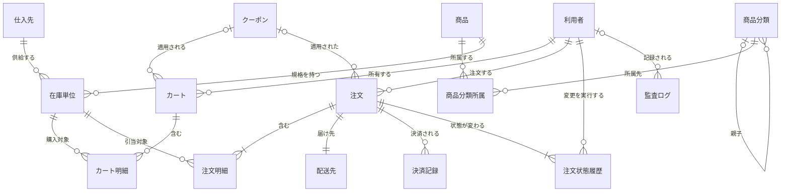

# データ要件定義書：MiniCommerce

## 0. 文書管理

### 0.1 改訂履歴

| 版数 | 日付 | 改訂内容 | 作成・改訂者 |
|---|---|---|---|
| 1.0 | 2026-10-09 | 初版作成 | MiniCommerce 要件定義チーム |
| 1.1 | 2026-11-09 | 設計情報（API物理仕様・物理名・実装方式・画面配置等）を削除し要件表現に整理 | MiniCommerce 要件定義チーム |

## 1. 本書の目的と適用範囲

### 1.1 目的

本書は、MiniCommerce が保持・管理するデータについて、データ項目、意味、形式、品質、保存期間、件数、機密区分、更新・参照ルールを定義することを目的とする。

### 1.2 適用範囲

| 区分 | 内容 |
|---|---|
| 本書で定義する | MiniCommerce が保持・管理する業務データ15件（D-01 利用者〜D-15 監査ログ）の項目・意味・形式、コード値、品質・整合性ルール、データ量、保存期間、機密区分・個人情報、更新・参照ルール、稼働開始時の初期データ |
| 本書で定義しない | 論理データモデルの詳細化（正規化）および物理設計（テーブル定義、インデックス、物理データ型、パーティション、ストレージ構成） |
| 本書で定義しない | 内部的な採番方式、データの取扱い要件の実現方式（暗号化方式、マスク処理の実装方法） |
| 本書で定義しない | ログイン状態の保持に関する情報、システムの運用ログ（アプリケーションログ等）、バックアップデータ。監査ログは D-15 として本書で定義する |
| 本書で定義しない | 本システムの外で管理する情報（在庫管理表による入荷・在庫補充の記録、返品・返金の記録、初期データの定義ファイルそのもの、決済代行事業者・配送業者が保持する情報） |
| 本書で用いる利用者区分 | 来訪者（ACT-001：ログインしていない閲覧者）、購入者（ACT-002：会員登録済みでログインした利用者）、管理者（ACT-003：EC運営担当・出荷担当。カート・注文確定・支払は行わない）、運用者（ACT-005：システム運用担当。運用の手順に従って初期データ一括投入と保存期間経過データの削除を行う。画面・Web API は使わない）、システム（本システムが利用者の操作を契機に自動で行う処理）の5区分とし、本書のすべての表でこの名称を用いる。決済サービス（模擬）（ACT-004）は本システム内の模擬機能であり、本書では利用者区分として扱わず、その応答に基づくデータの登録はシステムが行う |

## 2. データ全体像

### 2.1 データ（エンティティ）一覧

| データID | データ名 | 意味・説明 | 種別 | 発生源 | 主な利用者 | 件数見込み参照 |
|---|---|---|---|---|---|---|
| D-01 | 利用者 | 本システムにログインする利用者（購入者・管理者）のメールアドレス・パスワード（照合用）・氏名・利用者区分 | マスタ | 利用者入力（来訪者が会員登録で購入者として登録。ログイン中の購入者・管理者が会員登録を行った場合も購入者として登録）、初期投入（運用者が初期データ一括投入で管理者・購入者を登録） | 来訪者、購入者、管理者、運用者 | 6章参照 |
| D-02 | 仕入先 | 在庫単位の仕入元の事業者 | マスタ | 初期投入（運用者が初期データ一括投入で登録） | 管理者、運用者 | 6章参照 |
| D-03 | 商品分類 | 商品を分類する最大3階層の木構造の分類 | マスタ | 初期投入（運用者が初期データ一括投入で登録） | 来訪者、購入者、管理者、運用者 | 6章参照 |
| D-04 | 商品 | 販売する商品の名称・説明・公開状態 | マスタ | 初期投入（運用者が初期データ一括投入で登録） | 来訪者、購入者、管理者、運用者 | 6章参照 |
| D-05 | 商品分類所属 | 商品と商品分類の所属関係（どの商品がどの商品分類に所属するか） | マスタ | 初期投入（運用者が初期データ一括投入で登録） | 来訪者、購入者、管理者、運用者 | 6章参照 |
| D-06 | 在庫単位 | 商品の規格ごとの販売単位（SKU単位）。SKU・規格名・税抜価格・在庫数量を持つ | マスタ | 初期投入（運用者が初期データ一括投入で登録）、システム生成（注文確定時に在庫数量を減算、注文キャンセル時に在庫数量を加算） | 来訪者、購入者、管理者、運用者、システム | 6章参照 |
| D-07 | クーポン | カートに1枚まで適用できる割引の定義（割引方式・割引値・最低購入金額・有効期間） | マスタ | 初期投入（運用者が初期データ一括投入で登録） | 購入者、運用者 | 6章参照 |
| D-08 | カート | 購入者が注文確定の前に購入する在庫単位を集める入れ物と、適用中のクーポン | トランザクション | システム生成（購入者のカート照会・カート操作時に利用中のカートが無い場合に作成。注文確定の成功時に注文済へ変更） | 購入者、運用者、システム | 6章参照 |
| D-09 | カート明細 | カート内の在庫単位ごとの数量 | トランザクション | 利用者入力（購入者が明細の追加・数量変更・削除を行う） | 購入者、運用者 | 6章参照 |
| D-10 | 注文 | 注文確定で作成される注文の注文番号・状態・金額・日時 | トランザクション | システム生成（購入者の注文確定時に作成。支払・キャンセル・出荷登録・配達完了登録で状態を変更） | 購入者、管理者、運用者、システム | 6章参照 |
| D-11 | 注文明細 | 注文確定時点の在庫単位ごとのSKU・商品名・規格名・税抜単価・数量の複写 | トランザクション | システム生成（注文確定時にカート明細・在庫単位・商品から複写） | 購入者、管理者、運用者、システム | 6章参照 |
| D-12 | 配送先 | 注文の届け先の受取人氏名・住所・電話番号 | トランザクション | 利用者入力（購入者が注文確定時に入力） | 購入者、管理者、運用者 | 6章参照 |
| D-13 | 決済記録 | 支払の実行1回ごとの決済サービス（模擬）の結果・金額・取引参照番号 | 履歴 | システム生成（購入者の支払操作に対する決済サービス（模擬）の応答、または応答なし・応答不正の判定から生成） | 管理者、運用者、システム | 6章参照 |
| D-14 | 注文状態履歴 | 注文状態の変更1回ごとの変更前後の状態・変更日時・実行者 | 履歴 | システム生成（注文状態が変わるたびに生成） | 購入者、管理者、運用者、システム | 6章参照 |
| D-15 | 監査ログ | ログイン成功・ログイン失敗・ログアウト・初期データ一括投入の実行記録 | 業務記録 | システム生成（ログイン成功・失敗、ログアウト、初期データ一括投入の実行時） | 運用者、システム | 6章参照 |

### 2.2 データ間の関連

| ID | 関連元データ | 関連先データ | 関連の意味 | 多重度 |
|---|---|---|---|---|
| REL-01 | 利用者 | カート | 購入者はカートを所有する。カート状態が利用中のカートは購入者1名につき最大1件、注文済のカートは複数件 | 1:0..N |
| REL-02 | 利用者 | 注文 | 購入者は注文を行う | 1:0..N |
| REL-03 | 仕入先 | 在庫単位 | 仕入先は在庫単位を供給する。在庫単位の仕入先は1件 | 1:0..N |
| REL-04 | 商品分類 | 商品分類 | 親の商品分類は子の商品分類を持つ（最大3階層）。子から見た親は0件（最上位）または1件 | 1:0..N |
| REL-05 | 商品 | 商品分類所属 | 商品は0件以上の商品分類に所属する | 1:0..N |
| REL-06 | 商品分類 | 商品分類所属 | 商品分類には0件以上の商品が所属する | 1:0..N |
| REL-07 | 商品 | 在庫単位 | 商品は規格ごとの在庫単位を持つ。在庫単位を1件も持たない商品は来訪者・購入者に提供しない | 1:0..N |
| REL-08 | クーポン | カート | クーポンはカートに適用される。カートから見たクーポンは0件または1件 | 1:0..N |
| REL-09 | カート | カート明細 | カートは明細を持つ | 1:0..N |
| REL-10 | 在庫単位 | カート明細 | カート明細は購入する在庫単位を1件指す | 1:0..N |
| REL-11 | クーポン | 注文 | 注文確定時にカートに適用していたクーポンが注文に関連付く。注文から見たクーポンは0件または1件 | 1:0..N |
| REL-12 | 注文 | 注文明細 | 注文は1件以上の注文明細を持つ | 1:N |
| REL-13 | 在庫単位 | 注文明細 | 注文明細は注文確定時に引き当てた在庫単位を1件指す | 1:0..N |
| REL-14 | 注文 | 配送先 | 注文は配送先を1件持つ | 1:1 |
| REL-15 | 注文 | 決済記録 | 注文は支払の実行ごとの決済記録を持つ | 1:0..N |
| REL-16 | 注文 | 注文状態履歴 | 注文は状態の変更ごとの履歴を持つ（注文確定時の1件を含む） | 1:N |
| REL-17 | 利用者 | 注文状態履歴 | 購入者または管理者が注文状態の変更を実行した記録 | 1:0..N |
| REL-18 | 利用者 | 監査ログ | 利用者のログイン・ログアウトの記録。利用者を特定できない記録は利用者に関連付かない | 1:0..N |

## 3. データ項目定義

### 3.1 利用者

| 項目 | 内容 |
|---|---|
| データID | D-01 |
| データ名 | 利用者 |
| 識別子 | 利用者ID |
| 複合一意条件 | 該当なし |
| 状態を表す項目 | 該当なし |
| 備考 | 購入者と管理者の両方を保持する。管理者は初期データ一括投入でのみ登録する。パスワードの平文は保持しない。本リリースには会員情報の変更・パスワード再設定・退会の機能はない |

| 項目ID | 項目名 | 意味・説明 | データ形式 | 桁・長さ | 必須 | 一意 | 値域・書式 | 初期値 | 導出・計算ルール | 機密区分 | 備考 |
|---|---|---|---|---|---|---|---|---|---|---|---|
| D-01-01 | 利用者ID | 利用者を一意に識別する値 | 整数 | 該当なし | 必須 | 一意 | 1以上の整数 | 該当なし | システムが付与（登録時） | 社外秘 | 該当なし |
| D-01-02 | メールアドレス | ログインに用いる利用者のメールアドレス | 文字列 | 1〜254 | 必須 | 一意 | メールアドレス形式（「ローカル部@ドメイン部」、空白を含まない）。英字は小文字のみ | 該当なし | 入力値の前後の空白を除去し、全体の英字を小文字に変換した値を設定 | 機密 | 一意性は変換後の値で判定する（DQ-01） |
| D-01-03 | パスワード（照合用） | ログイン時にパスワードを照合するための情報 | 文字列 | 該当なし | 必須 | － | 該当なし（パスワードを平文・復号可能な形式で保持しない） | 該当なし | 会員登録または初期データ一括投入で受け取ったパスワードから設定 | 厳秘 | 画面・API・ログに出力しない |
| D-01-04 | 氏名 | 利用者の氏名 | 文字列 | 1〜50 | 必須 | － | 前後の空白を除去した後に1〜50文字 | 該当なし | 入力値の前後の空白を除去した値を設定 | 機密 | 該当なし |
| D-01-05 | 利用者区分 | 利用者が購入者・管理者のどちらとして本システムを利用するかを表す区分 | コード | 該当なし | 必須 | － | CD-01 | 購入者（会員登録時） | 会員登録時は購入者を設定。初期データ一括投入では指定された値を設定 | 社外秘 | 該当なし |
| D-01-06 | 登録日時 | 利用者を登録した日時 | 日時 | 該当なし | 必須 | － | 日本時間 | 該当なし | 登録処理時のシステム日時を設定 | 社外秘 | 該当なし |

### 3.2 仕入先

| 項目 | 内容 |
|---|---|
| データID | D-02 |
| データ名 | 仕入先 |
| 識別子 | 仕入先ID |
| 複合一意条件 | 該当なし |
| 状態を表す項目 | 該当なし |
| 備考 | 在庫単位の仕入元。来訪者・購入者には提供しない。初期データ一括投入では仕入先コードで参照する |

| 項目ID | 項目名 | 意味・説明 | データ形式 | 桁・長さ | 必須 | 一意 | 値域・書式 | 初期値 | 導出・計算ルール | 機密区分 | 備考 |
|---|---|---|---|---|---|---|---|---|---|---|---|
| D-02-01 | 仕入先ID | 仕入先を一意に識別する値 | 整数 | 該当なし | 必須 | 一意 | 1以上の整数 | 該当なし | システムが付与（登録時） | 社外秘 | 該当なし |
| D-02-02 | 仕入先コード | 仕入先を業務上識別するコード | 文字列 | 1〜20 | 必須 | 一意 | 半角英大文字・半角数字・ハイフンのみ | 該当なし | 該当なし | 社外秘 | 初期データ一括投入の業務キー |
| D-02-03 | 仕入先名 | 仕入先の名称 | 文字列 | 1〜100 | 必須 | － | 1〜100文字 | 該当なし | 該当なし | 社外秘 | 該当なし |

### 3.3 商品分類

| 項目 | 内容 |
|---|---|
| データID | D-03 |
| データ名 | 商品分類 |
| 識別子 | 商品分類ID |
| 複合一意条件 | 親分類＋分類名。最上位の分類（親分類が値なし）どうしでも分類名は一意（DQ-04） |
| 状態を表す項目 | 該当なし |
| 備考 | 最大3階層の木構造。公開状態は持たず、全分類を来訪者・購入者・管理者に提供する。初期データ一括投入では親の分類を分類コードで指定する |

| 項目ID | 項目名 | 意味・説明 | データ形式 | 桁・長さ | 必須 | 一意 | 値域・書式 | 初期値 | 導出・計算ルール | 機密区分 | 備考 |
|---|---|---|---|---|---|---|---|---|---|---|---|
| D-03-01 | 商品分類ID | 商品分類を一意に識別する値 | 整数 | 該当なし | 必須 | 一意 | 1以上の整数 | 該当なし | システムが付与（登録時） | 公開 | 該当なし |
| D-03-02 | 分類コード | 商品分類を業務上識別するコード | 文字列 | 1〜30 | 必須 | 一意 | 半角英小文字・半角数字・ハイフンのみ | 該当なし | 該当なし | 公開 | 初期データ一括投入の業務キー |
| D-03-03 | 分類名 | 商品分類の名称 | 文字列 | 1〜50 | 必須 | － | 1〜50文字 | 該当なし | 該当なし | 公開 | 同じ親の中で一意（DQ-04） |
| D-03-04 | 親分類 | 1階層上の商品分類 | 該当なし（関連） | 該当なし | 任意 | － | 登録済みの商品分類。自分自身と自分の配下の分類は不可 | 値なし（最上位の分類） | 初期データ一括投入で親の分類コードにより指定 | 公開 | 最上位の分類は値なし |
| D-03-05 | 深さ | 木構造での階層の深さ | 整数 | 1桁 | 必須 | － | 1以上3以下 | 該当なし | 親分類が値なしの場合は1、値ありの場合は親の深さ＋1（登録時に設定） | 公開 | DQ-17。商品分類一覧照会（FR-010）で「階層」として提供する |
| D-03-06 | 表示順 | 同じ親の中での表示順 | 整数 | 3桁 | 必須 | － | 0以上999以下 | 0 | 該当なし | 公開 | 小さい値ほど先に表示する |

### 3.4 商品

| 項目 | 内容 |
|---|---|
| データID | D-04 |
| データ名 | 商品 |
| 識別子 | 商品ID |
| 複合一意条件 | 該当なし |
| 状態を表す項目 | 該当なし（公開状態は真偽の項目として扱い、コード値を持たない） |
| 備考 | 規格ごとの価格・在庫数量は在庫単位で保持する。最低税抜価格（在庫単位の税抜価格の最小値）、最低税込価格（最低税抜価格×110÷100 の1円未満切り捨て）、在庫有無（在庫数量1以上の在庫単位が1件以上あれば「在庫あり」）は、在庫単位の現在の値から算出する |

| 項目ID | 項目名 | 意味・説明 | データ形式 | 桁・長さ | 必須 | 一意 | 値域・書式 | 初期値 | 導出・計算ルール | 機密区分 | 備考 |
|---|---|---|---|---|---|---|---|---|---|---|---|
| D-04-01 | 商品ID | 商品を一意に識別する値 | 整数 | 該当なし | 必須 | 一意 | 1以上の整数 | 該当なし | システムが付与（登録時） | 公開 | 該当なし |
| D-04-02 | 商品コード | 商品を業務上識別するコード | 文字列 | 1〜20 | 必須 | 一意 | 半角英大文字・半角数字・ハイフンのみ | 該当なし | 該当なし | 公開 | 初期データ一括投入の業務キー |
| D-04-03 | 商品名 | 商品の名称 | 文字列 | 1〜100 | 必須 | － | 1〜100文字 | 該当なし | 該当なし | 公開 | キーワード検索の対象 |
| D-04-04 | 商品説明 | 商品の説明文 | 文字列 | 0〜2000 | 任意 | － | 0〜2000文字 | 0文字の文字列 | 該当なし | 公開 | キーワード検索の対象 |
| D-04-05 | 公開状態 | 来訪者・購入者に商品を提供するかどうか | 真偽 | 該当なし | 必須 | － | 公開／非公開 | 公開 | 該当なし | 公開 | 非公開の商品とその在庫単位は来訪者・購入者に提供せず、カートへの追加・注文確定もできない |
| D-04-06 | 登録日時 | 商品を登録した日時 | 日時 | 該当なし | 必須 | － | 日本時間 | 投入処理時のシステム日時 | 定義ファイルで指定した値を設定。省略時は投入処理時のシステム日時を設定 | 公開 | 新着順の並び順に使う |

### 3.5 商品分類所属

| 項目 | 内容 |
|---|---|
| データID | D-05 |
| データ名 | 商品分類所属 |
| 識別子 | 所属する商品＋所属先の商品分類 |
| 複合一意条件 | 所属する商品＋所属先の商品分類（DQ-06） |
| 状態を表す項目 | 該当なし |
| 備考 | 商品と商品分類の所属関係。商品は0件以上の商品分類に所属する。初期データ一括投入では商品コードと分類コードで指定する |

| 項目ID | 項目名 | 意味・説明 | データ形式 | 桁・長さ | 必須 | 一意 | 値域・書式 | 初期値 | 導出・計算ルール | 機密区分 | 備考 |
|---|---|---|---|---|---|---|---|---|---|---|---|
| D-05-01 | 所属する商品 | 商品分類に所属する商品 | 該当なし（関連） | 該当なし | 必須 | － | 登録済みの商品 | 該当なし | 初期データ一括投入で商品コードにより指定 | 公開 | 該当なし |
| D-05-02 | 所属先の商品分類 | 商品が所属する商品分類 | 該当なし（関連） | 該当なし | 必須 | － | 登録済みの商品分類 | 該当なし | 初期データ一括投入で分類コードにより指定 | 公開 | 該当なし |

### 3.6 在庫単位

| 項目 | 内容 |
|---|---|
| データID | D-06 |
| データ名 | 在庫単位 |
| 識別子 | 在庫単位ID |
| 複合一意条件 | 該当なし |
| 状態を表す項目 | 該当なし |
| 備考 | 商品の規格ごとの販売単位（SKU単位）。税込価格（税抜価格×110÷100 の1円未満切り捨て）、在庫有無（在庫数量1以上で「在庫あり」）、低在庫（在庫数量5以下で「低在庫」）は、在庫単位の現在の値から算出する。在庫数量はEC販売用の数量であり、実店舗の在庫とは分けて管理する |

| 項目ID | 項目名 | 意味・説明 | データ形式 | 桁・長さ | 必須 | 一意 | 値域・書式 | 初期値 | 導出・計算ルール | 機密区分 | 備考 |
|---|---|---|---|---|---|---|---|---|---|---|---|
| D-06-01 | 在庫単位ID | 在庫単位を一意に識別する値 | 整数 | 該当なし | 必須 | 一意 | 1以上の整数 | 該当なし | システムが付与（登録時） | 公開 | 該当なし |
| D-06-02 | 所属する商品 | 在庫単位が属する商品 | 該当なし（関連） | 該当なし | 必須 | － | 登録済みの商品 | 該当なし | 初期データ一括投入で商品コードにより指定 | 公開 | 該当なし |
| D-06-03 | 仕入先 | 在庫単位の仕入先 | 該当なし（関連） | 該当なし | 必須 | － | 登録済みの仕入先 | 該当なし | 初期データ一括投入で仕入先コードにより指定 | 社外秘 | 来訪者・購入者には提供しない |
| D-06-04 | SKU | 在庫単位を識別するコード | 文字列 | 1〜32 | 必須 | 一意 | 半角英大文字・半角数字・ハイフンのみ | 該当なし | 該当なし | 公開 | 初期データ一括投入の業務キー |
| D-06-05 | 規格名 | 在庫単位の規格を表す名称（例「ブルー／M」） | 文字列 | 1〜50 | 必須 | － | 1〜50文字 | 該当なし | 該当なし | 公開 | 該当なし |
| D-06-06 | 税抜価格 | 在庫単位1個あたりの税抜の販売価格 | 整数 | 7桁 | 必須 | － | 0以上9,999,999以下（円） | 該当なし | 該当なし | 公開 | 購入者への表示は税込価格（備考の算出式） |
| D-06-07 | 在庫数量 | 販売可能な数量 | 整数 | 5桁 | 必須 | － | 0以上99,999以下 | 該当なし | 初期データ一括投入で設定。注文確定時にその注文の注文明細の数量を減算し、注文キャンセル時に加算する | 公開 | 0未満にならない（DQ-18） |
| D-06-08 | 更新日時 | 在庫単位を最後に変更した日時 | 日時 | 該当なし | 必須 | － | 日本時間 | 該当なし | 登録時、および在庫数量の変更時のシステム日時を設定 | 社外秘 | 該当なし |

### 3.7 クーポン

| 項目 | 内容 |
|---|---|
| データID | D-07 |
| データ名 | クーポン |
| 識別子 | クーポンコード |
| 複合一意条件 | 該当なし |
| 状態を表す項目 | 該当なし |
| 備考 | 利用回数の上限は持たない（有効期間内であれば利用者・注文の回数を制限しない）。クーポンの一覧は購入者に提供せず、購入者はコードを入力して適用する |

| 項目ID | 項目名 | 意味・説明 | データ形式 | 桁・長さ | 必須 | 一意 | 値域・書式 | 初期値 | 導出・計算ルール | 機密区分 | 備考 |
|---|---|---|---|---|---|---|---|---|---|---|---|
| D-07-02 | クーポンコード | 購入者がカートに適用するときに入力するコード | 文字列 | 1〜20 | 必須 | 一意 | 半角英大文字・半角数字・ハイフンのみ | 該当なし | 該当なし | 社外秘 | 初期データ一括投入の業務キー |
| D-07-03 | クーポン名 | クーポンの表示名 | 文字列 | 1〜50 | 必須 | － | 1〜50文字 | 該当なし | 該当なし | 社外秘 | 該当なし |
| D-07-04 | 割引方式 | 定額割引か定率割引か | コード | 該当なし | 必須 | － | CD-03 | 該当なし | 該当なし | 社外秘 | 該当なし |
| D-07-05 | 割引値 | 定額のときは割引する金額（円）、定率のときは割引率（%） | 整数 | 7桁 | 必須 | － | 定額：1以上9,999,999以下（円）。定率：1以上100以下（%） | 該当なし | 該当なし | 社外秘 | DQ-16 |
| D-07-06 | 最低購入金額 | クーポンを適用できる小計（税抜・割引前）の下限 | 整数 | 7桁 | 必須 | － | 0以上9,999,999以下（円） | 0 | 該当なし | 社外秘 | 小計がこの値以上の場合に適用できる |
| D-07-07 | 有効開始日時 | クーポンを適用できる期間の開始日時 | 日時 | 該当なし | 必須 | － | 日本時間。有効終了日時以前 | 該当なし | 該当なし | 社外秘 | 開始日時ちょうどは有効期間に含む（判定は秒単位） |
| D-07-08 | 有効終了日時 | クーポンを適用できる期間の終了日時 | 日時 | 該当なし | 必須 | － | 日本時間。有効開始日時以降 | 該当なし | 該当なし | 社外秘 | 終了日時ちょうどは有効期間に含む（判定は秒単位） |

### 3.8 カート

| 項目 | 内容 |
|---|---|
| データID | D-08 |
| データ名 | カート |
| 識別子 | 該当なし（利用者が指定する識別子を持たない。利用中のカートは所有する購入者により特定する） |
| 複合一意条件 | 所有する購入者ごとに、カート状態が利用中のカートは最大1件（DQ-09） |
| 状態を表す項目 | カート状態：CD-04 |
| 備考 | 適用できるクーポンは1枚まで。適用中のクーポンが有効期間外・最低購入金額未満になっても自動では解除しない。金額（小計・割引額・割引後小計・送料・消費税額・合計）、クーポンの適用可否・適用不可理由、合計点数は、参照のたびに在庫単位の現在の税抜価格と現在日時で算出する（小計はカート明細の（現在の税抜価格×数量）の合計、割引額以降の算出式は DQ-22〜DQ-26 と同じ。明細0件の場合は全金額0、クーポンの条件を満たさない場合は割引額0） |

| 項目ID | 項目名 | 意味・説明 | データ形式 | 桁・長さ | 必須 | 一意 | 値域・書式 | 初期値 | 導出・計算ルール | 機密区分 | 備考 |
|---|---|---|---|---|---|---|---|---|---|---|---|
| D-08-02 | 所有する購入者 | カートを所有する購入者 | 該当なし（関連） | 該当なし | 必須 | － | 登録済みの利用者（利用者区分が購入者） | 該当なし | 作成時にログイン中の購入者を設定 | 社外秘 | 該当なし |
| D-08-03 | 適用中のクーポン | カートに適用中のクーポン | 該当なし（関連） | 該当なし | 任意 | － | 登録済みのクーポン | 値なし（未適用） | クーポン適用時に設定し、クーポン解除時に値なしにする | 社外秘 | 最大1枚 |
| D-08-04 | カート状態 | カートの状態 | コード | 該当なし | 必須 | － | CD-04 | 利用中 | カート状態の変更時に変更後の状態を設定 | 社外秘 | 該当なし |
| D-08-05 | 作成日時 | カートを作成した日時 | 日時 | 該当なし | 必須 | － | 日本時間 | 該当なし | 作成時のシステム日時を設定 | 社外秘 | 該当なし |
| D-08-06 | 更新日時 | カート・カート明細・適用クーポンを最後に変更した日時 | 日時 | 該当なし | 必須 | － | 日本時間 | 該当なし | 作成時、明細の追加・数量変更・削除時、クーポンの適用・解除で値が変わったとき、注文済への変更時のシステム日時を設定 | 社外秘 | 該当なし |
| D-08-07 | 注文済日時 | 注文確定によりカートが注文済になった日時 | 日時 | 該当なし | 条件付き必須 | － | 日本時間 | 値なし | 注文確定の成功時のシステム日時を設定 | 社外秘 | カート状態が注文済のとき必須、利用中のとき値なし（DQ-32） |

### 3.9 カート明細

| 項目 | 内容 |
|---|---|
| データID | D-09 |
| データ名 | カート明細 |
| 識別子 | カート明細ID |
| 複合一意条件 | 所属するカート＋購入する在庫単位（DQ-10） |
| 状態を表す項目 | 該当なし |
| 備考 | 単価（在庫単位の現在の税抜価格）、明細金額（単価×数量）、SKU・商品ID・商品名・規格名・在庫数量は、在庫単位・商品の現在の値による。カートへの追加では在庫数量を減らさない（在庫の引当は注文確定時のみ） |

| 項目ID | 項目名 | 意味・説明 | データ形式 | 桁・長さ | 必須 | 一意 | 値域・書式 | 初期値 | 導出・計算ルール | 機密区分 | 備考 |
|---|---|---|---|---|---|---|---|---|---|---|---|
| D-09-01 | カート明細ID | カート明細を一意に識別する値 | 整数 | 該当なし | 必須 | 一意 | 1以上の整数 | 該当なし | システムが付与（作成時） | 社外秘 | 該当なし |
| D-09-02 | 所属するカート | 明細が属するカート | 該当なし（関連） | 該当なし | 必須 | － | 登録済みのカート（明細の登録・変更時点でカート状態が利用中） | 該当なし | 明細の作成時に購入者の利用中のカートを設定 | 社外秘 | 該当なし |
| D-09-03 | 購入する在庫単位 | 購入する在庫単位 | 該当なし（関連） | 該当なし | 必須 | － | 登録済みの在庫単位（その商品の公開状態が公開） | 該当なし | 該当なし | 社外秘 | 該当なし |
| D-09-04 | 数量 | 購入する数量 | 整数 | 2桁 | 必須 | － | 1以上10以下 | 該当なし | 明細の追加で同一在庫単位の明細が既にある場合は既存の数量に入力値を加算した値を設定。それ以外は入力値を設定 | 社外秘 | 追加・数量変更の時点の在庫数量以下（DQ-19） |
| D-09-05 | 追加日時 | 明細を追加した日時 | 日時 | 該当なし | 必須 | － | 日本時間 | 該当なし | 明細の作成時のシステム日時を設定。既存明細への数量の加算・数量変更では変更しない | 社外秘 | 明細の並び順（カートへ追加した順）の基準とする |

### 3.10 注文

| 項目 | 内容 |
|---|---|
| データID | D-10 |
| データ名 | 注文 |
| 識別子 | 注文ID |
| 複合一意条件 | 該当なし |
| 状態を表す項目 | 注文状態：CD-02 |
| 備考 | 金額はすべて整数の円とし、注文確定時点の在庫単位の税抜価格と確定時刻で算出して確定し、以後変更しない。合計点数（注文明細の数量の合計）は注文明細から算出する |

| 項目ID | 項目名 | 意味・説明 | データ形式 | 桁・長さ | 必須 | 一意 | 値域・書式 | 初期値 | 導出・計算ルール | 機密区分 | 備考 |
|---|---|---|---|---|---|---|---|---|---|---|---|
| D-10-01 | 注文ID | 注文を一意に識別する値 | 整数 | 該当なし | 必須 | 一意 | 1以上の整数 | 該当なし | システムが付与（注文確定時） | 社外秘 | 該当なし |
| D-10-02 | 注文番号 | 購入者・管理者に表示する注文の番号 | 文字列 | 11（固定長） | 必須 | 一意 | 「PO-」に続く半角数字8桁（例 PO-00000001） | 該当なし | 注文確定時に設定。8桁の数字は先頭を0で埋め、確定の順に大きくなる値とする。欠番は許容する | 社外秘 | 該当なし |
| D-10-03 | 注文した購入者 | 注文した購入者 | 該当なし（関連） | 該当なし | 必須 | － | 登録済みの利用者（利用者区分が購入者） | 該当なし | 注文確定時にログイン中の購入者を設定 | 社外秘 | 該当なし |
| D-10-04 | 注文状態 | 注文の状態 | コード | 該当なし | 必須 | － | CD-02 | 注文受付 | 注文状態の変更時に変更後の状態を設定 | 社外秘 | 状態と日時の整合は DQ-30 |
| D-10-05 | 適用したクーポン | 注文確定時にカートに適用していたクーポン | 該当なし（関連） | 該当なし | 任意 | － | 登録済みのクーポン | 値なし（クーポン未適用） | 注文確定時にカートの適用中のクーポンを設定 | 社外秘 | 該当なし |
| D-10-06 | クーポンコード | 注文確定時のクーポンコードの複写 | 文字列 | 1〜20 | 条件付き必須 | － | 半角英大文字・半角数字・ハイフンのみ | 値なし | 注文確定時にクーポンのクーポンコードを複写 | 社外秘 | 適用したクーポンがあるとき必須、ないとき値なし（DQ-27） |
| D-10-07 | 割引方式 | 注文確定時のクーポンの割引方式の複写 | コード | 該当なし | 条件付き必須 | － | CD-03 | 値なし | 注文確定時にクーポンの割引方式を複写 | 社外秘 | 同上 |
| D-10-08 | 割引値 | 注文確定時のクーポンの割引値の複写 | 整数 | 7桁 | 条件付き必須 | － | 定額：1以上9,999,999以下（円）。定率：1以上100以下（%） | 値なし | 注文確定時にクーポンの割引値を複写 | 社外秘 | 同上 |
| D-10-09 | 小計 | 税抜・割引前の商品代金の合計 | 整数 | 該当なし（上限を設けない） | 必須 | － | 0以上の整数（円） | 該当なし | 注文明細の明細金額の合計（DQ-21） | 社外秘 | 該当なし |
| D-10-10 | 割引額 | クーポンによる割引額 | 整数 | 該当なし（上限を設けない） | 必須 | － | 0以上、小計以下の整数（円） | 0 | クーポン未適用は0。定額は割引値と小計の小さい方。定率は 小計×割引率÷100 の1円未満切り捨て（DQ-22） | 社外秘 | 該当なし |
| D-10-11 | 割引後小計 | 小計から割引額を差し引いた額 | 整数 | 該当なし（上限を設けない） | 必須 | － | 0以上の整数（円） | 該当なし | 小計－割引額（DQ-23） | 社外秘 | 該当なし |
| D-10-12 | 送料 | 注文の送料（全国一律） | 整数 | 3桁 | 必須 | － | 0 または 500（円） | 該当なし | 割引後小計が5,000円以上なら0、5,000円未満なら500（DQ-24） | 社外秘 | 該当なし |
| D-10-13 | 消費税額 | 割引後小計と送料に対する消費税額（税率10%） | 整数 | 該当なし（上限を設けない） | 必須 | － | 0以上の整数（円） | 該当なし | （割引後小計＋送料）×10÷100 の1円未満切り捨て（DQ-25） | 社外秘 | 該当なし |
| D-10-14 | 合計金額 | 購入者が支払う税込の合計金額 | 整数 | 該当なし（上限を設けない） | 必須 | － | 0以上の整数（円） | 該当なし | 割引後小計＋送料＋消費税額（DQ-26） | 社外秘 | 決済金額として用いる |
| D-10-15 | 注文日時 | 注文を確定した日時 | 日時 | 該当なし | 必須 | － | 日本時間 | 該当なし | 注文確定時のシステム日時を設定 | 社外秘 | 保存期間の起算日 |
| D-10-16 | 支払日時 | 支払が承認された日時 | 日時 | 該当なし | 条件付き必須 | － | 日本時間 | 値なし | 支払の承認を反映した時点のシステム日時を設定 | 社外秘 | 注文状態が支払済・出荷済・配達完了のとき必須（DQ-30） |
| D-10-17 | 出荷日時 | 出荷を登録した日時 | 日時 | 該当なし | 条件付き必須 | － | 日本時間 | 値なし | 出荷登録時のシステム日時を設定 | 社外秘 | 注文状態が出荷済・配達完了のとき必須（DQ-30） |
| D-10-18 | 配達完了日時 | 配達完了を登録した日時 | 日時 | 該当なし | 条件付き必須 | － | 日本時間 | 値なし | 配達完了登録時のシステム日時を設定 | 社外秘 | 注文状態が配達完了のとき必須（DQ-30） |
| D-10-19 | キャンセル日時 | 注文をキャンセルした日時 | 日時 | 該当なし | 条件付き必須 | － | 日本時間 | 値なし | キャンセル時のシステム日時を設定 | 社外秘 | 注文状態がキャンセル済のとき必須（DQ-30） |
| D-10-20 | 配送伝票番号 | 配送業者の伝票番号 | 文字列 | 1〜30 | 任意 | － | 半角英字（大文字・小文字）・半角数字・ハイフンのみ | 値なし | 該当なし | 社外秘 | 出荷登録時に管理者が任意で入力する。注文状態が出荷済・配達完了のときのみ値を持てる（DQ-31） |

### 3.11 注文明細

| 項目 | 内容 |
|---|---|
| データID | D-11 |
| データ名 | 注文明細 |
| 識別子 | 所属する注文＋引き当てた在庫単位 |
| 複合一意条件 | 所属する注文＋引き当てた在庫単位（DQ-12） |
| 状態を表す項目 | 該当なし |
| 備考 | 注文確定時にカート明細1件につき1件作成し、在庫単位・商品の確定時点の値を複写する。登録後は変更しない（在庫単位・商品の値が後で変わっても注文明細は変わらない）。注文詳細での明細の並びは、注文確定時のカートでの並び（カートへ追加した順）とし、登録後は変わらない |

| 項目ID | 項目名 | 意味・説明 | データ形式 | 桁・長さ | 必須 | 一意 | 値域・書式 | 初期値 | 導出・計算ルール | 機密区分 | 備考 |
|---|---|---|---|---|---|---|---|---|---|---|---|
| D-11-02 | 所属する注文 | 明細が属する注文 | 該当なし（関連） | 該当なし | 必須 | － | 登録済みの注文 | 該当なし | 注文確定時に作成した注文を設定 | 社外秘 | 該当なし |
| D-11-03 | 引き当てた在庫単位 | 引き当てた在庫単位 | 該当なし（関連） | 該当なし | 必須 | － | 登録済みの在庫単位 | 該当なし | カート明細の購入する在庫単位を設定 | 社外秘 | 該当なし |
| D-11-04 | SKU | 注文確定時の在庫単位のSKUの複写 | 文字列 | 1〜32 | 必須 | － | 半角英大文字・半角数字・ハイフンのみ | 該当なし | 注文確定時の在庫単位のSKUを複写 | 社外秘 | 該当なし |
| D-11-05 | 商品名 | 注文確定時の商品の商品名の複写 | 文字列 | 1〜100 | 必須 | － | 1〜100文字 | 該当なし | 注文確定時の商品の商品名を複写 | 社外秘 | 該当なし |
| D-11-06 | 規格名 | 注文確定時の在庫単位の規格名の複写 | 文字列 | 1〜50 | 必須 | － | 1〜50文字 | 該当なし | 注文確定時の在庫単位の規格名を複写 | 社外秘 | 該当なし |
| D-11-07 | 税抜単価 | 注文確定時の在庫単位の税抜価格の複写 | 整数 | 7桁 | 必須 | － | 0以上9,999,999以下（円） | 該当なし | 注文確定時の在庫単位の税抜価格を複写 | 社外秘 | 該当なし |
| D-11-08 | 数量 | 注文した数量 | 整数 | 2桁 | 必須 | － | 1以上10以下 | 該当なし | カート明細の数量を複写 | 社外秘 | 該当なし |
| D-11-09 | 明細金額 | 明細の税抜金額 | 整数 | 8桁 | 必須 | － | 0以上99,999,990以下（円） | 該当なし | 税抜単価×数量（DQ-20） | 社外秘 | 該当なし |

### 3.12 配送先

| 項目 | 内容 |
|---|---|
| データID | D-12 |
| データ名 | 配送先 |
| 識別子 | 対象の注文（注文1件につき1件） |
| 複合一意条件 | 該当なし |
| 状態を表す項目 | 該当なし |
| 備考 | 注文1件につき1件。購入者が注文確定時に入力し、登録後は変更しない。全項目を機密（個人情報）として扱う。入力値の前後の空白は除去してから判定・保持する |

| 項目ID | 項目名 | 意味・説明 | データ形式 | 桁・長さ | 必須 | 一意 | 値域・書式 | 初期値 | 導出・計算ルール | 機密区分 | 備考 |
|---|---|---|---|---|---|---|---|---|---|---|---|
| D-12-01 | 対象の注文 | 配送先が属する注文 | 該当なし（関連） | 該当なし | 必須 | 一意 | 登録済みの注文 | 該当なし | 注文確定時に作成した注文を設定 | 機密 | 注文と1対1（DQ-13） |
| D-12-02 | 受取人氏名 | 荷物を受け取る人の氏名 | 文字列 | 1〜50 | 必須 | － | 前後の空白を除去した後に1〜50文字 | 該当なし | 入力値の前後の空白を除去した値を設定 | 機密 | 該当なし |
| D-12-03 | 郵便番号 | 届け先の郵便番号 | 文字列 | 7（固定長） | 必須 | － | 半角数字7桁 | 該当なし | 入力値からハイフンを除去した値を設定 | 機密 | 該当なし |
| D-12-04 | 都道府県コード | 届け先の都道府県 | コード | 該当なし | 必須 | － | CD-06 | 該当なし | 該当なし | 機密 | 先頭の0を含む2文字の数字（例 01） |
| D-12-05 | 市区町村・番地 | 届け先の市区町村と番地 | 文字列 | 1〜100 | 必須 | － | 前後の空白を除去した後に1〜100文字 | 該当なし | 入力値の前後の空白を除去した値を設定 | 機密 | 該当なし |
| D-12-06 | 建物名・部屋番号 | 市区町村・番地より後の住所（建物名・部屋番号） | 文字列 | 0〜100 | 任意 | － | 0〜100文字 | 値なし | 入力値の前後の空白を除去した値を設定 | 機密 | 該当なし |
| D-12-07 | 電話番号 | 届け先の連絡先電話番号 | 文字列 | 10〜11 | 必須 | － | 半角数字10〜11桁 | 該当なし | 入力値からハイフンを除去した値を設定 | 機密 | 該当なし |

### 3.13 決済記録

| 項目 | 内容 |
|---|---|
| データID | D-13 |
| データ名 | 決済記録 |
| 識別子 | 該当なし（利用者が指定する識別子を持たない。1件ごとの識別方法は設計で決定する） |
| 複合一意条件 | 支払の対象の注文ごとに、決済結果が承認の決済記録は最大1件（DQ-14） |
| 状態を表す項目 | 決済結果：CD-05 |
| 備考 | 支払の実行1回につき1件を登録する（承認・否認・連携エラーのいずれも登録する）。注文状態が注文受付以外のため支払を受け付けなかった場合は登録しない。登録後は変更しない。支払済注文のキャンセル時も変更しない（返金は本システム外で行う）。決済サービス（模擬）の応答に含まれる否認理由コードは保持しない |

| 項目ID | 項目名 | 意味・説明 | データ形式 | 桁・長さ | 必須 | 一意 | 値域・書式 | 初期値 | 導出・計算ルール | 機密区分 | 備考 |
|---|---|---|---|---|---|---|---|---|---|---|---|
| D-13-02 | 支払の対象の注文 | 支払の対象の注文 | 該当なし（関連） | 該当なし | 必須 | － | 登録済みの注文 | 該当なし | 支払の対象の注文を設定 | 社外秘 | 該当なし |
| D-13-03 | 決済結果 | 支払の結果 | コード | 該当なし | 必須 | － | CD-05 | 該当なし | 決済サービス（模擬）の応答が承認なら承認、否認なら否認、応答待ちの上限時間内に応答がない場合・応答が不正な場合は連携エラーを設定 | 社外秘 | 該当なし |
| D-13-04 | 決済金額 | 決済サービス（模擬）に要求した金額 | 整数 | 該当なし（上限を設けない） | 必須 | － | 0以上の整数（円） | 該当なし | 決済要求時の注文の合計金額を設定 | 社外秘 | 通貨は日本円のみ |
| D-13-05 | 取引参照番号 | 決済サービスが承認時に返す取引の参照番号 | 文字列 | 21（固定長） | 条件付き必須 | － | 「MOCK-」に続く半角英数字16文字 | 値なし | 承認時の応答の取引参照番号を設定 | 社外秘 | 決済結果が承認のとき必須、否認・連携エラーのとき値なし（DQ-33） |
| D-13-06 | 処理日時 | 決済を処理した日時 | 日時 | 該当なし | 必須 | － | 日本時間 | 該当なし | 承認・否認は応答に含まれる処理日時を設定。連携エラーは本システムが連携エラーと判定した時点のシステム日時を設定 | 社外秘 | 管理者への表示は処理日時の昇順（同じ処理日時の場合は記録した順） |

### 3.14 注文状態履歴

| 項目 | 内容 |
|---|---|
| データID | D-14 |
| データ名 | 注文状態履歴 |
| 識別子 | 該当なし（利用者が指定する識別子を持たない。1件ごとの識別方法は設計で決定する） |
| 複合一意条件 | 該当なし |
| 状態を表す項目 | 変更前状態・変更後状態：CD-02 |
| 備考 | 注文状態が変わるたびに1件を登録し、登録後は変更しない。状態の変更がエラーになった場合は登録しない |

| 項目ID | 項目名 | 意味・説明 | データ形式 | 桁・長さ | 必須 | 一意 | 値域・書式 | 初期値 | 導出・計算ルール | 機密区分 | 備考 |
|---|---|---|---|---|---|---|---|---|---|---|---|
| D-14-02 | 対象の注文 | 状態が変わった注文 | 該当なし（関連） | 該当なし | 必須 | － | 登録済みの注文 | 該当なし | 状態が変わった注文を設定 | 社外秘 | 該当なし |
| D-14-03 | 変更前状態 | 変更直前の注文状態 | コード | 該当なし | 条件付き必須 | － | CD-02 | 値なし | 変更直前の注文の注文状態を設定 | 社外秘 | 注文確定時（変更後状態が注文受付）は値なし、それ以外は必須（DQ-35） |
| D-14-04 | 変更後状態 | 変更後の注文状態 | コード | 該当なし | 必須 | － | CD-02 | 該当なし | 変更後の注文の注文状態を設定 | 社外秘 | 該当なし |
| D-14-05 | 変更日時 | 注文状態を変更した日時 | 日時 | 該当なし | 必須 | － | 日本時間 | 該当なし | 状態変更時のシステム日時を設定 | 社外秘 | 表示は変更日時の昇順（同じ変更日時の場合は記録した順） |
| D-14-06 | 実行した利用者 | 状態の変更を実行した利用者 | 該当なし（関連） | 該当なし | 必須 | － | 登録済みの利用者 | 該当なし | 操作したログイン中の利用者を設定 | 社外秘 | 購入者には提供しない |
| D-14-07 | 実行者の利用者区分 | 状態の変更を実行した利用者の利用者区分 | コード | 該当なし | 必須 | － | CD-01 | 該当なし | 実行者の操作時点の利用者区分を設定 | 社外秘 | DQ-36 |

### 3.15 監査ログ

| 項目 | 内容 |
|---|---|
| データID | D-15 |
| データ名 | 監査ログ |
| 識別子 | 該当なし（利用者が指定する識別子を持たない。1件ごとの識別方法は設計で決定する） |
| 複合一意条件 | 該当なし |
| 状態を表す項目 | 該当なし |
| 備考 | ログイン成功・ログイン失敗・ログアウト・初期データ一括投入の実行を1件ずつ記録する。入力されたメールアドレス・パスワード、ログイン状態を示す情報、個人情報（メールアドレス・氏名・住所・電話番号）は記録しない。画面・APIの照会機能は持たない。登録後は変更しない |

| 項目ID | 項目名 | 意味・説明 | データ形式 | 桁・長さ | 必須 | 一意 | 値域・書式 | 初期値 | 導出・計算ルール | 機密区分 | 備考 |
|---|---|---|---|---|---|---|---|---|---|---|---|
| D-15-02 | 発生日時 | イベントが発生した日時 | 日時 | 該当なし | 必須 | － | 日本時間 | 該当なし | イベント発生時のシステム日時を設定 | 社外秘 | 保存期間の起算日 |
| D-15-03 | イベント種別 | 記録したイベントの種類 | コード | 該当なし | 必須 | － | CD-07 | 該当なし | イベントの種類に応じて設定 | 社外秘 | 該当なし |
| D-15-04 | 対象の利用者 | イベントの対象の利用者 | 該当なし（関連） | 該当なし | 条件付き必須 | － | 登録済みの利用者（初期データ一括投入の、既存データ（監査ログを除く）を削除してから投入する指定で削除された利用者を含む。DQ-48） | 値なし | ログイン成功・ログアウトはその利用者を設定。ログイン失敗は入力されたメールアドレスで利用者を特定できた場合はその利用者、特定できない場合は値なし（「不明」として扱う）。初期データ一括投入は値なし | 社外秘 | ログイン成功・ログアウトのとき必須（DQ-37） |
| D-15-05 | 結果 | イベントの結果 | コード | 該当なし | 必須 | － | CD-08 | 該当なし | ログイン成功・ログアウトは成功、ログイン失敗は失敗、初期データ一括投入は全件を投入できた場合は成功、投入しなかった場合は失敗を設定 | 社外秘 | 該当なし |
| D-15-06 | 詳細 | イベントの補足情報 | 文字列 | 0〜1000 | 任意 | － | 個人情報・パスワード・ログイン状態を示す情報を含まない文字列 | 値なし | 初期データ一括投入のとき、データ別の投入件数を設定（結果が失敗のときは全データ0件）。それ以外のイベントは値なし | 社外秘 | 該当なし |

## 4. コード値定義

| コードID | コード名 | 値（外部に出る場合） | 表示名 | 意味 | 有効/廃止 | 備考 |
|---|---|---|---|---|---|---|
| CD-01 | 利用者区分 | 設計で決定 | 購入者 | 会員登録済みでログインした利用者。カート・注文確定・支払・キャンセル・注文履歴の照会を行う | 有効 | 該当なし |
| CD-01 | 利用者区分 | 設計で決定 | 管理者 | EC運営担当・出荷担当。在庫単位・注文の照会、出荷登録・配達完了登録、注文キャンセルを行う。カート・注文確定・支払は行わない | 有効 | 初期データ一括投入でのみ登録する |
| CD-02 | 注文状態 | 設計で決定 | 注文受付 | 注文確定済みで支払前の状態（初期状態） | 有効 | 該当なし |
| CD-02 | 注文状態 | 設計で決定 | 支払済 | 模擬決済で承認され支払が完了した状態 | 有効 | 該当なし |
| CD-02 | 注文状態 | 設計で決定 | 出荷済 | 管理者が出荷を登録した状態 | 有効 | 該当なし |
| CD-02 | 注文状態 | 設計で決定 | 配達完了 | 管理者が配達完了を登録した状態（終端） | 有効 | 該当なし |
| CD-02 | 注文状態 | 設計で決定 | キャンセル済 | 注文受付または支払済の状態からキャンセルされた状態（終端） | 有効 | 該当なし |
| CD-03 | 割引方式 | 設計で決定 | 定額 | 割引値（円）を小計から割り引く（小計を上限とする） | 有効 | 該当なし |
| CD-03 | 割引方式 | 設計で決定 | 定率 | 小計に割引率（%）を乗じた額（1円未満切り捨て）を割り引く | 有効 | 該当なし |
| CD-04 | カート状態 | 設計で決定 | 利用中 | 購入者が操作中のカート（初期状態） | 有効 | 該当なし |
| CD-04 | カート状態 | 設計で決定 | 注文済 | 注文確定により注文になったカート（終端。以後変更しない） | 有効 | 該当なし |
| CD-05 | 決済結果 | 設計で決定 | 承認 | 決済サービス（模擬）が支払を承認した | 有効 | 該当なし |
| CD-05 | 決済結果 | 設計で決定 | 否認 | 決済サービス（模擬）が支払を否認した | 有効 | 該当なし |
| CD-05 | 決済結果 | 設計で決定 | 連携エラー | 決済サービス（模擬）から応答待ちの上限時間内に応答がない、または応答が不正だった | 有効 | 該当なし |
| CD-06 | 都道府県 | 01 | 北海道 | 都道府県コード（JIS X 0401） | 有効 | 値は先頭の0を含む2文字の数字 |
| CD-06 | 都道府県 | 02 | 青森県 | 都道府県コード（JIS X 0401） | 有効 | 該当なし |
| CD-06 | 都道府県 | 03 | 岩手県 | 都道府県コード（JIS X 0401） | 有効 | 該当なし |
| CD-06 | 都道府県 | 04 | 宮城県 | 都道府県コード（JIS X 0401） | 有効 | 該当なし |
| CD-06 | 都道府県 | 05 | 秋田県 | 都道府県コード（JIS X 0401） | 有効 | 該当なし |
| CD-06 | 都道府県 | 06 | 山形県 | 都道府県コード（JIS X 0401） | 有効 | 該当なし |
| CD-06 | 都道府県 | 07 | 福島県 | 都道府県コード（JIS X 0401） | 有効 | 該当なし |
| CD-06 | 都道府県 | 08 | 茨城県 | 都道府県コード（JIS X 0401） | 有効 | 該当なし |
| CD-06 | 都道府県 | 09 | 栃木県 | 都道府県コード（JIS X 0401） | 有効 | 該当なし |
| CD-06 | 都道府県 | 10 | 群馬県 | 都道府県コード（JIS X 0401） | 有効 | 該当なし |
| CD-06 | 都道府県 | 11 | 埼玉県 | 都道府県コード（JIS X 0401） | 有効 | 該当なし |
| CD-06 | 都道府県 | 12 | 千葉県 | 都道府県コード（JIS X 0401） | 有効 | 該当なし |
| CD-06 | 都道府県 | 13 | 東京都 | 都道府県コード（JIS X 0401） | 有効 | 該当なし |
| CD-06 | 都道府県 | 14 | 神奈川県 | 都道府県コード（JIS X 0401） | 有効 | 該当なし |
| CD-06 | 都道府県 | 15 | 新潟県 | 都道府県コード（JIS X 0401） | 有効 | 該当なし |
| CD-06 | 都道府県 | 16 | 富山県 | 都道府県コード（JIS X 0401） | 有効 | 該当なし |
| CD-06 | 都道府県 | 17 | 石川県 | 都道府県コード（JIS X 0401） | 有効 | 該当なし |
| CD-06 | 都道府県 | 18 | 福井県 | 都道府県コード（JIS X 0401） | 有効 | 該当なし |
| CD-06 | 都道府県 | 19 | 山梨県 | 都道府県コード（JIS X 0401） | 有効 | 該当なし |
| CD-06 | 都道府県 | 20 | 長野県 | 都道府県コード（JIS X 0401） | 有効 | 該当なし |
| CD-06 | 都道府県 | 21 | 岐阜県 | 都道府県コード（JIS X 0401） | 有効 | 該当なし |
| CD-06 | 都道府県 | 22 | 静岡県 | 都道府県コード（JIS X 0401） | 有効 | 該当なし |
| CD-06 | 都道府県 | 23 | 愛知県 | 都道府県コード（JIS X 0401） | 有効 | 該当なし |
| CD-06 | 都道府県 | 24 | 三重県 | 都道府県コード（JIS X 0401） | 有効 | 該当なし |
| CD-06 | 都道府県 | 25 | 滋賀県 | 都道府県コード（JIS X 0401） | 有効 | 該当なし |
| CD-06 | 都道府県 | 26 | 京都府 | 都道府県コード（JIS X 0401） | 有効 | 該当なし |
| CD-06 | 都道府県 | 27 | 大阪府 | 都道府県コード（JIS X 0401） | 有効 | 該当なし |
| CD-06 | 都道府県 | 28 | 兵庫県 | 都道府県コード（JIS X 0401） | 有効 | 該当なし |
| CD-06 | 都道府県 | 29 | 奈良県 | 都道府県コード（JIS X 0401） | 有効 | 該当なし |
| CD-06 | 都道府県 | 30 | 和歌山県 | 都道府県コード（JIS X 0401） | 有効 | 該当なし |
| CD-06 | 都道府県 | 31 | 鳥取県 | 都道府県コード（JIS X 0401） | 有効 | 該当なし |
| CD-06 | 都道府県 | 32 | 島根県 | 都道府県コード（JIS X 0401） | 有効 | 該当なし |
| CD-06 | 都道府県 | 33 | 岡山県 | 都道府県コード（JIS X 0401） | 有効 | 該当なし |
| CD-06 | 都道府県 | 34 | 広島県 | 都道府県コード（JIS X 0401） | 有効 | 該当なし |
| CD-06 | 都道府県 | 35 | 山口県 | 都道府県コード（JIS X 0401） | 有効 | 該当なし |
| CD-06 | 都道府県 | 36 | 徳島県 | 都道府県コード（JIS X 0401） | 有効 | 該当なし |
| CD-06 | 都道府県 | 37 | 香川県 | 都道府県コード（JIS X 0401） | 有効 | 該当なし |
| CD-06 | 都道府県 | 38 | 愛媛県 | 都道府県コード（JIS X 0401） | 有効 | 該当なし |
| CD-06 | 都道府県 | 39 | 高知県 | 都道府県コード（JIS X 0401） | 有効 | 該当なし |
| CD-06 | 都道府県 | 40 | 福岡県 | 都道府県コード（JIS X 0401） | 有効 | 該当なし |
| CD-06 | 都道府県 | 41 | 佐賀県 | 都道府県コード（JIS X 0401） | 有効 | 該当なし |
| CD-06 | 都道府県 | 42 | 長崎県 | 都道府県コード（JIS X 0401） | 有効 | 該当なし |
| CD-06 | 都道府県 | 43 | 熊本県 | 都道府県コード（JIS X 0401） | 有効 | 該当なし |
| CD-06 | 都道府県 | 44 | 大分県 | 都道府県コード（JIS X 0401） | 有効 | 該当なし |
| CD-06 | 都道府県 | 45 | 宮崎県 | 都道府県コード（JIS X 0401） | 有効 | 該当なし |
| CD-06 | 都道府県 | 46 | 鹿児島県 | 都道府県コード（JIS X 0401） | 有効 | 該当なし |
| CD-06 | 都道府県 | 47 | 沖縄県 | 都道府県コード（JIS X 0401） | 有効 | 該当なし |
| CD-07 | 監査イベント種別 | 設計で決定 | ログイン成功 | メールアドレスとパスワードが一致しログインに成功した | 有効 | 該当なし |
| CD-07 | 監査イベント種別 | 設計で決定 | ログイン失敗 | 利用者が存在しない、またはパスワードが一致せずログインに失敗した | 有効 | 該当なし |
| CD-07 | 監査イベント種別 | 設計で決定 | ログアウト | 利用者がログアウトした | 有効 | 該当なし |
| CD-07 | 監査イベント種別 | 設計で決定 | 初期データ一括投入 | 運用者が初期データ一括投入を実行した | 有効 | 結果が失敗の場合も記録する |
| CD-08 | 監査ログの結果 | 設計で決定 | 成功 | イベントが成功した（ログイン成功・ログアウト、全件を投入できた初期データ一括投入） | 有効 | 該当なし |
| CD-08 | 監査ログの結果 | 設計で決定 | 失敗 | イベントが失敗した（ログイン失敗、投入しなかった初期データ一括投入） | 有効 | 該当なし |

## 5. データ品質・整合性ルール

| ID | 対象データ・項目 | ルール種別 | ルール内容 | 違反時の扱い |
|---|---|---|---|---|
| DQ-01 | 利用者：メールアドレス | 一意性 | 前後の空白を除去し英字を小文字に変換した後の値が、全利用者（購入者・管理者）で一意であること | 登録拒否（エラー）。会員登録ではメールアドレス登録済みのエラーとし登録しない。同一メールアドレスの同時登録は1件のみ登録する。初期データ一括投入では定義ファイルの全件を投入しない |
| DQ-02 | 仕入先：仕入先コード | 一意性 | 全仕入先で一意であること（既存データと定義ファイル内の両方で判定） | 登録拒否（エラー）。初期データ一括投入では定義ファイルの全件を投入しない |
| DQ-03 | 商品分類：分類コード | 一意性 | 全商品分類で一意であること（既存データと定義ファイル内の両方で判定） | 登録拒否（エラー）。初期データ一括投入では定義ファイルの全件を投入しない |
| DQ-04 | 商品分類：親分類＋分類名 | 一意性 | 同じ親を持つ商品分類の中で分類名が一意であること。最上位の分類（親分類が値なし）どうしでも分類名が一意であること | 登録拒否（エラー）。初期データ一括投入では定義ファイルの全件を投入しない |
| DQ-05 | 商品：商品コード | 一意性 | 全商品で一意であること（既存データと定義ファイル内の両方で判定） | 登録拒否（エラー）。初期データ一括投入では定義ファイルの全件を投入しない |
| DQ-06 | 商品分類所属：所属する商品＋所属先の商品分類 | 一意性 | 同じ商品と商品分類の組が2件以上ないこと | 登録拒否（エラー）。初期データ一括投入では定義ファイルの全件を投入しない |
| DQ-07 | 在庫単位：SKU | 一意性 | 全在庫単位で一意であること（既存データと定義ファイル内の両方で判定） | 登録拒否（エラー）。初期データ一括投入では定義ファイルの全件を投入しない |
| DQ-08 | クーポン：クーポンコード | 一意性 | 全クーポンで一意であること（既存データと定義ファイル内の両方で判定） | 登録拒否（エラー）。初期データ一括投入では定義ファイルの全件を投入しない |
| DQ-09 | カート：所有する購入者＋カート状態 | 一意性 | 購入者1名につき、カート状態が利用中のカートは最大1件であること（注文済のカートの件数は制限しない） | その他：利用中のカートが無い場合に限り作成する。同時に作成の要求があっても1件だけ作成し、他の要求はそのカートを使う |
| DQ-10 | カート明細：所属するカート＋購入する在庫単位 | 一意性 | 1つのカートに同一の在庫単位の明細が2件以上ないこと | その他：同一在庫単位の明細がある場合は新しい明細を作らず、既存の明細の数量に加算する（加算後の数量は DQ-19 で判定） |
| DQ-11 | 注文：注文番号 | 一意性 | 全注文で一意であること | 登録拒否（エラー）。注文を作成せず、データを変更しない |
| DQ-12 | 注文明細：所属する注文＋引き当てた在庫単位 | 一意性 | 1つの注文に同一の在庫単位の明細が2件以上ないこと（カート明細1件から注文明細1件を作成する） | 登録拒否（エラー）。注文を作成せず、データを変更しない |
| DQ-13 | 配送先：対象の注文 | 一意性 | 1つの注文に配送先が1件だけあること | 登録拒否（エラー）。注文を作成せず、データを変更しない |
| DQ-14 | 決済記録：支払の対象の注文＋決済結果 | 一意性 | 1つの注文につき、決済結果が承認の決済記録は最大1件であること（否認・連携エラーの件数は制限しない） | 登録拒否（エラー）。同一注文への同時の支払では後から処理される支払を状態不正のエラーとし、承認の決済記録を登録しない |
| DQ-15 | クーポン：有効開始日時、有効終了日時 | 項目間整合 | 有効開始日時 ≦ 有効終了日時 であること | 登録拒否（エラー）。初期データ一括投入では定義ファイルの全件を投入しない |
| DQ-16 | クーポン：割引方式、割引値 | 項目間整合 | 割引方式が定率のとき割引値は1以上100以下、定額のとき割引値は1以上9,999,999以下であること | 登録拒否（エラー）。初期データ一括投入では定義ファイルの全件を投入しない |
| DQ-17 | 商品分類：親分類、深さ | 項目間整合 | 親分類が値なしの分類の深さは1、値ありの分類の深さは親の深さ＋1であり、深さが3以下であること（深さ3の分類は子の分類を持たない）。親子関係が循環しないこと（自分自身・自分の配下の分類を親にしない） | 登録拒否（エラー）。初期データ一括投入では定義ファイルの全件を投入しない |
| DQ-18 | 在庫単位：在庫数量 | 項目間整合 | 在庫数量が常に0以上であること。注文確定で引き当てる数量の合計は、その時点の在庫数量を超えないこと（同一在庫単位への同時の注文確定を含む） | 登録拒否（エラー）。注文確定では在庫不足のエラーとし、どの在庫単位の在庫数量も減らさない |
| DQ-19 | カート明細：数量 | 項目間整合 | 1つのカートの同一在庫単位の数量が10以下であること（同一在庫単位の明細は1件のため明細の数量で判定）。明細の追加・数量変更の時点で、変更後の数量が在庫単位のその時点の在庫数量以下であること。変更後に在庫数量が減ってもカート明細の数量は変更せず、注文確定時に改めて判定する | 登録拒否（エラー）。上限超過は数量上限超過のエラー、在庫数量超過は在庫不足のエラーとし、カート明細を変更しない |
| DQ-20 | 注文明細：数量、税抜単価、明細金額 | 項目間整合 | 数量が1以上10以下であり、明細金額 ＝ 税抜単価 × 数量 であること | 登録拒否（エラー）。数量上限超過のエラーとし、注文を作成しない |
| DQ-21 | 注文：小計、注文明細：明細金額 | 項目間整合 | 注文の小計 ＝ その注文の全注文明細の明細金額の合計 であること | 登録拒否（エラー）。注文を作成せず、データを変更しない |
| DQ-22 | 注文：割引額、小計、割引方式、割引値 | 項目間整合 | クーポン未適用のとき割引額 ＝ 0。定額のとき割引額 ＝ 割引値と小計の小さい方。定率のとき割引額 ＝ 小計 × 割引値 ÷ 100 の1円未満切り捨て。いずれも 0 ≦ 割引額 ≦ 小計 であること | 登録拒否（エラー）。注文を作成せず、データを変更しない |
| DQ-23 | 注文：割引後小計、小計、割引額 | 項目間整合 | 割引後小計 ＝ 小計 － 割引額 であり、割引後小計 ≧ 0 であること | 登録拒否（エラー）。注文を作成せず、データを変更しない |
| DQ-24 | 注文：送料、割引後小計 | 項目間整合 | 送料は0または500であり、割引後小計が5,000円以上のとき0、5,000円未満のとき500であること | 登録拒否（エラー）。注文を作成せず、データを変更しない |
| DQ-25 | 注文：消費税額、割引後小計、送料 | 項目間整合 | 消費税額 ＝ （割引後小計 ＋ 送料）× 10 ÷ 100 の1円未満切り捨て であること | 登録拒否（エラー）。注文を作成せず、データを変更しない |
| DQ-26 | 注文：合計金額、割引後小計、送料、消費税額 | 項目間整合 | 合計金額 ＝ 割引後小計 ＋ 送料 ＋ 消費税額 であること | 登録拒否（エラー）。注文を作成せず、データを変更しない |
| DQ-27 | 注文：適用したクーポン、クーポンコード、割引方式、割引値 | 項目間整合 | 適用したクーポンがあるとき、クーポンコード・割引方式・割引値はすべて値あり。適用したクーポンがないとき、3項目はすべて値なしで割引額は0であること。割引方式が定率のとき割引値は1以上100以下であること | 登録拒否（エラー）。注文を作成せず、データを変更しない |
| DQ-28 | 注文：注文日時、支払日時、出荷日時、配達完了日時、キャンセル日時 | 項目間整合 | 値がある日時について、注文日時 ≦ 支払日時 ≦ 出荷日時 ≦ 配達完了日時 であること。キャンセル日時は注文日時以降であり、支払日時に値がある場合は支払日時以降であること | 登録拒否（エラー）。状態の変更を行わず、データを変更しない |
| DQ-29 | 決済記録：決済金額、注文：合計金額 | 項目間整合 | 決済金額 ＝ 決済要求時の注文の合計金額 であること | 登録拒否（エラー）。決済サービス（模擬）へ要求せず、データを変更しない |
| DQ-30 | 注文：注文状態と支払日時・出荷日時・配達完了日時・キャンセル日時 | 状態整合 | 注文受付：支払日時・出荷日時・配達完了日時・キャンセル日時はすべて値なし／支払済：支払日時は値あり、出荷日時・配達完了日時・キャンセル日時は値なし／出荷済：支払日時・出荷日時は値あり、配達完了日時・キャンセル日時は値なし／配達完了：支払日時・出荷日時・配達完了日時は値あり、キャンセル日時は値なし／キャンセル済：キャンセル日時は値あり、出荷日時・配達完了日時は値なし、支払日時は支払済からキャンセルした場合のみ値あり。注文日時はすべての状態で値あり | 登録拒否（エラー）。注文状態と日時の一方だけが変更された状態は生じない |
| DQ-31 | 注文：注文状態、配送伝票番号 | 状態整合 | 配送伝票番号は注文状態が出荷済・配達完了のときのみ値を持てること（出荷登録時に入力が無い場合は値なしのまま） | 登録拒否（エラー）。データを変更しない |
| DQ-32 | カート：カート状態、注文済日時 | 状態整合 | カート状態が注文済のとき注文済日時は値あり、利用中のとき値なしであること。注文済のカートとその明細・適用中のクーポンは変更しないこと | 登録拒否（エラー）。注文済のカートは変更しない（以後の購入者のカート操作は新しい利用中のカートで行う） |
| DQ-33 | 決済記録：決済結果、取引参照番号 | 状態整合 | 決済結果が承認のとき取引参照番号は値あり、否認・連携エラーのとき値なしであること | 登録拒否（エラー）。決済記録を登録せず、注文状態を変更しない |
| DQ-34 | 注文：支払日時、決済記録：決済結果 | 状態整合 | 支払日時に値がある注文は、決済結果が承認の決済記録をちょうど1件持つこと。支払日時が値なしの注文は承認の決済記録を持たないこと。支払済の注文をキャンセルしても決済記録は変更しないこと | 登録拒否（エラー）。承認の決済記録の登録と注文状態の支払済への変更の一方だけが反映された状態は生じない |
| DQ-35 | 注文状態履歴：変更前状態、変更後状態、注文：注文状態 | 状態整合 | （変更前状態, 変更後状態）の組は、注文状態の遷移として認められた組（注文確定時は（値なし, 注文受付））のいずれかであること。1つの注文につき変更前状態が値なしの履歴は1件であること。注文の現在の注文状態は、その注文の変更日時が最も新しい履歴の変更後状態と一致すること | 登録拒否（エラー）。認められない状態の変更は状態不正のエラーとし、注文状態・在庫数量・注文状態履歴を変更しない |
| DQ-36 | 注文状態履歴：実行者の利用者区分、実行した利用者 | 状態整合 | 実行者の利用者区分が購入者のとき、実行した利用者はその注文の注文した購入者と一致すること | 登録拒否（エラー）。状態の変更を行わず、データを変更しない |
| DQ-37 | 監査ログ：イベント種別、結果、対象の利用者 | 状態整合 | ログイン成功・ログアウト：結果は成功、対象の利用者は値あり／ログイン失敗：結果は失敗、対象の利用者は利用者を特定できた場合のみ値あり／初期データ一括投入：結果は成功または失敗、対象の利用者は値なしであること | 登録拒否（エラー）。システムが設定する値のため、ルールに従った値で登録する |
| DQ-38 | 注文明細：SKU・商品名・規格名・税抜単価・数量、注文：クーポンコード・割引方式・割引値 | 正確性 | 注文明細のSKU・商品名・規格名・税抜単価は注文確定時点の在庫単位・商品の値と一致し、数量は注文確定時点のカート明細の数量と一致すること。注文のクーポンコード・割引方式・割引値は注文確定時点のクーポンの値と一致すること。いずれも登録後は変更しないこと | 登録拒否（エラー）。注文を作成せず、データを変更しない |
| DQ-39 | 在庫単位：在庫数量 | 正確性 | 在庫単位の在庫数量 ＝ 初期データ一括投入で設定した在庫数量 －（その在庫単位を含む注文明細のうち、注文状態がキャンセル済でない注文の数量の合計）であること。キャンセル済の注文の在庫は1回だけ戻すこと。保存期間経過により削除した注文がある場合は、削除した注文の数量を含めて判定する | 登録拒否（エラー）。在庫数量の減算・加算と注文の作成・キャンセルの一方だけが反映された状態は生じない。二重のキャンセルは状態不正のエラーとし在庫数量を変更しない |
| DQ-40 | 在庫単位：所属する商品（REL-07）、仕入先（REL-03） | 参照整合性 | 存在する商品・仕入先を指すこと。関連先の商品・仕入先は本リリースでは個別に削除しない（DQ-49） | 登録拒否（エラー）。初期データ一括投入では定義ファイルの全件を投入しない |
| DQ-41 | 商品分類：親分類（REL-04） | 参照整合性 | 値がある場合は存在する商品分類を指すこと。関連先の商品分類は本リリースでは個別に削除しない（DQ-49） | 登録拒否（エラー）。初期データ一括投入では定義ファイルの全件を投入しない |
| DQ-42 | 商品分類所属：所属する商品（REL-05）、所属先の商品分類（REL-06） | 参照整合性 | 存在する商品・商品分類を指すこと。関連先の商品・商品分類は本リリースでは個別に削除しない（DQ-49） | 登録拒否（エラー）。初期データ一括投入では定義ファイルの全件を投入しない |
| DQ-43 | カート：所有する購入者（REL-01）、適用中のクーポン（REL-08） | 参照整合性 | 所有する購入者は利用者区分が購入者の登録済みの利用者であること。適用中のクーポンは値がある場合は登録済みのクーポンであること。関連先の利用者・クーポンは本リリースでは個別に削除しない（DQ-49） | 登録拒否（エラー）。クーポン適用で該当するクーポンコードが無い場合はクーポンが存在しない旨のエラーとし、カートを変更しない |
| DQ-44 | カート明細：所属するカート（REL-09）、購入する在庫単位（REL-10） | 参照整合性 | 所属するカートは登録済みのカートであり、明細の登録・変更時点でそのカートのカート状態が利用中であること。購入する在庫単位は、明細の追加時点で登録済みで、その商品の公開状態が公開である在庫単位であること。関連先の在庫単位は本リリースでは個別に削除しない（DQ-49） | 登録拒否（エラー）。在庫単位が存在しない・商品が非公開の場合は対象なしのエラーとし、カートを変更しない |
| DQ-45 | 注文：注文した購入者（REL-02）、適用したクーポン（REL-11） | 参照整合性 | 注文した購入者は利用者区分が購入者の登録済みの利用者であること。適用したクーポンは値がある場合は登録済みのクーポンであること。関連先の利用者・クーポンは本リリースでは個別に削除しない（DQ-49） | 登録拒否（エラー）。注文を作成せず、データを変更しない |
| DQ-46 | 注文明細：所属する注文（REL-12）、引き当てた在庫単位（REL-13） | 参照整合性 | 所属する注文は登録済みの注文であり、注文は注文明細を1件以上持つこと。引き当てた在庫単位は、注文確定時点で登録済みで、その商品の公開状態が公開である在庫単位であること | 登録拒否（エラー）。カート明細が0件の場合はカートが空である旨のエラー、商品が非公開の場合は商品が購入できない旨のエラーとし、注文を作成しない |
| DQ-47 | 配送先・決済記録・注文状態履歴：対象の注文（REL-14、REL-15、REL-16） | 参照整合性 | 登録済みの注文であること。注文は配送先を1件、注文状態履歴を1件以上持つこと | 登録拒否（エラー）。注文・配送先・最初の注文状態履歴のいずれかだけが登録された状態は生じない |
| DQ-48 | 注文状態履歴：実行した利用者（REL-17）、監査ログ：対象の利用者（REL-18） | 参照整合性 | 登録済みの利用者であること（監査ログの対象の利用者は値なし、および初期データ一括投入の、既存データ（監査ログを除く）を削除してから投入する指定で削除された利用者を許容する）。関連先の利用者は本リリースでは個別に削除しない（DQ-49） | 登録拒否（エラー）。データを変更しない |
| DQ-49 | 利用者・仕入先・商品分類・商品・商品分類所属・在庫単位・クーポン：関連先の削除 | 参照整合性 | 本リリースでは利用者とマスタを個別に削除しない（画面・API・初期データ一括投入のいずれにも個別の削除手段を持たない）。ただし初期データ一括投入で既存データ（監査ログを除く）を削除してから投入する指定をした場合は、関連するカート・注文・決済記録・注文状態履歴を含む監査ログ以外の全データ（D-01〜D-14）がまとめて削除されるため、関連先だけが削除された状態は生じない | その他：個別の削除の操作を受け付けない。既存データ（監査ログを除く）を削除してから投入する指定では、監査ログ以外の全データが削除されるか何も削除されないかのどちらかとし、定義ファイルに違反がある場合は削除も投入も行わない |
| DQ-50 | カート・注文：保存期間経過による削除時の関連データ | 参照整合性 | カートを削除するときは、そのカートのカート明細もあわせて削除すること。注文を削除するときは、その注文の注文明細・配送先・決済記録・注文状態履歴もあわせて削除すること。カート・注文が参照する利用者・クーポン・在庫単位は削除しないこと | その他：関連データを含めて全件が削除されるか、何も削除されないかのどちらかとする |

## 6. データ量

| データID | データ名 | 初期件数 | 増加件数（日/月/年） | 保存期間経過時点の最大件数 | 根拠 | 備考 |
|---|---|---|---|---|---|---|
| D-01 | 利用者 | 7件（管理者） | 平均9件/日（ピーク50件/日）、約250〜292件/月、3,000〜3,500件/年 | 17,007件（想定運用期間5年の終了時点。削除しない） | 当社 EC事業計画（2026年6月策定）：会員 1年後3,000名・3年後10,000名、新規登録 平均9名/日・ピーク50名/日。1年目3,000件、2年目以降3,500件/年として算出（4〜5年目は3年目と同じ件数） | 3年後 10,007件（管理者7件を含む） |
| D-02 | 仕入先 | 20件 | 約0.01件/日、約0.4件/月、5件/年 | 45件（想定運用期間5年の終了時点。削除しない） | 当社 EC事業計画（2026年6月策定）の見込み（年5件の追加） | 3年後 35件 |
| D-03 | 商品分類 | 30件 | 約0.01件/日、約0.4件/月、5件/年 | 55件（想定運用期間5年の終了時点。削除しない） | 当社 EC事業計画（2026年6月策定）の見込み（年5件の追加） | 3年後 45件 |
| D-04 | 商品 | 300件 | 約0.3件/日、約8件/月、100件/年 | 800件（想定運用期間5年の終了時点。削除しない） | 当社 EC事業計画（2026年6月策定）：初期300件、3年後600件 | 3年後 600件 |
| D-05 | 商品分類所属 | 600件 | 約0.5件/日、約17件/月、200件/年 | 1,600件（想定運用期間5年の終了時点。削除しない） | 商品1件あたり平均2件の商品分類に所属するとして、商品件数×2で算出 | 3年後 1,200件 |
| D-06 | 在庫単位 | 800件 | 約0.7件/日、約23件/月、270件/年 | 2,150件（想定運用期間5年の終了時点。削除しない） | 当社 EC事業計画（2026年6月策定）：初期800件、3年後1,600件 | 3年後 1,610件（約1,600件） |
| D-07 | クーポン | 0件 | 約0.1件/日、約4件/月、50件/年 | 250件（想定運用期間5年の終了時点。削除しない） | 当社 EC事業計画（2026年6月策定）：月4種類、年間50件 | 3年後 150件 |
| D-08 | カート | 0件 | 約110件/日、約3,333件/月、約40,000件/年（注文済になるカート36,500件＋新規会員の利用中カート3,500件） | 90,000件（利用中のカート最大17,000件＋注文済のカート2年分73,000件） | 利用中のカートは購入者1名につき最大1件（5年終了時点の購入者17,000名）。注文済のカートは注文と同数（平均100件/日）。注文済のカートは注文済日時から1年経過後に年1回削除するため、削除の直前に最大2年分を保持する | 年1回の削除の直後は 53,500件（17,000件＋36,500件） |
| D-09 | カート明細 | 0件 | 約356件/日、約10,833件/月、130,000件/年 | 260,000件（2年分。年1回の削除の直前） | 注文に至った明細（注文明細と同数 約110,000件/年）に、利用中のカートに残る明細を加えた見込み 130,000件/年。カートとあわせて削除するため、削除の直前に最大2年分を保持する | 年1回の削除の直後は 130,000件 |
| D-10 | 注文 | 0件 | 平均100件/日（ピーク400件/日）、約3,042件/月、36,500件/年 | 182,500件（想定運用期間5年の終了時点。保存期間7年に達しないため削除は発生しない） | 当社 EC事業計画（2026年6月策定）：注文 平均100件/日×365日 | 12月は平常月の2.0倍、7月は1.5倍。ピーク時間帯 120件/時（20:00〜21:00の1時間に1日の30%）。3年後 109,500件（約110,000件）。運用期間を延長した場合の最大は 292,000件（7年分＋年1回の削除までの1年分） |
| D-11 | 注文明細 | 0件 | 平均300件/日、約9,125件/月、109,500件/年（約110,000件） | 547,500件（想定運用期間5年の終了時点。削除は発生しない） | 1注文あたり平均3明細（当社 EC事業計画（2026年6月策定））×注文件数 | 3年後 328,500件（約330,000件） |
| D-12 | 配送先 | 0件 | 平均100件/日、約3,042件/月、36,500件/年 | 182,500件（想定運用期間5年の終了時点。削除は発生しない） | 注文1件につき1件（注文と同数） | 3年後 109,500件（約110,000件） |
| D-13 | 決済記録 | 0件 | 平均110件/日、約3,346件/月、40,150件/年（約40,000件） | 200,750件（想定運用期間5年の終了時点。削除は発生しない） | 否認・連携エラー後の再支払を含め注文件数の1.1倍 | 3年後 120,450件（約120,000件） |
| D-14 | 注文状態履歴 | 0件 | 平均300件/日、約9,125件/月、109,500件/年（約110,000件） | 547,500件（想定運用期間5年の終了時点。削除は発生しない） | 1注文あたり平均3件×注文件数 | 3年後 328,500件（約330,000件） |
| D-15 | 監査ログ | 0件 | 平均400件/日、約12,167件/月、146,000件/年（約150,000件） | 292,000件（2年分。年1回の削除の直前） | ログイン成功・ログイン失敗・ログアウトで1日平均400件の見込み。発生日時から1年経過後に年1回削除するため、削除の直前に最大2年分を保持する | 年1回の削除の直後は 146,000件。稼働開始前の初期データ一括投入と投入後確認のログイン・ログアウトの記録（1回の投入と管理者7名の確認で15件）は初期件数に含めない |

## 7. 保存期間・廃棄・アーカイブ

各行の保存期間ルールの ID（RET-01〜RET-15）は備考欄の先頭に記載する。

| データID | データ名 | 保存期間 | 起算日 | 期間経過後の扱い | 経過後の参照可否 | 実施契機 | 根拠（法令/規程） | 備考 |
|---|---|---|---|---|---|---|---|---|
| D-01 | 利用者 | 無期限（本リリースでは削除しない） | 該当なし（削除しない） | 該当なし（削除しない） | 該当なし | 該当なし | 本リリースは退会機能を持たない（会員情報の変更・退会は EC運営担当が問い合わせで個別に対応する）。退会時の個人情報の扱いは DOQ-01 | RET-01 |
| D-02 | 仕入先 | 無期限（稼働期間中は保持） | 該当なし（削除しない） | 該当なし（削除しない） | 該当なし | 該当なし | 法令上の保存義務なし。稼働期間中は在庫単位の参照先として保持する | RET-02 |
| D-03 | 商品分類 | 無期限（稼働期間中は保持） | 該当なし（削除しない） | 該当なし（削除しない） | 該当なし | 該当なし | 法令上の保存義務なし。稼働期間中は商品の分類として保持する | RET-03 |
| D-04 | 商品 | 無期限（稼働期間中は保持） | 該当なし（削除しない） | 該当なし（削除しない） | 該当なし | 該当なし | 法令上の保存義務なし。稼働期間中は在庫単位・注文明細の参照先として保持する | RET-04 |
| D-05 | 商品分類所属 | 無期限（稼働期間中は保持） | 該当なし（削除しない） | 該当なし（削除しない） | 該当なし | 該当なし | 法令上の保存義務なし。稼働期間中は商品の検索に用いるため保持する | RET-05 |
| D-06 | 在庫単位 | 無期限（稼働期間中は保持） | 該当なし（削除しない） | 該当なし（削除しない） | 該当なし | 該当なし | 法令上の保存義務なし。稼働期間中は注文明細・カート明細の参照先として保持する | RET-06 |
| D-07 | クーポン | 無期限（稼働期間中は保持） | 該当なし（削除しない） | 該当なし（削除しない） | 該当なし | 該当なし | 法令上の保存義務なし。稼働期間中は注文・カートの参照先として保持する（有効終了日時を過ぎたクーポンも保持する） | RET-07 |
| D-08 | カート | 1年 | 注文済日時 | 削除 | 参照不可（削除後は復元しない） | 手動 | 法令上の保存義務なし。注文済のカートの内容は注文明細に複写済みのため、業務上の保持期間を1年とする | RET-08。対象はカート状態が注文済のカートに限り、利用中のカートは削除しない。運用者が年1回、手順に従って実施する（自動削除の機能は本リリースの対象外） |
| D-09 | カート明細 | 1年 | 所属するカートの注文済日時 | 削除 | 参照不可（削除後は復元しない） | 手動 | RET-08 と同じ（カートとあわせて削除する） | RET-09。運用者が年1回、カートの削除とあわせて実施する |
| D-10 | 注文 | 7年 | 注文日時 | 削除 | 参照不可（削除後は復元しない） | 手動 | 法人税法（帳簿書類の保存期間 7年） | RET-10。運用者が年1回、手順に従って実施する。想定運用期間（5年）の間は保存期間に達しない。起算日の確認は DOQ-03 |
| D-11 | 注文明細 | 7年 | 所属する注文の注文日時 | 削除 | 参照不可（削除後は復元しない） | 手動 | 法人税法（帳簿書類の保存期間 7年） | RET-11。注文とあわせて削除する |
| D-12 | 配送先 | 7年 | 所属する注文の注文日時 | 削除 | 参照不可（削除後は復元しない） | 手動 | 法人税法（帳簿書類の保存期間 7年） | RET-12。注文とあわせて削除する |
| D-13 | 決済記録 | 7年 | 所属する注文の注文日時 | 削除 | 参照不可（削除後は復元しない） | 手動 | 法人税法（帳簿書類の保存期間 7年） | RET-13。注文とあわせて削除する |
| D-14 | 注文状態履歴 | 7年 | 所属する注文の注文日時 | 削除 | 参照不可（削除後は復元しない） | 手動 | 法人税法（帳簿書類の保存期間 7年） | RET-14。注文とあわせて削除する |
| D-15 | 監査ログ | 1年 | 発生日時 | 削除 | 参照不可（削除後は復元しない） | 手動 | 法令上の保存義務なし。ログイン・ログアウト・初期データ一括投入の実行状況を確認する期間として1年とする | RET-15。運用者が年1回、手順に従って実施する |

## 8. 機密区分・個人情報

### 8.1 機密区分の定義

| ID | 区分 | 定義 | 表示マスク | 暗号化 | アクセス制限 | 出力制限 |
|---|---|---|---|---|---|---|
| CLS-01 | 公開 | 来訪者を含むすべての利用者区分に提供してよい情報。商品、商品分類、商品分類所属、在庫単位の在庫単位ID・所属する商品・SKU・規格名・税抜価格・在庫数量 | 不要 | 保存時：不要。通信時：本番環境は必須、検証環境は不要 | 参照は利用者区分で制限しない。ただし公開状態が非公開の商品とその在庫単位・商品分類所属は来訪者・購入者に提供しない。登録は運用者（初期データ一括投入）、在庫数量の更新はシステムに限る | 画面・API以外への出力機能を持たない（ファイル出力なし） |
| CLS-02 | 社外秘 | 当社の業務関係者と、そのデータに関係する購入者本人以外に開示しない情報。仕入先、クーポン、カート、カート明細、注文の金額・状態・日時、注文明細、決済記録、注文状態履歴、監査ログ、利用者の利用者ID・利用者区分・登録日時、在庫単位の仕入先・更新日時 | 不要 | 保存時：不要。通信時：本番環境は必須、検証環境は不要 | 9.2 の参照ルールで定める利用者区分・範囲に限る。購入者は本人分のみとし、他の購入者の注文は存在しない場合と同じ扱い（対象なしのエラー）として存在の有無を明かさない。来訪者には提供しない | 画面・API以外への出力機能を持たない（ファイル出力なし） |
| CLS-03 | 機密 | 個人情報。利用者のメールアドレス・氏名、配送先の全項目 | 不要（参照できる利用者区分を本人と管理者に限るため、画面・APIではマスクせず表示する） | 保存時：不要（本リリース）。通信時：本番環境は必須、検証環境は不要 | 本人（購入者）と管理者に限る。来訪者・他の購入者には提供しない。運用者は値を参照しない | アプリケーションログ・監査ログ・エラーの通知に出力しない。ファイル出力機能を持たない |
| CLS-04 | 厳秘 | 漏えいすると利用者へのなりすましにつながる認証情報。パスワード（照合用） | 表示しない（画面・APIで提供しない） | 保存時：パスワードを平文・復号可能な形式で保持しない。通信時：本番環境は必須 | いずれの利用者区分も参照不可。ログイン時のパスワードの照合にのみ使う | 画面・API・アプリケーションログ・監査ログ・エラーの通知に出力しない |

### 8.2 個人情報・機微情報を含むデータと項目

各行の個人情報管理 ID（PI-01〜PI-10）は「個別の取扱い要件」欄の先頭に記載する。

| データID | データ名 | 項目ID | 項目名 | 情報種別 | 機密区分 | 利用目的 | 個別の取扱い要件 | 開示・訂正・削除請求への対応 |
|---|---|---|---|---|---|---|---|---|
| D-01 | 利用者 | D-01-02 | メールアドレス | 個人情報 | 機密 | ログイン時の利用者の識別、注文処理・問い合わせ対応時の購入者の特定 | PI-01：ログに出力しない（ログイン失敗時に入力された値を含む）。購入者本人と管理者（注文一覧・注文詳細の購入者情報）に限り提供する | 開示：対応要（本人がログイン利用者情報の照会で確認できる）。訂正・削除：本リリースの画面・APIに機能はなく、EC運営担当が問い合わせとして受け付け個別に対応する（本システム内のデータの扱いは DOQ-01・DOQ-02） |
| D-01 | 利用者 | D-01-04 | 氏名 | 個人情報 | 機密 | 注文処理・問い合わせ対応時の購入者の特定、ログイン中の画面での氏名の表示 | PI-02：ログに出力しない。購入者本人と管理者（注文一覧・注文詳細の購入者情報）に限り提供する | 開示：対応要（本人がログイン利用者情報の照会で確認できる）。訂正・削除：本リリースの画面・APIに機能はなく、EC運営担当が問い合わせとして受け付け個別に対応する（DOQ-01・DOQ-02） |
| D-12 | 配送先 | D-12-01 | 対象の注文 | 個人情報 | 機密 | 配送先を注文と購入者に結び付ける | PI-03：配送先の他の項目と同じ扱いとする | 開示：対応要（本人が注文詳細で確認できる）。訂正・削除：注文と1対1のため単独では訂正・削除しない（注文関連データの保存期間経過時に注文とあわせて削除する） |
| D-12 | 配送先 | D-12-02 | 受取人氏名 | 個人情報 | 機密 | 出荷時の宛先、配送に関する問い合わせ対応 | PI-04：ログに出力しない。注文した購入者本人と管理者に限り提供する。登録後は変更しない | 開示：対応要（本人が注文詳細で確認できる）。訂正：本リリースに機能はなく、EC運営担当が問い合わせとして受け付け個別に対応する（DOQ-02）。削除：注文日時から7年経過後に注文とあわせて削除する（それ以前の削除請求の扱いは DOQ-01） |
| D-12 | 配送先 | D-12-03 | 郵便番号 | 個人情報 | 機密 | 出荷時の宛先 | PI-05：ログに出力しない。注文した購入者本人と管理者に限り提供する。登録後は変更しない | PI-04 と同じ |
| D-12 | 配送先 | D-12-04 | 都道府県コード | 個人情報 | 機密 | 出荷時の宛先 | PI-06：ログに出力しない。注文した購入者本人と管理者に限り提供する。登録後は変更しない | PI-04 と同じ |
| D-12 | 配送先 | D-12-05 | 市区町村・番地 | 個人情報 | 機密 | 出荷時の宛先 | PI-07：ログに出力しない。注文した購入者本人と管理者に限り提供する。登録後は変更しない | PI-04 と同じ |
| D-12 | 配送先 | D-12-06 | 建物名・部屋番号 | 個人情報 | 機密 | 出荷時の宛先 | PI-08：ログに出力しない。注文した購入者本人と管理者に限り提供する。登録後は変更しない | PI-04 と同じ |
| D-12 | 配送先 | D-12-07 | 電話番号 | 個人情報 | 機密 | 配送時の連絡、配送に関する問い合わせ対応 | PI-09：ログに出力しない。注文した購入者本人と管理者に限り提供する。登録後は変更しない | PI-04 と同じ |
| D-01 | 利用者 | D-01-03 | パスワード（照合用） | 認証情報 | 厳秘 | ログイン時のパスワードの照合 | PI-10：画面・API・ログ・エラーの通知に出力しない。パスワードを平文・復号可能な形式で保持しない（初期データ一括投入で受け取ったパスワードを含む） | 開示：対応しない（値を開示しない）。訂正（パスワードの変更・再設定）・削除：本リリースに機能はなく、EC運営担当が問い合わせとして受け付け個別に対応する（DOQ-01・DOQ-02） |

## 9. 更新・参照ルール

### 9.1 更新ルール

| ID | 対象データ | 操作 | 実行者 | 契機 | 実行条件 | 履歴保持 | 同時更新時の扱い |
|---|---|---|---|---|---|---|---|
| UPD-01 | 利用者 | 登録 | 来訪者、購入者、管理者 | 来訪者、またはログイン中の購入者・管理者が会員登録を実行したとき（利用者区分は購入者とし、登録日時を設定） | 入力値が3章の値域を満たすこと（パスワード確認の値がパスワードと一致すること）。変換後のメールアドレスが未登録であること | 不要 | 先の更新を優先し後の更新はエラー（同一メールアドレスの同時登録は1件のみ登録し、後の登録はメールアドレス登録済みのエラー） |
| UPD-02 | 利用者 | 登録 | 運用者 | 運用者が初期データ一括投入を実行したとき（管理者・購入者を登録） | 定義ファイルの全行が3章の値域と5章の品質・整合性ルールを満たすこと。1行でも違反があれば全データとも登録しない | 不要（監査ログに実行日時・投入件数・結果を記録） | 先の更新を優先し後の更新はエラー（投入は全件登録か無変更のどちらか。同時に行われた会員登録とメールアドレスが重複した場合は先に確定した方を有効とする） |
| UPD-03 | 仕入先 | 登録 | 運用者 | 運用者が初期データ一括投入を実行したとき | 仕入先コードが既存データ・定義ファイル内で重複しないこと。定義ファイルの全行が3章の値域と5章の品質・整合性ルールを満たすこと（違反時は全データとも登録しない） | 不要（監査ログに実行日時・投入件数・結果を記録） | 先の更新を優先し後の更新はエラー（投入は全件登録か無変更のどちらか） |
| UPD-04 | 商品分類 | 登録 | 運用者 | 運用者が初期データ一括投入を実行したとき | 分類コードが既存データ・定義ファイル内で重複しないこと。親の分類が既存データまたは定義ファイル内に存在し、階層が3階層以下であること。全行が値域・品質ルールを満たすこと（違反時は全データとも登録しない） | 不要（監査ログに実行日時・投入件数・結果を記録） | 先の更新を優先し後の更新はエラー（投入は全件登録か無変更のどちらか） |
| UPD-05 | 商品 | 登録 | 運用者 | 運用者が初期データ一括投入を実行したとき（登録日時の省略時は投入処理時のシステム日時を設定） | 商品コードが既存データ・定義ファイル内で重複しないこと。全行が値域・品質ルールを満たすこと（違反時は全データとも登録しない） | 不要（監査ログに実行日時・投入件数・結果を記録） | 先の更新を優先し後の更新はエラー（投入は全件登録か無変更のどちらか） |
| UPD-06 | 商品分類所属 | 登録 | 運用者 | 運用者が初期データ一括投入を実行したとき | 商品・商品分類が既存データまたは定義ファイル内に存在し、組が重複しないこと（違反時は全データとも登録しない） | 不要（監査ログに実行日時・投入件数・結果を記録） | 先の更新を優先し後の更新はエラー（投入は全件登録か無変更のどちらか） |
| UPD-07 | 在庫単位 | 登録 | 運用者 | 運用者が初期データ一括投入を実行したとき | SKUが既存データ・定義ファイル内で重複しないこと。商品・仕入先が既存データまたは定義ファイル内に存在すること。在庫数量が0以上99,999以下であること（違反時は全データとも登録しない） | 不要（監査ログに実行日時・投入件数・結果を記録） | 先の更新を優先し後の更新はエラー（投入は全件登録か無変更のどちらか） |
| UPD-08 | 在庫単位 | 更新 | システム | 購入者が注文確定を実行し、確定時の判定をすべて満たしたとき（全注文明細の数量を各在庫単位の在庫数量から減算し、更新日時を設定） | 注文の全明細について、数量 ≦ その時点の在庫数量 であること。1明細でも不足する場合はどの在庫単位も減算しない | 不要（減算の根拠は注文明細・注文状態履歴で確認できる） | 先の更新完了後に後の更新が反映される（同一在庫単位への同時の注文確定でも、引当の合計が在庫数量を超えない。不足する側は在庫不足のエラー） |
| UPD-09 | 在庫単位 | 更新 | システム | 購入者または管理者が注文キャンセルを実行したとき（その注文の全注文明細の数量を各在庫単位の在庫数量へ加算し、更新日時を設定） | 注文状態が注文受付または支払済であること。同じ注文の在庫を2回以上戻さないこと | 不要（加算の根拠は注文状態履歴で確認できる） | 先の更新完了後に後の更新が反映される（同一在庫単位への同時の減算・加算は、逐次に実行した場合と同じ結果となる） |
| UPD-10 | クーポン | 登録 | 運用者 | 運用者が初期データ一括投入を実行したとき | クーポンコードが既存データ・定義ファイル内で重複しないこと。有効開始日時 ≦ 有効終了日時、割引値が割引方式の範囲内であること（違反時は全データとも登録しない） | 不要（監査ログに実行日時・投入件数・結果を記録） | 先の更新を優先し後の更新はエラー（投入は全件登録か無変更のどちらか） |
| UPD-11 | カート | 登録 | システム | 購入者がカートの照会、明細の追加・数量変更・削除、クーポンの適用・解除を行い、その購入者の利用中のカートが無いとき（カート状態は利用中、クーポンなし、明細なしで作成） | ログイン中の購入者本人のカートであること。利用中のカートは購入者1名につき最大1件 | 不要 | 先の更新完了後に後の更新が反映される（同時に作成の要求があっても利用中のカートは1件だけ作成する） |
| UPD-12 | カート | 更新 | 購入者 | 購入者がクーポンを適用したとき（適用中のクーポンを設定） | 本人の利用中のカートであること。明細が1件以上、クーポンが未適用、クーポンコードが存在、有効開始日時 ≦ 現在日時（秒単位） ≦ 有効終了日時、小計 ≧ 最低購入金額 であること | 不要 | 先の更新完了後に後の更新が反映される（同一カートへの後の操作は、先の操作の結果に対して判定する） |
| UPD-13 | カート | 更新 | 購入者 | 購入者がクーポンを解除したとき（適用中のクーポンを値なしにする） | 本人の利用中のカートであること（クーポンが未適用の場合は変更しない） | 不要 | 先の更新完了後に後の更新が反映される（同一カートへの後の操作は、先の操作の結果に対して判定する） |
| UPD-14 | カート | 更新 | システム | 購入者の注文確定が成功したとき（カート状態を注文済にし、注文済日時を設定） | カート状態が利用中であること。注文済のカートは変更しない | 不要 | 先の更新を優先し後の更新はエラー（同一カートの二重送信（同時を含む）では注文を1件だけ作成し、後の要求はカートが空である旨のエラー） |
| UPD-15 | カート明細 | 登録 | 購入者 | 購入者が明細の追加を実行し、カートに同一在庫単位の明細が無いとき | 在庫単位が存在し、その商品の公開状態が公開であること。数量が1以上10以下で、在庫単位のその時点の在庫数量以下であること | 不要 | 先の更新完了後に後の更新が反映される（同一カートへの後の操作は、先の操作の結果に対して判定する） |
| UPD-16 | カート明細 | 更新 | 購入者 | 購入者が明細の追加を実行し、カートに同一在庫単位の明細があるとき（既存の数量に加算） | 加算後の数量が10以下で、在庫単位のその時点の在庫数量以下であること（違反時は明細を変更しない） | 不要 | 先の更新完了後に後の更新が反映される（同一カートへの後の操作は、先の操作の結果に対して判定する） |
| UPD-17 | カート明細 | 更新 | 購入者 | 購入者が明細の数量を変更したとき | 本人の利用中のカートの明細であること。変更後の数量が1以上10以下で、在庫単位のその時点の在庫数量以下であること（減らす変更でも在庫数量を超える場合は変更しない） | 不要 | 先の更新完了後に後の更新が反映される（同一カートへの後の操作は、先の操作の結果に対して判定する） |
| UPD-18 | カート明細 | 削除 | 購入者 | 購入者が明細を削除したとき | 本人の利用中のカートの明細であること。全明細を削除してもカートの適用中のクーポンは維持する | 不要 | 先の更新完了後に後の更新が反映される（同一カートへの後の操作は、先の操作の結果に対して判定する） |
| UPD-19 | カート、カート明細 | 削除 | 運用者 | 運用者が年1回、手順に従って保存期間経過データの削除を行うとき | カート状態が注文済で、注文済日時から1年を経過したカートとその明細であること。利用中のカートは削除しない | 不要 | 先の更新完了後に後の更新が反映される（購入者の操作対象の利用中のカートは削除対象に含まれない） |
| UPD-20 | 注文 | 登録 | システム | 購入者が注文確定を実行し、確定時の判定をすべて満たしたとき（注文番号、注文状態（注文受付）、注文日時、金額、クーポンの複写値を設定） | カート明細が1件以上、全明細の商品の公開状態が公開、各明細の数量が10以下、適用中のクーポンが確定時刻で有効期間内かつ小計 ≧ 最低購入金額、全明細で数量 ≦ 在庫数量 であること | 要（注文状態履歴に変更前状態なし→注文受付、実行者、変更日時を記録） | 先の更新を優先し後の更新はエラー（同一カートの二重送信は注文を1件だけ作成し、後の要求はカートが空である旨のエラー。在庫数量の扱いは UPD-08） |
| UPD-21 | 注文 | 更新 | 購入者 | 購入者が支払を実行し、決済サービス（模擬）が承認を返したとき（注文状態を支払済にし、支払日時を設定） | 本人の注文で、注文状態が注文受付であること | 要（注文状態履歴に注文受付→支払済、実行者、変更日時を記録） | 先の更新を優先し後の更新はエラー（同一注文の同時の支払は先に確定した方を有効とし、後の支払は状態不正のエラー。支払とキャンセルの同時実行では、キャンセルが先に確定した場合は後の支払を状態不正のエラーとし、支払が先に確定した場合は後のキャンセルを支払済からのキャンセルとして受け付ける（UPD-22・UPD-23）） |
| UPD-22 | 注文 | 更新 | 購入者 | 購入者が注文をキャンセルしたとき（注文状態をキャンセル済にし、キャンセル日時を設定） | 本人の注文で、注文状態が注文受付または支払済であること | 要（注文状態履歴に注文受付または支払済→キャンセル済、実行者、変更日時を記録） | 先の更新を優先し後の更新はエラー（後の更新は状態不正のエラーとし在庫数量を変更しない）。支払と同時に実行され支払が先に確定した場合は、支払済からのキャンセルとして受け付ける（UPD-21） |
| UPD-23 | 注文 | 更新 | 管理者 | 管理者が注文をキャンセルしたとき（注文状態をキャンセル済にし、キャンセル日時を設定） | 注文状態が注文受付または支払済であること（全購入者の注文が対象） | 要（注文状態履歴に注文受付または支払済→キャンセル済、実行者、変更日時を記録） | 先の更新を優先し後の更新はエラー（後の更新は状態不正のエラーとし在庫数量を変更しない）。支払と同時に実行され支払が先に確定した場合は、支払済からのキャンセルとして受け付ける（UPD-21） |
| UPD-24 | 注文 | 更新 | 管理者 | 管理者が出荷を登録したとき（注文状態を出荷済にし、出荷日時と入力された配送伝票番号を設定） | 注文状態が支払済であること。配送伝票番号は入力する場合、英字・数字・ハイフン1〜30文字であること | 要（注文状態履歴に支払済→出荷済、実行者、変更日時を記録） | 先の更新を優先し後の更新はエラー（後の更新は状態不正のエラー） |
| UPD-25 | 注文 | 更新 | 管理者 | 管理者が配達完了を登録したとき（注文状態を配達完了にし、配達完了日時を設定） | 注文状態が出荷済であること | 要（注文状態履歴に出荷済→配達完了、実行者、変更日時を記録） | 先の更新を優先し後の更新はエラー（後の更新は状態不正のエラー） |
| UPD-26 | 注文明細 | 登録 | システム | 注文の登録と同時（カート明細1件につき1件） | 在庫単位・商品・カート明細の注文確定時点の値を複写すること | 不要（登録後は変更しない） | 注文の登録と同じ（UPD-20） |
| UPD-27 | 配送先 | 登録 | 購入者 | 購入者が注文確定時に配送先を入力し、注文が登録されたとき | 入力値が3章の値域を満たすこと（不備がある場合は全項目まとめて入力エラーとし、注文を作成しない） | 不要（登録後は変更しない） | 注文の登録と同じ（UPD-20） |
| UPD-28 | 決済記録 | 登録 | システム | 購入者が支払を実行し、決済サービス（模擬）が承認・否認を返したとき、または応答待ちの上限時間内に応答がない・応答が不正なとき | 本人の注文で、注文状態が注文受付であること。承認の決済記録は1注文につき最大1件 | 不要（登録後は変更しない） | 先の更新を優先し後の更新はエラー（同一注文への同時の支払では承認の決済記録は最大1件とし、後の支払は状態不正のエラー） |
| UPD-29 | 注文状態履歴 | 登録 | システム | 注文状態が変わったとき（注文確定、支払の承認、キャンセル、出荷登録、配達完了登録） | 注文状態の変更ごとに1件を登録すること。状態の変更がエラーになった場合は登録しない | 不要（登録後は変更しない） | 注文状態の変更と同じ（先の更新を優先し後の更新はエラー） |
| UPD-30 | 注文、注文明細、配送先、決済記録、注文状態履歴 | 削除 | 運用者 | 運用者が年1回、手順に従って保存期間経過データの削除を行うとき | 注文日時から7年を経過した注文と、その注文明細・配送先・決済記録・注文状態履歴をあわせて削除すること | 不要 | 先の更新完了後に後の更新が反映される（削除中の注文への操作は削除の完了後に処理され、対象なしのエラーとなる） |
| UPD-31 | 監査ログ | 登録 | システム | ログイン成功・ログイン失敗・ログアウト・初期データ一括投入の実行時（初期データ一括投入の結果が失敗の場合も登録する） | 1イベントにつき1件を登録すること | 不要（登録後は変更しない） | 同時に発生したイベントはすべて登録する |
| UPD-32 | 監査ログ | 削除 | 運用者 | 運用者が年1回、手順に従って保存期間経過データの削除を行うとき | 発生日時から1年を経過した監査ログであること | 不要 | 先の更新完了後に後の更新が反映される（新しく登録される監査ログは削除対象に含まれない） |
| UPD-33 | 監査ログ以外の全データ（D-01〜D-14） | 削除 | 運用者 | 運用者が初期データ一括投入で既存データ（監査ログを除く）を削除してから投入する指定をしたとき（監査ログ以外の全データを削除してから定義ファイルを投入する。監査ログは削除しない） | 検証環境に限ること（本番環境では指定しない）。定義ファイルに違反がある場合は削除も投入も行わない | 不要（投入後の監査ログに実行日時・投入件数・結果を記録） | 先の更新完了後に後の更新が反映される（削除と投入は全件成功か無変更のどちらか） |

本表に記載のない登録・更新・削除は行わない（利用者・マスタの画面・APIからの登録・更新・削除、注文明細・配送先・決済記録・注文状態履歴・監査ログの登録後の更新を含む）。

| ID | 対象データ | 削除後の通常参照 | 復元の可否・実行者 | 完全に消去されるまでの期間 |
|---|---|---|---|---|
| DEL-01 | カート明細（購入者による明細の削除：UPD-18） | 表示しない | 不可 | 削除時 |
| DEL-02 | カート、カート明細（保存期間経過による削除：UPD-19） | 表示しない | 不可 | 削除時 |
| DEL-03 | 注文、注文明細、配送先、決済記録、注文状態履歴（保存期間経過による削除：UPD-30） | 表示しない | 不可 | 削除時 |
| DEL-04 | 監査ログ（保存期間経過による削除：UPD-32） | 表示しない | 不可 | 削除時 |
| DEL-05 | 監査ログ以外の全データ（D-01〜D-14）（初期データ一括投入の、既存データ（監査ログを除く）を削除してから投入する指定：UPD-33） | 表示しない | 不可 | 削除時 |

### 9.2 参照ルール

| ID | 対象データ | 利用者区分 | 参照範囲 | 参照条件 | 項目制限 | 関連ID |
|---|---|---|---|---|---|---|
| REF-01 | 利用者 | 購入者 | 本人分のみ | ログイン中であること | パスワード（照合用）は参照不可 | CLS-03、CLS-04、D-01-02、D-01-03、D-01-04 |
| REF-02 | 利用者 | 来訪者、購入者、管理者 | 会員登録で自分が登録した利用者のみ（ログイン中の購入者・管理者が会員登録した場合を含む） | 会員登録の成功時の応答に限る | パスワード（照合用）は参照不可 | CLS-03、CLS-04、D-01-03 |
| REF-03 | 利用者 | 管理者 | 本人分、および注文をした購入者の利用者 | 購入者分は注文一覧・注文詳細の購入者情報として、注文に関連付く利用者に限る（利用者の一覧・検索は提供しない） | パスワード（照合用）は参照不可。購入者の利用者区分・登録日時は提供しない | CLS-03、CLS-04、D-01-02、D-01-04 |
| REF-04 | 仕入先 | 管理者 | 全件 | 在庫単位一覧で在庫単位の仕入先として参照する（仕入先IDでの絞り込みを含む） | 該当なし | CLS-02 |
| REF-05 | 仕入先 | 来訪者、購入者 | 参照不可 | 該当なし | 全項目（在庫単位の仕入先を含む） | CLS-02、D-06-03 |
| REF-06 | 商品分類 | 来訪者、購入者、管理者 | 全件 | 該当なし | 該当なし | CLS-01 |
| REF-07 | 商品 | 来訪者、購入者 | 公開状態が公開で、在庫単位を1件以上持つ商品 | 該当なし | 公開状態・登録日時は提供しない（登録日時は新着順の並び順にのみ使う） | CLS-01、D-04-05、D-04-06 |
| REF-08 | 商品 | 管理者 | 全件（公開状態が非公開の商品を含む） | 商品一覧・商品詳細は来訪者・購入者と同じ範囲（公開状態が公開で在庫単位を1件以上持つ商品）。在庫単位一覧では非公開の商品を含む全件 | 該当なし | CLS-01 |
| REF-09 | 商品分類所属 | 来訪者、購入者、管理者 | REF-07・REF-08 で参照できる商品の所属に限る | 該当なし | 該当なし | CLS-01 |
| REF-10 | 在庫単位 | 来訪者、購入者 | 公開状態が公開の商品の在庫単位 | 該当なし | 仕入先・更新日時は提供しない | CLS-01、CLS-02、D-06-03、D-06-08 |
| REF-11 | 在庫単位 | 管理者 | 全件（公開状態が非公開の商品の在庫単位を含む） | 該当なし | 該当なし | CLS-01、CLS-02 |
| REF-12 | クーポン | 購入者 | 本人の利用中のカートに適用しているクーポン | クーポンコードを入力して適用した後に限る（クーポンの一覧・検索は提供しない） | 該当なし | CLS-02 |
| REF-13 | クーポン | 来訪者、管理者 | 参照不可（管理者は注文に複写したクーポンの値を注文として参照する） | 該当なし | 全項目 | CLS-02 |
| REF-14 | カート | 購入者 | 本人のカートのうちカート状態が利用中のもの | ログイン中であること | 該当なし | CLS-02 |
| REF-15 | カート明細 | 購入者 | 本人の利用中のカートの明細 | ログイン中であること | 該当なし | CLS-02 |
| REF-16 | カート、カート明細 | 来訪者、管理者 | 参照不可 | 該当なし | 全項目 | CLS-02 |
| REF-17 | 注文 | 購入者 | 本人の注文のみ（他の購入者の注文は存在しない場合と同じ扱い） | すべての注文状態 | 該当なし | CLS-02 |
| REF-18 | 注文 | 管理者 | 全件 | すべての注文状態 | 該当なし | CLS-02 |
| REF-19 | 注文明細 | 購入者 | 本人の注文の明細のみ | 該当なし | 該当なし | CLS-02 |
| REF-20 | 注文明細 | 管理者 | 全件 | 該当なし | 該当なし | CLS-02 |
| REF-21 | 配送先 | 購入者 | 本人の注文の配送先のみ | 該当なし | 該当なし | CLS-03、PI-03〜PI-09 |
| REF-22 | 配送先 | 管理者 | 全件 | 該当なし | 該当なし | CLS-03、PI-03〜PI-09 |
| REF-23 | 決済記録 | 購入者 | 参照不可（支払の結果は注文状態・支払日時で確認する） | 該当なし | 全項目 | CLS-02 |
| REF-24 | 決済記録 | 管理者 | 全件 | 注文詳細で注文ごとに処理日時の昇順で参照する | 該当なし | CLS-02 |
| REF-25 | 注文状態履歴 | 購入者 | 本人の注文の履歴のみ | 該当なし | 実行した利用者は提供しない（実行者の利用者区分のみ提供する） | CLS-02、D-14-06 |
| REF-26 | 注文状態履歴 | 管理者 | 全件 | 該当なし | 該当なし | CLS-02 |
| REF-27 | 監査ログ | 来訪者、購入者、管理者 | 参照不可（画面・APIの照会機能を持たない） | 該当なし | 全項目 | CLS-02 |
| REF-28 | 監査ログ | 運用者 | 全件 | 運用の手順に従って参照する（画面・APIからは参照できない） | 該当なし（個人情報を含まない） | CLS-02 |
| REF-29 | 全データ（D-01〜D-15） | 運用者 | データ別の件数（初期データ一括投入の投入件数と違反内容（データ名・行番号・項目・理由）、保存期間経過データの削除対象件数） | 初期データ一括投入の実行結果として提示される場合と、保存期間経過データの削除手順の実施時に限る | 個人情報（CLS-03）とパスワード（照合用）（CLS-04）の値は参照しない | CLS-03、CLS-04 |

## 10. 初期データ・移行データ

| ID | データID | データ名 | 投入方法 | 移行元 | 件数 | データ変換・クレンジング要件 | 投入後の確認方法 | 投入時期 |
|---|---|---|---|---|---|---|---|---|
| INI-01 | D-01 | 利用者：管理者 | 初期投入 | 該当なし | 7件（EC運営担当3名、出荷担当4名。利用者区分は管理者） | メールアドレスは前後の空白を除去し英字を小文字に変換する。本番環境の初期データに購入者は含めない。5章の品質・整合性ルールに違反する行が1件でもあれば全データとも投入しない | 投入結果として提示される投入件数が定義ファイルの件数と一致し、違反が0件であること。投入した管理者7名全員がログインできること | 稼働開始日の前日（2027-03-31） |
| INI-02 | D-02 | 仕入先 | 初期投入 | 該当なし | 20件 | 仕入先コードは英大文字・数字・ハイフン1〜20文字で一意とする。違反行が1件でもあれば全データとも投入しない | 投入結果として提示される投入件数が定義ファイルの件数と一致し、違反が0件であること | 稼働開始日の前日（2027-03-31） |
| INI-03 | D-03 | 商品分類 | 初期投入 | 該当なし | 30件 | 親の分類は分類コードで指定し、階層は3階層以下とする。違反行が1件でもあれば全データとも投入しない | 投入結果として提示される投入件数が定義ファイルの件数と一致し、違反が0件であること | 稼働開始日の前日（2027-03-31） |
| INI-04 | D-04 | 商品 | 初期投入 | 該当なし | 300件 | 公開状態・所属する分類・登録日時を記載する（登録日時の省略時は投入処理時のシステム日時）。違反行が1件でもあれば全データとも投入しない | 投入結果として提示される投入件数が定義ファイルの件数と一致し、違反が0件であること。公開状態が公開で在庫単位を持つ商品が商品一覧に表示されること | 稼働開始日の前日（2027-03-31） |
| INI-05 | D-05 | 商品分類所属 | 初期投入 | 該当なし | 600件 | 商品は商品コード、商品分類は分類コードで指定する。違反行が1件でもあれば全データとも投入しない | 投入結果として提示される投入件数が定義ファイルの件数と一致し、違反が0件であること | 稼働開始日の前日（2027-03-31） |
| INI-06 | D-06 | 在庫単位 | 初期投入 | 該当なし | 800件 | 在庫数量は EC運営担当がEC販売用に割り当てた数量を記載する（実店舗の在庫とは分けて管理する）。商品は商品コード、仕入先は仕入先コードで指定する。違反行が1件でもあれば全データとも投入しない | 投入結果として提示される投入件数が定義ファイルの件数と一致し、違反が0件であること。全在庫単位の在庫数量の合計が定義ファイルの合計と一致すること | 稼働開始日の前日（2027-03-31） |
| INI-07 | D-07 | クーポン | 初期投入 | 該当なし | 0件 | 稼働開始時は投入しない。稼働後のクーポン（年間50件の見込み）は運用者が初期データ一括投入（既存データ（監査ログを除く）を削除してから投入する指定をしない）で追加する | 該当なし（投入しない） | 該当なし |
| INI-08 | D-08〜D-14 | カート、カート明細、注文、注文明細、配送先、決済記録、注文状態履歴 | 該当なし（投入しない） | 該当なし（現行の受注台帳・顧客情報からの移行は行わない） | 0件 | 該当なし | 稼働開始時に各データが0件であること | 該当なし |

## 11. 前提条件・制約事項

| ID | 区分 | 内容 | 影響範囲 | 関連ID |
|---|---|---|---|---|
| DCN-01 | 前提条件 | 件数見込みは「当社 EC事業計画（2026年6月策定）」の業務量に基づく：注文 平均100件/日（ピーク400件/日）、1注文あたり平均3明細・5点、会員 1年後3,000名・3年後10,000名、新規登録 平均9名/日（年間約3,300名）・ピーク50名/日、商品 3年後600件、在庫単位 3年後1,600件、クーポン 年間50件 | 6章 | D-01、D-04、D-06、D-07、D-10、D-11 |
| DCN-02 | 前提条件 | 想定運用期間は稼働開始（2027-04-01）から5年とする。削除しないデータの最大件数は5年の終了時点で算出し、4〜5年目の増加件数は3年目と同じとする | 6章 | D-01〜D-07、D-10〜D-14 |
| DCN-03 | 前提条件 | 保存期間を経過したデータの削除は、運用者が年1回、手順に従って手動で行う（自動削除の機能は本リリースの対象外）。このため保存期間1年のデータは削除の直前に最大2年分を保持する | 6章、7章、9.1 | D-08、D-09、D-15、UPD-19、UPD-30、UPD-32 |
| DCN-04 | 前提条件 | 新規システムのため、現行の受注台帳・顧客情報（通信販売）からのデータ移行は行わない | 10章 | INI-08 |
| DCN-05 | 前提条件 | EC在庫と実店舗在庫は分けて管理する。入荷・在庫補充は本システムの外（在庫管理表）で管理し、在庫数量は初期データ一括投入・注文確定・注文キャンセルでのみ変わる | 3.6、9.1 | D-06-07、UPD-07、UPD-08、UPD-09 |
| DCN-06 | 制約事項 | 利用者とマスタ（仕入先・商品分類・商品・商品分類所属・在庫単位・クーポン）の画面・APIによる登録・更新・削除は本リリースの対象外とする（会員登録による購入者の登録を除く）。マスタは運用者が初期データ一括投入で登録し、既存データ（監査ログを除く）を削除してから投入する指定をしない投入は、既存データへの追加のみで既存データを変更しない | 9.1 | UPD-02〜UPD-07、UPD-10 |
| DCN-07 | 制約事項 | 初期データ一括投入の、既存データ（監査ログを除く）を削除してから投入する指定は検証環境の初期化に限って使う。本番環境で使うと注文関連データの7年保存を満たせないため使わない | 7章、9.1 | UPD-33、RET-10〜RET-14 |
| DCN-08 | 前提条件 | 初期データ一括投入で投入するデータ間の参照は業務キー（メールアドレス、仕入先コード、分類コード、商品コード、SKU、クーポンコード）で行い、識別子はシステムが付与する。平文のパスワードを含む初期データの保管は運用者が本システムの外で行う | 10章 | INI-01〜INI-07 |
| DCN-09 | 制約事項 | 法人税法の帳簿書類の保存期間（7年）により、注文・注文明細・配送先・決済記録・注文状態履歴を注文日時から7年保存する | 7章 | RET-10〜RET-14 |
| DCN-10 | 制約事項 | 個人情報保護法により、個人情報の利用目的は注文処理・配送・問い合わせ対応に限り、個人情報にアクセスできる利用者区分は本人（購入者）と管理者に限る | 8章、9.2 | CLS-03、PI-01〜PI-09 |
| DCN-11 | 制約事項 | 消費税法 第63条（総額表示）により、購入者に表示する価格は税込価格（税抜価格×110÷100 の1円未満切り捨て）とする。税率は10%（標準税率）のみ。税込価格は税抜価格から算出する | 3.4、3.6 | D-06-06 |
| DCN-12 | 制約事項 | 金額は整数の円（日本円のみ）とし、端数は各計算の段階で1円未満を切り捨てる。日時は日本時間で秒単位まで保持し（ミリ秒以下は切り捨て）、日時の前後の判定（クーポンの有効期間の判定を含む）も秒単位で行う | 3章 | D-06-06、D-07-07、D-07-08、D-10-09〜D-10-14、D-13-04 |
| DCN-13 | 前提条件 | 決済は本リリースでは本システム内の模擬決済で行い、実在の決済サービスには接続しない。取引参照番号の書式は模擬決済のものである | 3.13 | D-13-05 |
| DCN-14 | 前提条件 | 8.1 の機密区分は、本システムのデータの取扱いのために本書で定める区分である | 8.1 | CLS-01〜CLS-04 |
| DCN-15 | 前提条件 | 検証環境のデータは初期データ一括投入で投入し、個人情報・パスワードには架空の値のみを使う（本番相当の個人情報を使わない） | 8.2、10章 | PI-01〜PI-10 |

## 12. 未決事項・確認事項

| ID | 内容 | 影響範囲 | 担当 | 期限 | 状態 |
|---|---|---|---|---|---|
| DOQ-01 | 退会の申出、または本人からの削除請求を受けた場合の個人情報（利用者のメールアドレス・氏名・パスワード（照合用）、配送先）の削除・匿名化の方針と手順を決める。配送先は注文関連データの7年保存との関係を含めて決める。本リリースは退会機能を持たず、本リリースの実装には影響しない | 7章（RET-01）、8.2（PI-01〜PI-10）、D-01、D-12 | EC運営担当、システム運用担当 | 2027-03-31 | 未着手 |
| DOQ-02 | 本人からの訂正請求（メールアドレス・氏名・配送先・パスワード）に対する、本システム内のデータの訂正手順を決める。本リリースに変更機能はなく、本リリースの実装には影響しない | 8.2（PI-01〜PI-10）、D-01、D-12 | EC運営担当、システム運用担当 | 2027-03-31 | 未着手 |
| DOQ-03 | 注文関連データの保存期間の起算日（本書では注文日時）を、法人税法の帳簿書類の保存期間の起算日（事業年度の確定申告書の提出期限の翌日）と照合し、削除対象の判定基準を確定する。最も早い削除対象の発生（2034年4月）より前に確認する。本リリースの実装には影響しない | 7章（RET-10〜RET-14）、6章（D-10〜D-14） | EC運営担当 | 2034-03-31 | 未着手 |
