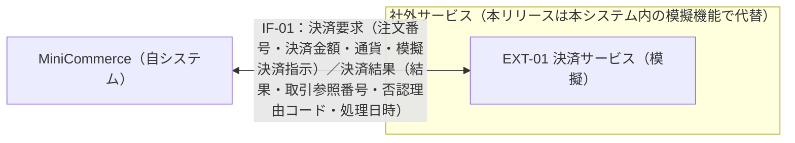

# 外部インターフェース要件一覧：MiniCommerce

## 0. 文書管理

### 0.1 改訂履歴

| 版数 | 日付 | 改訂内容 | 作成・改訂者 |
|---|---|---|---|
| 1.0 | 2026-10-09 | 初版作成 | MiniCommerce 要件定義チーム |

## 1. 本書の目的と適用範囲

### 1.1 目的

MiniCommerce（株式会社あおば雑貨（以下「当社」）の会員向け自社ECサイト）が外部と行う連携について、連携先・目的・送受信データ・方式・頻度・タイミング・エラー時の扱い・試験時の扱い・責任分界・運用の要求を定義する。本リリース（初期リリース（第1期）、稼働開始予定 2027-04-01）の外部連携は決済サービスとの1件であり、決済代行事業者が未選定のため、決済サービスを本システム内の模擬機能（模擬決済）で代替する。本書は、模擬決済が満たすべき振る舞いもあわせて定義する。

### 1.2 適用範囲

| 区分 | 内容 |
|---|---|
| 本書で定義する | 連携先、連携目的、送受信データの概要、方式、頻度、タイミング、データ量、エラー時の扱い、セキュリティ要件、性能・量の要件、責任分界、試験時の扱い、連携スケジュール・運用 |
| 本書で定義する | 送受信データ項目の業務上の意味・必須区分、および業務上の意味を確定するために必要な金額の単位（整数の円）と番号の構成・桁（5.1.4 の備考に記載） |
| 本書で定義しない | 電文・ファイルの物理フォーマット、API の詳細仕様（エンドポイント、パラメータ定義） |
| 本書で定義しない | 送受信データ項目ごとの型・電文上の表現形式、コード値の体系（ただし金額の単位と番号の構成・桁は 5.1.4 の備考に記載する） |
| 本書で定義しない | 実在の決済サービスとの接続（本リリースの対象外。決済代行事業者の選定後、後続フェーズで定義する。9章 XOQ-01〜XOQ-05） |
| 本書で定義しない | 本システム内部の業務処理の規則（カート操作・注文確定・キャンセル・出荷登録の判定、画面の表示内容） |
| 本書で用いるID（利用者区分） | ACT-002 購入者：会員登録済みでログインした利用者。自分の注文の支払を行う。ACT-004 決済サービス（模擬）：支払要求に承認／否認を返す外部システムの利用者区分。本リリースは本システム内の模擬機能 |
| 本書で用いるID（機能） | FR-031 支払（模擬決済）：購入者（ACT-002）が自分の注文（状態：注文受付）の代金を支払う機能。本書の IF-01 を起動する |
| 本書で用いる用語 | 模擬決済：実在の決済サービスに接続せず、本システム内で承認／否認を返す代替機能。注文の状態：注文受付→支払済→出荷済→配達完了の順にのみ進み、注文受付・支払済の注文に限りキャンセル済にできる。決済記録：支払1回ごとに、対象の注文、結果（承認／否認／連携エラー）、決済金額、取引参照番号（承認時）、処理日時を記録するデータ。取引参照番号：決済サービスが承認した取引を特定する番号 |

### 1.3 外部連携の有無

| 項目 | 内容 |
|---|---|
| 外部連携の有無 | あり（1件） |
| 連携先数 | 1件（EXT-01 決済サービス（模擬）） |
| IF数 | 1件（IF-01 決済要求（売上確定）） |
| 判断根拠・補足 | 購入者の支払（FR-031）では、注文の合計金額の売上確定を決済サービスに要求し、承認／否認の結果を受け取って注文の状態に反映する必要があるため、決済サービスとの連携を1件定義する。本リリースは決済代行事業者が未選定のため実在の決済サービスには接続せず、本システム内の模擬機能で代替する（外部ネットワークに接続しない）。次の連携は該当なしとする。メール送信：注文確認メールを含む通知を本リリースでは行わず、購入者は注文状況を画面・APIで確認する。配送業者：出荷・配達完了は、管理者が配送業者の情報を本システム外で確認したうえで画面から登録する。会計システム：本リリースの範囲に含まない。 |

## 2. 連携全体像

### 2.1 連携関係図

### 2.2 全体像の補足

| ID | 補足事項 | 関連ID |
|---|---|---|
| OVW-01 | 本リリースの EXT-01 は本システム内の模擬機能であり、外部ネットワーク（インターネット・専用線）に接続しない。図は、実決済サービスへの接続時に置き換わる連携先の位置を示す。 | EXT-01, IF-01 |
| OVW-02 | 連携の前後関係：購入者（ACT-002）が注文を確定すると、注文（状態：注文受付）が作成され在庫が引き当てられる。その後、購入者が支払（FR-031）を実行したときに IF-01 を起動する。承認の場合は注文が支払済となり、管理者による出荷登録の対象となる。否認・連携エラーの場合は注文受付のままとし、購入者が再度支払を実行できる。 | IF-01 |
| OVW-03 | メール送信・配送業者・会計システムとは連携しない（該当なし）。根拠は 1.3 の「判断根拠・補足」のとおり。 | 該当なし |
| OVW-04 | 当社の在庫管理表（表計算ファイル）とは連携しない。本システムの在庫数量は、運用者（当社 情報システム課のシステム運用担当）がサーバー上でコマンドを実行し、定義ファイル（JSON）から登録する初期データ一括投入で登録する（稼働後の補充分の反映方法は後続で決定する）。初期データ一括投入は本システム内の機能であり、外部インターフェースとして扱わない。 | 該当なし |

## 3. 連携先一覧

| ID | 連携先名称 | 種別 | 概要 | 管理組織・窓口 | 提供環境（本番/検証/サンドボックス） | 利用条件・制約（API利用制限、契約、費用） |
|---|---|---|---|---|---|---|
| EXT-01 | 決済サービス（模擬） | 社外システム・サービス（外部API） | 購入者の支払要求に対して、決済の承認／否認を返す決済サービス（利用者区分 ACT-004）。本リリースは実在の決済サービスに接続せず、本システム内の模擬機能（模擬決済）で代替する | 本リリース：模擬機能は本システムの一部として、当社 情報システム課（システム運用担当 2名）が管理する（連絡手段：電話・社内メール）。実決済サービスの提供事業者・窓口：未決（決済代行事業者が未選定。XOQ-01） | 本番：無、検証：無、サンドボックス：無（連携先として独立した環境を持たない。模擬機能は本システムと同じ環境で動作する。実決済サービスの提供環境は未決：XOQ-01） | 本リリース：利用回数制限なし、契約なし、利用費用なし（本システム内の機能のため）、外部ネットワーク接続なし。実決済サービスの利用回数制限・契約条件・利用費用：未決（XOQ-01） |

## 4. 外部インターフェース一覧

| ID | IF名称 | 連携先ID | 方向 | 連携目的 | 送受信データ概要 | 方式 | 同期・非同期 | 頻度 | タイミング（起動契機・時刻） | データ量（1回あたり） | データ量（日次） | 優先度 |
|---|---|---|---|---|---|---|---|---|---|---|---|---|
| IF-01 | 決済要求（売上確定） | EXT-01 | 双方向 | 購入者が注文の代金を支払う際に、注文の合計金額の売上確定を決済サービスに要求し、承認／否認の結果を受け取って注文の状態（承認時は支払済）に反映する | 要求：注文番号、決済金額、通貨、模擬決済指示／応答：結果、取引参照番号、否認理由コード、処理日時 | API（要求・応答）。本リリースは本システム内の模擬機能を呼び出す | 同期 | 随時（支払操作1回につき1回）。平均110件/日、ピーク130件/時 | 利用者操作：購入者（ACT-002）が自分の注文（状態：注文受付）に対して支払（FR-031）を実行したとき。24時間365日（本システムの計画停止を除く） | 平均1件／ピーク1件 | 平均110件／ピーク440件 | 必須 |

## 5. インターフェース別要件

### 5.1 IF-01：決済要求（売上確定）

#### 5.1.1 基本情報

| 項目 | 内容 |
|---|---|
| IF ID | IF-01 |
| IF名称 | 決済要求（売上確定） |
| 連携先ID・名称 | EXT-01：決済サービス（模擬） |
| 方向 | 双方向（MiniCommerce→決済サービス：要求、決済サービス→MiniCommerce：応答） |
| 方式 | API（要求・応答）。本リリースは本システム内の模擬機能を呼び出す |
| 同期・非同期 | 同期（応答を受信してから支払の処理を継続する） |
| 優先度 | 必須 |

#### 5.1.2 連携目的と業務上の位置づけ

| 項目 | 内容 |
|---|---|
| 連携目的 | 購入者が確定した注文の合計金額について決済サービスに売上確定を要求し、承認された場合に限り注文を支払済にする。否認・連携エラーの場合は注文を支払済にしない。 |
| 業務上の位置づけ（前後の業務・処理） | 前：購入者（ACT-002）が配送先を入力して注文を確定し、注文（状態：注文受付）が作成され、全明細の在庫が引き当てられている。本IF：購入者が自分の注文に対して支払（FR-031）を実行した時点で起動する。後（承認）：注文の状態を支払済とし支払日時を記録する。出荷担当（管理者として操作）が、支払済の注文を翌営業日までに出荷登録する。後（否認・連携エラー）：注文は注文受付のままとし、購入者が再度支払を実行する、または注文をキャンセルする。 |
| 連携失敗時の業務影響 | 注文が支払済にならず、出荷登録（支払済の注文に限り可能）ができないため、出荷が開始できない。注文と在庫の引当は保持されるため、注文・在庫は失われない。購入者は時間をおいて支払を再実行する必要がある。 |

#### 5.1.3 起動契機・タイミング・頻度

| ID | 起動契機 | 起動時刻・条件 | 頻度 | 完了期限 | 前提となる先行処理 |
|---|---|---|---|---|---|
| IF-01-TRG-01 | 利用者操作 | 購入者（ACT-002）が自分の注文（状態：注文受付）に対して支払（FR-031）を実行したとき。受付時間帯は24時間365日（本システムの計画停止を除く）。注文が存在しない場合、他の購入者の注文の場合、状態が注文受付以外の場合、模擬決済指示が承認・否認以外の場合は IF-01 を起動しない | 随時（支払操作1回につき1回）。平均110件/日、ピーク130件/時 | 要求送信から10秒以内に応答を受信する。10秒を超えた場合はタイムアウトとして扱う（5.1.9）。模擬機能は1秒以内に応答する | 注文確定（注文が作成され、状態が注文受付であること） |

#### 5.1.4 送受信データ

| ID | 区分 | データ項目 | 意味 | 必須 | 備考 |
|---|---|---|---|---|---|
| IF-01-DAT-01 | 要求 | 注文番号 | 決済の対象となる注文を一意に特定する番号 | 必須 | 「PO-」＋8桁の数字（例 PO-00000001） |
| IF-01-DAT-02 | 要求 | 決済金額 | 売上確定を求める金額。注文確定時に確定した注文の合計金額（割引後小計＋送料＋消費税額。税込）と同額 | 必須 | 整数の円（1円未満の端数を持たない） |
| IF-01-DAT-03 | 要求 | 通貨 | 決済金額の通貨 | 必須 | 「JPY」（日本円）固定 |
| IF-01-DAT-04 | 要求 | 模擬決済指示 | 模擬機能に返させる結果の指示。承認（approve）または否認（decline） | 必須 | 購入者が支払時に指定する。指定しない場合は承認（approve）を送る。本リリースの模擬機能に限り用いる項目 |
| IF-01-DAT-05 | 応答 | 結果 | 決済の結果。承認（approved）または否認（declined） | 必須 | 2種類以外の値は応答不正として扱う（IF-01-EXC-04） |
| IF-01-DAT-06 | 応答 | 取引参照番号 | 決済サービスが承認した取引を特定する番号。決済記録として保持し、管理者が注文詳細で確認する | 条件付き必須 | 結果が承認のとき必須。「MOCK-」＋英数字16桁（計21文字） |
| IF-01-DAT-07 | 応答 | 否認理由コード | 決済が否認された理由を示すコード | 条件付き必須 | 結果が否認のとき必須。模擬機能は「DECLINED」を返す |
| IF-01-DAT-08 | 応答 | 処理日時 | 決済サービスが要求を処理した日時 | 必須 | 日本時間（JST） |

#### 5.1.5 方式・プロトコル要件

| ID | 項目 | 要件 | 根拠・備考 |
|---|---|---|---|
| IF-01-PRT-01 | 方式 | API（同期の要求・応答）。本リリースは本システム内の模擬機能を呼び出す | 決済代行事業者が未選定のため模擬機能で代替する。実決済サービスの方式は未決（XOQ-02） |
| IF-01-PRT-02 | プロトコル | 該当なし（本リリースは本システム内の模擬機能のため通信プロトコルを用いない）。実決済サービス接続時に決定 | XOQ-02 |
| IF-01-PRT-03 | 通信経路 | 該当なし（本システム内で完結し、外部ネットワーク（インターネット・専用線・閉域網）に接続しない）。実決済サービス接続時に決定 | XOQ-02 |
| IF-01-PRT-04 | 処理単位 | 1件ずつ（1回の要求で1注文の支払1回分） | 支払操作ごとの同期連携のため |
| IF-01-PRT-05 | 接続の開始側 | 自システム（MiniCommerce が要求を送り、決済サービスが応答を返す）。決済サービスから自システムへの要求は受け付けない | 同期の要求・応答で結果を受け取るため |
| IF-01-PRT-06 | 連携先側の制約 | 本リリース：利用回数制限なし、利用可能時間帯の制限なし（本システムのサービス提供時間 24時間365日（計画停止を除く）と同じ） | 本システム内の模擬機能のため。実決済サービスの制約は未決（XOQ-01） |

#### 5.1.6 データ形式・文字コード

| ID | 項目 | 要件 | 根拠・備考 |
|---|---|---|---|
| IF-01-FMT-01 | データ形式 | 該当なし（本リリースは本システム内の模擬機能のため電文を用いない）。実決済サービス接続時に決定 | XOQ-03 |
| IF-01-FMT-02 | 文字コード | 該当なし（本リリースは本システム内の模擬機能のため電文を用いない）。実決済サービス接続時に決定 | XOQ-03 |
| IF-01-FMT-03 | 改行コード | 該当なし（本リリースは本システム内の模擬機能のため電文を用いない）。実決済サービス接続時に決定 | XOQ-03 |
| IF-01-FMT-04 | 日付・時刻の表現とタイムゾーン | 処理日時は日本標準時（JST、UTC+9、Asia/Tokyo）で扱う。電文上の表現方法は本リリースでは該当なし（本システム内の模擬機能のため）。実決済サービス接続時に決定 | 本システムの日時はすべて日本時間で扱うため。XOQ-03 |
| IF-01-FMT-05 | 外字・使用可能文字の制約 | 送受信データに日本語文字・外字を含めない。注文番号・通貨・模擬決済指示・結果・取引参照番号・否認理由コードは英数字とハイフン、決済金額は数字で構成する | 5.1.4 の各項目の構成による |
| IF-01-FMT-06 | ファイル名・圧縮（ファイル連携の場合） | 該当なし（ファイル連携ではない） | 方式が同期の API のため |

#### 5.1.7 認証・セキュリティ要件

| ID | 項目 | 要件 |
|---|---|---|
| IF-01-SEC-01 | 認証方式 | 該当なし（本リリースは本システム内の模擬機能の呼び出しであり、連携先への接続認証を行わない）。実決済サービスの認証方式は未決（XOQ-04） |
| IF-01-SEC-02 | 認可（アクセス可能な範囲） | IF-01 を起動できるのは、ログインした購入者（ACT-002）が自分の注文（状態：注文受付）に対して支払（FR-031）を実行した場合に限る。判定はサーバー側で行う。未ログインの利用者、管理者、他の購入者の注文に対する支払要求では IF-01 を起動しない |
| IF-01-SEC-03 | 通信の暗号化 | IF-01 自体は本システム内で完結し外部との通信経路がないため該当なし。購入者の端末から本システムへの支払操作の通信は、本番環境では HTTPS（TLS 1.2以上）のみとする（検証環境は HTTP を許容）。実決済サービス接続時の暗号化方式は未決（XOQ-02） |
| IF-01-SEC-04 | データ自体の暗号化・マスキング | 送受信データ（5.1.4）に個人情報（氏名・住所・電話番号・メールアドレス）を含めない。このため、暗号化・マスキングの対象となる項目はない |
| IF-01-SEC-05 | 接続元制限（IP制限） | 該当なし（外部からの接続を受け付けず、本システム内の呼び出しのみで動作する） |
| IF-01-SEC-06 | 改ざん検知（署名・ハッシュ照合） | 該当なし（本システム内で完結し、外部の通信経路を経由しないため）。実決済サービス接続時の改ざん検知方式は未決（XOQ-04） |
| IF-01-SEC-07 | 認証情報の管理（保管場所、更新周期、有効期限） | 本リリースは連携用の認証情報（APIキー・証明書）を用いないため該当なし。実決済サービス接続時に認証情報を用いる場合は、ソースコード・リポジトリに含めず環境変数で与える。更新周期・有効期限は未決（XOQ-04） |
| IF-01-SEC-08 | 連携記録（ログ）の取得項目 | 支払1回ごとに決済記録として、対象の注文、結果（承認／否認／連携エラー）、決済金額、取引参照番号（承認時）、処理日時を記録する。決済記録は登録後に更新・削除しない。アプリケーションログには個人情報（氏名・住所・電話番号・メールアドレス）、パスワード、認証トークンを出力しない |

#### 5.1.8 性能・量の要件

| ID | 指標 | 目標値 | 測定条件 |
|---|---|---|---|
| IF-01-PRF-01 | 1回あたりの件数 | 平均1件／最大1件 | 1回の要求で1注文の支払1回分 |
| IF-01-PRF-02 | 日次件数 | 平均110件／ピーク440件 | 平均：注文 平均100件/日の1.1倍（否認後の再支払を含む）。ピーク：注文 ピーク400件/日（12月の繁忙日・クーポン配布初日）の1.1倍 |
| IF-01-PRF-03 | ピーク時の処理量 | 130件/時 | ピーク日（12月の繁忙日・クーポン配布初日）の 20:00〜21:00 |
| IF-01-PRF-04 | 応答時間・処理時間 | 模擬機能の応答：1秒以内（全要求）。支払の API 応答時間（模擬機能の処理を含む）：95パーセンタイルで2.0秒以内 | 模擬機能：要求送信から応答受信まで。支払の API：本システムが支払要求を受信してから応答を返すまで。ピーク同時利用者150人（購入者・来訪者の合計）、3年後のデータ量（注文110,000件） |
| IF-01-PRF-05 | タイムアウト時間 | 10秒 | 応答：要求送信から応答受信まで |
| IF-01-PRF-06 | 同時接続数・同時要求数 | 該当なし（本システム内の模擬機能のため、同時要求数の上限を設けない） | 同一注文への同時の支払要求の扱いは IF-01-CON-01 による |

#### 5.1.9 エラー時の扱い

| ID | エラー種別 | 検知方法 | 自システムの振る舞い | 再送・リカバリ | 通知先 |
|---|---|---|---|---|---|
| IF-01-EXC-01 | 連携先からのエラー応答（業務エラー：決済否認） | 応答の結果が否認（declined） | 決済記録（結果：否認）を登録し、注文の状態は注文受付のまま変更しない（支払日時・在庫も変更しない）。購入者に決済が否認された旨を業務エラー（エラーコード PAYMENT_DECLINED）として表示する | 自動再送なし。購入者が支払を再実行できる | 購入者（支払画面のメッセージ、API のエラー応答） |
| IF-01-EXC-02 | タイムアウト | 要求送信から10秒を超えて応答を受信しない | 応答待ちを打ち切り、決済記録（結果：連携エラー）を登録する。注文の状態は注文受付のまま変更しない。購入者に外部連携エラー（エラーコード PAYMENT_SERVICE_ERROR。時間をおいて支払を再実行する旨）を表示する | 自動再送なし（二重決済防止のため）。購入者が時間をおいて支払を再実行する | 購入者（支払画面のメッセージ、API のエラー応答）。システム運用担当へはアプリケーションログで記録する（7.4） |
| IF-01-EXC-03 | 接続不可 | 模擬機能の呼び出しが応答を得られずに失敗する | IF-01-EXC-02 と同じ（決済記録（連携エラー）を登録、注文受付のまま、外部連携エラー（PAYMENT_SERVICE_ERROR）を表示） | 自動再送なし。購入者が時間をおいて支払を再実行する | IF-01-EXC-02 と同じ |
| IF-01-EXC-04 | データ不正（応答不正） | 応答に次のいずれかがある：結果が承認・否認以外、結果または処理日時の欠落、結果が承認で取引参照番号が欠落または「MOCK-」＋英数字16桁でない、結果が否認で否認理由コードが欠落 | IF-01-EXC-02 と同じ（決済記録（連携エラー）を登録、注文受付のまま、外部連携エラー（PAYMENT_SERVICE_ERROR）を表示） | 自動再送なし。購入者が時間をおいて支払を再実行する | IF-01-EXC-02 と同じ |
| IF-01-EXC-05 | 連携先からのエラー応答（システムエラー） | 本リリースの模擬機能は承認・否認以外の応答を返さない。承認・否認以外の応答を受信した場合は IF-01-EXC-04 で検知する | IF-01-EXC-04 と同じ | IF-01-EXC-04 と同じ | IF-01-EXC-04 と同じ |
| IF-01-EXC-06 | 件数不一致・欠落 | 該当なし（1回の要求で1件のみを送受信し、件数の突合が発生しないため） | 該当なし | 該当なし | 該当なし |

#### 5.1.10 整合性

| ID | 項目 | 要件 | 備考 |
|---|---|---|---|
| IF-01-CON-01 | 二重送信・冪等性 | 1注文につき承認済みの決済記録は最大1件とする。同一注文への支払が同時に要求された場合も、承認を反映して注文を支払済にするのは1回だけとし、後から確定する要求は状態不正の業務エラー（エラーコード INVALID_STATUS_TRANSITION）として承認の決済記録を追加しない。支払とキャンセルが同時に要求された場合は、逐次に実行した場合と同じ結果とする。キャンセルが先に確定した場合は、後着の支払を同じ業務エラー（INVALID_STATUS_TRANSITION）とし IF-01 を起動しない。支払が先に確定した場合は、後着のキャンセルを支払済の注文のキャンセルとして受け付け、決済記録は変更しない（返金は IF-01-SUP-02 のとおり本システム外で行う）。タイムアウト・応答不正の後に自動再送しない | 二重決済防止のため |
| IF-01-CON-02 | 順序保証 | 該当なし（1回の要求で1注文を扱い、注文間の処理順序に依存しない） | 同一注文内の処理は IF-01-CON-01 による |
| IF-01-CON-03 | トランザクション境界（自システムの更新と連携の成否の関係） | 承認の応答を受けた場合は、決済記録（承認）の登録、注文の状態の支払済への変更、支払日時の記録、注文状態履歴（注文受付→支払済、実行者：購入者）の記録を一括で行い、すべて成功するか何も変更しないかのどちらかとする。否認・連携エラーの場合は決済記録（否認／連携エラー）のみを登録し、注文の状態・支払日時・注文状態履歴・在庫は変更しない | 否認・連携エラーの決済記録は、支払の試行を記録するために登録する |
| IF-01-CON-04 | 一部失敗時の扱い（一括処理の場合） | 該当なし（一括処理ではない） | 該当なし |
| IF-01-CON-05 | 連携結果の照合（件数・合計値の突合） | 承認の決済記録の決済金額は、対象の注文の合計金額と一致すること。決済サービス側の取引記録との突合は、本リリースは模擬機能のため該当なし。実決済サービス接続時の突合方法は未決（XOQ-05） | 該当なし |

#### 5.1.11 責任分界

| ID | 補足事項 | 自システム側 | 連携先側 |
|---|---|---|---|
| IF-01-SUP-01 | 本リリースは、連携先（決済サービス（模擬））も本システムの一部として当社が開発・運用する | 模擬機能を含めて MiniCommerce の開発範囲として実装・試験する | 該当なし（本リリースでは連携先の組織が存在しない。決済代行事業者は未選定） |
| IF-01-SUP-02 | 支払済の注文をキャンセルした場合の返金 | IF-01 で返金を要求せず、決済記録も変更しない。EC運営担当（EC事業部）が本システム外で、キャンセルから5営業日以内に返金する | 該当なし（本リリースは IF-01 で返金を受け付けない） |

#### 5.1.12 試験時の扱い

**(1) 試験工程ごとの接続先**

| ID | 試験工程 | 接続先 | 選定理由・利用条件 | 代替時に確認できない事項 |
|---|---|---|---|---|
| IF-01-TST-01 | 結合テスト | スタブ・モック（本システム内の模擬機能） | 決済代行事業者が未選定で、連携先の検証環境が存在しないため。利用期間・事前申請の制約なし | 実決済サービスでの売上確定と取引参照番号の採番、実決済サービスの応答時間・エラー応答の内容、通信経路・認証（後続フェーズで確認。XOQ-01〜XOQ-04） |
| IF-01-TST-02 | システムテスト | スタブ・モック（本システム内の模擬機能） | IF-01-TST-01 と同じ | IF-01-TST-01 と同じ |
| IF-01-TST-03 | 受入テスト | スタブ・モック（本システム内の模擬機能） | IF-01-TST-01 と同じ | IF-01-TST-01 と同じ |

**(2) スタブ・モックで代替する場合の振る舞い**

| ID | 想定ケース | スタブ・モックの応答内容 | 確認する自システムの振る舞い |
|---|---|---|---|
| IF-01-MCK-01 | 全ケース共通 | 外部ネットワークに接続せず、本システム内で応答を作成する。購入者の画面・API から模擬機能に指示できる結果は承認（approve）・否認（decline）の2種類に限る | 外部ネットワークに接続できない環境で、IF-01-MCK-02・IF-01-MCK-03 の支払が完了すること |
| IF-01-MCK-02 | 正常（承認） | 模擬決済指示が承認（approve）のとき（指示の省略を含む）、結果：承認（approved）、取引参照番号：「MOCK-」＋英数字16桁、処理日時を1秒以内に返す | 決済記録（承認）が登録され、注文の状態が支払済となり、支払日時と注文状態履歴（注文受付→支払済）が記録されること（IF-01-CON-03） |
| IF-01-MCK-03 | 業務エラー（否認） | 模擬決済指示が否認（decline）のとき、結果：否認（declined）、否認理由コード：「DECLINED」、処理日時を1秒以内に返す | 決済記録（否認）が登録され、注文が注文受付のまま、購入者に決済否認（PAYMENT_DECLINED）が表示されること。続けて承認を指示した支払が成功すること（IF-01-EXC-01） |
| IF-01-MCK-04 | タイムアウト | 自動テストのテストコード内で模擬機能を試験用の代替に置き換え、10秒を超えて応答を返さない | 決済記録（連携エラー）が登録され、注文が注文受付のまま、外部連携エラー（PAYMENT_SERVICE_ERROR）が返り、自動再送されないこと（IF-01-EXC-02） |
| IF-01-MCK-05 | 接続不可 | 自動テストのテストコード内で模擬機能を試験用の代替に置き換え、呼び出し時に失敗を返す | IF-01-MCK-04 と同じ（IF-01-EXC-03） |
| IF-01-MCK-06 | データ不正（応答不正） | 自動テストのテストコード内で模擬機能を試験用の代替に置き換え、結果が承認・否認以外の値の応答、および結果が承認で取引参照番号が欠落した応答を返す | IF-01-MCK-04 と同じ（IF-01-EXC-04） |
| IF-01-MCK-07 | 二重送信 | 同一注文に対する2件の支払要求（模擬決済指示：承認）を同時に受け、それぞれに承認を返す | 承認の決済記録が1件のみ、注文状態の遷移が1回のみで、後着の要求が状態不正（INVALID_STATUS_TRANSITION）となること（IF-01-CON-01） |

**(3) 試験データ**

| ID | 項目 | 内容 |
|---|---|---|
| IF-01-TDT-01 | 試験データの準備主体 | 自システム側（運用者が初期データ一括投入で購入者・商品・在庫単位を登録し、試験者が購入者として注文を確定して、支払の対象とする注文（状態：注文受付）を作成する） |
| IF-01-TDT-02 | 試験データの条件・件数 | 状態が注文受付の注文：承認・否認・タイムアウト・接続不可・応答不正・二重送信の各ケースに1件以上。状態が支払済・出荷済・配達完了・キャンセル済の注文：各1件以上（状態不正の確認用）。他の購入者の注文：1件以上（他人の注文で IF-01 を起動しないことの確認用）。個人情報は架空の値のみを用いる |
| IF-01-TDT-03 | 試験後のデータの扱い（削除・初期化の要否） | 連携先側にデータは残らない（模擬機能のため）。本システム側の注文・決済記録は、初期データ一括投入の「全削除して投入」の指定で削除し、試験開始前の状態に戻す |

## 6. 責任分界

| ID | IF ID | 項目 | 自システム側 | 連携先側 | 備考 |
|---|---|---|---|---|---|
| RSP-01 | IF-01 | データ作成 | MiniCommerce が、購入者の支払操作時に注文番号・決済金額（注文の合計金額）・通貨・模擬決済指示を作成する | 模擬機能が応答（結果・取引参照番号・否認理由コード・処理日時）を作成する | 本リリースは模擬機能も本システムの一部として当社が開発する |
| RSP-02 | IF-01 | 送信 | MiniCommerce が支払操作1回につき要求を1回送る | 模擬機能が要求1件につき応答を1回、1秒以内に返す | 自動再送はしない |
| RSP-03 | IF-01 | 受信確認 | MiniCommerce が応答の結果と必須項目（5.1.4）を確認し、不正な応答を連携エラーとする | 該当なし（模擬機能は受信確認を行わない） | IF-01-EXC-04 |
| RSP-04 | IF-01 | エラー検知 | MiniCommerce がタイムアウト（10秒）・接続不可・応答不正を検知し、決済記録（連携エラー）を登録する | 該当なし（模擬機能はエラーの検知を行わない） | IF-01-EXC-02〜IF-01-EXC-04 |
| RSP-05 | IF-01 | 再送判断 | MiniCommerce は自動再送しない。支払の再実行は購入者が判断して行う | 該当なし | 二重決済防止のため |
| RSP-06 | IF-01 | 障害連絡 | 購入者へは支払画面のメッセージ・API のエラー応答で知らせる。システム運用担当（情報システム課）が連携エラーの継続（7.2）を確認した場合、EC運営担当（EC事業部）へ電話・社内メールで連絡する | 該当なし（本リリースは連携先の組織がない） | 連絡期限：確認から1時間以内。EC運営の業務時間（平日 9:00〜18:00）外に確認した場合は翌営業日 10:00 まで |
| RSP-07 | IF-01 | データ保管 | 決済記録（承認・否認・連携エラーのすべて）を注文日から7年保管する。登録後に更新・削除しない。期間経過後の削除は運用者が年1回、手順に従って実施する | 該当なし（模擬機能はデータを保管しない） | 7年は法人税法の帳簿書類保存期間による |
| RSP-08 | IF-01 | 仕様変更連絡 | 模擬機能の仕様（応答項目・応答時間・承認／否認の指示）は本書で定め、変更時は MiniCommerce 要件定義チームが本書を改訂する | 該当なし（本リリースは連携先の組織がない） | 実決済サービスの仕様変更の事前通知期間は未決（XOQ-01） |

## 7. 連携スケジュール・運用

### 7.1 定期連携のカレンダー

| ID | IF ID | 実行日・曜日 | 実行時刻 | 休日・祝日・特定日の扱い | 完了期限 | 先行・後続処理 |
|---|---|---|---|---|---|---|
| 該当なし | 該当なし | 該当なし（IF-01 は購入者の支払操作ごとの随時連携であり、定期連携はない） | 該当なし | 該当なし | 該当なし | 該当なし |

### 7.2 連携停止時の運用

| ID | IF ID | 想定事象（停止の継続時間等） | 検知方法 | 業務への影響 | 停止中の暫定運用 | 復旧後の処理（再連携・照合） | 判断者 |
|---|---|---|---|---|---|---|---|
| OPS-01 | IF-01 | 支払の連携エラー（タイムアウト・接続不可・応答不正）が続き、購入者が支払を完了できない | 購入者への外部連携エラー（PAYMENT_SERVICE_ERROR）の応答、アプリケーションログの記録、決済記録（連携エラー）の登録 | 注文が支払済にならず、出荷登録が開始できない。商品閲覧・カート・注文確定・注文照会・キャンセルは継続して利用できる | 支払画面に支払ができない旨（時間をおいて支払を再実行する旨）を表示する。注文（状態：注文受付）と在庫の引当は保持し、自動ではキャンセルしない。購入者は注文受付の注文を自分でキャンセルできる | 復旧後、購入者が注文詳細から支払を再実行する（自動再送・一括再送は行わない）。照合は該当なし（連携エラーの決済記録は承認を含まないため） | システム運用担当（情報システム課） |

### 7.3 連携先の計画停止の扱い

| ID | 連携先ID | 停止の周期・時間帯 | 通知方法・通知時期 | 停止中の自システムの振る舞い | 再開後の処理 |
|---|---|---|---|---|---|
| OPS-02 | EXT-01 | 模擬機能は独自の計画停止を持たない。本システムの計画停止（月1回、毎月第2水曜 2:00〜4:00 の2時間以内）と同時に停止する。実決済サービスの計画停止は未決（XOQ-01） | 該当なし（本システムの計画停止として扱う） | 本システム全体が停止するため、支払要求は発生しない | 該当なし（保留する要求がない） |

### 7.4 連携状況の監視・確認

| ID | IF ID | 監視・確認の対象 | 確認のタイミング | 異常時の通知 |
|---|---|---|---|---|
| OPS-03 | IF-01 | 外部連携エラー（PAYMENT_SERVICE_ERROR、5xx 応答）の発生件数 | 本番環境：運用開始時に設定する監視（5xx 応答率）で常時確認する。検証環境：監視の対象外 | 通知先：システム運用担当（情報システム課）。通知手段は本番環境の監視設定とあわせて決定する（未決：XOQ-06） |
| OPS-04 | IF-01 | 注文ごとの決済記録（結果・決済金額・取引参照番号・処理日時） | 管理者が出荷登録の前、および購入者からの問い合わせを受けたときに、管理者向けの注文詳細画面で確認する | 該当なし（画面での確認のため通知しない） |

## 8. 前提条件・制約事項

| ID | 区分 | 内容 | 影響範囲 | 関連ID |
|---|---|---|---|---|
| XCN-01 | 前提条件 | 本リリースでは決済代行事業者が未選定であり、実在の決済サービスに接続しない。決済は本システム内の模擬機能（模擬決済）で代替し、模擬決済で稼働確認を行う | 3〜7章、5.1.12 | EXT-01, IF-01 |
| XCN-02 | 制約事項 | 本システムは外部ネットワーク（インターネット）に接続せずに起動・動作すること（コンテナイメージ・依存パッケージの取得時を除く）。模擬機能も外部ネットワークに接続しない | 5.1.5、5.1.12 | IF-01 |
| XCN-03 | 制約事項 | 本リリースでは、実在の決済サービス・外部 API への接続処理を実装しない | 5.1.5、5.1.7 | IF-01 |
| XCN-04 | 制約事項 | 金額は整数の円、通貨は日本円（JPY）のみとする（多通貨は本リリースの対象外） | 5.1.4 | IF-01 |
| XCN-05 | 前提条件 | 支払は購入者（ACT-002）本人が自分の注文（状態：注文受付）に対してのみ行う。管理者は支払を行わない | 5.1.3、5.1.7 | IF-01, FR-031 |
| XCN-06 | 制約事項 | 支払済の注文をキャンセルした場合の返金は IF-01 では行わず、EC運営担当が本システム外で5営業日以内に行う（返品・返金機能は本リリースの対象外） | 5.1.11、6章 | IF-01 |
| XCN-07 | 前提条件 | 日時は日本時間（JST、Asia/Tokyo）で扱う | 5.1.4、5.1.6 | IF-01 |
| XCN-08 | 制約事項 | 決済記録は注文日から7年保管する（法人税法の帳簿書類保存期間） | 6章 | IF-01 |
| XCN-09 | 制約事項 | 未払いの注文（状態：注文受付）を期限経過で自動キャンセルする機能は本リリースの対象外とする。連携停止中も注文を保持する | 7.2 | IF-01 |

## 9. 未決事項・確認事項

| ID | 内容 | 影響範囲 | 担当 | 期限 | 状態 |
|---|---|---|---|---|---|
| XOQ-01 | 実決済サービス（決済代行事業者）の選定、および管理組織・窓口、提供環境（本番／検証／サンドボックス）、契約条件・利用費用・利用回数制限、計画停止、仕様変更の事前通知期間の確認。本リリースは模擬機能で稼働確認を行うため、本リリースの実装には影響しない | EXT-01、3章、5.1.5、6章（RSP-08）、7.3 | EC事業責任者（取締役） | 後続フェーズの要件定義開始時（日付は後続フェーズの計画時に設定） | 未着手 |
| XOQ-02 | 実決済サービスとの接続方式（プロトコル、通信経路、通信の暗号化方式、同期／非同期、決済サービスからの結果通知の有無）。本リリースの実装には影響しない | IF-01、5.1.5、5.1.7 | システム運用担当（情報システム課） | 後続フェーズの要件定義開始時（日付は後続フェーズの計画時に設定） | 未着手 |
| XOQ-03 | 実決済サービスとのデータ形式（データ形式、文字コード、改行コード、日時の表現、送受信項目の追加・削除の有無）。本リリースの実装には影響しない | IF-01、5.1.4、5.1.6 | システム運用担当（情報システム課） | 後続フェーズの要件定義開始時（日付は後続フェーズの計画時に設定） | 未着手 |
| XOQ-04 | 実決済サービスの認証方式、改ざん検知方式、認証情報の管理（保管場所・更新周期・有効期限）。本リリースの実装には影響しない | IF-01、5.1.7 | システム運用担当（情報システム課） | 後続フェーズの要件定義開始時（日付は後続フェーズの計画時に設定） | 未着手 |
| XOQ-05 | 実決済サービス接続時に、タイムアウト・応答不正の後で決済サービス側では承認されていた取引の確認方法、および決済サービス側の取引記録と決済記録との突合方法。本リリースの実装には影響しない | IF-01、5.1.9、5.1.10 | EC事業責任者（取締役）、システム運用担当（情報システム課） | 後続フェーズの要件定義開始時（日付は後続フェーズの計画時に設定） | 未着手 |
| XOQ-06 | 本番環境での連携エラー監視の通知手段（本番環境の基盤選定後に、監視設定とあわせて決定）。本リリースの実装には影響しない | IF-01、7.4 | システム運用担当（情報システム課） | 本番環境の基盤選定時（日付は基盤選定の計画時に設定） | 未着手 |
