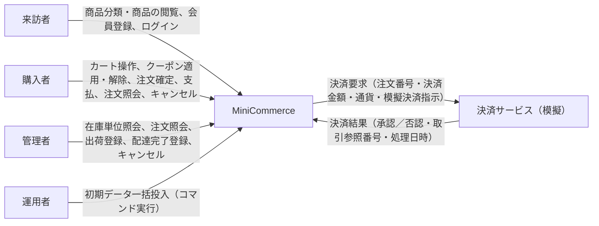
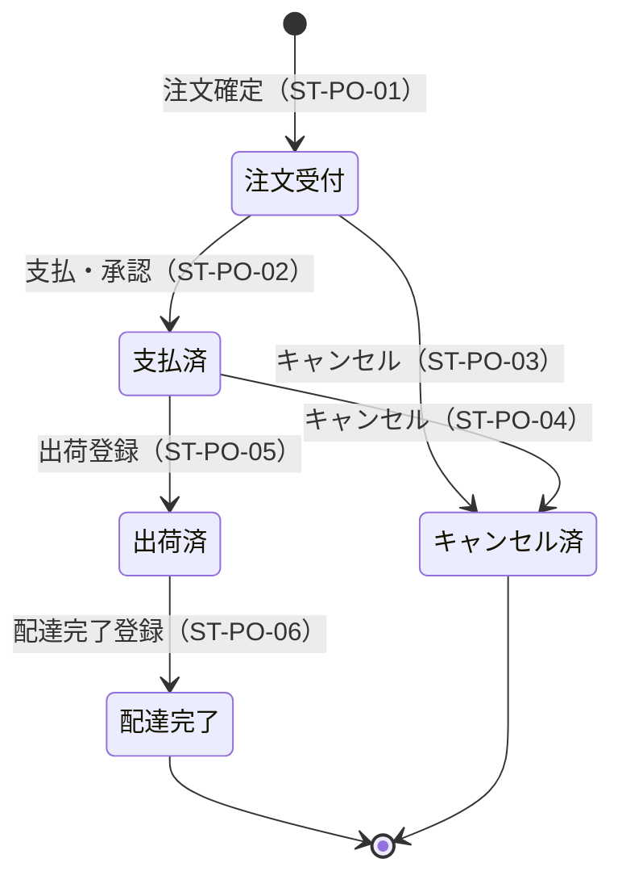
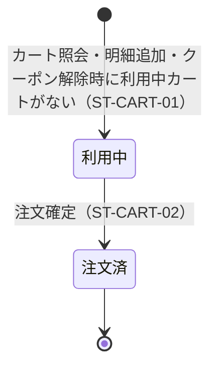

# 機能要件定義書：MiniCommerce

## 0. 文書管理

### 0.1 改訂履歴

| 版数 | 日付 | 改訂内容 | 作成・改訂者 |
|---|---|---|---|
| 1.0 | 2026-10-09 | 初版作成 | MiniCommerce 要件定義チーム |

## 1. 本書の目的と適用範囲

### 1.1 目的

本書は、株式会社あおば雑貨（以下「当社」）の自社ECサイト MiniCommerce が、来訪者・購入者・管理者・運用者および決済サービス（模擬）に提供する機能と、その振る舞い（入力・処理・出力・状態変化・例外）を定義する。本書の記載内容だけを根拠に、各機能の正常終了・異常終了の結果を判定できることを目的とする。

### 1.2 適用範囲

| 区分 | 内容 |
|---|---|
| 本書で定義する | 機能一覧、利用者区分×機能の権限、機能詳細（事前条件／入力／処理／出力／事後条件／例外）、共通機能、状態遷移、バッチ・定期処理、メッセージ・エラー通知方針 |
| 本書で定義しない | データ項目の型・桁・形式、コード値の割当て、画面・帳票のレイアウト・デザイン、外部連携電文の物理形式、Web API の呼出し方式（パス・電文形式） |
| 対象リリース | MiniCommerce 初期リリース（第1期。稼働開始予定 2027-04-01） |
| 対象とする提供形態 | 購入者・管理者向けの Web 画面（PCブラウザ）、同じ機能を提供する Web API、運用者がサーバー上で実行するコマンド（FR-060）。画面と Web API は同一の業務ルールに従う |
| 対象外 | 2.3 に列挙する対象外機能（FR-OUT-01〜FR-OUT-16） |

## 2. システム化範囲の概要

### 2.1 提供機能の全体像

| 大分類 | 提供する機能の概要 | 主な利用者区分 |
|---|---|---|
| 会員・認証 | 来訪者の会員登録、購入者・管理者のログイン・ログアウト、ログイン中の利用者情報の照会 | ACT-001 来訪者、ACT-002 購入者、ACT-003 管理者 |
| 商品カタログ | 商品分類の一覧、分類・キーワードによる商品の検索、商品詳細（在庫単位ごとの税込価格・在庫数量）の照会 | ACT-001 来訪者、ACT-002 購入者、ACT-003 管理者 |
| カート | カートの照会、明細の追加・数量変更・削除、クーポンの適用・解除、金額内訳（小計・割引額・割引後小計・送料・消費税額・合計）の計算 | ACT-002 購入者 |
| 注文 | 注文確定（全明細の在庫引当）、模擬決済による支払、注文履歴・注文詳細の照会、出荷前の注文キャンセル | ACT-002 購入者、ACT-004 決済サービス（模擬） |
| 管理 | 在庫単位一覧（低在庫を含む）の照会、注文の検索・詳細照会、出荷登録・配達完了登録・注文キャンセル | ACT-003 管理者 |
| 運用 | 定義ファイルによる初期データの一括投入（サーバー上のコマンド実行） | ACT-005 運用者 |

### 2.2 システム境界

### 2.3 対象外機能

| ID | 対象外とする機能 | 理由 | 代替手段・担当 |
|---|---|---|---|
| FR-OUT-01 | 実決済サービスとの連携 | 決済代行事業者が未選定 | 模擬決済（決済サービス（模擬））で代替する。後続フェーズで検討する |
| FR-OUT-02 | 商品・商品分類・仕入先・在庫単位・クーポンの画面／Web API による登録・更新・削除（マスタ保守） | 初期商品数が限られ、改廃頻度が低い | 運用者が初期データ一括投入（FR-060）で登録・再投入する |
| FR-OUT-03 | 入荷・在庫補充の登録 | 現行の在庫管理表で運用を継続する | 稼働開始時の在庫数量は初期データ一括投入（FR-060）で登録する。稼働後の補充分の反映方法は FOQ-01 で決定する（本リリースは登録済みの在庫数量を補充する機能を持たない） |
| FR-OUT-04 | 返品・返金・部分出荷・分割配送 | 件数が少ない | 支払済注文のキャンセル時の返金は、EC運営担当が本システム外で手作業で対応する |
| FR-OUT-05 | 複数クーポンの併用、ポイント、ギフト券、自動適用の割引キャンペーン | 割引は単一クーポンに限定する | 実施しない |
| FR-OUT-06 | 多通貨・多言語・海外配送・多国税制 | 国内向け販売のみ | 実施しない（日本語・日本円・国内のみ） |
| FR-OUT-07 | 配送業者との連携、住所検証、配送日時指定、送料の地域別設定 | 出荷は運営側の手作業で行う | 管理者が出荷登録（FR-043）・配達完了登録（FR-044）を行う |
| FR-OUT-08 | メールその他の手段による利用者への通知（注文確認メールを含む） | 初期リリースでは画面・Web API での状態確認で代替する | 実施しない |
| FR-OUT-09 | 会員情報の変更、パスワード再設定、退会 | 初期リリースの範囲を限定する | EC運営担当が問い合わせを受けて個別に対応する（本システム外） |
| FR-OUT-10 | 未ログイン状態でのカート利用（ゲスト購入） | 会員向けサービスとして開始する | カート・注文はログインを必須とする |
| FR-OUT-11 | 認証失敗時のアカウントロック、ログイン試行回数の制限 | 初期リリースの範囲を限定する | 実施しない（後続フェーズで検討する） |
| FR-OUT-12 | 未払い注文の自動キャンセル（期限切れ処理） | 初期リリースの範囲を限定する | 購入者（FR-034）または管理者（FR-045）がキャンセルする |
| FR-OUT-13 | 商品画像、商品レビュー、お気に入り、おすすめ表示 | 初期リリースの範囲を限定する | 実施しない |
| FR-OUT-14 | スマートフォン専用画面 | 初期リリースはPCブラウザを対象とする | 後続フェーズで検討する |
| FR-OUT-15 | 帳票（PDF・CSVを含むファイル出力） | 一覧画面での確認で足りる | 実施しない |
| FR-OUT-16 | 「特定商取引法に基づく表記」を含む静的ページ | サイト運営側の静的コンテンツとして別途用意する | 本システムの対象外 |

## 3. 利用者区分（アクター）

### 3.1 利用者区分

| ID | 利用者区分 | 説明 | 認証要否 | 登録者数 | 同時利用者数 |
|---|---|---|---|---|---|
| ACT-001 | 来訪者 | ログインしていない閲覧者。商品分類・商品の閲覧、会員登録、ログインのみ行える | 不要 | 該当なし（不特定多数で登録はない） | 150 人（ピーク時。購入者と合算。平常時は30人） |
| ACT-002 | 購入者 | 会員登録済みでログインした利用者。カート操作、クーポンの適用・解除、注文確定、支払、注文履歴の照会、出荷前の注文キャンセルを行う。会員登録（FR-001）または初期データ一括投入（FR-060）で作成する | 要 | 3,000 人（稼働後1年）／10,000 人（稼働後3年） | 150 人（ピーク時。来訪者と合算。平常時は30人） |
| ACT-003 | 管理者 | EC運営担当（3人）・出荷担当（4人）。在庫単位・注文の確認、出荷登録・配達完了登録、注文キャンセルを行う。購入機能（カート・注文確定・支払）は利用できない。アカウントは初期データ一括投入（FR-060）でのみ作成する | 要 | 7 人 | 5 人 |
| ACT-005 | 運用者 | システム運用担当（情報システム課）。サーバー上でコマンドを実行し、初期データを一括投入する。Web 画面・Web API は利用しない | 要（サーバーへのログイン権限で判定する。本システムの認証機能の対象外） | 2 人 | 1 人 |

### 3.2 外部システムアクター

| ID | 外部システム名 | 本システムとの関係 | 連携方向 |
|---|---|---|---|
| ACT-004 | 決済サービス（模擬） | 支払（FR-031）の実行時に、本システムから決済要求（注文番号・決済金額・通貨・模擬決済指示）を受け、承認／否認の決済結果を同期で返す。本リリースでは本システム内の模擬機能として提供し、実在の決済サービスには接続しない | 双方向（決済要求を送信し、決済結果を受信する） |

## 4. 機能一覧

| ID | 大分類 | 中分類 | 機能名 | 概要 | 機能種別 | 利用者区分 | 起動方式 | 優先度 |
|---|---|---|---|---|---|---|---|---|
| FR-001 | 会員・認証 | 会員 | 会員登録 | メールアドレス・パスワード・氏名を登録し、利用者区分が購入者の利用者を作成する | 登録 | ACT-001（ログイン中の ACT-002／ACT-003 も可） | 画面操作 | 必須 |
| FR-002 | 会員・認証 | 認証 | ログイン | メールアドレスとパスワードを照合し、認証トークンの発行またはログインセッションの開始を行う | 照会・検索（認証） | ACT-001（成功後 ACT-002／ACT-003） | 画面操作 | 必須 |
| FR-003 | 会員・認証 | 認証 | ログアウト | 要求に使われた認証トークン（画面ではログインセッション）を無効化する | 更新 | ACT-002, ACT-003 | 画面操作 | 必須 |
| FR-004 | 会員・認証 | 認証 | ログイン利用者情報照会 | ログイン中の利用者本人の利用者ID・メールアドレス・氏名・利用者区分を返す | 照会・検索 | ACT-002, ACT-003 | 画面操作 | 推奨 |
| FR-010 | 商品カタログ | 分類 | 商品分類一覧照会 | 全商品分類を親子の木構造の順に返す | 照会・検索 | ACT-001, ACT-002, ACT-003 | 画面操作 | 必須 |
| FR-011 | 商品カタログ | 商品 | 商品一覧検索 | 公開中の商品を分類・キーワードで検索し、指定の並び順・ページ単位で返す | 照会・検索 | ACT-001, ACT-002, ACT-003 | 画面操作 | 必須 |
| FR-012 | 商品カタログ | 商品 | 商品詳細照会 | 公開中の商品の説明と、在庫単位ごとの税抜価格・税込価格・在庫数量を返す | 照会・検索 | ACT-001, ACT-002, ACT-003 | 画面操作 | 必須 |
| FR-020 | カート | カート | カート照会 | 購入者の利用中カートの明細・クーポン・金額内訳を返す（利用中カートがない場合は空のカートを作成する） | 照会・検索 | ACT-002 | 画面操作 | 必須 |
| FR-021 | カート | 明細 | カート明細追加 | 在庫単位と数量を指定してカートに入れる（同一在庫単位の合算数量10個以下かつ在庫数量以下） | 登録 | ACT-002 | 画面操作 | 必須 |
| FR-022 | カート | 明細 | カート明細数量変更 | カート明細の数量を変更する（10個以下かつ在庫数量以下） | 更新 | ACT-002 | 画面操作 | 必須 |
| FR-023 | カート | 明細 | カート明細削除 | カート明細を削除する | 削除 | ACT-002 | 画面操作 | 必須 |
| FR-024 | カート | クーポン | クーポン適用 | クーポンコードを判定し、1カートにつき1枚のクーポンを適用する | 更新 | ACT-002 | 画面操作 | 必須 |
| FR-025 | カート | クーポン | クーポン解除 | 適用中のクーポンをカートから外す | 更新 | ACT-002 | 画面操作 | 必須 |
| FR-026 | カート | 金額 | 注文金額計算 | 小計・割引額・割引後小計・送料・消費税額・合計を算出し、適用中クーポンの適用可否を判定する | 計算・判定 | ACT-002（FR-020〜FR-025, FR-030 の実行時に内部で起動） | イベント契機 | 必須 |
| FR-030 | 注文 | 確定 | 注文確定 | 配送先を受け付け、数量上限・クーポン条件・在庫を再判定して全明細の在庫を一括で引き当て、注文を作成する | 登録 | ACT-002 | 画面操作 | 必須 |
| FR-031 | 注文 | 支払 | 支払（模擬決済） | 注文受付の注文の合計金額を決済サービス（模擬）へ要求し、承認された場合に注文を支払済にする | 連携 | ACT-002（相手：ACT-004） | 画面操作 | 必須 |
| FR-032 | 注文 | 照会 | 注文履歴一覧照会 | 購入者本人の注文を注文日時の新しい順にページ単位で返す | 照会・検索 | ACT-002 | 画面操作 | 必須 |
| FR-033 | 注文 | 照会 | 注文詳細照会（購入者） | 購入者本人の注文の明細・金額・配送先・状態履歴を返す | 照会・検索 | ACT-002 | 画面操作 | 必須 |
| FR-034 | 注文 | キャンセル | 注文キャンセル（購入者） | 注文受付・支払済の本人の注文をキャンセル済にし、全明細の数量を在庫数量へ戻す | 更新 | ACT-002 | 画面操作 | 必須 |
| FR-040 | 管理 | 在庫 | 在庫単位一覧照会 | 全在庫単位（非公開商品を含む）の在庫数量・低在庫を条件指定で返す | 照会・検索 | ACT-003 | 画面操作 | 必須 |
| FR-041 | 管理 | 注文 | 注文一覧検索（管理者） | 全注文を注文番号・注文状態・注文日・購入者のメールアドレスで検索する | 照会・検索 | ACT-003 | 画面操作 | 必須 |
| FR-042 | 管理 | 注文 | 注文詳細照会（管理者） | 注文の詳細に購入者情報・決済記録を加えて返す | 照会・検索 | ACT-003 | 画面操作 | 必須 |
| FR-043 | 管理 | 注文 | 出荷登録 | 支払済の注文を出荷済にし、出荷日時・配送伝票番号を記録する | 更新 | ACT-003 | 画面操作 | 必須 |
| FR-044 | 管理 | 注文 | 配達完了登録 | 出荷済の注文を配達完了にし、配達完了日時を記録する | 更新 | ACT-003 | 画面操作 | 必須 |
| FR-045 | 管理 | 注文 | 注文キャンセル（管理者） | 注文受付・支払済の注文をキャンセル済にし、全明細の数量を在庫数量へ戻す | 更新 | ACT-003 | 画面操作 | 必須 |
| FR-060 | 運用 | 初期データ | 初期データ一括投入 | 定義ファイルから利用者・仕入先・商品分類・商品・在庫単位・クーポンを一括で登録する（違反が1件でもあれば何も投入しない） | 登録 | ACT-005 | コマンド実行 | 必須 |

## 5. 利用者区分×機能の権限

### 5.1 権限表

| 機能ID | 機能名 | ACT-001 来訪者 | ACT-002 購入者 | ACT-003 管理者 | ACT-005 運用者 |
|---|---|---|---|---|---|
| FR-001 | 会員登録 | ○ | ○ | ○ | × |
| FR-002 | ログイン | ○ | ○ | ○ | × |
| FR-003 | ログアウト | × | ○ | ○ | × |
| FR-004 | ログイン利用者情報照会 | × | ○ | ○ | × |
| FR-010 | 商品分類一覧照会 | ○ | ○ | ○ | × |
| FR-011 | 商品一覧検索 | ○ | ○ | ○ | × |
| FR-012 | 商品詳細照会 | ○ | ○ | ○ | × |
| FR-020 | カート照会 | × | ○ | × | × |
| FR-021 | カート明細追加 | × | ○ | × | × |
| FR-022 | カート明細数量変更 | × | ○ | × | × |
| FR-023 | カート明細削除 | × | ○ | × | × |
| FR-024 | クーポン適用 | × | ○ | × | × |
| FR-025 | クーポン解除 | × | ○ | × | × |
| FR-026 | 注文金額計算 | × | ○ | × | × |
| FR-030 | 注文確定 | × | ○ | × | × |
| FR-031 | 支払（模擬決済） | × | 条件付き | × | × |
| FR-032 | 注文履歴一覧照会 | × | ○ | × | × |
| FR-033 | 注文詳細照会（購入者） | × | 条件付き | × | × |
| FR-034 | 注文キャンセル（購入者） | × | 条件付き | × | × |
| FR-040 | 在庫単位一覧照会 | × | × | ○ | × |
| FR-041 | 注文一覧検索（管理者） | × | × | ○ | × |
| FR-042 | 注文詳細照会（管理者） | × | × | ○ | × |
| FR-043 | 出荷登録 | × | × | ○ | × |
| FR-044 | 配達完了登録 | × | × | ○ | × |
| FR-045 | 注文キャンセル（管理者） | × | × | ○ | × |
| FR-060 | 初期データ一括投入 | × | × | × | ○ |

- 来訪者（未ログイン）が×の機能を要求した場合は認証エラー（ERR-04）とする。ログイン中の購入者・管理者が×の機能を要求した場合（購入者が FR-040〜FR-045、管理者が FR-020〜FR-026・FR-030〜FR-034 を要求）は権限エラー（ERR-03）とする。判定はサーバー側で行う。
- 運用者は本システムの認証機能の対象外であり、Web 画面・Web API を利用しない。運用者列の×は、運用者に当該機能の利用手段を提供しないことを示す。FR-060 はサーバー上のコマンドでのみ起動でき、来訪者・購入者・管理者には起動手段を提供しない。
- FR-026 は単独では起動せず、FR-020〜FR-025・FR-030 の処理の中で起動する。利用可否は起動元機能の権限に従う。

### 5.2 条件付き権限の条件

| ID | 機能ID | 利用者区分 | 条件 | 条件不成立時の振る舞い |
|---|---|---|---|---|
| PRM-01 | FR-031, FR-033, FR-034 | ACT-002 購入者 | ログイン中の購入者本人が注文した注文（注文の購入者がログイン中の購入者と同一）に限る。注文の状態による利用可否は各機能の処理内容に従う（FR-031 は注文受付の注文のみ、FR-034 は注文受付・支払済の注文のみ） | 他の購入者の注文を指定した場合は、注文が存在しない場合と同じ対象なしエラー（ERR-06、エラーコード NOT_FOUND）とし、注文の存在有無を明かさない。注文履歴一覧（FR-032、SCR-009）には他の購入者の注文を表示しないため、画面から他の購入者の注文は選択できない |

## 6. 機能詳細

### 6.1 FR-001：会員登録

#### 6.1.1 基本情報

| 項目 | 内容 |
|---|---|
| 機能ID | FR-001 |
| 機能名 | 会員登録 |
| 目的 | 来訪者がメールアドレス・パスワード・氏名を登録し、購入者としてログインできる状態にする |
| 利用者区分 | ACT-001 来訪者（ログイン中の ACT-002 購入者／ACT-003 管理者も可） |
| 起動契機 | 画面操作：SCR-003（会員登録）で会員情報を入力して「登録する」を操作したとき、または同等の Web API 要求を受信したとき |
| 機能種別 | 登録 |
| 優先度 | 必須 |

#### 6.1.2 事前条件

| 区分 | 条件 | 不成立時の扱い（例外ID） |
|---|---|---|
| 利用者 | 認証は不要（来訪者のほか、ログイン中の購入者・管理者も実行できる） | 該当なし |
| データ状態 | 正規化後のメールアドレスと同じメールアドレスの利用者が登録されていない | E-001-02 |
| システム状態 | 利用者を登録できる状態である | E-001-03 |

#### 6.1.3 入力

| 項目名 | 必須 | 内容・条件 | 入力元 |
|---|---|---|---|
| メールアドレス（email） | 必須 | ログインに使うメールアドレス。前後の空白を除去し、全体を英小文字に正規化してから判定・登録する。正規化後に254文字以下で、メールアドレスの形式であること | 画面入力 |
| パスワード（password） | 必須 | 8文字以上64文字以下。英字と数字をそれぞれ1文字以上含む。英小文字化した値が正規化後のメールアドレスと一致しない。前後の空白は除去しない | 画面入力 |
| パスワード（確認）（password_confirmation） | 必須 | パスワードと一致すること。前後の空白は除去しない | 画面入力 |
| 氏名（full_name） | 必須 | 前後の空白を除去した後、1文字以上50文字以下 | 画面入力 |
| 利用者区分（role） | 必須 | 購入者を設定する。利用者が指定することはできない | システム自動設定 |
| 登録日時（registered_at） | 必須 | 処理時刻を設定する | システム自動設定 |

#### 6.1.4 処理内容

| 手順 | 処理内容 | 条件・分岐 |
|---|---|---|
| 1 | メールアドレス・氏名の前後の空白を除去し、メールアドレス全体を英小文字に変換する（パスワード・パスワード（確認）は変換しない） | 手順2へ |
| 2 | 6.1.3 の画面入力の全項目について条件を判定する（未入力、メールアドレスの254文字超・形式違反、パスワードの8文字未満・65文字以上・英字なし・数字なし・英小文字化した値が正規化後のメールアドレスと一致、パスワード（確認）の不一致、氏名の0文字・51文字以上） | 1項目以上が条件を満たさない場合は例外E-001-01（条件を満たさない全項目を通知）、全項目が条件を満たす場合は手順3へ |
| 3 | 正規化後のメールアドレスと同じメールアドレスの利用者（購入者・管理者を問わない）が登録済みか判定する | 登録済みの場合は例外E-001-02、未登録の場合は手順4へ |
| 4 | パスワードを一方向ハッシュ値に変換する（平文は保持しない） | 手順5へ |
| 5 | 利用者を1件登録する（メールアドレス＝正規化後の値、氏名＝前後の空白除去後の値、利用者区分＝購入者、登録日時＝処理時刻、パスワード＝手順4のハッシュ値） | 登録中にシステム障害が発生した場合は例外E-001-03、登録できた場合は手順6へ |
| 6 | 登録結果（利用者ID、メールアドレス、氏名、利用者区分、登録日時）を返す。自動ログインは行わない（認証トークンを発行せず、ログインセッションを開始しない） | 終了 |

#### 6.1.5 出力・結果

| 出力区分 | 出力内容 |
|---|---|
| データ更新 | 利用者を1件登録する（利用者区分＝購入者、登録日時＝処理時刻、パスワードはハッシュ値で保持） |
| 画面表示 | SCR-004（ログイン）へ遷移し、画面上部のメッセージ領域に会員登録が完了した旨を表示する。Web API 要求には、利用者ID・メールアドレス・氏名・利用者区分・登録日時を応答する |

#### 6.1.6 事後条件

| 区分 | 成立している状態 |
|---|---|
| 正常終了 | 利用者が1件増えており、その利用者のメールアドレス＝正規化後の値、利用者区分＝購入者、登録日時＝処理時刻、パスワードは平文ではなくハッシュ値で保持されている。認証トークンは発行されておらず、ログインセッションも開始されていない |
| 異常終了 | 利用者の件数・内容は処理前から変化していない |

#### 6.1.7 例外・エラー

| ID | 発生条件 | システムの振る舞い | 利用者への通知内容 | エラー種別 |
|---|---|---|---|---|
| E-001-01 | 入力項目の1つ以上が 6.1.3 の条件を満たさない | 処理を中断し、利用者を登録しない。自動再試行は行わない。画面は入力値を保持して再表示する（パスワード・パスワード（確認）を除く） | VALIDATION_ERROR。条件を満たさない全項目の項目名と理由 | 入力エラー |
| E-001-02 | 正規化後のメールアドレスと同じメールアドレスの利用者が登録済みである（同一メールアドレスの同時登録で他方が先に登録した場合を含む） | 処理を中断し、利用者を登録しない | EMAIL_ALREADY_REGISTERED。入力したメールアドレスが登録済みである旨 | 業務エラー |
| E-001-03 | 利用者の参照・登録中にシステム障害が発生した | 処理を中断し、登録途中のデータを取り消す。自動再試行は行わない。画面は SCR-901（システムエラー）を表示する | INTERNAL_ERROR。時間をおいて再実行し、解消しない場合は問い合わせる旨（内部の詳細は含めない） | システムエラー |

#### 6.1.8 検索仕様

| 検索条件項目 | 必須 | 一致方法 |
|---|---|---|
| 該当なし | 該当なし | 該当なし |

| 項目 | 内容 |
|---|---|
| 検索条件の組合せ | 該当なし |
| 検索対象の範囲 | 該当なし |
| 初期表示 | 該当なし |
| 並び順 | 該当なし |
| 件数上限 | 該当なし |
| 上限超過時の振る舞い | 該当なし |
| ページング | 該当なし |
| 該当0件時の振る舞い | 該当なし |

#### 6.1.9 排他・同時実行

| 項目 | 内容 |
|---|---|
| 同時実行の想定 | 同一メールアドレスでの会員登録の同時実行 |
| 排他の方式 | 7章に従う（CMN-19） |
| 競合時の振る舞い | 利用者は1件だけ登録され、他の要求は例外E-001-02 とする |
| 二重実行防止 | 同一内容の再送信は、2回目以降が例外E-001-02 となり、利用者は1件だけ登録される。画面の「登録する」は押下後、処理が完了するまで再押下できない（CMN-22） |

### 6.2 FR-002：ログイン

#### 6.2.1 基本情報

| 項目 | 内容 |
|---|---|
| 機能ID | FR-002 |
| 機能名 | ログイン |
| 目的 | 登録済みの利用者（購入者・管理者）をメールアドレスとパスワードで認証し、利用者区分に応じた機能を利用できる状態にする |
| 利用者区分 | ACT-001 来訪者（成功後 ACT-002 購入者／ACT-003 管理者） |
| 起動契機 | 画面操作：SCR-004（ログイン）でメールアドレスとパスワードを入力して「ログイン」を操作したとき、または同等の Web API 要求を受信したとき |
| 機能種別 | 照会・検索（認証） |
| 優先度 | 必須 |

#### 6.2.2 事前条件

| 区分 | 条件 | 不成立時の扱い（例外ID） |
|---|---|---|
| 利用者 | 認証は不要（ログイン中の利用者が再度ログインすることもできる） | 該当なし |
| データ状態 | 正規化後のメールアドレスの利用者が登録されており、入力されたパスワードがその利用者のパスワードと一致する | E-002-02 |
| システム状態 | 利用者を参照でき、監査ログを記録できる状態である | E-002-03 |

#### 6.2.3 入力

| 項目名 | 必須 | 内容・条件 | 入力元 |
|---|---|---|---|
| メールアドレス（email） | 必須 | 前後の空白を除去し、全体を英小文字に正規化して照合に使う。未入力（前後の空白除去後に0文字）の場合のみ入力エラーとし、形式の判定は行わない | 画面入力 |
| パスワード（password） | 必須 | 未入力（0文字）の場合のみ入力エラーとする。前後の空白は除去しない | 画面入力 |
| 戻り先画面 | 条件付き必須 | 認証エラー（ERR-04）により SCR-004 へ遷移した場合に限り、遷移前に表示しようとした画面を保持する。それ以外の場合は持たない | システム自動設定 |

#### 6.2.4 処理内容

| 手順 | 処理内容 | 条件・分岐 |
|---|---|---|
| 1 | メールアドレスの前後の空白を除去し、全体を英小文字に変換する（パスワードは変換しない） | 手順2へ |
| 2 | メールアドレス・パスワードの未入力を判定する | 1項目以上が未入力の場合は例外E-002-01（未入力の全項目を通知）、いずれも入力されている場合は手順3へ |
| 3 | 正規化後のメールアドレスと一致する利用者（購入者・管理者）を検索する | 該当する利用者がいない場合は手順4へ、いる場合は手順5へ |
| 4 | 監査ログにログイン失敗を1件記録する（発生日時＝処理時刻、利用者ID＝値なし（空）、結果＝失敗）。入力されたメールアドレス・パスワードは記録しない | 例外E-002-02 |
| 5 | 入力されたパスワードを、手順3の利用者のパスワードハッシュ値と照合する | 一致しない場合は手順6へ、一致する場合は手順7へ |
| 6 | 監査ログにログイン失敗を1件記録する（発生日時＝処理時刻、利用者ID＝手順3の利用者の利用者ID、結果＝失敗）。入力されたメールアドレス・パスワードは記録しない | 例外E-002-02 |
| 7 | Web API 要求の場合は認証トークンを新たに1件発行する（有効期限＝発行時刻から24時間後）。画面操作の場合はログインセッションを新たに開始する（無操作30分で切断）。同じ利用者の既存の認証トークン・ログインセッションは無効化しない | 手順8へ |
| 8 | 監査ログにログイン成功を1件記録する（発生日時＝処理時刻、利用者ID、結果＝成功） | 手順9へ |
| 9 | 結果を返す。Web API 要求には認証トークン、有効期限日時、利用者情報（利用者ID・メールアドレス・氏名・利用者区分）を返す。画面操作では、戻り先画面がある場合はその画面へ、ない場合は購入者を SCR-001（商品一覧）、管理者を SCR-102（注文一覧（管理））へ遷移する | 終了 |

#### 6.2.5 出力・結果

| 出力区分 | 出力内容 |
|---|---|
| データ更新 | 成功時は認証トークンを1件発行する（画面操作ではログインセッションを1件開始する）。成功・失敗（E-002-02）のいずれも監査ログを1件登録する |
| 画面表示 | 成功時は戻り先画面、または利用者区分に応じて SCR-001（購入者）・SCR-102（管理者）を表示する。Web API 要求には認証トークン、有効期限日時、利用者ID・メールアドレス・氏名・利用者区分を応答する |

#### 6.2.6 事後条件

| 区分 | 成立している状態 |
|---|---|
| 正常終了 | 新しい認証トークン（有効期限＝発行時刻＋24時間）が1件有効になっている、または新しいログインセッションが開始されている。同じ利用者の既存の認証トークン・ログインセッションは有効期間内であれば有効のままである。監査ログにログイン成功が1件記録されている |
| 異常終了 | 認証トークンは発行されておらず、ログインセッションも開始されていない。E-002-02 の場合に限り監査ログにログイン失敗が1件記録されており、それ以外のデータは処理前から変化していない。E-002-01・E-002-03 の場合は監査ログを含めデータは処理前から変化していない |

#### 6.2.7 例外・エラー

| ID | 発生条件 | システムの振る舞い | 利用者への通知内容 | エラー種別 |
|---|---|---|---|---|
| E-002-01 | メールアドレス・パスワードの1つ以上が未入力である | 処理を中断し、認証トークンを発行しない。監査ログは記録しない。画面はメールアドレスを保持して再表示する | VALIDATION_ERROR。未入力の全項目の項目名と理由 | 入力エラー |
| E-002-02 | 正規化後のメールアドレスの利用者が存在しない、またはパスワードが一致しない | 処理を中断し、認証トークンを発行せずログインセッションも開始しない。監査ログにログイン失敗を記録する。アカウントロックは行わず、再試行の回数を制限しない | INVALID_CREDENTIALS。メールアドレスまたはパスワードが誤っている旨（どちらが誤りかを区別しない） | 認証失敗 |
| E-002-03 | 利用者の参照、認証トークンの発行、監査ログの記録中にシステム障害が発生した | 処理を中断し、発行途中の認証トークン・ログインセッションを無効とする。自動再試行は行わない。画面は SCR-901（システムエラー）を表示する | INTERNAL_ERROR。時間をおいて再実行し、解消しない場合は問い合わせる旨（内部の詳細は含めない） | システムエラー |

#### 6.2.8 検索仕様

| 検索条件項目 | 必須 | 一致方法 |
|---|---|---|
| メールアドレス（正規化後） | 必須 | 完全一致 |

| 項目 | 内容 |
|---|---|
| 検索条件の組合せ | 該当なし（単一条件） |
| 検索対象の範囲 | 登録済みの全利用者（購入者・管理者） |
| 初期表示 | 該当なし（SCR-004 は入力欄のみを表示する） |
| 並び順 | 該当なし（結果は最大1件） |
| 件数上限 | 1 件 |
| 上限超過時の振る舞い | 該当なし（メールアドレスは利用者間で重複しないため、2件以上該当しない） |
| ページング | 該当なし |
| 該当0件時の振る舞い | 監査ログにログイン失敗（利用者ID＝値なし（空））を記録し、例外E-002-02 とする |

#### 6.2.9 排他・同時実行

| 項目 | 内容 |
|---|---|
| 同時実行の想定 | 同一利用者の複数端末・複数要求からの同時ログイン（多重ログイン） |
| 排他の方式 | 7章に従う（CMN-11） |
| 競合時の振る舞い | 競合しない。要求ごとに別の認証トークン（ログインセッション）を発行し、いずれも有効期間内は有効とする |
| 二重実行防止 | 同一内容の再送信は、要求ごとに新しい認証トークン（ログインセッション）を発行し、既存のものは無効化しない。画面の「ログイン」は押下後、処理が完了するまで再押下できない（CMN-22） |

### 6.3 FR-003：ログアウト

#### 6.3.1 基本情報

| 項目 | 内容 |
|---|---|
| 機能ID | FR-003 |
| 機能名 | ログアウト |
| 目的 | 利用中の認証トークン（画面ではログインセッション）を無効化し、以後その資格で操作できない状態にする |
| 利用者区分 | ACT-002 購入者、ACT-003 管理者 |
| 起動契機 | 画面操作：共通ヘッダーの「ログアウト」を操作したとき、または同等の Web API 要求を受信したとき |
| 機能種別 | 更新 |
| 優先度 | 必須 |

#### 6.3.2 事前条件

| 区分 | 条件 | 不成立時の扱い（例外ID） |
|---|---|---|
| 利用者 | 有効な認証トークンまたはログインセッションでログインしている | E-003-01 |
| システム状態 | 認証トークン・ログインセッションを無効化でき、監査ログを記録できる状態である | E-003-02 |

#### 6.3.3 入力

| 項目名 | 必須 | 内容・条件 | 入力元 |
|---|---|---|---|
| 認証トークン（画面ではログインセッション） | 必須 | 当該要求に使われた認証資格 | システム自動設定 |

#### 6.3.4 処理内容

| 手順 | 処理内容 | 条件・分岐 |
|---|---|---|
| 1 | 要求に使われた認証トークン（画面ではログインセッション）が有効か判定する（未提示、有効期限切れ、ログアウト済み、無操作30分による切断済みは無効） | 無効の場合は例外E-003-01、有効の場合は手順2へ |
| 2 | 要求に使われた認証トークンを無効化する（画面ではそのログインセッションを終了する）。同じ利用者の他の認証トークン・ログインセッションは無効化しない | 手順3へ |
| 3 | 監査ログにログアウトを1件記録する（発生日時＝処理時刻、利用者ID、結果＝成功） | 手順4へ |
| 4 | 正常終了を返す（Web API 要求には応答内容なしで正常終了を返す）。画面は SCR-001（商品一覧）へ遷移する | 終了 |

#### 6.3.5 出力・結果

| 出力区分 | 出力内容 |
|---|---|
| データ更新 | 要求に使われた認証トークン（ログインセッション）を無効化し、監査ログを1件登録する |
| 画面表示 | SCR-001（商品一覧）を来訪者として表示する。Web API 要求には応答内容なしで正常終了を返す |

#### 6.3.6 事後条件

| 区分 | 成立している状態 |
|---|---|
| 正常終了 | 当該認証トークン（ログインセッション）による以後の要求はすべて認証エラー（ERR-04）となる。同じ利用者の他の認証トークン・ログインセッションは有効のままである。監査ログにログアウトが1件記録されている |
| 異常終了 | 認証トークン・ログインセッションの状態と監査ログは処理前から変化していない |

#### 6.3.7 例外・エラー

| ID | 発生条件 | システムの振る舞い | 利用者への通知内容 | エラー種別 |
|---|---|---|---|---|
| E-003-01 | 未ログイン、ログアウト済み、認証トークンの有効期限切れ、ログインセッションの切断（無操作30分）のいずれかである | 処理を中断し、データを変更しない。画面は SCR-004（ログイン）へ遷移する | AUTHENTICATION_REQUIRED。ログインが必要である旨（ログインセッション切断時は切断された旨） | 認証エラー |
| E-003-02 | 認証トークンの無効化、監査ログの記録中にシステム障害が発生した | 処理を中断し、無効化・記録を取り消す（認証トークンは有効のまま）。自動再試行は行わない。画面は SCR-901（システムエラー）を表示する | INTERNAL_ERROR。時間をおいて再実行し、解消しない場合は問い合わせる旨（内部の詳細は含めない） | システムエラー |

#### 6.3.8 検索仕様

| 検索条件項目 | 必須 | 一致方法 |
|---|---|---|
| 該当なし | 該当なし | 該当なし |

| 項目 | 内容 |
|---|---|
| 検索条件の組合せ | 該当なし |
| 検索対象の範囲 | 該当なし |
| 初期表示 | 該当なし |
| 並び順 | 該当なし |
| 件数上限 | 該当なし |
| 上限超過時の振る舞い | 該当なし |
| ページング | 該当なし |
| 該当0件時の振る舞い | 該当なし |

#### 6.3.9 排他・同時実行

| 項目 | 内容 |
|---|---|
| 同時実行の想定 | 同一の認証トークンによるログアウトの同時要求 |
| 排他の方式 | 7章に従う（CMN-19） |
| 競合時の振る舞い | 先に処理された要求が認証トークンを無効化し、後着の要求は例外E-003-01 とする |
| 二重実行防止 | 同一要求の再送信は例外E-003-01 となり、監査ログのログアウトは1件だけ記録される |

### 6.4 FR-004：ログイン利用者情報照会

#### 6.4.1 基本情報

| 項目 | 内容 |
|---|---|
| 機能ID | FR-004 |
| 機能名 | ログイン利用者情報照会 |
| 目的 | ログイン中の利用者が自分の利用者情報を確認できるようにし、画面の共通ヘッダーに氏名を表示する |
| 利用者区分 | ACT-002 購入者、ACT-003 管理者 |
| 起動契機 | 画面操作：ログイン中の利用者に画面を表示し、共通ヘッダーに氏名を表示するとき、または同等の Web API 要求を受信したとき |
| 機能種別 | 照会・検索 |
| 優先度 | 推奨 |

#### 6.4.2 事前条件

| 区分 | 条件 | 不成立時の扱い（例外ID） |
|---|---|---|
| 利用者 | 有効な認証トークンまたはログインセッションでログインしている | E-004-01 |
| システム状態 | 利用者を参照できる状態である | E-004-02 |

#### 6.4.3 入力

| 項目名 | 必須 | 内容・条件 | 入力元 |
|---|---|---|---|
| 認証トークン（画面ではログインセッション） | 必須 | 当該要求に使われた認証資格。照会対象の利用者を特定する | システム自動設定 |

#### 6.4.4 処理内容

| 手順 | 処理内容 | 条件・分岐 |
|---|---|---|
| 1 | 要求に使われた認証トークン（画面ではログインセッション）が有効か判定する | 無効の場合は例外E-004-01、有効の場合は手順2へ |
| 2 | 認証資格に対応する利用者を取得する | 手順3へ |
| 3 | 利用者ID・メールアドレス・氏名・利用者区分を返す | 終了 |

#### 6.4.5 出力・結果

| 出力区分 | 出力内容 |
|---|---|
| 画面表示 | 共通ヘッダーにログイン中の利用者の氏名を表示する。Web API 要求には利用者ID・メールアドレス・氏名・利用者区分を応答する |

#### 6.4.6 事後条件

| 区分 | 成立している状態 |
|---|---|
| 正常終了 | データは処理前から変化していない（照会のみ） |
| 異常終了 | データは処理前から変化していない |

#### 6.4.7 例外・エラー

| ID | 発生条件 | システムの振る舞い | 利用者への通知内容 | エラー種別 |
|---|---|---|---|---|
| E-004-01 | 未ログイン、ログアウト済み、認証トークンの有効期限切れ、ログインセッションの切断（無操作30分）のいずれかである | 処理を中断する。画面は SCR-004（ログイン）へ遷移し、ログイン後に元の画面へ戻す | AUTHENTICATION_REQUIRED。ログインが必要である旨（ログインセッション切断時は切断された旨） | 認証エラー |
| E-004-02 | 利用者の参照中にシステム障害が発生した | 処理を中断する。自動再試行は行わない。画面は SCR-901（システムエラー）を表示する | INTERNAL_ERROR。時間をおいて再実行し、解消しない場合は問い合わせる旨（内部の詳細は含めない） | システムエラー |

#### 6.4.8 検索仕様

| 検索条件項目 | 必須 | 一致方法 |
|---|---|---|
| 該当なし（ログイン中の利用者本人を対象とし、検索条件を持たない） | 該当なし | 該当なし |

| 項目 | 内容 |
|---|---|
| 検索条件の組合せ | 該当なし |
| 検索対象の範囲 | ログイン中の利用者本人の1件 |
| 初期表示 | 該当なし（検索条件を持たない） |
| 並び順 | 該当なし（結果は1件） |
| 件数上限 | 1 件 |
| 上限超過時の振る舞い | 該当なし（2件以上該当しない） |
| ページング | 該当なし |
| 該当0件時の振る舞い | 発生しない（利用者を特定できない要求は例外E-004-01 とする） |

#### 6.4.9 排他・同時実行

| 項目 | 内容 |
|---|---|
| 同時実行の想定 | 照会のみで、データの更新を伴わない |
| 排他の方式 | 7章に従う |
| 競合時の振る舞い | 該当なし（更新を伴わないため競合しない） |
| 二重実行防止 | 同一要求の再送信には同じ内容を返す |

### 6.5 FR-010：商品分類一覧照会

#### 6.5.1 基本情報

| 項目 | 内容 |
|---|---|
| 機能ID | FR-010 |
| 機能名 | 商品分類一覧照会 |
| 目的 | 商品を探すための商品分類を、親子の木構造が分かる順で表示する |
| 利用者区分 | ACT-001 来訪者、ACT-002 購入者、ACT-003 管理者 |
| 起動契機 | 画面操作：SCR-001（商品一覧）を表示するとき（商品分類の一覧を表示する）、または同等の Web API 要求を受信したとき |
| 機能種別 | 照会・検索 |
| 優先度 | 必須 |

#### 6.5.2 事前条件

| 区分 | 条件 | 不成立時の扱い（例外ID） |
|---|---|---|
| 利用者 | 認証は不要（来訪者・購入者・管理者のいずれも実行できる） | 該当なし |
| システム状態 | 商品分類を参照できる状態である | E-010-01 |

#### 6.5.3 入力

| 項目名 | 必須 | 内容・条件 | 入力元 |
|---|---|---|---|
| 該当なし | 該当なし | 入力項目はない（全商品分類を対象とする） | 該当なし |

#### 6.5.4 処理内容

| 手順 | 処理内容 | 条件・分岐 |
|---|---|---|
| 1 | 全商品分類を取得する（商品分類に公開状態はなく、全件を対象とする） | 0件の場合は手順3へ、1件以上の場合は手順2へ |
| 2 | 親子の木構造の深さ優先順に並べる。最上位の分類（親分類なし）同士、および同じ親分類を持つ分類同士は、表示順の昇順→分類名の昇順→分類IDの昇順で並べ、各分類の直後にその配下の分類を同じ規則で並べる | 手順3へ |
| 3 | 各分類について分類ID・分類コード・分類名・親分類ID（最上位の分類は「なし」）・階層（1〜3。最上位が1）・表示順を返す。0件の場合は空の一覧を返す | 終了 |

#### 6.5.5 出力・結果

| 出力区分 | 出力内容 |
|---|---|
| 画面表示 | SCR-001（商品一覧）に商品分類の一覧を手順2の順で表示する。Web API 要求には手順3の項目を手順2の順で応答する |

#### 6.5.6 事後条件

| 区分 | 成立している状態 |
|---|---|
| 正常終了 | データは処理前から変化していない（照会のみ）。返した件数は登録済みの商品分類の件数と一致する |
| 異常終了 | データは処理前から変化していない |

#### 6.5.7 例外・エラー

| ID | 発生条件 | システムの振る舞い | 利用者への通知内容 | エラー種別 |
|---|---|---|---|---|
| E-010-01 | 商品分類の参照中にシステム障害が発生した | 処理を中断する。自動再試行は行わない。画面は SCR-901（システムエラー）を表示する | INTERNAL_ERROR。時間をおいて再実行し、解消しない場合は問い合わせる旨（内部の詳細は含めない） | システムエラー |

#### 6.5.8 検索仕様

| 検索条件項目 | 必須 | 一致方法 |
|---|---|---|
| 該当なし（検索条件を持たず全件を返す） | 該当なし | 該当なし |

| 項目 | 内容 |
|---|---|
| 検索条件の組合せ | 該当なし |
| 検索対象の範囲 | 登録済みの全商品分類（公開状態による絞り込みはない。来訪者・購入者・管理者で同じ結果） |
| 初期表示 | SCR-001 の表示時に全商品分類を表示する |
| 並び順 | 親子の木構造の深さ優先順。同じ親分類の中では 表示順 昇順 → 分類名 昇順 → 分類ID 昇順 |
| 件数上限 | 上限なし（全件を返す。3年後の見込み件数は45件） |
| 上限超過時の振る舞い | 該当なし（上限を設けない） |
| ページング | 該当なし（全件を1回で返す） |
| 該当0件時の振る舞い | 空の一覧を返す（エラーにしない） |

#### 6.5.9 排他・同時実行

| 項目 | 内容 |
|---|---|
| 同時実行の想定 | 照会のみで、データの更新を伴わない（商品分類の登録・更新は FR-060 でのみ行う） |
| 排他の方式 | 7章に従う |
| 競合時の振る舞い | 該当なし（更新を伴わないため競合しない） |
| 二重実行防止 | 同一要求の再送信には同じ内容を返す |

### 6.6 FR-011：商品一覧検索

#### 6.6.1 基本情報

| 項目 | 内容 |
|---|---|
| 機能ID | FR-011 |
| 機能名 | 商品一覧検索 |
| 目的 | 来訪者・購入者が、商品分類・キーワードで公開中の商品を探せるようにする |
| 利用者区分 | ACT-001 来訪者、ACT-002 購入者、ACT-003 管理者 |
| 起動契機 | 画面操作：SCR-001（商品一覧）を表示するとき、SCR-001 で商品分類の選択・並び順の変更・ページの移動を操作したとき、共通ヘッダーのキーワード検索欄で検索を操作したとき、または同等の Web API 要求を受信したとき |
| 機能種別 | 照会・検索 |
| 優先度 | 必須 |

#### 6.6.2 事前条件

| 区分 | 条件 | 不成立時の扱い（例外ID） |
|---|---|---|
| 利用者 | 認証は不要（来訪者・購入者・管理者のいずれも実行できる） | 該当なし |
| システム状態 | 商品・在庫単位・商品分類を参照できる状態である | E-011-02 |

#### 6.6.3 入力

| 項目名 | 必須 | 内容・条件 | 入力元 |
|---|---|---|---|
| 分類ID（collection_id） | 任意 | 登録済みの商品分類の分類IDであること。指定した場合は、指定した分類とその配下のすべての分類（階層を問わない）のいずれかに所属する商品を対象とする | 画面入力 |
| キーワード（keyword） | 任意 | 前後の空白を除去した後、0文字以上50文字以下。0文字の場合は条件なしとして扱う。商品名または商品説明に部分一致する商品を対象とする（英字の大文字・小文字を区別しない） | 画面入力 |
| 並び順（sort） | 任意 | 新着順（new）／価格の安い順（price_asc）／価格の高い順（price_desc）／商品名順（name）のいずれか。省略時は新着順 | 画面入力 |
| ページ番号（page） | 任意 | 1以上の整数。省略時は1 | 画面入力 |

#### 6.6.4 処理内容

| 手順 | 処理内容 | 条件・分岐 |
|---|---|---|
| 1 | キーワードの前後の空白を除去する。省略された並び順は新着順、ページ番号は1とする | 手順2へ |
| 2 | 入力の条件を判定する（分類IDが登録済みの分類IDでない、キーワードが51文字以上、並び順が4種類のいずれでもない、ページ番号が整数でないまたは1未満） | 1項目以上が条件を満たさない場合は例外E-011-01（条件を満たさない全項目を通知）、全項目が条件を満たす場合は手順3へ |
| 3 | 公開状態が「公開」で、かつ在庫単位を1件以上持つ商品を対象とする（在庫数量0の在庫単位しか持たない商品も対象に含む） | 手順4へ |
| 4 | 分類IDが指定されている場合は、指定した分類とその配下のすべての分類のいずれかに所属する商品に絞り込む | 分類IDが指定されていない場合は絞り込まずに手順5へ、指定されている場合は絞り込んで手順5へ |
| 5 | キーワードが1文字以上の場合は、商品名または商品説明にキーワードを部分一致で含む商品に絞り込む（英字の大文字・小文字を区別しない） | キーワードが0文字の場合は絞り込まずに手順6へ、1文字以上の場合は絞り込んで手順6へ |
| 6 | 各商品の最低税抜価格（その商品の全在庫単位の税抜価格の最小値）を求める | 手順7へ |
| 7 | 並び順に従って並べる。新着順＝商品登録日時の降順（同値は商品IDの降順）／価格の安い順＝最低税抜価格の昇順（同値は商品IDの昇順）／価格の高い順＝最低税抜価格の降順（同値は商品IDの昇順）／商品名順＝商品名の昇順（同値は商品IDの昇順） | 手順8へ |
| 8 | 総件数と総ページ数（総件数÷20 の小数点以下切り上げ。総件数0件の場合は0）を求め、指定ページの20件（（ページ番号−1）×20＋1 件目から ページ番号×20 件目まで）を取り出す | ページ番号が総ページ数を超える場合は0件の一覧として手順9へ（エラーにしない）、それ以外は手順9へ |
| 9 | 各商品について商品ID・商品コード・商品名・最低税抜価格・最低税込価格（最低税抜価格×110÷100 の1円未満切り捨て）・在庫有無（在庫数量1以上の在庫単位を1件以上持つ場合は「在庫あり」、持たない場合は「在庫なし」）・所属分類（分類ID・分類名）を返す。あわせてページ番号・1ページの件数（20件）・総件数・総ページ数を返す | 終了 |

#### 6.6.5 出力・結果

| 出力区分 | 出力内容 |
|---|---|
| 画面表示 | SCR-001（商品一覧）に検索結果を表示する（最低税込価格を主に表示し、最低税抜価格を併記する。在庫有無を表示する）。ページ移動は「前へ／次へ」とページ番号で行う。Web API 要求には手順9の項目を応答する |

#### 6.6.6 事後条件

| 区分 | 成立している状態 |
|---|---|
| 正常終了 | データは処理前から変化していない（照会のみ）。返した商品はすべて公開状態が「公開」で在庫単位を1件以上持ち、指定条件をすべて満たす。返した件数は20件以下である |
| 異常終了 | データは処理前から変化していない |

#### 6.6.7 例外・エラー

| ID | 発生条件 | システムの振る舞い | 利用者への通知内容 | エラー種別 |
|---|---|---|---|---|
| E-011-01 | 分類IDが登録済みの分類IDでない、キーワードが51文字以上、並び順が4種類のいずれでもない、ページ番号が整数でないまたは1未満、のいずれか1つ以上に該当する | 処理を中断し、検索結果を返さない。画面は入力値を保持して再表示する | VALIDATION_ERROR。条件を満たさない全項目の項目名と理由 | 入力エラー |
| E-011-02 | 商品・在庫単位・商品分類の参照中にシステム障害が発生した | 処理を中断する。自動再試行は行わない。画面は SCR-901（システムエラー）を表示する | INTERNAL_ERROR。時間をおいて再実行し、解消しない場合は問い合わせる旨（内部の詳細は含めない） | システムエラー |

#### 6.6.8 検索仕様

| 検索条件項目 | 必須 | 一致方法 |
|---|---|---|
| 分類ID | 任意 | 完全一致（指定した分類とその配下のすべての分類を対象とする） |
| キーワード | 任意 | 部分一致（商品名または商品説明。英字の大文字・小文字を区別しない） |

| 項目 | 内容 |
|---|---|
| 検索条件の組合せ | 分類IDとキーワードは AND。キーワードの対象（商品名・商品説明）は OR |
| 検索対象の範囲 | 公開状態が「公開」で、かつ在庫単位を1件以上持つ商品（在庫数量0の商品を含む）。来訪者・購入者・管理者で同じ範囲 |
| 初期表示 | SCR-001 の表示時は、検索条件なし・新着順・1ページ目の結果を表示する |
| 並び順 | 新着順：商品登録日時 降順、商品ID 降順／価格の安い順：最低税抜価格 昇順、商品ID 昇順／価格の高い順：最低税抜価格 降順、商品ID 昇順／商品名順：商品名 昇順、商品ID 昇順 |
| 件数上限 | 1回の応答で 20 件（検索結果の総件数には上限を設けない） |
| 上限超過時の振る舞い | 21件目以降は次ページ以降で返す。総ページ数を超えるページ番号の指定には0件の一覧を返す（エラーにしない） |
| ページング | 1ページ20件。画面は「前へ／次へ」とページ番号で移動する |
| 該当0件時の振る舞い | 空の一覧（総件数0、総ページ数0）を返す。画面は該当する商品がない旨を表示する（エラーにしない） |

#### 6.6.9 排他・同時実行

| 項目 | 内容 |
|---|---|
| 同時実行の想定 | 照会のみで、データの更新を伴わない（在庫数量は他の購入者の注文確定・キャンセルで変化する） |
| 排他の方式 | 7章に従う |
| 競合時の振る舞い | 該当なし（照会時点の在庫数量で在庫有無を判定して返す） |
| 二重実行防止 | 同一要求の再送信には、再送信時点のデータで同じ処理を行った結果を返す |

### 6.7 FR-012：商品詳細照会

#### 6.7.1 基本情報

| 項目 | 内容 |
|---|---|
| 機能ID | FR-012 |
| 機能名 | 商品詳細照会 |
| 目的 | 商品の説明と、規格（在庫単位）ごとの税込価格・在庫数量を確認し、カートに入れる規格を選べるようにする |
| 利用者区分 | ACT-001 来訪者、ACT-002 購入者、ACT-003 管理者 |
| 起動契機 | 画面操作：SCR-001（商品一覧）で商品を選択し SCR-002（商品詳細）を表示するとき、または同等の Web API 要求を受信したとき |
| 機能種別 | 照会・検索 |
| 優先度 | 必須 |

#### 6.7.2 事前条件

| 区分 | 条件 | 不成立時の扱い（例外ID） |
|---|---|---|
| 利用者 | 認証は不要（来訪者・購入者・管理者のいずれも実行できる） | 該当なし |
| データ状態 | 指定した商品が存在し、公開状態が「公開」で、在庫単位を1件以上持つ | E-012-01 |
| システム状態 | 商品・在庫単位・商品分類を参照できる状態である | E-012-02 |

#### 6.7.3 入力

| 項目名 | 必須 | 内容・条件 | 入力元 |
|---|---|---|---|
| 商品ID（item_id） | 必須 | 表示する商品の識別子。該当する商品がない場合（識別子として解釈できない値を含む）は対象なしとする（CMN-18） | 画面入力 |

#### 6.7.4 処理内容

| 手順 | 処理内容 | 条件・分岐 |
|---|---|---|
| 1 | 商品IDに該当する商品を取得する | 該当する商品がない場合（識別子として解釈できない値を含む）は例外E-012-01、ある場合は手順2へ |
| 2 | 商品の公開状態を判定する | 公開状態が「非公開」の場合は例外E-012-01、「公開」の場合は手順3へ |
| 3 | 商品が持つ在庫単位の件数を判定する | 0件の場合は例外E-012-01、1件以上の場合は手順4へ |
| 4 | 在庫単位を SKU の昇順に並べ、各在庫単位の税込価格（税抜価格×110÷100 の1円未満切り捨て）と在庫有無（在庫数量1以上の場合は「在庫あり」、0の場合は「在庫なし」）を求める | 手順5へ |
| 5 | 商品ID・商品コード・商品名・商品説明・所属分類（分類ID・分類名）と、在庫単位の一覧（在庫単位ID・SKU・規格名・税抜価格・税込価格・在庫数量・在庫有無）を返す。仕入先の情報は返さない | 終了 |

#### 6.7.5 出力・結果

| 出力区分 | 出力内容 |
|---|---|
| 画面表示 | SCR-002（商品詳細）に商品の情報と在庫単位の一覧を表示する（税込価格を主に表示し、税抜価格を併記する）。ログイン中の利用者が管理者の場合は、規格・数量の選択と「カートに入れる」を表示しない（管理者は FR-021 を利用できない）。Web API 要求には手順5の項目を応答する |

#### 6.7.6 事後条件

| 区分 | 成立している状態 |
|---|---|
| 正常終了 | データは処理前から変化していない（照会のみ）。返した在庫単位の件数は当該商品の在庫単位の件数と一致する |
| 異常終了 | データは処理前から変化していない |

#### 6.7.7 例外・エラー

| ID | 発生条件 | システムの振る舞い | 利用者への通知内容 | エラー種別 |
|---|---|---|---|---|
| E-012-01 | 商品IDに該当する商品がない（識別子として解釈できない値を含む）、商品の公開状態が「非公開」、または在庫単位を1件も持たない | 処理を中断する。画面は SCR-901（対象なし）を表示する | NOT_FOUND。指定した商品が見つからない旨（存在しない・非公開・在庫単位なしを区別しない） | 対象なしエラー |
| E-012-02 | 商品・在庫単位・商品分類の参照中にシステム障害が発生した | 処理を中断する。自動再試行は行わない。画面は SCR-901（システムエラー）を表示する | INTERNAL_ERROR。時間をおいて再実行し、解消しない場合は問い合わせる旨（内部の詳細は含めない） | システムエラー |

#### 6.7.8 検索仕様

| 検索条件項目 | 必須 | 一致方法 |
|---|---|---|
| 商品ID | 必須 | 完全一致 |

| 項目 | 内容 |
|---|---|
| 検索条件の組合せ | 該当なし（単一条件） |
| 検索対象の範囲 | 公開状態が「公開」で、かつ在庫単位を1件以上持つ商品。来訪者・購入者・管理者で同じ範囲 |
| 初期表示 | 該当なし（SCR-001 で選択した商品を表示する） |
| 並び順 | 在庫単位の一覧：SKU 昇順 |
| 件数上限 | 商品は1件。在庫単位は上限なし（当該商品の全在庫単位を返す） |
| 上限超過時の振る舞い | 該当なし（上限を設けない） |
| ページング | 該当なし |
| 該当0件時の振る舞い | 例外E-012-01 とする |

#### 6.7.9 排他・同時実行

| 項目 | 内容 |
|---|---|
| 同時実行の想定 | 照会のみで、データの更新を伴わない（在庫数量は他の購入者の注文確定・キャンセルで変化する） |
| 排他の方式 | 7章に従う |
| 競合時の振る舞い | 該当なし（照会時点の在庫数量を返す） |
| 二重実行防止 | 同一要求の再送信には、再送信時点のデータで同じ処理を行った結果を返す |

### 6.8 FR-020：カート照会

#### 6.8.1 基本情報

| 項目 | 内容 |
|---|---|
| 機能ID | FR-020 |
| 機能名 | カート照会 |
| 目的 | 購入者がカートの明細と金額内訳（小計・割引額・割引後小計・送料・消費税額・合計）、クーポンの適用状況を確認できるようにする |
| 利用者区分 | ACT-002 購入者 |
| 起動契機 | 画面操作：SCR-005（カート）・SCR-006（注文手続き）を表示するとき、購入者向けの共通ヘッダーにカートの合計点数を表示するとき、または同等の Web API 要求を受信したとき |
| 機能種別 | 照会・検索 |
| 優先度 | 必須 |

#### 6.8.2 事前条件

| 区分 | 条件 | 不成立時の扱い（例外ID） |
|---|---|---|
| 利用者 | 有効な認証トークンまたはログインセッションでログインしている | E-020-01 |
| 利用者 | ログイン中の利用者の利用者区分が購入者である | E-020-02 |
| システム状態 | カート・在庫単位・クーポンを参照・登録できる状態である | E-020-03 |

#### 6.8.3 入力

| 項目名 | 必須 | 内容・条件 | 入力元 |
|---|---|---|---|
| ログイン中の購入者 | 必須 | 認証資格から特定した購入者。照会対象のカートを特定する | システム自動設定 |
| 処理時刻 | 必須 | クーポンの有効期間の判定（FR-026）に使う時刻 | システム自動設定 |

#### 6.8.4 処理内容

| 手順 | 処理内容 | 条件・分岐 |
|---|---|---|
| 1 | 要求に使われた認証トークン（画面ではログインセッション）が有効か判定する | 無効の場合は例外E-020-01、有効の場合は手順2へ |
| 2 | ログイン中の利用者の利用者区分を判定する | 管理者の場合は例外E-020-02、購入者の場合は手順3へ |
| 3 | ログイン中の購入者の利用中カートを取得する | 利用中カートがない場合は手順4へ、ある場合は手順5へ |
| 4 | 明細0件・クーポンなしの利用中カートを1件作成する（ST-CART-01。作成日時＝処理時刻）。1購入者の利用中カートは常に最大1件とする | 手順5へ |
| 5 | 明細を追加日時の昇順に並べ、各明細の現在の税抜単価（在庫単位の現在の税抜価格）・明細金額（現在の税抜単価×数量）・現在の在庫数量と、合計点数（全明細の数量の合計）を求める | 手順6へ |
| 6 | FR-026（注文金額計算）で、処理時刻における金額内訳とクーポンの適用可否を算出する | 手順7へ |
| 7 | カート内容（6.8.5）を返す | 終了 |

#### 6.8.5 出力・結果

| 出力区分 | 出力内容 |
|---|---|
| 画面表示 | SCR-005（カート）・SCR-006（注文手続き）にカート内容を表示し、購入者向けの共通ヘッダーに合計点数を表示する。Web API 要求にはカート内容を応答する。カート内容は次のとおりとする（FR-021〜FR-025 も同じ内容を返す）。①カートID ②明細（カート明細ID、在庫単位ID、SKU、商品ID、商品名、規格名、現在の税抜単価、数量、明細金額、現在の在庫数量。追加日時の昇順） ③合計点数 ④クーポン（未適用の場合は「なし」。適用中の場合はクーポンコード、クーポン名、割引方式（定額／定率）、割引値、最低購入金額、有効開始日時、有効終了日時、適用可否、適用不可理由） ⑤金額（小計、割引額、割引後小計、送料、消費税額、合計） |
| データ更新 | 利用中カートがない場合に限り、明細0件・クーポンなしの利用中カートを1件登録する（ST-CART-01）。それ以外の場合は更新しない |

#### 6.8.6 事後条件

| 区分 | 成立している状態 |
|---|---|
| 正常終了 | ログイン中の購入者の利用中カートがちょうど1件存在する（処理前になかった場合は明細0件・クーポンなしで作成されている）。カート明細・クーポンの適用・在庫数量は処理前から変化していない |
| 異常終了 | データは処理前から変化していない（利用中カートも作成されていない） |

#### 6.8.7 例外・エラー

| ID | 発生条件 | システムの振る舞い | 利用者への通知内容 | エラー種別 |
|---|---|---|---|---|
| E-020-01 | 未ログイン、ログアウト済み、認証トークンの有効期限切れ、ログインセッションの切断（無操作30分）のいずれかである | 処理を中断し、データを変更しない。画面は SCR-004（ログイン）へ遷移し、ログイン後に元の画面へ戻す | AUTHENTICATION_REQUIRED。ログインが必要である旨（ログインセッション切断時は切断された旨） | 認証エラー |
| E-020-02 | ログイン中の利用者が管理者である | 処理を中断し、データを変更しない。画面は SCR-901（権限なし）を表示する | PERMISSION_DENIED。この操作を行う権限がない旨 | 権限エラー |
| E-020-03 | カート・在庫単位・クーポンの参照、または利用中カートの作成中にシステム障害が発生した | 処理を中断し、作成途中の利用中カートを取り消す。自動再試行は行わない。画面は SCR-901（システムエラー）を表示する | INTERNAL_ERROR。時間をおいて再実行し、解消しない場合は問い合わせる旨（内部の詳細は含めない） | システムエラー |

#### 6.8.8 検索仕様

| 検索条件項目 | 必須 | 一致方法 |
|---|---|---|
| 該当なし（ログイン中の購入者の利用中カートを対象とし、検索条件を持たない） | 該当なし | 該当なし |

| 項目 | 内容 |
|---|---|
| 検索条件の組合せ | 該当なし |
| 検索対象の範囲 | ログイン中の購入者本人の利用中カート1件（注文済のカート、他の購入者のカートは対象外） |
| 初期表示 | 該当なし（検索条件を持たない） |
| 並び順 | 明細：追加日時 昇順 |
| 件数上限 | カートは1件。明細は上限なし（利用中カートの全明細を返す） |
| 上限超過時の振る舞い | 該当なし（上限を設けない） |
| ページング | 該当なし |
| 該当0件時の振る舞い | 明細が0件の場合は空の明細一覧と、すべて0円の金額を返す（エラーにしない）。利用中カートがない場合は手順4で作成して返す |

#### 6.8.9 排他・同時実行

| 項目 | 内容 |
|---|---|
| 同時実行の想定 | 同一購入者の複数画面・複数端末からの同時照会（利用中カートがない状態での同時照会を含む）、照会と同時に行われるカート操作・他の購入者の注文確定 |
| 排他の方式 | 7章に従う（CMN-19）。利用中カートは1購入者につき最大1件とし、同時に作成が必要になった場合も1件だけ作成する |
| 競合時の振る舞い | 後着の要求は、先に作成された利用中カートを返す。照会時点のカート明細・価格・在庫数量で金額を算出して返す |
| 二重実行防止 | 同一要求の再送信には同じ利用中カートの内容を返し、利用中カートを2件以上作成しない |

### 6.9 FR-021：カート明細追加

#### 6.9.1 基本情報

| 項目 | 内容 |
|---|---|
| 機能ID | FR-021 |
| 機能名 | カート明細追加 |
| 目的 | 購入者が選んだ在庫単位を、数量を指定してカートに入れる（在庫は引き当てない） |
| 利用者区分 | ACT-002 購入者 |
| 起動契機 | 画面操作：SCR-002（商品詳細）で在庫単位（規格）と数量を指定して「カートに入れる」を操作したとき、または同等の Web API 要求を受信したとき |
| 機能種別 | 登録 |
| 優先度 | 必須 |

#### 6.9.2 事前条件

| 区分 | 条件 | 不成立時の扱い（例外ID） |
|---|---|---|
| 利用者 | 有効な認証トークンまたはログインセッションでログインしている（来訪者が「カートに入れる」を操作した場合は SCR-004 へ遷移する） | E-021-01 |
| 利用者 | ログイン中の利用者の利用者区分が購入者である | E-021-02 |
| データ状態 | 指定した在庫単位が存在し、その在庫単位が属する商品の公開状態が「公開」である | E-021-04 |
| データ状態 | カート内の同一在庫単位の数量と追加する数量の合計（合算数量）が10個以下である | E-021-05 |
| データ状態 | 合算数量が、その在庫単位の現在の在庫数量以下である | E-021-06 |
| システム状態 | カート・在庫単位を参照・更新できる状態である | E-021-07 |

#### 6.9.3 入力

| 項目名 | 必須 | 内容・条件 | 入力元 |
|---|---|---|---|
| 在庫単位ID（stock_unit_id） | 必須 | カートに入れる在庫単位（規格）の識別子。整数であること | 画面入力 |
| 数量（quantity） | 必須 | カートに入れる数量。1以上の整数であること（0以下・整数でない値は入力エラー） | 画面入力 |
| ログイン中の購入者 | 必須 | 認証資格から特定した購入者。対象のカートを特定する | システム自動設定 |

#### 6.9.4 処理内容

| 手順 | 処理内容 | 条件・分岐 |
|---|---|---|
| 1 | 要求に使われた認証トークン（画面ではログインセッション）が有効か判定する | 無効の場合は例外E-021-01、有効の場合は手順2へ |
| 2 | ログイン中の利用者の利用者区分を判定する | 管理者の場合は例外E-021-02、購入者の場合は手順3へ |
| 3 | 入力の条件を判定する（在庫単位IDの未入力・整数でない値、数量の未入力・整数でない値・0以下） | 1項目以上が条件を満たさない場合は例外E-021-03（条件を満たさない全項目を通知）、全項目が条件を満たす場合は手順4へ |
| 4 | 在庫単位IDに該当する在庫単位を取得し、その在庫単位が属する商品の公開状態を判定する | 在庫単位が存在しない、または商品の公開状態が「非公開」の場合は例外E-021-04、在庫単位が存在し商品が「公開」の場合は手順5へ |
| 5 | ログイン中の購入者の利用中カートを取得する。利用中カートがない場合は、明細0件・クーポンなしの利用中カートを1件作成する（ST-CART-01） | 手順6へ |
| 6 | 合算数量＝カート内の同一在庫単位の明細の数量（明細がない場合は0）＋入力された数量 を求める | 手順7へ |
| 7 | 合算数量が10以下か判定する（同一商品でも在庫単位が異なれば別に数える）。例：既存8個に2個追加→合算10で手順8へ。既存8個に3個追加→合算11で例外E-021-05（明細は8個のまま）。明細なしで11個追加→合算11で例外E-021-05 | 合算数量が11以上の場合は例外E-021-05、10以下の場合は手順8へ |
| 8 | 合算数量が、在庫単位の現在の在庫数量以下か判定する（在庫数量0の場合は必ず超える）。例：既存3個・在庫数量4で2個追加→合算5で例外E-021-06 | 合算数量が在庫数量を超える場合は例外E-021-06、在庫数量以下の場合は手順9へ |
| 9 | 同一在庫単位の明細がある場合はその明細の数量を合算数量に更新し、ない場合は明細を1行追加する（数量＝入力された数量、追加日時＝処理時刻）。同一在庫単位の明細は1カートに1行とする。カートの更新日時を処理時刻にする。在庫単位の在庫数量は変更しない | 手順10へ |
| 10 | FR-026（注文金額計算）で金額内訳とクーポンの適用可否を算出し、カート内容（6.8.5）を返す | 終了 |

#### 6.9.5 出力・結果

| 出力区分 | 出力内容 |
|---|---|
| データ更新 | カート明細を1行追加する、または同一在庫単位の明細の数量を合算数量に更新する。利用中カートがなかった場合は利用中カートを1件登録する。在庫単位の在庫数量は更新しない |
| 画面表示 | SCR-002（商品詳細）の画面上部のメッセージ領域にカートに追加した旨を表示し、共通ヘッダーのカートの合計点数を更新する。Web API 要求には更新後のカート内容（6.8.5）を応答する |

#### 6.9.6 事後条件

| 区分 | 成立している状態 |
|---|---|
| 正常終了 | 利用中カートに当該在庫単位の明細がちょうど1行あり、その数量＝合算数量（1以上10以下、かつ処理時点の在庫数量以下）である。明細の行数は、処理前に同一在庫単位の明細がなかった場合は1行増え、あった場合は変わらない。在庫単位の在庫数量は処理前と同じである |
| 異常終了 | カート（明細の行数・数量・クーポンの適用）と在庫単位の在庫数量は処理前から変化していない。処理前に利用中カートがなかった場合も利用中カートは作成されていない |

#### 6.9.7 例外・エラー

| ID | 発生条件 | システムの振る舞い | 利用者への通知内容 | エラー種別 |
|---|---|---|---|---|
| E-021-01 | 未ログイン（来訪者）、ログアウト済み、認証トークンの有効期限切れ、ログインセッションの切断（無操作30分）のいずれかである | 処理を中断し、データを変更しない。画面は SCR-004（ログイン）へ遷移し、ログイン後に元の画面（SCR-002）へ戻す | AUTHENTICATION_REQUIRED。ログインが必要である旨（ログインセッション切断時は切断された旨） | 認証エラー |
| E-021-02 | ログイン中の利用者が管理者である | 処理を中断し、データを変更しない。画面は SCR-901（権限なし）を表示する | PERMISSION_DENIED。この操作を行う権限がない旨 | 権限エラー |
| E-021-03 | 在庫単位IDが未入力・整数でない、または数量が未入力・整数でない・0以下である | 処理を中断し、データを変更しない。画面は入力値を保持して再表示する | VALIDATION_ERROR。条件を満たさない全項目の項目名と理由 | 入力エラー |
| E-021-04 | 在庫単位IDに該当する在庫単位が存在しない、またはその在庫単位が属する商品の公開状態が「非公開」である | 処理を中断し、データを変更しない。画面は SCR-901（対象なし）を表示する | NOT_FOUND。指定した商品の規格が見つからない旨（存在しない・非公開を区別しない） | 対象なしエラー |
| E-021-05 | 合算数量が10を超える | 処理を中断し、カートを変更しない（既存の明細の数量はそのまま） | QUANTITY_LIMIT_EXCEEDED。在庫単位ID（stock_unit_id）、同一在庫単位の上限数量（limit。10）、現在のカート内の当該在庫単位の数量（current_quantity。明細がない場合は0）、要求後の数量（requested_quantity。合算数量） | 業務エラー |
| E-021-06 | 合算数量が在庫単位の現在の在庫数量を超える（在庫数量0を含む） | 処理を中断し、カートを変更しない（既存の明細の数量はそのまま） | INSUFFICIENT_STOCK。在庫が不足している旨と、不足する在庫単位の一覧（shortages。当該在庫単位の1件）。在庫単位ID（stock_unit_id）、SKU（sku）、要求数量（requested_quantity。合算数量）、現在の在庫数量（available_quantity） | 業務エラー |
| E-021-07 | カート・在庫単位の参照・更新中にシステム障害が発生した | 処理を中断し、当該操作によるデータ変更をすべて取り消す。自動再試行は行わない。画面は SCR-901（システムエラー）を表示する | INTERNAL_ERROR。時間をおいて再実行し、解消しない場合は問い合わせる旨（内部の詳細は含めない） | システムエラー |

#### 6.9.8 検索仕様

| 検索条件項目 | 必須 | 一致方法 |
|---|---|---|
| 該当なし | 該当なし | 該当なし |

| 項目 | 内容 |
|---|---|
| 検索条件の組合せ | 該当なし |
| 検索対象の範囲 | 該当なし |
| 初期表示 | 該当なし |
| 並び順 | 該当なし |
| 件数上限 | 該当なし |
| 上限超過時の振る舞い | 該当なし |
| ページング | 該当なし |
| 該当0件時の振る舞い | 該当なし |

#### 6.9.9 排他・同時実行

| 項目 | 内容 |
|---|---|
| 同時実行の想定 | 同一購入者の複数画面・複数端末からの同一在庫単位への同時追加、追加と同時に行われる数量変更・削除、他の購入者の注文確定・キャンセルによる在庫数量の変化 |
| 排他の方式 | 7章に従う（CMN-19） |
| 競合時の振る舞い | 同一カートへの同時追加は逐次実行と同じ結果とする（後着の要求の合算数量は、先着の要求の反映後の数量で求め、10を超える場合は例外E-021-05、在庫数量を超える場合は例外E-021-06）。在庫数量の判定は判定時点の在庫数量で行う |
| 二重実行防止 | 同一内容の再送信は、再送信時点のカートに対して改めて判定し、条件を満たせば数量を再度加算する（合算数量が10を超える場合は例外E-021-05、在庫数量を超える場合は例外E-021-06）。画面の「カートに入れる」は押下後、処理が完了するまで再押下できない（CMN-22） |

### 6.10 FR-022：カート明細数量変更

#### 6.10.1 基本情報

| 項目 | 内容 |
|---|---|
| 機能ID | FR-022 |
| 機能名 | カート明細数量変更 |
| 目的 | 購入者がカート内の明細の数量を変更する |
| 利用者区分 | ACT-002 購入者 |
| 起動契機 | 画面操作：SCR-005（カート）での数量変更操作、または同等の Web API 要求を受信したとき |
| 機能種別 | 更新 |
| 優先度 | 必須 |

#### 6.10.2 事前条件

| 区分 | 条件 | 不成立時の扱い（例外ID） |
|---|---|---|
| 利用者 | 有効な認証トークンまたはログインセッションでログインしている | E-022-01 |
| 利用者 | ログイン中の利用者の利用者区分が購入者である | E-022-02 |
| データ状態 | 指定したカート明細が、ログイン中の購入者の利用中カートに存在する | E-022-04 |
| データ状態 | 変更後の数量が10個以下である | E-022-05 |
| データ状態 | 変更後の数量が、その在庫単位の現在の在庫数量以下である | E-022-06 |
| システム状態 | カート・在庫単位を参照・更新できる状態である | E-022-07 |

#### 6.10.3 入力

| 項目名 | 必須 | 内容・条件 | 入力元 |
|---|---|---|---|
| カート明細ID（cart_line_id） | 必須 | 数量を変更する明細の識別子。ログイン中の購入者の利用中カートに該当する明細がない場合（識別子として解釈できない値を含む）は対象なしとする（CMN-18） | 画面入力 |
| 数量（quantity） | 必須 | 変更後の数量。1以上の整数であること（0以下・整数でない値は入力エラー。明細の削除は FR-023 で行う） | 画面入力 |
| ログイン中の購入者 | 必須 | 認証資格から特定した購入者。対象のカートを特定する | システム自動設定 |

#### 6.10.4 処理内容

| 手順 | 処理内容 | 条件・分岐 |
|---|---|---|
| 1 | 要求に使われた認証トークン（画面ではログインセッション）が有効か判定する | 無効の場合は例外E-022-01、有効の場合は手順2へ |
| 2 | ログイン中の利用者の利用者区分を判定する | 管理者の場合は例外E-022-02、購入者の場合は手順3へ |
| 3 | 数量の条件を判定する（未入力・整数でない値・0以下） | 条件を満たさない場合は例外E-022-03、満たす場合は手順4へ |
| 4 | カート明細IDに該当する明細が、ログイン中の購入者の利用中カートに存在するか判定する（他の購入者のカートの明細、注文済のカートの明細、削除済みの明細、利用中カートがない場合は存在しないものとする） | 存在しない場合は例外E-022-04、存在する場合は手順5へ |
| 5 | 変更後の数量（入力された数量）が10以下か判定する。例：10個の明細を11個に変更→例外E-022-05（10個のまま） | 11以上の場合は例外E-022-05、10以下の場合は手順6へ |
| 6 | 変更後の数量が、在庫単位の現在の在庫数量以下か判定する。数量を減らす変更でも、変更後の数量が在庫数量を超える場合は該当する。例：明細8個・在庫数量5で6個に変更→例外E-022-06、5個に変更→手順7へ | 在庫数量を超える場合は例外E-022-06、在庫数量以下の場合は手順7へ |
| 7 | 明細の数量を変更後の数量に更新し、カートの更新日時を処理時刻にする（変更後の数量が現在の数量と同じ場合も正常終了とする）。在庫単位の在庫数量は変更しない | 手順8へ |
| 8 | FR-026（注文金額計算）で金額内訳とクーポンの適用可否を算出し、カート内容（6.8.5）を返す | 終了 |

#### 6.10.5 出力・結果

| 出力区分 | 出力内容 |
|---|---|
| データ更新 | 指定したカート明細の数量を変更後の数量に更新する。在庫単位の在庫数量は更新しない |
| 画面表示 | SCR-005（カート）に更新後のカート内容を表示し、共通ヘッダーのカートの合計点数を更新する。Web API 要求には更新後のカート内容（6.8.5）を応答する |

#### 6.10.6 事後条件

| 区分 | 成立している状態 |
|---|---|
| 正常終了 | 指定した明細の数量＝変更後の数量（1以上10以下、かつ処理時点の在庫数量以下）である。他の明細、クーポンの適用、在庫単位の在庫数量は処理前と同じである |
| 異常終了 | カート（明細の行数・数量・クーポンの適用）と在庫単位の在庫数量は処理前から変化していない |

#### 6.10.7 例外・エラー

| ID | 発生条件 | システムの振る舞い | 利用者への通知内容 | エラー種別 |
|---|---|---|---|---|
| E-022-01 | 未ログイン、ログアウト済み、認証トークンの有効期限切れ、ログインセッションの切断（無操作30分）のいずれかである | 処理を中断し、データを変更しない。画面は SCR-004（ログイン）へ遷移し、ログイン後に元の画面（SCR-005）へ戻す | AUTHENTICATION_REQUIRED。ログインが必要である旨（ログインセッション切断時は切断された旨） | 認証エラー |
| E-022-02 | ログイン中の利用者が管理者である | 処理を中断し、データを変更しない。画面は SCR-901（権限なし）を表示する | PERMISSION_DENIED。この操作を行う権限がない旨 | 権限エラー |
| E-022-03 | 数量が未入力・整数でない・0以下である | 処理を中断し、データを変更しない。画面は入力値を保持して再表示する | VALIDATION_ERROR。項目名（数量）と理由 | 入力エラー |
| E-022-04 | カート明細IDに該当する明細が、ログイン中の購入者の利用中カートに存在しない | 処理を中断し、データを変更しない。画面は SCR-901（対象なし）を表示する | NOT_FOUND。指定したカート明細が見つからない旨 | 対象なしエラー |
| E-022-05 | 変更後の数量が10を超える | 処理を中断し、明細の数量を変更しない | QUANTITY_LIMIT_EXCEEDED。在庫単位ID（stock_unit_id）、同一在庫単位の上限数量（limit。10）、現在のカート内の当該在庫単位の数量（current_quantity）、要求後の数量（requested_quantity。変更後の数量） | 業務エラー |
| E-022-06 | 変更後の数量が在庫単位の現在の在庫数量を超える | 処理を中断し、明細の数量を変更しない | INSUFFICIENT_STOCK。在庫が不足している旨と、不足する在庫単位の一覧（shortages。当該在庫単位の1件）。在庫単位ID（stock_unit_id）、SKU（sku）、要求数量（requested_quantity。変更後の数量）、現在の在庫数量（available_quantity） | 業務エラー |
| E-022-07 | カート・在庫単位の参照・更新中にシステム障害が発生した | 処理を中断し、当該操作によるデータ変更をすべて取り消す。自動再試行は行わない。画面は SCR-901（システムエラー）を表示する | INTERNAL_ERROR。時間をおいて再実行し、解消しない場合は問い合わせる旨（内部の詳細は含めない） | システムエラー |

#### 6.10.8 検索仕様

| 検索条件項目 | 必須 | 一致方法 |
|---|---|---|
| 該当なし | 該当なし | 該当なし |

| 項目 | 内容 |
|---|---|
| 検索条件の組合せ | 該当なし |
| 検索対象の範囲 | 該当なし |
| 初期表示 | 該当なし |
| 並び順 | 該当なし |
| 件数上限 | 該当なし |
| 上限超過時の振る舞い | 該当なし |
| ページング | 該当なし |
| 該当0件時の振る舞い | 該当なし |

#### 6.10.9 排他・同時実行

| 項目 | 内容 |
|---|---|
| 同時実行の想定 | 同一明細に対する数量変更・削除の同時実行（複数画面・複数端末）、他の購入者の注文確定・キャンセルによる在庫数量の変化 |
| 排他の方式 | 7章に従う（CMN-19） |
| 競合時の振る舞い | 逐次実行と同じ結果とする。同一明細への数量変更の同時実行では、後に処理された要求の数量が残る。先に削除された明細への数量変更は例外E-022-04 とする。在庫数量の判定は判定時点の在庫数量で行う |
| 二重実行防止 | 同一内容の再送信は同じ数量を再度設定し、結果は1回目と同じになる。画面の数量変更操作は、処理が完了するまで再実行できない（CMN-22） |

### 6.11 FR-023：カート明細削除

#### 6.11.1 基本情報

| 項目 | 内容 |
|---|---|
| 機能ID | FR-023 |
| 機能名 | カート明細削除 |
| 目的 | 購入者がカートから不要な明細を取り除く |
| 利用者区分 | ACT-002 購入者 |
| 起動契機 | 画面操作：SCR-005（カート）で明細の「削除」を操作し、確認ダイアログで承諾したとき、または同等の Web API 要求を受信したとき |
| 機能種別 | 削除 |
| 優先度 | 必須 |

#### 6.11.2 事前条件

| 区分 | 条件 | 不成立時の扱い（例外ID） |
|---|---|---|
| 利用者 | 有効な認証トークンまたはログインセッションでログインしている | E-023-01 |
| 利用者 | ログイン中の利用者の利用者区分が購入者である | E-023-02 |
| データ状態 | 指定したカート明細が、ログイン中の購入者の利用中カートに存在する | E-023-03 |
| システム状態 | カート・在庫単位・クーポンを参照・更新できる状態である | E-023-04 |

#### 6.11.3 入力

| 項目名 | 必須 | 内容・条件 | 入力元 |
|---|---|---|---|
| カート明細ID（cart_line_id） | 必須 | 削除する明細の識別子。ログイン中の購入者の利用中カートに該当する明細がない場合（識別子として解釈できない値を含む）は対象なしとする（CMN-18） | 画面入力 |
| ログイン中の購入者 | 必須 | 認証資格から特定した購入者。対象のカートを特定する | システム自動設定 |

#### 6.11.4 処理内容

| 手順 | 処理内容 | 条件・分岐 |
|---|---|---|
| 1 | 要求に使われた認証トークン（画面ではログインセッション）が有効か判定する | 無効の場合は例外E-023-01、有効の場合は手順2へ |
| 2 | ログイン中の利用者の利用者区分を判定する | 管理者の場合は例外E-023-02、購入者の場合は手順3へ |
| 3 | カート明細IDに該当する明細が、ログイン中の購入者の利用中カートに存在するか判定する（他の購入者のカートの明細、注文済のカートの明細、削除済みの明細、利用中カートがない場合は存在しないものとする） | 存在しない場合は例外E-023-03、存在する場合は手順4へ |
| 4 | 明細を削除し、カートの更新日時を処理時刻にする。クーポンの適用は変更しない（全明細を削除した場合もクーポンは適用中のまま残す） | 手順5へ |
| 5 | FR-026（注文金額計算）で金額内訳とクーポンの適用可否を算出し、カート内容（6.8.5）を返す（明細0件の場合は金額がすべて0円となり、クーポン適用中であれば適用不可理由は CART_EMPTY となる） | 終了 |

#### 6.11.5 出力・結果

| 出力区分 | 出力内容 |
|---|---|
| データ更新 | 指定したカート明細を1行削除する。クーポンの適用と在庫単位の在庫数量は更新しない |
| 画面表示 | SCR-005（カート）に更新後のカート内容を表示し、共通ヘッダーのカートの合計点数を更新する。Web API 要求には更新後のカート内容（6.8.5）を応答する |

#### 6.11.6 事後条件

| 区分 | 成立している状態 |
|---|---|
| 正常終了 | 利用中カートの明細が1行減り、指定した明細は存在しない。他の明細、クーポンの適用状態、在庫単位の在庫数量は処理前と同じである |
| 異常終了 | カート（明細の行数・数量・クーポンの適用）は処理前から変化していない |

#### 6.11.7 例外・エラー

| ID | 発生条件 | システムの振る舞い | 利用者への通知内容 | エラー種別 |
|---|---|---|---|---|
| E-023-01 | 未ログイン、ログアウト済み、認証トークンの有効期限切れ、ログインセッションの切断（無操作30分）のいずれかである | 処理を中断し、データを変更しない。画面は SCR-004（ログイン）へ遷移し、ログイン後に元の画面（SCR-005）へ戻す | AUTHENTICATION_REQUIRED。ログインが必要である旨（ログインセッション切断時は切断された旨） | 認証エラー |
| E-023-02 | ログイン中の利用者が管理者である | 処理を中断し、データを変更しない。画面は SCR-901（権限なし）を表示する | PERMISSION_DENIED。この操作を行う権限がない旨 | 権限エラー |
| E-023-03 | カート明細IDに該当する明細が、ログイン中の購入者の利用中カートに存在しない | 処理を中断し、データを変更しない。画面は SCR-901（対象なし）を表示する | NOT_FOUND。指定したカート明細が見つからない旨 | 対象なしエラー |
| E-023-04 | カートの参照・更新中にシステム障害が発生した | 処理を中断し、削除を取り消す。自動再試行は行わない。画面は SCR-901（システムエラー）を表示する | INTERNAL_ERROR。時間をおいて再実行し、解消しない場合は問い合わせる旨（内部の詳細は含めない） | システムエラー |

#### 6.11.8 検索仕様

| 検索条件項目 | 必須 | 一致方法 |
|---|---|---|
| 該当なし | 該当なし | 該当なし |

| 項目 | 内容 |
|---|---|
| 検索条件の組合せ | 該当なし |
| 検索対象の範囲 | 該当なし |
| 初期表示 | 該当なし |
| 並び順 | 該当なし |
| 件数上限 | 該当なし |
| 上限超過時の振る舞い | 該当なし |
| ページング | 該当なし |
| 該当0件時の振る舞い | 該当なし |

#### 6.11.9 排他・同時実行

| 項目 | 内容 |
|---|---|
| 同時実行の想定 | 同一明細に対する削除・数量変更の同時実行（複数画面・複数端末） |
| 排他の方式 | 7章に従う（CMN-19） |
| 競合時の振る舞い | 逐次実行と同じ結果とする。同一明細への削除の同時実行では、先に処理された要求が明細を削除し、後着の要求は例外E-023-03 とする |
| 二重実行防止 | 同一要求の再送信は例外E-023-03 となり、明細は1行だけ削除される。画面の確認ダイアログの承諾後、処理が完了するまで再操作できない（CMN-22） |

### 6.12 FR-024：クーポン適用

#### 6.12.1 基本情報

| 項目 | 内容 |
|---|---|
| 機能ID | FR-024 |
| 機能名 | クーポン適用 |
| 目的 | 購入者がクーポンコードを入力し、条件を満たすクーポン1枚をカートに適用して割引を受けられるようにする |
| 利用者区分 | ACT-002 購入者 |
| 起動契機 | 画面操作：SCR-005（カート）でクーポンコードを入力して「適用」を操作したとき、または同等の Web API 要求を受信したとき |
| 機能種別 | 更新 |
| 優先度 | 必須 |

#### 6.12.2 事前条件

| 区分 | 条件 | 不成立時の扱い（例外ID） |
|---|---|---|
| 利用者 | 有効な認証トークンまたはログインセッションでログインしている | E-024-01 |
| 利用者 | ログイン中の利用者の利用者区分が購入者である | E-024-02 |
| データ状態 | 利用中カートに明細が1件以上ある | E-024-04 |
| データ状態 | 利用中カートにクーポンが適用されていない | E-024-05 |
| データ状態 | 入力されたクーポンコードのクーポンが存在する | E-024-06 |
| データ状態 | 処理時刻がクーポンの有効期間内（有効開始日時以上、有効終了日時以下）である | E-024-07, E-024-08 |
| データ状態 | カートの小計がクーポンの最低購入金額以上である | E-024-09 |
| システム状態 | カート・在庫単位・クーポンを参照・更新できる状態である | E-024-10 |

#### 6.12.3 入力

| 項目名 | 必須 | 内容・条件 | 入力元 |
|---|---|---|---|
| クーポンコード（code） | 必須 | 前後の空白を除去し、英字を大文字に正規化してから判定する。正規化後に1文字以上20文字以下で、英大文字・数字・ハイフンのみからなること | 画面入力 |
| ログイン中の購入者 | 必須 | 認証資格から特定した購入者。対象のカートを特定する | システム自動設定 |
| 処理時刻 | 必須 | クーポンの有効期間の判定に使う時刻 | システム自動設定 |

#### 6.12.4 処理内容

| 手順 | 処理内容 | 条件・分岐 |
|---|---|---|
| 1 | 要求に使われた認証トークン（画面ではログインセッション）が有効か判定する | 無効の場合は例外E-024-01、有効の場合は手順2へ |
| 2 | ログイン中の利用者の利用者区分を判定する | 管理者の場合は例外E-024-02、購入者の場合は手順3へ |
| 3 | クーポンコードの前後の空白を除去し、英字を大文字に変換する | 手順4へ |
| 4 | 正規化後のクーポンコードが1文字以上20文字以下で、英大文字・数字・ハイフンのみからなるか判定する（未入力を含む） | 条件を満たさない場合は例外E-024-03、満たす場合は手順5へ |
| 5 | ログイン中の購入者の利用中カートを取得し、明細の件数を判定する（利用中カートがない場合は明細0件として扱う） | 明細0件の場合は例外E-024-04、1件以上の場合は手順6へ |
| 6 | 利用中カートにクーポンが適用中か判定する（入力と同じクーポンコードが適用中の場合、適用中のクーポンが適用不可の状態の場合を含む）。1カートに適用できるクーポンは1枚までとし、差し替えるには先に FR-025 で解除する | 適用中の場合は例外E-024-05、未適用の場合は手順7へ |
| 7 | 正規化後のクーポンコードと完全一致するクーポンを検索する | 該当なしの場合は例外E-024-06、該当ありの場合は手順8へ |
| 8 | 処理時刻とクーポンの有効開始日時を判定する | 処理時刻＜有効開始日時の場合は例外E-024-07、処理時刻≧有効開始日時の場合は手順9へ（有効開始日時ちょうどは有効） |
| 9 | 処理時刻とクーポンの有効終了日時を判定する | 処理時刻＞有効終了日時の場合は例外E-024-08、処理時刻≦有効終了日時の場合は手順10へ（有効終了日時ちょうどは有効） |
| 10 | 小計＝Σ（在庫単位の現在の税抜価格×数量）（税抜・割引前）を求め、クーポンの最低購入金額と判定する。例：最低購入金額3,000円で小計2,999円→例外E-024-09、小計3,000円→手順11へ | 小計＜最低購入金額の場合は例外E-024-09、小計≧最低購入金額の場合は手順11へ |
| 11 | 利用中カートにクーポンを適用し、カートの更新日時を処理時刻にする。クーポンの利用回数は制限しない（他の購入者・他の注文での利用の有無を判定しない） | 手順12へ |
| 12 | FR-026（注文金額計算）で金額内訳とクーポンの適用可否を算出し、カート内容（6.8.5）を返す | 終了 |

#### 6.12.5 出力・結果

| 出力区分 | 出力内容 |
|---|---|
| データ更新 | 利用中カートに当該クーポンを1枚適用する。カート明細と在庫単位の在庫数量は更新しない |
| 画面表示 | SCR-005（カート）の画面上部のメッセージ領域にクーポンを適用した旨を表示し、割引額を反映したカート内容を表示する。Web API 要求には更新後のカート内容（6.8.5）を応答する |

#### 6.12.6 事後条件

| 区分 | 成立している状態 |
|---|---|
| 正常終了 | 利用中カートに当該クーポンが1枚だけ適用されている。カート内容の割引額は FR-026 の手順4で算出した値であり、適用可否は「可」である。カート明細と在庫単位の在庫数量は処理前と同じである |
| 異常終了 | カートのクーポンの適用状態と明細は処理前から変化していない（処理前に適用中だったクーポンは適用中のまま、未適用だった場合は未適用のまま） |

#### 6.12.7 例外・エラー

| ID | 発生条件 | システムの振る舞い | 利用者への通知内容 | エラー種別 |
|---|---|---|---|---|
| E-024-01 | 未ログイン、ログアウト済み、認証トークンの有効期限切れ、ログインセッションの切断（無操作30分）のいずれかである | 処理を中断し、データを変更しない。画面は SCR-004（ログイン）へ遷移し、ログイン後に元の画面（SCR-005）へ戻す | AUTHENTICATION_REQUIRED。ログインが必要である旨（ログインセッション切断時は切断された旨） | 認証エラー |
| E-024-02 | ログイン中の利用者が管理者である | 処理を中断し、データを変更しない。画面は SCR-901（権限なし）を表示する | PERMISSION_DENIED。この操作を行う権限がない旨 | 権限エラー |
| E-024-03 | 正規化後のクーポンコードが未入力、21文字以上、または英大文字・数字・ハイフン以外の文字を含む | 処理を中断し、データを変更しない。画面は入力値を保持して再表示する | VALIDATION_ERROR。項目名（クーポンコード）と理由 | 入力エラー |
| E-024-04 | 利用中カートに明細が1件もない（利用中カートがない場合を含む） | 処理を中断し、データを変更しない | CART_EMPTY。カートに商品がないためクーポンを適用できない旨 | 業務エラー |
| E-024-05 | 利用中カートにクーポンが適用中である（同じクーポンコードの場合を含む） | 処理を中断し、適用中のクーポンをそのまま残す | COUPON_ALREADY_APPLIED。適用中のクーポンのクーポンコードと、クーポンは1枚まで適用でき、別のクーポンを適用するには適用中のクーポンを解除する必要がある旨 | 業務エラー |
| E-024-06 | 正規化後のクーポンコードと一致するクーポンが存在しない | 処理を中断し、データを変更しない | COUPON_NOT_FOUND。入力したクーポンコードのクーポンが見つからない旨 | 業務エラー |
| E-024-07 | 処理時刻がクーポンの有効開始日時より前である | 処理を中断し、データを変更しない | COUPON_NOT_YET_VALID。クーポンの有効期間前である旨と、有効開始日時（valid_from）・有効終了日時（valid_until） | 業務エラー |
| E-024-08 | 処理時刻がクーポンの有効終了日時より後である | 処理を中断し、データを変更しない | COUPON_EXPIRED。クーポンの有効期間が終了している旨と、有効開始日時（valid_from）・有効終了日時（valid_until） | 業務エラー |
| E-024-09 | カートの小計がクーポンの最低購入金額未満である | 処理を中断し、データを変更しない | COUPON_MIN_SPEND_NOT_MET。クーポンの最低購入金額（min_spend）と、現在の小計（subtotal） | 業務エラー |
| E-024-10 | カート・在庫単位・クーポンの参照・更新中にシステム障害が発生した | 処理を中断し、適用を取り消す。自動再試行は行わない。画面は SCR-901（システムエラー）を表示する | INTERNAL_ERROR。時間をおいて再実行し、解消しない場合は問い合わせる旨（内部の詳細は含めない） | システムエラー |

#### 6.12.8 検索仕様

| 検索条件項目 | 必須 | 一致方法 |
|---|---|---|
| 該当なし | 該当なし | 該当なし |

| 項目 | 内容 |
|---|---|
| 検索条件の組合せ | 該当なし |
| 検索対象の範囲 | 該当なし |
| 初期表示 | 該当なし |
| 並び順 | 該当なし |
| 件数上限 | 該当なし |
| 上限超過時の振る舞い | 該当なし |
| ページング | 該当なし |
| 該当0件時の振る舞い | 該当なし |

#### 6.12.9 排他・同時実行

| 項目 | 内容 |
|---|---|
| 同時実行の想定 | 同一カートへのクーポン適用の同時実行（複数画面・複数端末）、クーポン適用と解除・明細操作の同時実行 |
| 排他の方式 | 7章に従う（CMN-19） |
| 競合時の振る舞い | 逐次実行と同じ結果とする。同一カートへの同時適用では先に処理された要求のクーポン1枚だけを適用し、後着の要求は例外E-024-05 とする。明細の全削除と同時に処理された場合は、処理順に応じて例外E-024-04 または適用成功（その後の金額計算で適用不可理由 CART_EMPTY）のいずれかとなる |
| 二重実行防止 | 同一内容の再送信は例外E-024-05 となり、1回目の適用はそのまま維持される。画面の「適用」は押下後、処理が完了するまで再押下できない（CMN-22） |

### 6.13 FR-025：クーポン解除

#### 6.13.1 基本情報

| 項目 | 内容 |
|---|---|
| 機能ID | FR-025 |
| 機能名 | クーポン解除 |
| 目的 | 購入者が適用中のクーポンをカートから外し、別のクーポンを適用できる状態、または割引なしの状態にする |
| 利用者区分 | ACT-002 購入者 |
| 起動契機 | 画面操作：SCR-005（カート）で「クーポン解除」を操作したとき、または同等の Web API 要求を受信したとき |
| 機能種別 | 更新 |
| 優先度 | 必須 |

#### 6.13.2 事前条件

| 区分 | 条件 | 不成立時の扱い（例外ID） |
|---|---|---|
| 利用者 | 有効な認証トークンまたはログインセッションでログインしている | E-025-01 |
| 利用者 | ログイン中の利用者の利用者区分が購入者である | E-025-02 |
| データ状態 | 条件なし（クーポンが未適用の場合も正常終了する） | 該当なし |
| システム状態 | カート・在庫単位・クーポンを参照・更新できる状態である | E-025-03 |

#### 6.13.3 入力

| 項目名 | 必須 | 内容・条件 | 入力元 |
|---|---|---|---|
| ログイン中の購入者 | 必須 | 認証資格から特定した購入者。対象のカートを特定する | システム自動設定 |

#### 6.13.4 処理内容

| 手順 | 処理内容 | 条件・分岐 |
|---|---|---|
| 1 | 要求に使われた認証トークン（画面ではログインセッション）が有効か判定する | 無効の場合は例外E-025-01、有効の場合は手順2へ |
| 2 | ログイン中の利用者の利用者区分を判定する | 管理者の場合は例外E-025-02、購入者の場合は手順3へ |
| 3 | ログイン中の購入者の利用中カートを取得する。利用中カートがない場合は、明細0件・クーポンなしの利用中カートを1件作成する（ST-CART-01） | 手順4へ |
| 4 | 利用中カートにクーポンが適用中か判定する | 未適用の場合は変更せずに手順6へ、適用中の場合は手順5へ |
| 5 | 利用中カートのクーポンの適用を解除し、カートの更新日時を処理時刻にする | 手順6へ |
| 6 | FR-026（注文金額計算）で金額内訳を算出し、カート内容（6.8.5）を返す | 終了 |

#### 6.13.5 出力・結果

| 出力区分 | 出力内容 |
|---|---|
| データ更新 | 利用中カートのクーポンの適用を解除する（未適用の場合は更新しない）。利用中カートがなかった場合は利用中カートを1件登録する。カート明細と在庫単位の在庫数量は更新しない |
| 画面表示 | SCR-005（カート）の画面上部のメッセージ領域にクーポンを解除した旨を表示し、割引額0円のカート内容を表示する。Web API 要求には更新後のカート内容（6.8.5）を応答する |

#### 6.13.6 事後条件

| 区分 | 成立している状態 |
|---|---|
| 正常終了 | 利用中カートにクーポンが適用されておらず、カート内容の割引額は0円である。カート明細と在庫単位の在庫数量は処理前と同じである |
| 異常終了 | カートのクーポンの適用状態と明細は処理前から変化していない（利用中カートも作成されていない） |

#### 6.13.7 例外・エラー

| ID | 発生条件 | システムの振る舞い | 利用者への通知内容 | エラー種別 |
|---|---|---|---|---|
| E-025-01 | 未ログイン、ログアウト済み、認証トークンの有効期限切れ、ログインセッションの切断（無操作30分）のいずれかである | 処理を中断し、データを変更しない。画面は SCR-004（ログイン）へ遷移し、ログイン後に元の画面（SCR-005）へ戻す | AUTHENTICATION_REQUIRED。ログインが必要である旨（ログインセッション切断時は切断された旨） | 認証エラー |
| E-025-02 | ログイン中の利用者が管理者である | 処理を中断し、データを変更しない。画面は SCR-901（権限なし）を表示する | PERMISSION_DENIED。この操作を行う権限がない旨 | 権限エラー |
| E-025-03 | カートの参照・更新中にシステム障害が発生した | 処理を中断し、解除を取り消す。自動再試行は行わない。画面は SCR-901（システムエラー）を表示する | INTERNAL_ERROR。時間をおいて再実行し、解消しない場合は問い合わせる旨（内部の詳細は含めない） | システムエラー |

#### 6.13.8 検索仕様

| 検索条件項目 | 必須 | 一致方法 |
|---|---|---|
| 該当なし | 該当なし | 該当なし |

| 項目 | 内容 |
|---|---|
| 検索条件の組合せ | 該当なし |
| 検索対象の範囲 | 該当なし |
| 初期表示 | 該当なし |
| 並び順 | 該当なし |
| 件数上限 | 該当なし |
| 上限超過時の振る舞い | 該当なし |
| ページング | 該当なし |
| 該当0件時の振る舞い | 該当なし |

#### 6.13.9 排他・同時実行

| 項目 | 内容 |
|---|---|
| 同時実行の想定 | 同一カートへのクーポン解除の同時実行、解除と適用の同時実行 |
| 排他の方式 | 7章に従う（CMN-19） |
| 競合時の振る舞い | 逐次実行と同じ結果とする。解除の同時実行はいずれも正常終了し、クーポンは未適用になる。解除と適用の同時実行は、後に処理された要求の結果が残る |
| 二重実行防止 | 同一要求の再送信は正常終了し、変化はない（クーポンは未適用のまま）。画面の「クーポン解除」は押下後、処理が完了するまで再押下できない（CMN-22） |

### 6.14 FR-026：注文金額計算

#### 6.14.1 基本情報

| 項目 | 内容 |
|---|---|
| 機能ID | FR-026 |
| 機能名 | 注文金額計算 |
| 目的 | カート・注文の金額内訳（小計・割引額・割引後小計・送料・消費税額・合計）と、適用中クーポンの適用可否を、業務ルールに従い整数の円で算出する |
| 利用者区分 | ACT-002 購入者（FR-020〜FR-025, FR-030 の実行時に内部で起動） |
| 起動契機 | イベント契機：FR-020〜FR-025 がカート内容を返すとき、および FR-030 が注文の金額を確定するとき（単独では起動しない） |
| 機能種別 | 計算・判定 |
| 優先度 | 必須 |

#### 6.14.2 事前条件

| 区分 | 条件 | 不成立時の扱い（例外ID） |
|---|---|---|
| 利用者 | 起動元機能（FR-020〜FR-025, FR-030）で認証・権限の判定が完了している | 該当なし（起動元機能の例外で扱う） |
| データ状態 | 計算対象のカート（明細0件の場合を含む）が特定されている | 該当なし（起動元機能の例外で扱う） |
| システム状態 | 在庫単位の税抜価格とクーポンを参照できる状態である | E-026-01 |

#### 6.14.3 入力

| 項目名 | 必須 | 内容・条件 | 入力元 |
|---|---|---|---|
| カート明細（在庫単位・数量） | 必須 | 計算対象カートの全明細（明細0件の場合を含む） | システム自動設定 |
| 在庫単位の税抜価格 | 必須 | 計算時刻における各在庫単位の税抜価格（現在の価格） | システム自動設定 |
| 適用中のクーポン | 任意 | カートにクーポンが適用中の場合のみ。割引方式（定額／定率）、割引値（定額は円、定率は%）、最低購入金額、有効開始日時、有効終了日時 | システム自動設定 |
| 計算時刻 | 必須 | 起動元機能の処理時刻（FR-030 では注文確定時刻） | システム自動設定 |

#### 6.14.4 処理内容

| 手順 | 処理内容 | 条件・分岐 |
|---|---|---|
| 1 | 小計＝Σ（在庫単位の現在の税抜価格×数量）を求める | 明細0件の場合は、小計・割引額・割引後小計・送料・消費税額・合計をすべて0円とし、クーポン適用中であれば適用可否＝不可・適用不可理由＝CART_EMPTY として終了する。明細1件以上の場合は手順2へ |
| 2 | クーポンが適用中か判定する | 未適用の場合は割引額＝0円として手順5へ、適用中の場合は手順3へ |
| 3 | 適用中クーポンの条件を計算時刻で判定する。①有効開始日時≦計算時刻≦有効終了日時（両端を含む） ②小計≧最低購入金額。①を先に判定する。条件を満たさない場合もクーポンは自動では外さない | 計算時刻＜有効開始日時の場合は割引額＝0円、適用可否＝不可、適用不可理由＝COUPON_NOT_YET_VALID として手順5へ。計算時刻＞有効終了日時の場合は割引額＝0円、適用可否＝不可、適用不可理由＝COUPON_EXPIRED として手順5へ。①を満たし小計＜最低購入金額の場合は割引額＝0円、適用可否＝不可、適用不可理由＝COUPON_MIN_SPEND_NOT_MET として手順5へ。①②をともに満たす場合は手順4へ |
| 4 | 割引額を求める。定額＝min（割引値, 小計）。定率＝小計×割引率（%）÷100 の1円未満切り捨て。適用可否＝可（適用不可理由なし）とする | 手順5へ |
| 5 | 割引後小計＝小計−割引額 を求める（0円未満にならない） | 手順6へ |
| 6 | 送料を求める。割引後小計が5,000円以上の場合は0円、5,000円未満の場合は500円（全国一律） | 手順7へ |
| 7 | 消費税額＝（割引後小計＋送料）×10÷100 の1円未満切り捨て を求める（税率10%） | 手順8へ |
| 8 | 合計＝割引後小計＋送料＋消費税額 を求め、小計・割引額・割引後小計・送料・消費税額・合計と、クーポンの適用可否・適用不可理由を起動元機能へ返す | 終了 |

計算例（手順1〜8の適用結果）：

- 例＝1、小計＝5,000円、クーポン＝なし、割引額＝0円、割引後小計＝5,000円、送料＝0円、消費税額＝500円、合計＝5,500円
- 例＝2、小計＝4,999円、クーポン＝なし、割引額＝0円、割引後小計＝4,999円、送料＝500円、消費税額＝549円（5,499×10÷100＝549.9 の切り捨て）、合計＝6,048円
- 例＝3、小計＝5,550円、クーポン＝定率10%、割引額＝555円、割引後小計＝4,995円、送料＝500円、消費税額＝549円（5,495×10÷100＝549.5 の切り捨て）、合計＝6,044円
- 例＝4、小計＝6,000円、クーポン＝定額1,000円、割引額＝1,000円、割引後小計＝5,000円、送料＝0円、消費税額＝500円、合計＝5,500円
- 例＝5、小計＝800円、クーポン＝定額1,000円（最低購入金額0円）、割引額＝800円（min（1,000, 800））、割引後小計＝0円、送料＝500円、消費税額＝50円、合計＝550円
- 例＝6、小計＝1,999円、クーポン＝定率15%、割引額＝299円（299.85 の切り捨て）、割引後小計＝1,700円、送料＝500円、消費税額＝220円、合計＝2,420円
- 例＝7、小計＝0円（明細0件）、クーポン＝適用中、割引額＝0円、割引後小計＝0円、送料＝0円、消費税額＝0円、合計＝0円（適用可否＝不可、適用不可理由＝CART_EMPTY）

#### 6.14.5 出力・結果

| 出力区分 | 出力内容 |
|---|---|
| 画面表示 | 起動元機能へ小計・割引額・割引後小計・送料・消費税額・合計と、クーポンの適用可否・適用不可理由を返す。FR-020〜FR-025 はこれをカート内容（6.8.5）の金額として SCR-005・SCR-006 に表示・応答し、適用不可の場合は適用不可である旨と理由を表示する |
| データ更新 | 該当なし（本機能はデータを更新しない。FR-030 が算出結果を注文の金額として記録する） |

#### 6.14.6 事後条件

| 区分 | 成立している状態 |
|---|---|
| 正常終了 | データは処理前から変化していない（カートのクーポンの適用状態も、適用不可の場合を含めて変化していない）。返した金額はすべて0以上の整数の円で、割引後小計＝小計−割引額、合計＝割引後小計＋送料＋消費税額 を満たす |
| 異常終了 | データは処理前から変化しておらず、起動元機能の処理は中断されている |

#### 6.14.7 例外・エラー

| ID | 発生条件 | システムの振る舞い | 利用者への通知内容 | エラー種別 |
|---|---|---|---|---|
| E-026-01 | 在庫単位の税抜価格、クーポンの参照中にシステム障害が発生した | 計算を中断し、起動元機能の処理も中断させる（起動元機能の当該操作によるデータ変更もすべて取り消す）。自動再試行は行わない。画面は SCR-901（システムエラー）を表示する | INTERNAL_ERROR。時間をおいて再実行し、解消しない場合は問い合わせる旨（内部の詳細は含めない） | システムエラー |

#### 6.14.8 検索仕様

| 検索条件項目 | 必須 | 一致方法 |
|---|---|---|
| 該当なし | 該当なし | 該当なし |

| 項目 | 内容 |
|---|---|
| 検索条件の組合せ | 該当なし |
| 検索対象の範囲 | 該当なし |
| 初期表示 | 該当なし |
| 並び順 | 該当なし |
| 件数上限 | 該当なし |
| 上限超過時の振る舞い | 該当なし |
| ページング | 該当なし |
| 該当0件時の振る舞い | 該当なし |

#### 6.14.9 排他・同時実行

| 項目 | 内容 |
|---|---|
| 同時実行の想定 | 起動元機能の処理の中で実行され、単独では同時実行されない |
| 排他の方式 | 7章に従う。計算は、起動元機能が判定に用いたのと同じ時点のカート明細・在庫単位の税抜価格・クーポンの値で行う |
| 競合時の振る舞い | 該当なし（起動元機能の競合時の振る舞いに従う） |
| 二重実行防止 | 該当なし（データを更新しない。同じ入力と計算時刻に対しては同じ結果を返す） |

### 6.15 FR-030：注文確定

#### 6.15.1 基本情報

| 項目 | 内容 |
|---|---|
| 機能ID | FR-030 |
| 機能名 | 注文確定 |
| 目的 | 購入者が配送先を指定して利用中カートの内容を注文として確定する。確定時に数量上限・クーポン条件・在庫を改めて判定し、全明細の在庫を一括で引き当て、注文番号を発行する |
| 利用者区分 | ACT-002 購入者 |
| 起動契機 | 画面操作：SCR-006（注文手続き（配送先入力・確認））で配送先を入力して「注文を確定する」を操作し、確認ダイアログで承諾したとき、または同等の Web API 要求を受信したとき |
| 機能種別 | 登録 |
| 優先度 | 必須 |

#### 6.15.2 事前条件

| 区分 | 条件 | 不成立時の扱い（例外ID） |
|---|---|---|
| 利用者 | 有効な認証トークンまたはログインセッションでログインしている | E-030-01 |
| 利用者 | ログイン中の利用者の利用者区分が購入者である | E-030-02 |
| データ状態 | ログイン中の購入者の利用中カートに明細が1件以上ある | E-030-04 |
| データ状態 | 利用中カートの全明細について、在庫単位が属する商品の公開状態が「公開」である | E-030-05 |
| データ状態 | 利用中カートの各明細の数量が10個以下である | E-030-06 |
| データ状態 | 利用中カートにクーポンが適用中の場合、確定時刻がクーポンの有効期間内（有効開始日時以上、有効終了日時以下）である | E-030-07, E-030-08 |
| データ状態 | 利用中カートにクーポンが適用中の場合、確定時刻におけるカートの小計がクーポンの最低購入金額以上である | E-030-09 |
| データ状態 | 利用中カートの全明細について、明細の数量が在庫単位の現在の在庫数量以下である | E-030-10 |
| システム状態 | カート・在庫単位・クーポン・注文・注文明細・配送先・注文状態履歴を参照・更新できる状態である | E-030-11 |

#### 6.15.3 入力

| 項目名 | 必須 | 内容・条件 | 入力元 |
|---|---|---|---|
| 受取人氏名（recipient_name） | 必須 | 前後の空白を除去した後、1文字以上50文字以下 | 画面入力 |
| 郵便番号（postal_code） | 必須 | 前後の空白を除去した後、「半角数字7桁」（例 1234567）または「半角数字3桁・ハイフン・半角数字4桁」（例 123-4567）のいずれかの形式であること。ハイフンを除いた半角数字7桁で登録する | 画面入力 |
| 都道府県コード（prefecture_code） | 必須 | JIS X 0401 の都道府県コード。前後の空白を除去した後、2桁の半角数字で "01"（北海道）以上 "47"（沖縄県）以下であること | 画面入力 |
| 住所1（address_line1） | 必須 | 市区町村・番地。前後の空白を除去した後、1文字以上100文字以下 | 画面入力 |
| 住所2（address_line2） | 任意 | 建物名・部屋番号。前後の空白を除去した後、0文字以上100文字以下。0文字の場合は未設定として登録する | 画面入力 |
| 電話番号（phone_number） | 必須 | 前後の空白を除去した後、半角数字とハイフンのみからなり、ハイフンを除いた半角数字が10桁または11桁であること。ハイフンを除いた半角数字で登録する | 画面入力 |
| ログイン中の購入者 | 必須 | 認証資格から特定した購入者。確定対象の利用中カートと、注文の購入者を特定する | システム自動設定 |
| 確定時刻 | 必須 | 要求を受け付けた処理時刻（秒単位。ミリ秒以下は切り捨て）。クーポンの再判定、FR-026 による金額の確定、注文日時、注文状態履歴の変更日時、カートの注文済日時に同じ値を使う | システム自動設定 |

#### 6.15.4 処理内容

| 手順 | 処理内容 | 条件・分岐 |
|---|---|---|
| 1 | 要求に使われた認証トークン（画面ではログインセッション）が有効か判定する | 無効の場合は例外E-030-01、有効の場合は手順2へ |
| 2 | ログイン中の利用者の利用者区分を判定する | 管理者の場合は例外E-030-02、購入者の場合は手順3へ |
| 3 | 6.15.3 の画面入力の全項目の前後の空白を除去し、全項目について条件を判定する（受取人氏名の0文字・51文字以上、郵便番号の形式違反、都道府県コードの "01"〜"47" 以外の値、住所1の0文字・101文字以上、住所2の101文字以上、電話番号の半角数字・ハイフン以外の文字を含む値とハイフン除去後の9桁以下・12桁以上） | 1項目以上が条件を満たさない場合は例外E-030-03（条件を満たさない全項目を通知）、全項目が条件を満たす場合は手順4へ |
| 4 | ログイン中の購入者の利用中カートを取得し、明細の件数を判定する。利用中カートがない場合（同一カートの注文確定が先に完了し、カートが注文済になった場合を含む）は明細0件として扱い、利用中カートを作成しない | 明細0件の場合は例外E-030-04、1件以上の場合は手順5へ |
| 5 | 全明細について、在庫単位が属する商品の公開状態を判定する | 公開状態が「非公開」の商品の明細が1件以上ある場合は例外E-030-05（該当する全明細の在庫単位IDを、明細の追加日時の昇順で通知）、全明細の商品が「公開」の場合は手順6へ |
| 6 | 各明細の数量が10以下か判定する（同一商品でも在庫単位が異なれば別に数える） | 数量が11以上の明細が1件以上ある場合は例外E-030-06（明細の追加日時の昇順で最初に該当した明細を通知）、全明細が10以下の場合は手順7へ |
| 7 | 利用中カートにクーポンが適用中か判定し、適用中の場合は確定時刻とクーポンの有効期間を秒単位で判定する（有効開始日時ちょうど・有効終了日時ちょうどは有効）。例：有効終了日時が 2027-04-30 23:59:59 の場合、確定時刻 2027-04-30 23:59:59 は手順8へ、2027-05-01 00:00:00 は例外E-030-08 | 未適用の場合は手順9へ。確定時刻＜有効開始日時の場合は例外E-030-07、確定時刻＞有効終了日時の場合は例外E-030-08、有効期間内の場合は手順8へ |
| 8 | 小計＝Σ（在庫単位の現在の税抜価格×数量）を求め、クーポンの最低購入金額と判定する。例：最低購入金額3,000円で小計2,999円→例外E-030-09、小計3,000円→手順9へ | 小計＜最低購入金額の場合は例外E-030-09、小計≧最低購入金額の場合は手順9へ |
| 9 | 全明細について、明細の数量≦在庫単位の現在の在庫数量 を判定する（在庫引当の判定）。1明細でも在庫が不足する場合は、不足する全在庫単位を求め、どの在庫単位の在庫数量も減らさない（一部の明細だけを引き当てない）。例：明細A 3個（在庫数量5）・明細B 2個（在庫数量1）・明細C 4個（在庫数量0）→ 例外E-030-10（不足：B と C）とし、A・B・C の在庫数量は 5・1・0 のまま | 在庫が不足する明細が1件以上ある場合は例外E-030-10（不足する全在庫単位を、明細の追加日時の昇順で通知）、全明細が在庫数量以下の場合は手順10へ |
| 10 | 全明細について、在庫単位の在庫数量から明細の数量を減算し（在庫引当）、在庫単位の更新日時を確定時刻にする。減算後の在庫数量は0以上である | 手順11へ |
| 11 | FR-026（注文金額計算）の手順1〜8（6.14.4）を、確定時刻と在庫単位の現在の税抜価格で実行し、小計・割引額・割引後小計・送料・消費税額・合計を確定する（手順7・手順8 でクーポン条件を満たすことを確認済みのため、クーポン適用中の場合の適用可否は「可」となる） | 手順12へ |
| 12 | 注文番号を採番する。注文番号は「PO-」＋8桁のゼロ埋めの通番（例 PO-00000001）とし、全注文で一意で、確定した順に大きくなる。採番後に処理がエラー終了した場合、その番号は欠番となる（欠番は認める） | 手順13へ |
| 13 | 注文を1件登録する。内容：注文番号、購入者＝ログイン中の購入者、状態＝注文受付、注文日時＝確定時刻、手順11 の各金額（小計・割引額・割引後小計・送料・消費税額・合計）、クーポンのスナップショット（クーポン適用中の場合のみ。クーポンの識別子、クーポンコード、割引方式、割引値）。支払日時・出荷日時・配達完了日時・キャンセル日時・配送伝票番号は未設定とする | 手順14へ |
| 14 | 利用中カートの全明細について、明細の追加日時の昇順に注文明細を1件ずつ登録する（注文明細IDの昇順＝カートへの追加日時の昇順）。各注文明細は確定時点のスナップショットとし、在庫単位ID、SKU、商品名、規格名、税抜単価（確定時刻の在庫単位の税抜価格）、数量、明細金額（税抜単価×数量）を記録する。全注文明細の明細金額の合計は注文の小計と一致する | 手順15へ |
| 15 | 配送先を注文に1件登録する（受取人氏名・住所1・住所2＝前後の空白除去後の値、郵便番号＝ハイフンを除いた半角数字7桁、都道府県コード、電話番号＝ハイフンを除いた半角数字） | 手順16へ |
| 16 | 注文状態履歴を1件記録する（変更前の状態＝なし、変更後の状態＝注文受付、変更日時＝確定時刻、実行者の利用者ID＝ログイン中の購入者、実行者の利用者区分＝購入者）（CMN-26、ST-PO-01） | 手順17へ |
| 17 | 利用中カートを注文済にし、注文済日時を確定時刻にする（ST-CART-02）。注文済のカートの明細・クーポンの適用は変更しない。以後の購入者のカートの照会・操作は、新しい利用中カート（ST-CART-01）に対して行う | 手順10〜手順17 のいずれかでシステム障害が発生した場合は例外E-030-11（手順10〜手順17 の変更をすべて取り消す）、すべて成功した場合は手順18へ |
| 18 | 登録した注文の注文詳細内容（6.18.5）を返す | 終了 |

#### 6.15.5 出力・結果

| 出力区分 | 出力内容 |
|---|---|
| データ更新 | ①在庫単位：全明細の在庫単位の在庫数量を明細の数量だけ減算する ②注文：1件登録する（状態＝注文受付） ③注文明細：利用中カートの明細と同数を登録する ④配送先：1件登録する ⑤注文状態履歴：1件登録する（なし→注文受付） ⑥カート：利用中カートを注文済にし、注文済日時を記録する。①〜⑥はすべて成功するか、何も変更しないかのどちらかとする（CMN-21） |
| 画面表示 | 確認ダイアログで承諾した場合のみ実行する（MSG-01）。成功時は SCR-007（注文完了）に注文番号（order_number）と合計（total）を表示し、「支払へ進む」（SCR-008 へ）と「注文詳細を見る」（SCR-010 へ）を表示する（MSG-02）。共通ヘッダーのカートの合計点数は0点となる。Web API 要求には登録した注文の注文詳細内容（6.18.5）を応答する |

#### 6.15.6 事後条件

| 区分 | 成立している状態 |
|---|---|
| 正常終了 | 注文が1件増えており、その状態＝注文受付、注文番号＝「PO-」＋8桁の数字で既存の注文と重複しない、注文日時＝確定時刻である。注文明細の件数＝確定前の利用中カートの明細の件数で、各注文明細の税抜単価・数量・明細金額は確定時点の値であり、Σ明細金額＝小計である。注文の金額は確定時刻に FR-026 で算出した値で、割引後小計＝小計−割引額、合計＝割引後小計＋送料＋消費税額 を満たす。配送先が1件、注文状態履歴が1件（なし→注文受付、実行者＝購入者）登録されている。各明細の在庫単位の在庫数量＝処理前の在庫数量−明細の数量（0以上）である。確定したカートは注文済で注文済日時＝確定時刻であり、購入者の利用中カートは存在しない |
| 異常終了 | 注文・注文明細・配送先・注文状態履歴の件数は処理前と同じである。全在庫単位の在庫数量は処理前と同じである。利用中カートは利用中のままで、明細の行数・数量・クーポンの適用は処理前から変化していない（非公開の商品の明細、数量11以上の明細、条件を満たさないクーポンも自動では外さない）。E-030-11 で採番済みだった注文番号は欠番となる |

#### 6.15.7 例外・エラー

| ID | 発生条件 | システムの振る舞い | 利用者への通知内容 | エラー種別 |
|---|---|---|---|---|
| E-030-01 | 未ログイン、ログアウト済み、認証トークンの有効期限切れ、ログインセッションの切断（無操作30分）のいずれかである | 処理を中断し、データを変更しない。画面は SCR-004（ログイン）へ遷移し、ログイン後に元の画面（SCR-006）へ戻す。ログインセッションの切断前に入力中だった配送先は保持しない（CMN-10） | AUTHENTICATION_REQUIRED。ログインが必要である旨（ログインセッション切断時は切断された旨） | 認証エラー |
| E-030-02 | ログイン中の利用者が管理者である | 処理を中断し、データを変更しない。画面は SCR-901（権限なし）を表示する | PERMISSION_DENIED。この操作を行う権限がない旨 | 権限エラー |
| E-030-03 | 配送先の入力項目の1つ以上が 6.15.3 の条件を満たさない | 処理を中断し、データを変更しない。画面は SCR-006 に入力値を保持して再表示し、該当項目の近傍に理由を表示する | VALIDATION_ERROR。条件を満たさない全項目の項目名と理由 | 入力エラー |
| E-030-04 | ログイン中の購入者の利用中カートに明細が1件もない（利用中カートがない場合、同一カートの注文確定が先に完了した場合を含む） | 処理を中断し、データを変更しない。注文を作成せず、利用中カートも作成しない。画面は SCR-005（カート）へ遷移し、画面上部のメッセージ領域に表示する | CART_EMPTY。カートに商品がないため注文を確定できない旨（判定に用いた値は含まない） | 業務エラー |
| E-030-05 | 利用中カートの明細のうち、在庫単位が属する商品の公開状態が「非公開」の明細が1件以上ある | 処理を中断し、在庫数量・カート（該当する明細を含む）を変更せず、注文を作成しない。画面は SCR-006 の画面上部のメッセージ領域に表示し、入力した配送先を保持して再表示する | ITEM_NOT_AVAILABLE。現在販売していない（公開状態が「非公開」の）商品が含まれているため注文を確定できない旨と、該当する全明細の在庫単位IDの一覧（stock_unit_ids。明細の追加日時の昇順） | 業務エラー |
| E-030-06 | 利用中カートの明細のうち、数量が10を超える明細が1件以上ある | 処理を中断し、在庫数量・カートを変更せず、注文を作成しない。画面は SCR-006 の画面上部のメッセージ領域に表示し、入力した配送先を保持して再表示する | QUANTITY_LIMIT_EXCEEDED。明細の追加日時の昇順で最初に該当した明細について、在庫単位ID（stock_unit_id）、上限数量（limit。10）、カート内の現在の数量（current_quantity）、要求後の数量（requested_quantity。注文確定では数量を変更しないため current_quantity と同じ値） | 業務エラー |
| E-030-07 | 適用中のクーポンについて、確定時刻がクーポンの有効開始日時より前である | 処理を中断し、在庫数量・カートを変更せず、注文を作成しない。クーポンは外さない（クーポンを外して確定することはしない）。画面は SCR-006 の画面上部のメッセージ領域に表示し、入力した配送先を保持して再表示する | COUPON_NOT_YET_VALID。クーポンの有効期間前である旨と、有効開始日時（valid_from）・有効終了日時（valid_until） | 業務エラー |
| E-030-08 | 適用中のクーポンについて、確定時刻がクーポンの有効終了日時より後である | 処理を中断し、在庫数量・カートを変更せず、注文を作成しない。クーポンは外さない。画面は SCR-006 の画面上部のメッセージ領域に表示し、入力した配送先を保持して再表示する | COUPON_EXPIRED。クーポンの有効期間が終了している旨と、有効開始日時（valid_from）・有効終了日時（valid_until） | 業務エラー |
| E-030-09 | 適用中のクーポンについて、確定時刻におけるカートの小計がクーポンの最低購入金額未満である | 処理を中断し、在庫数量・カートを変更せず、注文を作成しない。クーポンは外さない。画面は SCR-006 の画面上部のメッセージ領域に表示し、入力した配送先を保持して再表示する | COUPON_MIN_SPEND_NOT_MET。最低購入金額に達していない旨と、クーポンの最低購入金額（min_spend）・現在の小計（subtotal） | 業務エラー |
| E-030-10 | 利用中カートの明細のうち、明細の数量が在庫単位の現在の在庫数量を超える明細が1件以上ある（在庫数量0を含む。同一在庫単位への他の注文確定が先に在庫を引き当てた場合を含む） | 処理を中断し、どの在庫単位の在庫数量も減らさず、カートを変更せず、注文を作成しない。画面は SCR-006 の画面上部のメッセージ領域に表示し、入力した配送先を保持して再表示する | INSUFFICIENT_STOCK。在庫が不足している旨と、在庫が不足する全在庫単位の一覧（shortages。明細の追加日時の昇順）。各在庫単位について在庫単位ID（stock_unit_id）、SKU（sku）、要求数量（requested_quantity。明細の数量）、現在の在庫数量（available_quantity） | 業務エラー |
| E-030-11 | カート・在庫単位・クーポン・注文・注文明細・配送先・注文状態履歴の参照・更新中、または注文番号の採番中にシステム障害が発生した | 処理を中断し、当該操作によるデータ変更（在庫数量の減算、注文・注文明細・配送先・注文状態履歴の登録、カートの注文済への変更）をすべて取り消す。自動再試行は行わない。画面は SCR-901（システムエラー）を表示する | INTERNAL_ERROR。時間をおいて再実行し、解消しない場合は問い合わせる旨（内部の詳細は含めない） | システムエラー |

#### 6.15.8 検索仕様

| 検索条件項目 | 必須 | 一致方法 |
|---|---|---|
| 該当なし | 該当なし | 該当なし |

| 項目 | 内容 |
|---|---|
| 検索条件の組合せ | 該当なし |
| 検索対象の範囲 | 該当なし |
| 初期表示 | 該当なし |
| 並び順 | 該当なし |
| 件数上限 | 該当なし |
| 上限超過時の振る舞い | 該当なし |
| ページング | 該当なし |
| 該当0件時の振る舞い | 該当なし |

#### 6.15.9 排他・同時実行

| 項目 | 内容 |
|---|---|
| 同時実行の想定 | 同一在庫単位を含む複数の購入者の注文確定の同時実行（同一在庫単位に対する10並列を含む）、同一カートの注文確定の二重送信・同時送信（複数画面・複数端末）、注文確定と同一カートへの明細操作・クーポン操作の同時実行、注文確定と他の注文のキャンセル（在庫戻し）の同時実行 |
| 排他の方式 | 7章 CMN-19・CMN-20・CMN-23 に従う。差異：在庫引当の判定（手順9）から在庫数量の減算（手順10）までの間に、同じ在庫単位の在庫数量を他の要求が変更しないようにし、判定時点の在庫数量で引き当てる。同一カートについては、手順4 の判定から手順17 のカートの注文済への変更までを1つの単位とし、同じカートに対する他の注文確定・明細操作・クーポン操作はその完了後に判定する |
| 競合時の振る舞い | 逐次実行と同じ結果とする。同一在庫単位への同時確定でも、引き当てる数量の合計は在庫数量を超えず、在庫数量は0未満にならない。在庫が足りなくなった側の要求は例外E-030-10 とし、在庫が足りる側の注文は確定する。例：在庫数量1の在庫単位を1個ずつ含む2つのカートの同時確定→1件だけ確定して在庫数量0、他方は例外E-030-10（現在の在庫数量0）で、他方のカートと在庫数量は変化しない。明細操作・クーポン操作が先に処理された場合は、変更後のカートの内容で手順4〜手順9 を判定する。注文確定が先に処理された場合、後着の明細操作・クーポン操作は新しい利用中カートに対して行われる（注文済のカートの明細を指定した数量変更・削除は E-022-04・E-023-03 となる）。他の注文のキャンセルによる在庫戻しが先に反映された場合は、戻した後の在庫数量で判定する |
| 二重実行防止 | 同一カートの二重送信（同時送信を含む）では、注文は1件だけ作成され、2件目以降は例外E-030-04（CART_EMPTY）とし、在庫数量は1件分だけ減算される。画面の「注文を確定する」は確認ダイアログの承諾後、処理が完了するまで再押下できない（CMN-22） |

### 6.16 FR-031：支払（模擬決済）

#### 6.16.1 基本情報

| 項目 | 内容 |
|---|---|
| 機能ID | FR-031 |
| 機能名 | 支払（模擬決済） |
| 目的 | 購入者が注文受付の自分の注文について、合計金額の決済を決済サービス（模擬）へ要求し、承認された場合に注文を支払済にする |
| 利用者区分 | ACT-002 購入者（相手：ACT-004 決済サービス（模擬）） |
| 起動契機 | 画面操作：SCR-008（支払（模擬決済））で模擬決済の結果（承認／否認）を選択して「支払う」を操作したとき、または同等の Web API 要求を受信したとき。SCR-008 へは SCR-007（注文完了）の「支払へ進む」、または SCR-010（注文詳細）の「支払う」から遷移する |
| 機能種別 | 連携 |
| 優先度 | 必須 |

#### 6.16.2 事前条件

| 区分 | 条件 | 不成立時の扱い（例外ID） |
|---|---|---|
| 利用者 | 有効な認証トークンまたはログインセッションでログインしている | E-031-01 |
| 利用者 | ログイン中の利用者の利用者区分が購入者である | E-031-02 |
| データ状態 | 指定した注文が存在し、ログイン中の購入者本人の注文である（PRM-01） | E-031-04 |
| データ状態 | 注文の状態が注文受付である | E-031-05 |
| システム状態 | 決済サービス（模擬）が決済要求を受け付け、送信から10秒以内に正しい形式の決済結果を返す | E-031-07 |
| システム状態 | 注文・決済記録・注文状態履歴を参照・更新できる状態である | E-031-08 |

#### 6.16.3 入力

| 項目名 | 必須 | 内容・条件 | 入力元 |
|---|---|---|---|
| 注文ID（purchase_order_id） | 必須 | 支払う注文の識別子。ログイン中の購入者本人の注文に該当がない場合（識別子として解釈できない値、他の購入者の注文を含む）は対象なしとする（CMN-04、CMN-18） | 画面入力 |
| 模擬決済指示（mock_result） | 任意 | 決済サービス（模擬）に返させる結果。承認（approve）または否認（decline）のいずれか（英小文字の値と完全一致）。省略時は承認（approve）。画面では「模擬決済の結果」として承認／否認を選択する（既定は承認） | 画面入力 |
| ログイン中の購入者 | 必須 | 認証資格から特定した購入者。注文の所有者の判定と、注文状態履歴の実行者に使う | システム自動設定 |
| 処理時刻 | 必須 | 支払日時、注文状態履歴の変更日時、連携エラー時の決済記録の処理日時に使う時刻（秒単位） | システム自動設定 |

#### 6.16.4 処理内容

| 手順 | 処理内容 | 条件・分岐 |
|---|---|---|
| 1 | 要求に使われた認証トークン（画面ではログインセッション）が有効か判定する | 無効の場合は例外E-031-01、有効の場合は手順2へ |
| 2 | ログイン中の利用者の利用者区分を判定する | 管理者の場合は例外E-031-02、購入者の場合は手順3へ |
| 3 | 模擬決済指示の前後の空白を除去し、省略されている場合は承認（approve）とする。値が approve または decline と完全一致するか判定する | 一致しない場合は例外E-031-03、一致する場合は手順4へ |
| 4 | 注文IDに該当する注文が存在し、その注文の購入者がログイン中の購入者か判定する（識別子として解釈できない値、他の購入者の注文は存在しないものとして扱い、存在有無を明かさない） | 該当しない場合は例外E-031-04、該当する場合は手順5へ |
| 5 | 注文の状態を判定する | 注文受付以外（支払済・出荷済・配達完了・キャンセル済）の場合は例外E-031-05（決済要求を送信しない）、注文受付の場合は手順6へ |
| 6 | 決済サービス（模擬）へ決済要求を1回送信する。要求内容：注文番号、決済金額＝注文の合計（注文確定時に確定した値。再計算しない）、通貨＝JPY、模擬決済指示。送信から最大10秒、決済結果を待つ | 手順7へ |
| 7 | 決済結果を判定する。正しい形式の決済結果とは、結果が承認または否認であり、承認の場合は取引参照番号（「MOCK-」＋英数字16桁）と処理日時を、否認の場合は否認理由コード（「DECLINED」）と処理日時を含むものをいう。これ以外を応答不正とする | 送信から10秒以内に承認を受信した場合は手順8へ、10秒以内に否認を受信した場合は手順10へ、10秒以内に決済結果を受信しない場合（10秒を超えた場合）または応答不正の場合は手順11へ |
| 8 | 承認の結果を反映する。①決済記録を1件登録する（結果＝承認、金額＝決済金額、取引参照番号＝決済結果の取引参照番号、処理日時＝決済結果の処理日時） ②注文の状態を支払済にし、支払日時を処理時刻にする（ST-PO-02） ③注文状態履歴を1件記録する（変更前の状態＝注文受付、変更後の状態＝支払済、変更日時＝支払日時、実行者の利用者ID＝ログイン中の購入者、実行者の利用者区分＝購入者）（CMN-26）。①〜③はすべて成功するか、何も変更しないかのどちらかとする。在庫数量は変更しない | ①〜③のいずれかでシステム障害が発生した場合は例外E-031-08、すべて成功した場合は手順9へ |
| 9 | 更新後の注文の注文詳細内容（6.18.5）を返す | 終了 |
| 10 | 否認の結果として、決済記録を1件登録する（結果＝否認、金額＝決済金額、取引参照番号＝なし、処理日時＝決済結果の処理日時）。注文の状態は注文受付のままとし、支払日時・注文状態履歴・在庫数量は変更しない。購入者は同じ注文に再度支払える | 決済記録の登録でシステム障害が発生した場合は例外E-031-08、登録した場合は例外E-031-06 |
| 11 | 連携エラーとして、決済記録を1件登録する（結果＝連携エラー、金額＝決済金額、取引参照番号＝なし、処理日時＝連携エラーと判定した処理時刻）。注文の状態は注文受付のままとし、支払日時・注文状態履歴・在庫数量は変更しない。決済要求の自動再送は行わない（二重決済防止）。10秒を超えた後に受信した決済結果は反映しない。購入者は同じ注文に再度支払える | 決済記録の登録でシステム障害が発生した場合は例外E-031-08、登録した場合は例外E-031-07 |

#### 6.16.5 出力・結果

| 出力区分 | 出力内容 |
|---|---|
| 外部連携 | 決済サービス（模擬）へ決済要求（注文番号、決済金額（整数の円）、通貨（JPY）、模擬決済指示）を1回だけ送信し、決済結果（結果（承認／否認）、取引参照番号（承認時。「MOCK-」＋英数字16桁）、否認理由コード（否認時。DECLINED）、処理日時）を同期で受信する。決済サービス（模擬）は本システム内の模擬機能であり、1秒以内に応答する（FCN-01） |
| データ更新 | 承認：決済記録を1件登録し（結果＝承認）、注文の状態を支払済・支払日時を処理時刻に更新し、注文状態履歴を1件登録する（注文受付→支払済）。否認：決済記録を1件登録する（結果＝否認）。連携エラー：決済記録を1件登録する（結果＝連携エラー）。否認・連携エラーの決済記録はエラー終了時も残す（CMN-21）。いずれの場合も在庫数量は更新しない |
| 画面表示 | SCR-008（支払（模擬決済））は注文番号と合計を表示し、模擬決済の結果（承認／否認。既定は承認）の選択と「支払う」を表示する。承認の場合は SCR-010（注文詳細）へ遷移し、画面上部のメッセージ領域に支払が完了した旨を表示する（MSG-02）。否認・連携エラーの場合は SCR-008 の画面上部のメッセージ領域に表示する。Web API 要求には、承認の場合に更新後の注文詳細内容（6.18.5）を応答する。購入者には決済記録の内容を表示・応答しない（MSG-04） |

#### 6.16.6 事後条件

| 区分 | 成立している状態 |
|---|---|
| 正常終了 | 注文の状態＝支払済、支払日時＝処理時刻である。当該注文の決済記録が1件増えており、結果＝承認の決済記録は当該注文につきちょうど1件（金額＝注文の合計、取引参照番号＝「MOCK-」＋英数字16桁）である。注文状態履歴が1件増えている（注文受付→支払済、実行者＝購入者）。在庫数量、注文の金額・明細・配送先は処理前と同じである |
| 異常終了（否認・外部連携エラー） | 注文の状態は注文受付のままで、支払日時は未設定、注文状態履歴・在庫数量は処理前と同じである。当該注文の決済記録が1件増えており、その結果は否認（E-031-06）または連携エラー（E-031-07）で、取引参照番号は未設定である。結果＝承認の決済記録は増えていない |
| 異常終了（その他） | E-031-01〜E-031-05・E-031-08 の場合、注文の状態・支払日時、決済記録、注文状態履歴、在庫数量は処理前から変化していない。E-031-01〜E-031-05 の場合、決済要求は送信されていない |

#### 6.16.7 例外・エラー

| ID | 発生条件 | システムの振る舞い | 利用者への通知内容 | エラー種別 |
|---|---|---|---|---|
| E-031-01 | 未ログイン、ログアウト済み、認証トークンの有効期限切れ、ログインセッションの切断（無操作30分）のいずれかである | 処理を中断し、決済要求を送信せず、データを変更しない。画面は SCR-004（ログイン）へ遷移し、ログイン後に元の画面（SCR-008）へ戻す | AUTHENTICATION_REQUIRED。ログインが必要である旨（ログインセッション切断時は切断された旨） | 認証エラー |
| E-031-02 | ログイン中の利用者が管理者である | 処理を中断し、決済要求を送信せず、データを変更しない。画面は SCR-901（権限なし）を表示する | PERMISSION_DENIED。この操作を行う権限がない旨 | 権限エラー |
| E-031-03 | 模擬決済指示が approve・decline のいずれでもない | 処理を中断し、決済要求を送信せず、データを変更しない。画面は入力値を保持して再表示する | VALIDATION_ERROR。項目名（模擬決済指示）と理由 | 入力エラー |
| E-031-04 | 注文IDに該当する注文がない（識別子として解釈できない値を含む）、または他の購入者の注文である | 処理を中断し、決済要求を送信せず、データを変更しない。画面は SCR-901（対象なし）を表示する | NOT_FOUND。指定した注文が見つからない旨（存在しない・他の購入者の注文を区別しない） | 対象なしエラー |
| E-031-05 | 注文の状態が注文受付でない（支払済・出荷済・配達完了・キャンセル済。同一注文への支払・キャンセルが先に完了した場合を含む） | 処理を中断し、決済要求を送信せず、注文の状態・決済記録・注文状態履歴・在庫数量を変更しない。画面は SCR-010（注文詳細）へ遷移し、画面上部のメッセージ領域に表示する | INVALID_STATUS_TRANSITION。現在の注文状態では支払えない旨と、現在の注文状態（current_status） | 業務エラー |
| E-031-06 | 決済サービス（模擬）が否認を返した | 決済記録（結果＝否認）を1件登録し、エラー終了後も残す。注文の状態は注文受付のままとし、支払日時・注文状態履歴・在庫数量は変更しない。画面は SCR-008 の画面上部のメッセージ領域に否認された旨を表示する | PAYMENT_DECLINED。決済が否認され支払が完了していない旨と、注文は注文受付のままで再度支払える旨（判定に用いた値は含まない） | 業務エラー |
| E-031-07 | 決済要求の送信から10秒以内に決済結果を受信しない、または決済結果が応答不正である | 決済記録（結果＝連携エラー）を1件登録し、エラー終了後も残す。注文の状態は注文受付のままとし、支払日時・注文状態履歴・在庫数量は変更しない。決済要求の自動再送は行わない。アプリケーションログに連携エラーを記録する（ERR-07）。画面は SCR-008 の画面上部のメッセージ領域に表示する | PAYMENT_SERVICE_ERROR。決済サービスとの連携に失敗し支払が完了していない旨と、注文は注文受付のままで、時間をおいて支払を再実行できる旨（判定に用いた値は含まない） | 外部連携エラー |
| E-031-08 | 注文・決済記録・注文状態履歴の参照・更新中にシステム障害が発生した | 処理を中断し、当該操作によるデータ変更（決済記録の登録、注文の状態・支払日時の更新、注文状態履歴の登録）をすべて取り消す。自動再試行は行わない。画面は SCR-901（システムエラー）を表示する | INTERNAL_ERROR。時間をおいて再実行し、解消しない場合は問い合わせる旨（内部の詳細は含めない） | システムエラー |

#### 6.16.8 検索仕様

| 検索条件項目 | 必須 | 一致方法 |
|---|---|---|
| 該当なし | 該当なし | 該当なし |

| 項目 | 内容 |
|---|---|
| 検索条件の組合せ | 該当なし |
| 検索対象の範囲 | 該当なし |
| 初期表示 | 該当なし |
| 並び順 | 該当なし |
| 件数上限 | 該当なし |
| 上限超過時の振る舞い | 該当なし |
| ページング | 該当なし |
| 該当0件時の振る舞い | 該当なし |

#### 6.16.9 排他・同時実行

| 項目 | 内容 |
|---|---|
| 同時実行の想定 | 同一注文への支払の同時実行（複数画面・複数端末・二重送信）、同一注文への支払とキャンセル（FR-034、FR-045）の同時実行 |
| 排他の方式 | 7章 CMN-19・CMN-23 に従う。差異：同一注文について、手順5 の状態判定から手順8・手順10・手順11 の結果反映までを1つの単位とし、その間に受け付けた同一注文への支払・キャンセルは、先の要求の結果反映後に判定する |
| 競合時の振る舞い | 逐次実行と同じ結果とする。同一注文への同時支払では、承認の決済記録は最大1件、注文状態の遷移（注文受付→支払済）は1回だけとし、先の要求が承認された場合、後着の要求は例外E-031-05（現在の注文状態＝支払済）として決済要求を送信しない。先の要求が否認・連携エラーで終了した場合、後着の要求は注文受付の注文として手順6 以降を行う。支払とキャンセルの同時実行では、キャンセルが先に確定した場合は後着の支払を例外E-031-05（現在の注文状態＝キャンセル済）とし、決済要求を送信しない。支払が先に確定した場合は、後着のキャンセルを支払済からのキャンセルとして成功させる（在庫戻しを行い、決済記録は変更しない。6.19 参照） |
| 二重実行防止 | 同一要求の再送信は、再送信時点の注文の状態で改めて判定する。承認後の再送信は例外E-031-05 となり、承認の決済記録は1件のまま増えない。否認・連携エラー後の再送信は新たな支払として決済要求を送信する。本システムは決済要求を自動で再送しない。画面の「支払う」は押下後、処理が完了するまで再押下できない（CMN-22） |

### 6.17 FR-032：注文履歴一覧照会

#### 6.17.1 基本情報

| 項目 | 内容 |
|---|---|
| 機能ID | FR-032 |
| 機能名 | 注文履歴一覧照会 |
| 目的 | 購入者が自分の注文の一覧と各注文の状態・合計を確認できるようにする |
| 利用者区分 | ACT-002 購入者 |
| 起動契機 | 画面操作：購入者向けの共通ヘッダーの「注文履歴」を操作して SCR-009（注文履歴一覧）を表示するとき、SCR-009 でページを移動したとき、または同等の Web API 要求を受信したとき |
| 機能種別 | 照会・検索 |
| 優先度 | 必須 |

#### 6.17.2 事前条件

| 区分 | 条件 | 不成立時の扱い（例外ID） |
|---|---|---|
| 利用者 | 有効な認証トークンまたはログインセッションでログインしている | E-032-01 |
| 利用者 | ログイン中の利用者の利用者区分が購入者である | E-032-02 |
| システム状態 | 注文・注文明細を参照できる状態である | E-032-04 |

#### 6.17.3 入力

| 項目名 | 必須 | 内容・条件 | 入力元 |
|---|---|---|---|
| ページ番号（page） | 任意 | 1以上の整数。省略時は1（CMN-35） | 画面入力 |
| ログイン中の購入者 | 必須 | 認証資格から特定した購入者。照会対象の注文を特定する | システム自動設定 |

#### 6.17.4 処理内容

| 手順 | 処理内容 | 条件・分岐 |
|---|---|---|
| 1 | 要求に使われた認証トークン（画面ではログインセッション）が有効か判定する | 無効の場合は例外E-032-01、有効の場合は手順2へ |
| 2 | ログイン中の利用者の利用者区分を判定する | 管理者の場合は例外E-032-02、購入者の場合は手順3へ |
| 3 | 省略されたページ番号は1とし、ページ番号が1以上の整数か判定する | 整数でない、または1未満の場合は例外E-032-03、1以上の整数の場合は手順4へ |
| 4 | ログイン中の購入者が注文した注文（全状態。キャンセル済を含む）を対象とし、注文日時の降順（同値は注文IDの降順）に並べる。他の購入者の注文は含めない | 手順5へ |
| 5 | 総件数と総ページ数（総件数÷20 の小数点以下切り上げ。総件数0件の場合は0）を求め、指定ページの20件（（ページ番号−1）×20＋1 件目から ページ番号×20 件目まで）を取り出す | ページ番号が総ページ数を超える場合は0件の一覧として手順6へ（エラーにしない）、それ以外は手順6へ |
| 6 | 各注文について、注文ID（purchase_order_id）、注文番号（order_number）、注文日時（ordered_at）、注文状態（status）、合計（total）、合計点数（total_quantity。その注文の全注文明細の数量の合計）を返す。あわせてページ番号（page）、1ページの件数（page_size。20）、総件数（total_count）、総ページ数（total_pages）を返す | 終了 |

#### 6.17.5 出力・結果

| 出力区分 | 出力内容 |
|---|---|
| 画面表示 | SCR-009（注文履歴一覧）に、各注文の注文番号・注文日時・注文状態（表示名。MSG-06）・合計・合計点数を一覧で表示する。注文を選択すると SCR-010（注文詳細）へ遷移する。ページ移動は「前へ／次へ」とページ番号で行う。Web API 要求には手順6 の項目（注文ID（purchase_order_id）、注文番号（order_number）、注文日時（ordered_at）、注文状態（status）、合計（total）、合計点数（total_quantity）と、ページ番号（page）、1ページの件数（page_size）、総件数（total_count）、総ページ数（total_pages））を応答する |
| データ更新 | 該当なし（照会のみ） |

#### 6.17.6 事後条件

| 区分 | 成立している状態 |
|---|---|
| 正常終了 | データは処理前から変化していない（照会のみ）。返した注文はすべてログイン中の購入者本人の注文で、件数は20件以下であり、注文日時の降順（同値は注文IDの降順）に並んでいる。総件数はログイン中の購入者本人の全注文の件数と一致する |
| 異常終了 | データは処理前から変化していない |

#### 6.17.7 例外・エラー

| ID | 発生条件 | システムの振る舞い | 利用者への通知内容 | エラー種別 |
|---|---|---|---|---|
| E-032-01 | 未ログイン、ログアウト済み、認証トークンの有効期限切れ、ログインセッションの切断（無操作30分）のいずれかである | 処理を中断する。画面は SCR-004（ログイン）へ遷移し、ログイン後に元の画面（SCR-009）へ戻す | AUTHENTICATION_REQUIRED。ログインが必要である旨（ログインセッション切断時は切断された旨） | 認証エラー |
| E-032-02 | ログイン中の利用者が管理者である | 処理を中断する。画面は SCR-901（権限なし）を表示する | PERMISSION_DENIED。この操作を行う権限がない旨 | 権限エラー |
| E-032-03 | ページ番号が整数でない、または1未満である | 処理を中断し、一覧を返さない。画面は SCR-009 を再表示し、理由を表示する | VALIDATION_ERROR。項目名（ページ番号）と理由 | 入力エラー |
| E-032-04 | 注文・注文明細の参照中にシステム障害が発生した | 処理を中断する。自動再試行は行わない。画面は SCR-901（システムエラー）を表示する | INTERNAL_ERROR。時間をおいて再実行し、解消しない場合は問い合わせる旨（内部の詳細は含めない） | システムエラー |

#### 6.17.8 検索仕様

| 検索条件項目 | 必須 | 一致方法 |
|---|---|---|
| 購入者（ログイン中の購入者。システム自動設定） | 必須 | 完全一致（注文の購入者＝ログイン中の購入者） |

| 項目 | 内容 |
|---|---|
| 検索条件の組合せ | 該当なし（単一条件。利用者が指定できる絞込み条件はない） |
| 検索対象の範囲 | ログイン中の購入者本人の全注文（注文受付・支払済・出荷済・配達完了・キャンセル済のすべて）。他の購入者の注文は含めない（PRM-01） |
| 初期表示 | SCR-009 の表示時は1ページ目を表示する |
| 並び順 | 注文日時 降順、注文ID 降順 |
| 件数上限 | 1回の応答で 20 件（総件数には上限を設けない） |
| 上限超過時の振る舞い | 21件目以降は次ページ以降で返す。総ページ数を超えるページ番号の指定には0件の一覧を返す（エラーにしない） |
| ページング | 1ページ20件。7章 CMN-35 に従う |
| 該当0件時の振る舞い | 空の一覧（総件数0、総ページ数0）を返す。画面は注文がない旨を表示する（エラーにしない） |

#### 6.17.9 排他・同時実行

| 項目 | 内容 |
|---|---|
| 同時実行の想定 | 照会のみで、データの更新を伴わない（注文の状態は支払・キャンセル・出荷登録・配達完了登録で変化し、注文は注文確定で増える） |
| 排他の方式 | 7章に従う |
| 競合時の振る舞い | 該当なし（照会時点の注文と注文状態を返す） |
| 二重実行防止 | 同一要求の再送信には、再送信時点のデータで同じ処理を行った結果を返す |

### 6.18 FR-033：注文詳細照会（購入者）

#### 6.18.1 基本情報

| 項目 | 内容 |
|---|---|
| 機能ID | FR-033 |
| 機能名 | 注文詳細照会（購入者） |
| 目的 | 購入者が自分の注文の明細・金額内訳・配送先・状態の経過を確認し、支払・キャンセルができるかを判断できるようにする |
| 利用者区分 | ACT-002 購入者 |
| 起動契機 | 画面操作：SCR-009（注文履歴一覧）で注文を選択して SCR-010（注文詳細）を表示するとき、SCR-007（注文完了）・SCR-008（支払（模擬決済））を表示するとき、または同等の Web API 要求を受信したとき |
| 機能種別 | 照会・検索 |
| 優先度 | 必須 |

#### 6.18.2 事前条件

| 区分 | 条件 | 不成立時の扱い（例外ID） |
|---|---|---|
| 利用者 | 有効な認証トークンまたはログインセッションでログインしている | E-033-01 |
| 利用者 | ログイン中の利用者の利用者区分が購入者である | E-033-02 |
| データ状態 | 指定した注文が存在し、ログイン中の購入者本人の注文である（PRM-01） | E-033-03 |
| システム状態 | 注文・注文明細・配送先・注文状態履歴を参照できる状態である | E-033-04 |

#### 6.18.3 入力

| 項目名 | 必須 | 内容・条件 | 入力元 |
|---|---|---|---|
| 注文ID（purchase_order_id） | 必須 | 照会する注文の識別子。ログイン中の購入者本人の注文に該当がない場合（識別子として解釈できない値、他の購入者の注文を含む）は対象なしとする（CMN-04、CMN-18） | 画面入力 |
| ログイン中の購入者 | 必須 | 認証資格から特定した購入者。注文の所有者の判定に使う | システム自動設定 |

#### 6.18.4 処理内容

| 手順 | 処理内容 | 条件・分岐 |
|---|---|---|
| 1 | 要求に使われた認証トークン（画面ではログインセッション）が有効か判定する | 無効の場合は例外E-033-01、有効の場合は手順2へ |
| 2 | ログイン中の利用者の利用者区分を判定する | 管理者の場合は例外E-033-02、購入者の場合は手順3へ |
| 3 | 注文IDに該当する注文が存在し、その注文の購入者がログイン中の購入者か判定する（識別子として解釈できない値、他の購入者の注文は存在しないものとして扱い、存在有無を明かさない） | 該当しない場合は例外E-033-03、該当する場合は手順4へ |
| 4 | 注文明細を注文明細IDの昇順（カートへの追加日時の昇順と一致）に、注文状態履歴を変更日時の昇順（同値は記録した順）に並べる | 手順5へ |
| 5 | 支払可否とキャンセル可否を求める。支払可否＝注文状態が注文受付の場合は「可」、それ以外は「不可」。キャンセル可否＝注文状態が注文受付または支払済の場合は「可」、それ以外（出荷済・配達完了・キャンセル済）は「不可」 | 手順6へ |
| 6 | 注文詳細内容（6.18.5）を返す。決済記録と、注文状態履歴の実行者の利用者IDは返さない（MSG-04） | 終了 |

#### 6.18.5 出力・結果

| 出力区分 | 出力内容 |
|---|---|
| 画面表示 | SCR-010（注文詳細）に注文詳細内容を表示する（注文状態は表示名。MSG-06。金額内訳は小計・割引額・割引後小計・送料・消費税額・合計（税込）。CMN-32）。支払可否が「可」の場合は「支払う」（SCR-008 へ）を、キャンセル可否が「可」の場合は「キャンセルする」を表示する。SCR-007（注文完了）・SCR-008（支払（模擬決済））には注文番号と合計を表示する。Web API 要求には注文詳細内容を応答する。注文詳細内容は次のとおりとする（FR-030・FR-031・FR-034 も同じ内容を返す）。①注文ID（purchase_order_id） ②注文番号（order_number） ③注文状態（status） ④注文日時（ordered_at）、支払日時（paid_at）、出荷日時（shipped_at）、配達完了日時（delivered_at）、キャンセル日時（cancelled_at）（未発生の日時は「なし」） ⑤配送伝票番号（tracking_number）（未登録は「なし」） ⑥明細（lines）：注文明細ID（purchase_order_line_id）、在庫単位ID（stock_unit_id）、SKU（sku）、商品名（item_name）、規格名（variant_name）、税抜単価（unit_price）、数量（quantity）、明細金額（line_amount）。注文明細IDの昇順。いずれも注文確定時のスナップショットの値 ⑦クーポン（coupon）：未適用の注文は「なし」。適用した注文はクーポンコード（code）、割引方式（discount_type。定額／定率）、割引値（discount_value）（注文確定時のスナップショットの値） ⑧金額（amounts）：小計（subtotal）、割引額（discount_amount）、割引後小計（discounted_subtotal）、送料（shipping_fee）、消費税額（tax_amount）、合計（total） ⑨配送先（shipping_address）：受取人氏名（recipient_name）、郵便番号（postal_code。半角数字7桁）、都道府県コード（prefecture_code）、住所1（address_line1）、住所2（address_line2。未設定は「なし」）、電話番号（phone_number。半角数字10桁または11桁） ⑩状態履歴（status_history）：変更前の状態（from_status。注文確定時の履歴は「なし」）、変更後の状態（to_status）、変更日時（changed_at）、実行者の利用者区分（actor_role。購入者／管理者）。変更日時の昇順（同値は記録した順） ⑪支払可否（can_pay） ⑫キャンセル可否（can_cancel） |
| データ更新 | 該当なし（照会のみ） |

#### 6.18.6 事後条件

| 区分 | 成立している状態 |
|---|---|
| 正常終了 | データは処理前から変化していない（照会のみ）。返した注文はログイン中の購入者本人の注文であり、明細の件数・状態履歴の件数は当該注文の注文明細・注文状態履歴の件数と一致する。返した内容に決済記録と実行者の利用者IDは含まれていない |
| 異常終了 | データは処理前から変化していない。E-033-03 の場合、指定した注文が存在するかどうかを判別できる情報は返していない |

#### 6.18.7 例外・エラー

| ID | 発生条件 | システムの振る舞い | 利用者への通知内容 | エラー種別 |
|---|---|---|---|---|
| E-033-01 | 未ログイン、ログアウト済み、認証トークンの有効期限切れ、ログインセッションの切断（無操作30分）のいずれかである | 処理を中断する。画面は SCR-004（ログイン）へ遷移し、ログイン後に元の画面（SCR-007・SCR-008・SCR-010 のうち表示しようとした画面）へ戻す | AUTHENTICATION_REQUIRED。ログインが必要である旨（ログインセッション切断時は切断された旨） | 認証エラー |
| E-033-02 | ログイン中の利用者が管理者である | 処理を中断する。画面は SCR-901（権限なし）を表示する | PERMISSION_DENIED。この操作を行う権限がない旨 | 権限エラー |
| E-033-03 | 注文IDに該当する注文がない（識別子として解釈できない値を含む）、または他の購入者の注文である | 処理を中断する。画面は SCR-901（対象なし）を表示する | NOT_FOUND。指定した注文が見つからない旨（存在しない・他の購入者の注文を区別しない） | 対象なしエラー |
| E-033-04 | 注文・注文明細・配送先・注文状態履歴の参照中にシステム障害が発生した | 処理を中断する。自動再試行は行わない。画面は SCR-901（システムエラー）を表示する | INTERNAL_ERROR。時間をおいて再実行し、解消しない場合は問い合わせる旨（内部の詳細は含めない） | システムエラー |

#### 6.18.8 検索仕様

| 検索条件項目 | 必須 | 一致方法 |
|---|---|---|
| 注文ID | 必須 | 完全一致 |

| 項目 | 内容 |
|---|---|
| 検索条件の組合せ | 該当なし（単一条件。ログイン中の購入者本人の注文に限る） |
| 検索対象の範囲 | ログイン中の購入者本人の注文（全状態）。他の購入者の注文は対象外（PRM-01） |
| 初期表示 | 該当なし（SCR-009 で選択した注文、または SCR-007・SCR-008 の対象の注文を表示する） |
| 並び順 | 明細：注文明細ID 昇順／状態履歴：変更日時 昇順（同値は記録した順） |
| 件数上限 | 注文は1件。明細・状態履歴は上限なし（当該注文の全件を返す） |
| 上限超過時の振る舞い | 該当なし（上限を設けない） |
| ページング | 該当なし |
| 該当0件時の振る舞い | 例外E-033-03 とする |

#### 6.18.9 排他・同時実行

| 項目 | 内容 |
|---|---|
| 同時実行の想定 | 照会のみで、データの更新を伴わない（照会と同時に支払・キャンセル・出荷登録・配達完了登録で注文の状態が変化する） |
| 排他の方式 | 7章に従う |
| 競合時の振る舞い | 該当なし（照会時点の注文状態と、その状態から求めた支払可否・キャンセル可否を返す） |
| 二重実行防止 | 同一要求の再送信には、再送信時点のデータで同じ処理を行った結果を返す |

### 6.19 FR-034：注文キャンセル（購入者）

#### 6.19.1 基本情報

| 項目 | 内容 |
|---|---|
| 機能ID | FR-034 |
| 機能名 | 注文キャンセル（購入者） |
| 目的 | 購入者が出荷前（注文受付・支払済）の自分の注文を取り消し、その注文で引き当てた全明細の在庫を在庫数量へ戻す |
| 利用者区分 | ACT-002 購入者 |
| 起動契機 | 画面操作：SCR-010（注文詳細）で「キャンセルする」を操作し、確認ダイアログで承諾したとき、または同等の Web API 要求を受信したとき |
| 機能種別 | 更新 |
| 優先度 | 必須 |

#### 6.19.2 事前条件

| 区分 | 条件 | 不成立時の扱い（例外ID） |
|---|---|---|
| 利用者 | 有効な認証トークンまたはログインセッションでログインしている | E-034-01 |
| 利用者 | ログイン中の利用者の利用者区分が購入者である | E-034-02 |
| データ状態 | 指定した注文が存在し、ログイン中の購入者本人の注文である（PRM-01） | E-034-03 |
| データ状態 | 注文の状態が注文受付または支払済である | E-034-04 |
| システム状態 | 注文・注文明細・在庫単位・注文状態履歴を参照・更新できる状態である | E-034-05 |

#### 6.19.3 入力

| 項目名 | 必須 | 内容・条件 | 入力元 |
|---|---|---|---|
| 注文ID（purchase_order_id） | 必須 | キャンセルする注文の識別子。ログイン中の購入者本人の注文に該当がない場合（識別子として解釈できない値、他の購入者の注文を含む）は対象なしとする（CMN-04、CMN-18） | 画面入力 |
| ログイン中の購入者 | 必須 | 認証資格から特定した購入者。注文の所有者の判定と、注文状態履歴の実行者に使う | システム自動設定 |
| 処理時刻 | 必須 | キャンセル日時、注文状態履歴の変更日時、在庫単位の更新日時に使う時刻（秒単位） | システム自動設定 |

#### 6.19.4 処理内容

| 手順 | 処理内容 | 条件・分岐 |
|---|---|---|
| 1 | 要求に使われた認証トークン（画面ではログインセッション）が有効か判定する | 無効の場合は例外E-034-01、有効の場合は手順2へ |
| 2 | ログイン中の利用者の利用者区分を判定する | 管理者の場合は例外E-034-02、購入者の場合は手順3へ |
| 3 | 注文IDに該当する注文が存在し、その注文の購入者がログイン中の購入者か判定する（識別子として解釈できない値、他の購入者の注文は存在しないものとして扱い、存在有無を明かさない） | 該当しない場合は例外E-034-03、該当する場合は手順4へ |
| 4 | 注文の状態を判定する | 出荷済・配達完了・キャンセル済の場合は例外E-034-04（在庫数量を変更しない）、注文受付・支払済の場合は手順5へ |
| 5 | 注文の状態をキャンセル済にし、キャンセル日時を処理時刻にする（注文受付からは ST-PO-03、支払済からは ST-PO-04） | 手順6へ |
| 6 | 注文の全注文明細について、在庫単位の在庫数量に注文明細の数量を加算し（在庫戻し）、在庫単位の更新日時を処理時刻にする。1つの注文の在庫戻しは1回だけ行う（キャンセル済の注文は手順4 で例外E-034-04 となるため、2回以上戻さない）。例：明細A 3個（在庫数量2）・明細B 1個（在庫数量0）の注文をキャンセル→在庫数量 A 5・B 1 | 手順7へ |
| 7 | 注文状態履歴を1件記録する（変更前の状態＝処理前の状態（注文受付または支払済）、変更後の状態＝キャンセル済、変更日時＝キャンセル日時、実行者の利用者ID＝ログイン中の購入者、実行者の利用者区分＝購入者）（CMN-26） | 手順8へ |
| 8 | 決済記録は変更しない（支払済の注文の場合も承認の決済記録をそのまま残す）。支払済の注文の返金は、EC運営担当が本システム外で5営業日以内に行う（FCN-05）。注文の金額・注文明細・配送先も変更しない | 手順5〜手順7 のいずれかでシステム障害が発生した場合は例外E-034-05（手順5〜手順7 の変更をすべて取り消す）、すべて成功した場合は手順9へ |
| 9 | 更新後の注文の注文詳細内容（6.18.5）を返す | 終了 |

#### 6.19.5 出力・結果

| 出力区分 | 出力内容 |
|---|---|
| データ更新 | ①注文：状態をキャンセル済、キャンセル日時を処理時刻に更新する ②在庫単位：注文の全明細の在庫単位の在庫数量に明細の数量を加算する ③注文状態履歴：1件登録する（注文受付または支払済→キャンセル済）。①〜③はすべて成功するか、何も変更しないかのどちらかとする（CMN-21）。決済記録は更新しない |
| 画面表示 | 確認ダイアログで承諾した場合のみ実行する（MSG-01）。成功時は SCR-010（注文詳細）に更新後の注文詳細内容を表示し、画面上部のメッセージ領域にキャンセルが完了した旨を表示する（MSG-02）。支払可否・キャンセル可否はともに「不可」となり、「支払う」「キャンセルする」は表示しない。Web API 要求には更新後の注文詳細内容（6.18.5）を応答する |

#### 6.19.6 事後条件

| 区分 | 成立している状態 |
|---|---|
| 正常終了 | 注文の状態＝キャンセル済、キャンセル日時＝処理時刻である。注文の各明細の在庫単位の在庫数量＝処理前の在庫数量＋明細の数量 であり、加算は1回だけ行われている。注文状態履歴が1件増えている（処理前の状態→キャンセル済、実行者＝購入者）。決済記録の件数・内容、注文の金額・注文明細・配送先は処理前と同じである |
| 異常終了 | 注文の状態・キャンセル日時、全在庫単位の在庫数量、注文状態履歴の件数、決済記録は処理前から変化していない |

#### 6.19.7 例外・エラー

| ID | 発生条件 | システムの振る舞い | 利用者への通知内容 | エラー種別 |
|---|---|---|---|---|
| E-034-01 | 未ログイン、ログアウト済み、認証トークンの有効期限切れ、ログインセッションの切断（無操作30分）のいずれかである | 処理を中断し、データを変更しない。画面は SCR-004（ログイン）へ遷移し、ログイン後に元の画面（SCR-010）へ戻す | AUTHENTICATION_REQUIRED。ログインが必要である旨（ログインセッション切断時は切断された旨） | 認証エラー |
| E-034-02 | ログイン中の利用者が管理者である | 処理を中断し、データを変更しない。画面は SCR-901（権限なし）を表示する | PERMISSION_DENIED。この操作を行う権限がない旨 | 権限エラー |
| E-034-03 | 注文IDに該当する注文がない（識別子として解釈できない値を含む）、または他の購入者の注文である | 処理を中断し、データを変更しない。画面は SCR-901（対象なし）を表示する | NOT_FOUND。指定した注文が見つからない旨（存在しない・他の購入者の注文を区別しない） | 対象なしエラー |
| E-034-04 | 注文の状態が出荷済・配達完了・キャンセル済のいずれかである（同一注文へのキャンセル・出荷登録が先に完了した場合を含む） | 処理を中断し、注文の状態・在庫数量・注文状態履歴・決済記録を変更しない（在庫を戻さない）。画面は SCR-010 の画面上部のメッセージ領域に表示する | INVALID_STATUS_TRANSITION。現在の注文状態ではキャンセルできない旨と、現在の注文状態（current_status） | 業務エラー |
| E-034-05 | 注文・注文明細・在庫単位・注文状態履歴の参照・更新中にシステム障害が発生した | 処理を中断し、当該操作によるデータ変更（注文の状態・キャンセル日時の更新、在庫数量の加算、注文状態履歴の登録）をすべて取り消す。自動再試行は行わない。画面は SCR-901（システムエラー）を表示する | INTERNAL_ERROR。時間をおいて再実行し、解消しない場合は問い合わせる旨（内部の詳細は含めない） | システムエラー |

#### 6.19.8 検索仕様

| 検索条件項目 | 必須 | 一致方法 |
|---|---|---|
| 該当なし | 該当なし | 該当なし |

| 項目 | 内容 |
|---|---|
| 検索条件の組合せ | 該当なし |
| 検索対象の範囲 | 該当なし |
| 初期表示 | 該当なし |
| 並び順 | 該当なし |
| 件数上限 | 該当なし |
| 上限超過時の振る舞い | 該当なし |
| ページング | 該当なし |
| 該当0件時の振る舞い | 該当なし |

#### 6.19.9 排他・同時実行

| 項目 | 内容 |
|---|---|
| 同時実行の想定 | 同一注文へのキャンセルの同時実行（複数画面・複数端末・二重送信）、購入者のキャンセルと管理者のキャンセル（FR-045）の同時実行、キャンセルと支払（FR-031）・出荷登録（FR-043）の同時実行、在庫戻しと他の購入者の注文確定（同一在庫単位の在庫引当）の同時実行 |
| 排他の方式 | 7章 CMN-19・CMN-20 に従う。差異：同一注文について、手順4 の状態判定から手順7 の注文状態履歴の記録までを1つの単位とし、その間に受け付けた同一注文への支払・キャンセル・出荷登録は、先の要求の反映後に判定する |
| 競合時の振る舞い | 逐次実行と同じ結果とする。同一注文への同時キャンセル（購入者・管理者を問わない）では、先に処理された要求だけが成功し、後着の要求は例外E-034-04（現在の注文状態＝キャンセル済）とし、在庫は1回だけ戻す。支払とキャンセルの同時実行では、キャンセルが先に確定した場合は後着の支払を INVALID_STATUS_TRANSITION（E-031-05）とする。支払が先に確定した場合は、後着のキャンセルを支払済からのキャンセルとして成功させ（ST-PO-04）、在庫を戻し、決済記録は変更しない。出荷登録が先に確定した場合は、後着のキャンセルを例外E-034-04（現在の注文状態＝出荷済）とする。在庫戻しと同一在庫単位への注文確定の同時実行では、在庫戻しが先に反映された場合、注文確定は戻した後の在庫数量で在庫引当を判定する |
| 二重実行防止 | 同一要求の再送信は例外E-034-04（現在の注文状態＝キャンセル済）となり、在庫数量は2回以上加算されず、注文状態履歴も1件だけ記録される。画面の「キャンセルする」は確認ダイアログの承諾後、処理が完了するまで再押下できない（CMN-22） |

### 6.20 FR-040：在庫単位一覧照会

#### 6.20.1 基本情報

| 項目 | 内容 |
|---|---|
| 機能ID | FR-040 |
| 機能名 | 在庫単位一覧照会 |
| 目的 | 管理者が、非公開の商品を含む全在庫単位の在庫数量と低在庫（在庫数量5個以下）を条件を指定して確認し、補充（本システム外で行う）を判断できるようにする |
| 利用者区分 | ACT-003 管理者 |
| 起動契機 | 画面操作：管理者向けの共通ヘッダーの「在庫単位一覧」を操作して SCR-101（在庫単位一覧（管理））を表示するとき、SCR-101 で検索条件を指定して検索を操作したとき・ページの移動を操作したとき、または同等の Web API 要求を受信したとき |
| 機能種別 | 照会・検索 |
| 優先度 | 必須 |

#### 6.20.2 事前条件

| 区分 | 条件 | 不成立時の扱い（例外ID） |
|---|---|---|
| 利用者 | 有効な認証トークンまたはログインセッションでログインしている | E-040-01 |
| 利用者 | ログイン中の利用者の利用者区分が管理者である | E-040-02 |
| システム状態 | 在庫単位・商品・仕入先を参照できる状態である | E-040-04 |

#### 6.20.3 入力

| 項目名 | 必須 | 内容・条件 | 入力元 |
|---|---|---|---|
| SKU（sku） | 任意 | 前後の空白を除去した後、0文字以上32文字以下。0文字の場合は条件なしとして扱う。SKU が入力値で始まる在庫単位を対象とする（前方一致。英字の大文字・小文字を区別しない） | 画面入力 |
| 商品名（item_name） | 任意 | 前後の空白を除去した後、0文字以上100文字以下。0文字の場合は条件なしとして扱う。在庫単位が属する商品の商品名に入力値を含む在庫単位を対象とする（部分一致。英字の大文字・小文字を区別しない） | 画面入力 |
| 仕入先ID（supplier_id） | 任意 | 登録済みの仕入先の仕入先ID（整数）であること。前後の空白を除去した後に0文字の場合は指定なしとして扱う。指定した仕入先の在庫単位を対象とする（完全一致）。画面（SCR-101）では登録済みの全仕入先を仕入先コード昇順で選択肢として表示し、そこから選択する | 画面入力 |
| 低在庫のみ（low_stock_only） | 任意 | true または false。true の場合は在庫数量が5以下（0を含む）の在庫単位だけを対象とする。省略時・0文字・false の場合は在庫数量で絞り込まない | 画面入力 |
| ページ番号（page） | 任意 | 1以上の整数。省略時は1。7章 CMN-35 に従う | 画面入力 |

#### 6.20.4 処理内容

| 手順 | 処理内容 | 条件・分岐 |
|---|---|---|
| 1 | 要求に使われた認証トークン（画面ではログインセッション）が有効か判定する | 無効の場合は例外E-040-01、有効の場合は手順2へ |
| 2 | ログイン中の利用者の利用者区分を判定する | 購入者の場合は例外E-040-02、管理者の場合は手順3へ |
| 3 | SKU・商品名・仕入先ID・低在庫のみの前後の空白を除去する。省略または0文字の仕入先ID・低在庫のみは指定なし、省略されたページ番号は1とする | 手順4へ |
| 4 | 入力の条件を判定する（SKU が33文字以上、商品名が101文字以上、仕入先IDが整数でないまたは登録済みの仕入先IDでない、低在庫のみが true・false のいずれでもない、ページ番号が整数でないまたは1未満） | 1項目以上が条件を満たさない場合は例外E-040-03（条件を満たさない全項目を通知）、全項目が条件を満たす場合は手順5へ |
| 5 | 全在庫単位を対象とする（在庫単位が属する商品の公開状態が「非公開」の在庫単位、在庫数量0の在庫単位を含む） | 手順6へ |
| 6 | SKU が1文字以上の場合は、SKU が入力値で始まる在庫単位に絞り込む（英字の大文字・小文字を区別しない。例：入力「kc-01」は SKU「KC-0101-BL」に一致する） | 0文字の場合は絞り込まずに手順7へ、1文字以上の場合は絞り込んで手順7へ |
| 7 | 商品名が1文字以上の場合は、在庫単位が属する商品の商品名に入力値を含む在庫単位に絞り込む（英字の大文字・小文字を区別しない） | 0文字の場合は絞り込まずに手順8へ、1文字以上の場合は絞り込んで手順8へ |
| 8 | 仕入先IDが指定されている場合は、在庫単位の仕入先が指定した仕入先である在庫単位に絞り込む | 指定なしの場合は絞り込まずに手順9へ、指定ありの場合は絞り込んで手順9へ |
| 9 | 低在庫のみが true の場合は、在庫数量が5以下（0を含む）の在庫単位に絞り込む。低在庫のしきい値は5個の固定値とし、変更する機能は持たない | true でない場合は絞り込まずに手順10へ、true の場合は絞り込んで手順10へ |
| 10 | SKU の昇順に並べる（7章 CMN-36 に従う。SKU は在庫単位間で重複しないため同値は発生しない） | 手順11へ |
| 11 | 総件数と総ページ数（総件数÷50 の小数点以下切り上げ。総件数0件の場合は0）を求め、指定ページの50件（（ページ番号−1）×50＋1 件目から ページ番号×50 件目まで）を取り出す | ページ番号が総ページ数を超える場合は0件の一覧として手順12へ（エラーにしない）、それ以外は手順12へ |
| 12 | 各在庫単位の低在庫（在庫数量が5以下の場合は「低在庫である」、6以上の場合は「低在庫でない」）を求め、6.20.5 の項目を返す | 終了 |

#### 6.20.5 出力・結果

| 出力区分 | 出力内容 |
|---|---|
| 画面表示 | SCR-101（在庫単位一覧（管理））に検索結果を表示する。税抜価格は「1,000円」の形式、商品の公開状態は「公開」「非公開」で表示し、低在庫の在庫単位には低在庫である旨を表示する。ページ移動は「前へ／次へ」とページ番号で行う。Web API 要求には次の項目を応答する。①一覧（results）の各在庫単位：在庫単位ID（stock_unit_id）、SKU（sku）、商品ID（item_id）、商品コード（item_code）、商品名（item_name）、規格名（variant_name）、商品の公開状態（item_is_public）、仕入先ID（supplier_id）、仕入先名（supplier_name）、税抜価格（price）、在庫数量（quantity）、低在庫（is_low_stock。在庫数量が5以下の場合は真、6以上の場合は偽） ②ページ番号（page） ③1ページの件数（page_size。50） ④総件数（total_count） ⑤総ページ数（total_pages） |

#### 6.20.6 事後条件

| 区分 | 成立している状態 |
|---|---|
| 正常終了 | データは処理前から変化していない（照会のみ）。返した在庫単位はすべて指定条件を満たし、SKU の昇順に並んでいる。返した件数は50件以下である。各在庫単位の低在庫は、在庫数量が5以下の場合に限り真である |
| 異常終了 | データは処理前から変化していない |

#### 6.20.7 例外・エラー

| ID | 発生条件 | システムの振る舞い | 利用者への通知内容 | エラー種別 |
|---|---|---|---|---|
| E-040-01 | 未ログイン、ログアウト済み、認証トークンの有効期限切れ、ログインセッションの切断（無操作30分）のいずれかである | 処理を中断し、検索結果を返さない。画面は SCR-004（ログイン）へ遷移し、ログイン後に元の画面（SCR-101）へ戻す | AUTHENTICATION_REQUIRED。ログインが必要である旨（ログインセッション切断時は切断された旨） | 認証エラー |
| E-040-02 | ログイン中の利用者が購入者である | 処理を中断し、検索結果を返さない。画面は SCR-901（権限なし）を表示する | PERMISSION_DENIED。この操作を行う権限がない旨 | 権限エラー |
| E-040-03 | SKU が33文字以上、商品名が101文字以上、仕入先IDが整数でないまたは登録済みの仕入先IDでない、低在庫のみが true・false のいずれでもない、ページ番号が整数でないまたは1未満、のいずれか1つ以上に該当する | 処理を中断し、検索結果を返さない。画面は入力値を保持して再表示する（7章 CMN-17 に従う） | VALIDATION_ERROR。条件を満たさない全項目の項目名と理由 | 入力エラー |
| E-040-04 | 在庫単位・商品・仕入先の参照中にシステム障害が発生した | 処理を中断する。自動再試行は行わない。画面は SCR-901（システムエラー）を表示する | INTERNAL_ERROR。時間をおいて再実行し、解消しない場合は問い合わせる旨（内部の詳細は含めない） | システムエラー |

#### 6.20.8 検索仕様

| 検索条件項目 | 必須 | 一致方法 |
|---|---|---|
| SKU | 任意 | 前方一致（英字の大文字・小文字を区別しない） |
| 商品名 | 任意 | 部分一致（在庫単位が属する商品の商品名。英字の大文字・小文字を区別しない） |
| 仕入先ID | 任意 | 完全一致 |
| 低在庫のみ | 任意 | true の場合は在庫数量5以下（0を含む）の在庫単位に限る |

| 項目 | 内容 |
|---|---|
| 検索条件の組合せ | SKU・商品名・仕入先ID・低在庫のみは AND |
| 検索対象の範囲 | 全在庫単位（在庫単位が属する商品の公開状態が「公開」「非公開」のいずれも含む。在庫数量0の在庫単位を含む） |
| 初期表示 | SCR-101 の表示時は、検索条件なし（低在庫のみは指定なし）・SKU 昇順・1ページ目の結果を表示する |
| 並び順 | SKU 昇順（7章 CMN-36 に従う） |
| 件数上限 | 1回の応答で 50 件（検索結果の総件数には上限を設けない） |
| 上限超過時の振る舞い | 51件目以降は次ページ以降で返す。総ページ数を超えるページ番号の指定には0件の一覧を返す（エラーにしない） |
| ページング | 1ページ50件。7章 CMN-35 に従う。画面のページ移動では、指定中の検索条件を引き継ぐ |
| 該当0件時の振る舞い | 空の一覧（総件数0、総ページ数0）を返す。画面は該当する在庫単位がない旨を表示する（エラーにしない） |

#### 6.20.9 排他・同時実行

| 項目 | 内容 |
|---|---|
| 同時実行の想定 | 照会のみで、データの更新を伴わない（在庫数量は購入者の注文確定、購入者・管理者のキャンセル、初期データ一括投入で変化する） |
| 排他の方式 | 7章 CMN-19 に従う |
| 競合時の振る舞い | 該当なし（照会時点の在庫数量で低在庫を判定して返す） |
| 二重実行防止 | 同一要求の再送信には、再送信時点のデータで同じ処理を行った結果を返す |

### 6.21 FR-041：注文一覧検索（管理者）

#### 6.21.1 基本情報

| 項目 | 内容 |
|---|---|
| 機能ID | FR-041 |
| 機能名 | 注文一覧検索（管理者） |
| 目的 | 管理者が、全購入者の注文を注文番号・注文状態・注文日・購入者のメールアドレスで検索し、出荷登録・配達完了登録・キャンセルの対象と問い合わせの対象の注文を特定できるようにする |
| 利用者区分 | ACT-003 管理者 |
| 起動契機 | 画面操作：管理者のログイン後に SCR-102（注文一覧（管理））を表示するとき、管理者向けの共通ヘッダーの「注文一覧」を操作したとき、SCR-102 で検索条件を指定して検索を操作したとき・ページの移動を操作したとき、または同等の Web API 要求を受信したとき |
| 機能種別 | 照会・検索 |
| 優先度 | 必須 |

#### 6.21.2 事前条件

| 区分 | 条件 | 不成立時の扱い（例外ID） |
|---|---|---|
| 利用者 | 有効な認証トークンまたはログインセッションでログインしている | E-041-01 |
| 利用者 | ログイン中の利用者の利用者区分が管理者である | E-041-02 |
| システム状態 | 注文・利用者を参照できる状態である | E-041-04 |

#### 6.21.3 入力

| 項目名 | 必須 | 内容・条件 | 入力元 |
|---|---|---|---|
| 注文番号（order_number） | 任意 | 前後の空白を除去した後、0文字の場合は条件なしとして扱う。1文字以上の場合は「PO-」に続けて数字8桁（計11文字）の形式であること。注文番号が入力値と一致する注文を対象とする（完全一致） | 画面入力 |
| 注文状態（status） | 任意 | 注文受付（created）／支払済（paid）／出荷済（shipped）／配達完了（delivered）／キャンセル済（cancelled）のいずれか。複数指定でき、指定したいずれかの状態の注文を対象とする（OR）。Web API ではクエリの同じ項目を繰り返して指定する（例：status=paid&status=shipped）。画面では複数の状態を選択できる。同じ状態を重複して指定した場合は1回の指定と同じに扱い、0文字の値は指定なしとして扱う。省略時は状態で絞り込まない | 画面入力 |
| 注文日（開始）（ordered_from） | 任意 | YYYY-MM-DD 形式の実在する日付（JST）。前後の空白を除去した後に0文字の場合は指定なしとして扱う。注文日時が指定日の 00:00:00（JST）以降の注文を対象とする（指定日を含む） | 画面入力 |
| 注文日（終了）（ordered_to） | 任意 | YYYY-MM-DD 形式の実在する日付（JST）。前後の空白を除去した後に0文字の場合は指定なしとして扱う。注文日時が指定日の 23:59:59（JST）以前、すなわち翌日の 00:00:00 より前の注文を対象とする（指定日を含む）。注文日（開始）と両方を指定する場合は、注文日（開始）≦注文日（終了）であること（同じ日は可） | 画面入力 |
| 購入者のメールアドレス（buyer_email） | 任意 | 前後の空白を除去した後、0文字以上254文字以下。0文字の場合は条件なしとして扱う。注文した購入者のメールアドレスに入力値を含む注文を対象とする（部分一致。英字の大文字・小文字を区別しない） | 画面入力 |
| ページ番号（page） | 任意 | 1以上の整数。省略時は1。7章 CMN-35 に従う | 画面入力 |

#### 6.21.4 処理内容

| 手順 | 処理内容 | 条件・分岐 |
|---|---|---|
| 1 | 要求に使われた認証トークン（画面ではログインセッション）が有効か判定する | 無効の場合は例外E-041-01、有効の場合は手順2へ |
| 2 | ログイン中の利用者の利用者区分を判定する | 購入者の場合は例外E-041-02、管理者の場合は手順3へ |
| 3 | 注文番号・注文日（開始）・注文日（終了）・購入者のメールアドレスの前後の空白を除去する。0文字の注文日（開始）・注文日（終了）と0文字の注文状態の値は指定なしとし、重複した注文状態は1つにまとめる。省略されたページ番号は1とする | 手順4へ |
| 4 | 入力の条件を判定する（注文番号が「PO-」＋数字8桁の形式でない、注文状態に5種類以外の値がある、注文日（開始）・注文日（終了）が YYYY-MM-DD 形式でないまたは実在しない日付、注文日（開始）・注文日（終了）がともに正しい日付で注文日（開始）＞注文日（終了）、購入者のメールアドレスが255文字以上、ページ番号が整数でないまたは1未満）。例：注文日（開始）2027-04-10・注文日（終了）2027-04-09 は例外E-041-03、ともに 2027-04-10 は手順5へ | 1項目以上が条件を満たさない場合は例外E-041-03（条件を満たさない全項目を通知）、全項目が条件を満たす場合は手順5へ |
| 5 | 全購入者の全注文を対象とする（全状態。キャンセル済を含む） | 手順6へ |
| 6 | 注文番号が指定されている場合は、注文番号が入力値と一致する注文に絞り込む | 指定なしの場合は絞り込まずに手順7へ、指定ありの場合は絞り込んで手順7へ |
| 7 | 注文状態が1つ以上指定されている場合は、指定したいずれかの状態の注文に絞り込む | 指定なしの場合は絞り込まずに手順8へ、指定ありの場合は絞り込んで手順8へ |
| 8 | 注文日（開始）が指定されている場合は、注文日時（秒単位）が指定日の 00:00:00（JST）以降の注文に絞り込む | 指定なしの場合は絞り込まずに手順9へ、指定ありの場合は絞り込んで手順9へ |
| 9 | 注文日（終了）が指定されている場合は、注文日時（秒単位）が指定日の翌日 00:00:00（JST）より前の注文に絞り込む。例：注文日（終了）2027-04-30 の場合、注文日時 2027-04-30 23:59:59 の注文は対象、2027-05-01 00:00:00 の注文は対象外 | 指定なしの場合は絞り込まずに手順10へ、指定ありの場合は絞り込んで手順10へ |
| 10 | 購入者のメールアドレスが1文字以上の場合は、注文した購入者のメールアドレスに入力値を含む注文に絞り込む（英字の大文字・小文字を区別しない） | 0文字の場合は絞り込まずに手順11へ、1文字以上の場合は絞り込んで手順11へ |
| 11 | 注文日時の降順に並べる（同値は注文IDの降順） | 手順12へ |
| 12 | 総件数と総ページ数（総件数÷20 の小数点以下切り上げ。総件数0件の場合は0）を求め、指定ページの20件（（ページ番号−1）×20＋1 件目から ページ番号×20 件目まで）を取り出す | ページ番号が総ページ数を超える場合は0件の一覧として手順13へ（エラーにしない）、それ以外は手順13へ |
| 13 | 各注文の合計点数（全明細の数量の合計）を求め、6.21.5 の項目を返す | 終了 |

#### 6.21.5 出力・結果

| 出力区分 | 出力内容 |
|---|---|
| 画面表示 | SCR-102（注文一覧（管理））に検索結果を表示する。注文日時は「YYYY/MM/DD HH:MM」、注文状態は表示名（注文受付／支払済／出荷済／配達完了／キャンセル済）、合計金額は「1,234円」の形式で表示する。注文を選択すると SCR-103（注文詳細（管理））へ遷移する。ページ移動は「前へ／次へ」とページ番号で行う。Web API 要求には次の項目を応答する。①一覧（results）の各注文：注文ID（purchase_order_id）、注文番号（order_number）、注文日時（ordered_at）、購入者のメールアドレス（buyer_email）、購入者の氏名（buyer_name）、注文状態（status）、合計金額（total）、合計点数（total_quantity） ②ページ番号（page） ③1ページの件数（page_size。20） ④総件数（total_count） ⑤総ページ数（total_pages） |

#### 6.21.6 事後条件

| 区分 | 成立している状態 |
|---|---|
| 正常終了 | データは処理前から変化していない（照会のみ）。返した注文はすべて指定条件を満たし、注文日時の降順（同値は注文IDの降順）に並んでいる。返した件数は20件以下である |
| 異常終了 | データは処理前から変化していない |

#### 6.21.7 例外・エラー

| ID | 発生条件 | システムの振る舞い | 利用者への通知内容 | エラー種別 |
|---|---|---|---|---|
| E-041-01 | 未ログイン、ログアウト済み、認証トークンの有効期限切れ、ログインセッションの切断（無操作30分）のいずれかである | 処理を中断し、検索結果を返さない。画面は SCR-004（ログイン）へ遷移し、ログイン後に元の画面（SCR-102）へ戻す | AUTHENTICATION_REQUIRED。ログインが必要である旨（ログインセッション切断時は切断された旨） | 認証エラー |
| E-041-02 | ログイン中の利用者が購入者である | 処理を中断し、検索結果を返さない。画面は SCR-901（権限なし）を表示する | PERMISSION_DENIED。この操作を行う権限がない旨 | 権限エラー |
| E-041-03 | 注文番号が「PO-」＋数字8桁の形式でない、注文状態に5種類以外の値がある、注文日（開始）・注文日（終了）が YYYY-MM-DD 形式でないまたは実在しない日付、注文日（開始）＞注文日（終了）、購入者のメールアドレスが255文字以上、ページ番号が整数でないまたは1未満、のいずれか1つ以上に該当する | 処理を中断し、検索結果を返さない。画面は入力値を保持して再表示する（7章 CMN-17 に従う） | VALIDATION_ERROR。条件を満たさない全項目の項目名と理由（注文日（開始）＞注文日（終了）の場合は、注文日（開始）が注文日（終了）より後である旨） | 入力エラー |
| E-041-04 | 注文・利用者の参照中にシステム障害が発生した | 処理を中断する。自動再試行は行わない。画面は SCR-901（システムエラー）を表示する | INTERNAL_ERROR。時間をおいて再実行し、解消しない場合は問い合わせる旨（内部の詳細は含めない） | システムエラー |

#### 6.21.8 検索仕様

| 検索条件項目 | 必須 | 一致方法 |
|---|---|---|
| 注文番号 | 任意 | 完全一致 |
| 注文状態（複数指定可） | 任意 | 完全一致（複数指定した場合はいずれかに一致） |
| 注文日（開始） | 任意 | 範囲（注文日時が指定日の 00:00:00（JST）以降。指定日を含む） |
| 注文日（終了） | 任意 | 範囲（注文日時が指定日の 23:59:59（JST）以前。指定日を含む） |
| 購入者のメールアドレス | 任意 | 部分一致（英字の大文字・小文字を区別しない） |

| 項目 | 内容 |
|---|---|
| 検索条件の組合せ | 項目間は AND。注文状態の複数指定は OR |
| 検索対象の範囲 | 全購入者の全注文（注文受付・支払済・出荷済・配達完了・キャンセル済のすべて） |
| 初期表示 | SCR-102 の表示時（管理者のログイン後を含む）は、検索条件なし・注文日時の降順・1ページ目の結果を表示する |
| 並び順 | 注文日時 降順、注文ID 降順 |
| 件数上限 | 1回の応答で 20 件（検索結果の総件数には上限を設けない） |
| 上限超過時の振る舞い | 21件目以降は次ページ以降で返す。総ページ数を超えるページ番号の指定には0件の一覧を返す（エラーにしない） |
| ページング | 1ページ20件。7章 CMN-35 に従う。画面のページ移動では、指定中の検索条件を引き継ぐ |
| 該当0件時の振る舞い | 空の一覧（総件数0、総ページ数0）を返す。画面は該当する注文がない旨を表示する（エラーにしない） |

#### 6.21.9 排他・同時実行

| 項目 | 内容 |
|---|---|
| 同時実行の想定 | 照会のみで、データの更新を伴わない（注文は購入者の注文確定で増え、注文状態は支払・キャンセル・出荷登録・配達完了登録で変化する） |
| 排他の方式 | 7章 CMN-19 に従う |
| 競合時の振る舞い | 該当なし（照会時点の注文と注文状態で検索して返す） |
| 二重実行防止 | 同一要求の再送信には、再送信時点のデータで同じ処理を行った結果を返す |

### 6.22 FR-042：注文詳細照会（管理者）

#### 6.22.1 基本情報

| 項目 | 内容 |
|---|---|
| 機能ID | FR-042 |
| 機能名 | 注文詳細照会（管理者） |
| 目的 | 管理者が、注文の明細・金額・配送先・状態履歴に加えて購入者の情報と決済記録を確認し、出荷登録・配達完了登録・キャンセルを行えるかを判断できるようにする |
| 利用者区分 | ACT-003 管理者 |
| 起動契機 | 画面操作：SCR-102（注文一覧（管理））で注文を選択し SCR-103（注文詳細（管理））を表示するとき、または同等の Web API 要求を受信したとき |
| 機能種別 | 照会・検索 |
| 優先度 | 必須 |

#### 6.22.2 事前条件

| 区分 | 条件 | 不成立時の扱い（例外ID） |
|---|---|---|
| 利用者 | 有効な認証トークンまたはログインセッションでログインしている | E-042-01 |
| 利用者 | ログイン中の利用者の利用者区分が管理者である | E-042-02 |
| データ状態 | 指定した注文が存在する（購入者を問わない） | E-042-03 |
| システム状態 | 注文・注文明細・配送先・決済記録・注文状態履歴・利用者を参照できる状態である | E-042-04 |

#### 6.22.3 入力

| 項目名 | 必須 | 内容・条件 | 入力元 |
|---|---|---|---|
| 注文ID（purchase_order_id） | 必須 | 表示する注文の識別子。全購入者の注文を指定できる。該当する注文がない場合は対象なしとする（7章 CMN-18 に従う） | 画面入力 |

#### 6.22.4 処理内容

| 手順 | 処理内容 | 条件・分岐 |
|---|---|---|
| 1 | 要求に使われた認証トークン（画面ではログインセッション）が有効か判定する | 無効の場合は例外E-042-01、有効の場合は手順2へ |
| 2 | ログイン中の利用者の利用者区分を判定する | 購入者の場合は例外E-042-02、管理者の場合は手順3へ |
| 3 | 注文IDに該当する注文を取得する（注文した購入者を問わない） | 該当する注文がない場合（識別子として解釈できない値を含む）は例外E-042-03、ある場合は手順4へ |
| 4 | 注文の明細を注文明細IDの昇順、注文状態履歴を変更日時の昇順（同値は注文状態履歴IDの昇順）、決済記録を処理日時の昇順（同値は決済記録IDの昇順）に並べる | 手順5へ |
| 5 | 注文状態から操作可否を求める。支払可否＝注文受付の場合は可、キャンセル可否＝注文受付・支払済の場合は可、出荷登録可否＝支払済の場合は可、配達完了登録可否＝出荷済の場合は可。いずれも条件に該当しない状態では不可とする | 手順6へ |
| 6 | 注文詳細（管理者）の内容（6.22.5）を返す | 終了 |

#### 6.22.5 出力・結果

| 出力区分 | 出力内容 |
|---|---|
| 画面表示 | SCR-103（注文詳細（管理））に注文詳細（管理者）の内容を表示する。日時は「YYYY/MM/DD HH:MM」、金額は「1,234円」、注文状態は表示名で表示し、決済記録と注文状態履歴を一覧で表示する。出荷登録可否が可の場合は配送伝票番号（任意）の入力欄と「出荷登録」、配達完了登録可否が可の場合は「配達完了登録」、キャンセル可否が可の場合は「キャンセル」を表示する。管理者は支払を実行できないため、支払可否にかかわらず支払の操作は表示しない。Web API 要求には注文詳細（管理者）の内容を応答する。注文詳細（管理者）の内容は次のとおりとする（FR-043〜FR-045 も同じ内容を返す）。①注文ID（purchase_order_id） ②注文番号（order_number） ③注文状態（status） ④注文日時（ordered_at）、支払日時（paid_at）、出荷日時（shipped_at）、配達完了日時（delivered_at）、キャンセル日時（cancelled_at）（未発生の日時は「なし」） ⑤配送伝票番号（tracking_number。未登録の場合は「なし」） ⑥明細（lines：注文明細ID（purchase_order_line_id）、在庫単位ID（stock_unit_id）、SKU（sku）、商品名（item_name）、規格名（variant_name）、税抜単価（unit_price）、数量（quantity）、明細金額（line_amount）。注文確定時の値。注文明細IDの昇順） ⑦クーポン（coupon：未適用の場合は「なし」。適用時はクーポンコード（code）、割引方式（discount_type）、割引値（discount_value）。注文確定時の値） ⑧金額（amounts：小計（subtotal）、割引額（discount_amount）、割引後小計（discounted_subtotal）、送料（shipping_fee）、消費税額（tax_amount）、合計（total）） ⑨配送先（shipping_address：受取人氏名（recipient_name）、郵便番号（postal_code）、都道府県コード（prefecture_code）、住所1（address_line1。市区町村・番地）、住所2（address_line2。建物名。未入力の場合は「なし」）、電話番号（phone_number）） ⑩注文状態履歴（status_history：変更前の状態（from_status。注文確定時は「なし」）、変更後の状態（to_status）、変更日時（changed_at）、実行者の利用者区分（actor_role）、実行者の利用者ID（actor_user_id）。変更日時の昇順、同値は注文状態履歴IDの昇順） ⑪支払可否（can_pay） ⑫キャンセル可否（can_cancel） ⑬購入者（buyer：利用者ID（user_id）、メールアドレス（email）、氏名（full_name）） ⑭決済記録（payment_records：決済結果（result。承認／否認／連携エラー）、決済金額（amount）、取引参照番号（transaction_ref。承認の場合のみ。否認・連携エラーの場合は「なし」）、処理日時（processed_at）。処理日時の昇順、同値は決済記録IDの昇順。決済記録がない場合は空の一覧） ⑮出荷登録可否（can_ship） ⑯配達完了登録可否（can_deliver） |

#### 6.22.6 事後条件

| 区分 | 成立している状態 |
|---|---|
| 正常終了 | データは処理前から変化していない（照会のみ）。返した明細・注文状態履歴・決済記録の件数は、当該注文の注文明細・注文状態履歴・決済記録の件数とそれぞれ一致する |
| 異常終了 | データは処理前から変化していない |

#### 6.22.7 例外・エラー

| ID | 発生条件 | システムの振る舞い | 利用者への通知内容 | エラー種別 |
|---|---|---|---|---|
| E-042-01 | 未ログイン、ログアウト済み、認証トークンの有効期限切れ、ログインセッションの切断（無操作30分）のいずれかである | 処理を中断し、注文の内容を返さない。画面は SCR-004（ログイン）へ遷移し、ログイン後に元の画面（SCR-103）へ戻す | AUTHENTICATION_REQUIRED。ログインが必要である旨（ログインセッション切断時は切断された旨） | 認証エラー |
| E-042-02 | ログイン中の利用者が購入者である | 処理を中断し、注文の内容を返さない。画面は SCR-901（権限なし）を表示する | PERMISSION_DENIED。この操作を行う権限がない旨 | 権限エラー |
| E-042-03 | 注文IDに該当する注文がない（識別子として解釈できない値を含む） | 処理を中断する。画面は SCR-901（対象なし）を表示する | NOT_FOUND。指定した注文が見つからない旨 | 対象なしエラー |
| E-042-04 | 注文・注文明細・配送先・決済記録・注文状態履歴・利用者の参照中にシステム障害が発生した | 処理を中断する。自動再試行は行わない。画面は SCR-901（システムエラー）を表示する | INTERNAL_ERROR。時間をおいて再実行し、解消しない場合は問い合わせる旨（内部の詳細は含めない） | システムエラー |

#### 6.22.8 検索仕様

| 検索条件項目 | 必須 | 一致方法 |
|---|---|---|
| 注文ID | 必須 | 完全一致 |

| 項目 | 内容 |
|---|---|
| 検索条件の組合せ | 該当なし（単一条件） |
| 検索対象の範囲 | 全購入者の全注文（全状態） |
| 初期表示 | 該当なし（SCR-102 で選択した注文を表示する） |
| 並び順 | 明細：注文明細ID 昇順／注文状態履歴：変更日時 昇順、注文状態履歴ID 昇順／決済記録：処理日時 昇順、決済記録ID 昇順 |
| 件数上限 | 注文は1件。明細・注文状態履歴・決済記録は上限なし（当該注文の全件を返す） |
| 上限超過時の振る舞い | 該当なし（上限を設けない） |
| ページング | 該当なし |
| 該当0件時の振る舞い | 注文が該当しない場合は例外E-042-03 とする。決済記録が0件の場合は空の一覧を返す（エラーにしない） |

#### 6.22.9 排他・同時実行

| 項目 | 内容 |
|---|---|
| 同時実行の想定 | 照会のみで、データの更新を伴わない（注文状態・決済記録・注文状態履歴は支払・キャンセル・出荷登録・配達完了登録で変化する） |
| 排他の方式 | 7章 CMN-19 に従う |
| 競合時の振る舞い | 該当なし（照会時点の注文状態で操作可否を求めて返す。画面表示後に状態が変わった注文への操作は、各更新機能の状態判定で業務エラーとなる） |
| 二重実行防止 | 同一要求の再送信には、再送信時点のデータで同じ処理を行った結果を返す |

### 6.23 FR-043：出荷登録

#### 6.23.1 基本情報

| 項目 | 内容 |
|---|---|
| 機能ID | FR-043 |
| 機能名 | 出荷登録 |
| 目的 | 出荷担当が本システム外で発送した支払済の注文について、出荷日時と配送伝票番号を記録し、注文を出荷済にする |
| 利用者区分 | ACT-003 管理者 |
| 起動契機 | 画面操作：SCR-103（注文詳細（管理））で配送伝票番号（任意）を入力して「出荷登録」を操作し、確認ダイアログで承諾したとき、または同等の Web API 要求を受信したとき |
| 機能種別 | 更新 |
| 優先度 | 必須 |

#### 6.23.2 事前条件

| 区分 | 条件 | 不成立時の扱い（例外ID） |
|---|---|---|
| 利用者 | 有効な認証トークンまたはログインセッションでログインしている | E-043-01 |
| 利用者 | ログイン中の利用者の利用者区分が管理者である | E-043-02 |
| データ状態 | 指定した注文が存在する（購入者を問わない） | E-043-04 |
| データ状態 | 注文の状態が支払済である | E-043-05 |
| システム状態 | 注文・注文状態履歴を参照・更新できる状態である | E-043-06 |

#### 6.23.3 入力

| 項目名 | 必須 | 内容・条件 | 入力元 |
|---|---|---|---|
| 注文ID（purchase_order_id） | 必須 | 出荷を登録する注文の識別子。全購入者の注文を指定できる。該当する注文がない場合は対象なしとする（7章 CMN-18 に従う） | 画面入力 |
| 配送伝票番号（tracking_number） | 任意 | 前後の空白を除去した後、0文字の場合は指定なしとして扱い、配送伝票番号を記録しない。1文字以上の場合は30文字以下で、半角の英字（大文字・小文字）・数字・ハイフンのみからなること。英字の大文字・小文字は変換せずに記録する | 画面入力 |
| ログイン中の管理者 | 必須 | 認証資格から特定した管理者。注文状態履歴の実行者として記録する | システム自動設定 |
| 処理時刻 | 必須 | 出荷日時と注文状態履歴の変更日時として記録する | システム自動設定 |

#### 6.23.4 処理内容

| 手順 | 処理内容 | 条件・分岐 |
|---|---|---|
| 1 | 要求に使われた認証トークン（画面ではログインセッション）が有効か判定する | 無効の場合は例外E-043-01、有効の場合は手順2へ |
| 2 | ログイン中の利用者の利用者区分を判定する | 購入者の場合は例外E-043-02、管理者の場合は手順3へ |
| 3 | 配送伝票番号の前後の空白を除去する。0文字の場合は指定なしとする | 手順4へ |
| 4 | 配送伝票番号が指定されている場合は、30文字以下で半角の英字・数字・ハイフンのみからなるか判定する | 条件を満たさない場合は例外E-043-03、満たす場合と指定なしの場合は手順5へ |
| 5 | 注文IDに該当する注文を取得する（注文した購入者を問わない） | 該当する注文がない場合（識別子として解釈できない値を含む）は例外E-043-04、ある場合は手順6へ |
| 6 | 更新する時点の注文の状態を判定する（7章 CMN-20 に従う） | 支払済でない場合（注文受付・出荷済・配達完了・キャンセル済）は例外E-043-05、支払済の場合は手順7へ |
| 7 | 注文の状態を出荷済にし（ST-PO-05）、出荷日時＝処理時刻、配送伝票番号＝手順3の値（指定なしの場合は記録しない）を記録する。注文日時・支払日時、在庫単位の在庫数量、決済記録は変更しない | 手順8へ |
| 8 | 注文状態履歴を1件記録する（変更前の状態＝支払済、変更後の状態＝出荷済、変更日時＝処理時刻、実行者の利用者ID＝ログイン中の管理者の利用者ID、実行者の利用者区分＝管理者） | 手順9へ |
| 9 | 手順7・8の変更を一括で確定する（すべて成功するか、何も変更しないかのどちらか。7章 CMN-21 に従う） | 確定中にシステム障害が発生した場合は例外E-043-06、確定できた場合は手順10へ |
| 10 | 注文詳細（管理者）の内容（6.22.5）を返す | 終了 |

#### 6.23.5 出力・結果

| 出力区分 | 出力内容 |
|---|---|
| データ更新 | 注文の状態を出荷済に更新し、出荷日時と配送伝票番号（指定時のみ）を記録する。注文状態履歴を1件登録する。在庫単位の在庫数量と決済記録は更新しない |
| 画面表示 | SCR-103（注文詳細（管理））を更新後の内容で再表示し、画面上部のメッセージ領域に出荷を登録した旨を表示する。Web API 要求には更新後の注文詳細（管理者）の内容（6.22.5）を応答する |

#### 6.23.6 事後条件

| 区分 | 成立している状態 |
|---|---|
| 正常終了 | 注文の状態が出荷済であり、出荷日時＝処理時刻、配送伝票番号＝入力値（指定なしの場合は「なし」）が記録されている。注文日時・支払日時は処理前と同じで、配達完了日時・キャンセル日時は「なし」である。注文状態履歴が1件増えている（支払済→出荷済、実行者＝ログイン中の管理者）。在庫単位の在庫数量と決済記録は処理前と同じである |
| 異常終了 | 注文の状態・各日時・配送伝票番号、在庫単位の在庫数量、決済記録、注文状態履歴の件数は処理前から変化していない |

#### 6.23.7 例外・エラー

| ID | 発生条件 | システムの振る舞い | 利用者への通知内容 | エラー種別 |
|---|---|---|---|---|
| E-043-01 | 未ログイン、ログアウト済み、認証トークンの有効期限切れ、ログインセッションの切断（無操作30分）のいずれかである | 処理を中断し、データを変更しない。画面は SCR-004（ログイン）へ遷移し、ログイン後に元の画面（SCR-103）へ戻す | AUTHENTICATION_REQUIRED。ログインが必要である旨（ログインセッション切断時は切断された旨） | 認証エラー |
| E-043-02 | ログイン中の利用者が購入者である | 処理を中断し、データを変更しない。画面は SCR-901（権限なし）を表示する | PERMISSION_DENIED。この操作を行う権限がない旨 | 権限エラー |
| E-043-03 | 配送伝票番号が31文字以上、または半角の英字・数字・ハイフン以外の文字を含む | 処理を中断し、データを変更しない。画面は入力値を保持して再表示する（7章 CMN-17 に従う） | VALIDATION_ERROR。項目名（配送伝票番号）と理由 | 入力エラー |
| E-043-04 | 注文IDに該当する注文がない（識別子として解釈できない値を含む） | 処理を中断し、データを変更しない。画面は SCR-901（対象なし）を表示する | NOT_FOUND。指定した注文が見つからない旨 | 対象なしエラー |
| E-043-05 | 注文の状態が支払済でない（注文受付・出荷済・配達完了・キャンセル済。同一注文への出荷登録やキャンセルが先に確定した場合を含む） | 処理を中断し、注文の状態・各日時・配送伝票番号、在庫単位の在庫数量、決済記録、注文状態履歴を変更しない | INVALID_STATUS_TRANSITION。出荷登録できるのは支払済の注文に限る旨と、現在の注文状態（current_status） | 業務エラー |
| E-043-06 | 注文・注文状態履歴の参照・更新中にシステム障害が発生した | 処理を中断し、当該操作によるデータ変更をすべて取り消す。自動再試行は行わない。画面は SCR-901（システムエラー）を表示する | INTERNAL_ERROR。時間をおいて再実行し、解消しない場合は問い合わせる旨（内部の詳細は含めない） | システムエラー |

#### 6.23.8 検索仕様

| 検索条件項目 | 必須 | 一致方法 |
|---|---|---|
| 該当なし | 該当なし | 該当なし |

| 項目 | 内容 |
|---|---|
| 検索条件の組合せ | 該当なし |
| 検索対象の範囲 | 該当なし |
| 初期表示 | 該当なし |
| 並び順 | 該当なし |
| 件数上限 | 該当なし |
| 上限超過時の振る舞い | 該当なし |
| ページング | 該当なし |
| 該当0件時の振る舞い | 該当なし |

#### 6.23.9 排他・同時実行

| 項目 | 内容 |
|---|---|
| 同時実行の想定 | 同一注文への出荷登録の同時実行（複数の管理者・複数画面）、出荷登録とキャンセル（購入者の FR-034、管理者の FR-045）の同時実行、出荷登録と支払（FR-031）の同時実行 |
| 排他の方式 | 7章 CMN-19 に従う |
| 競合時の振る舞い | 逐次実行と同じ結果とする。同一注文への同時の出荷登録は1件だけ成功し、後着の要求は例外E-043-05（現在の状態＝出荷済）とする（配送伝票番号は先着の要求の値が残る）。出荷登録とキャンセルは先に確定した方が有効で、キャンセルが先の場合は出荷登録が例外E-043-05（現在の状態＝キャンセル済）、出荷登録が先の場合はキャンセルが INVALID_STATUS_TRANSITION（現在の状態＝出荷済）となり在庫は戻らない。注文受付の注文への出荷登録と支払は、支払が先に確定した場合は出荷登録が成功し、出荷登録が先の場合は例外E-043-05（現在の状態＝注文受付）とする |
| 二重実行防止 | 同一内容の再送信は例外E-043-05（現在の状態＝出荷済）となり、1回目の出荷日時・配送伝票番号・注文状態履歴はそのまま維持される（注文状態履歴は1件だけ増える）。画面の「出荷登録」は押下後、処理が完了するまで再押下できない（7章 CMN-22 に従う） |

### 6.24 FR-044：配達完了登録

#### 6.24.1 基本情報

| 項目 | 内容 |
|---|---|
| 機能ID | FR-044 |
| 機能名 | 配達完了登録 |
| 目的 | EC運営担当が配送業者の配達完了情報を本システム外で確認した出荷済の注文について、配達完了日時を記録し、注文を配達完了にする |
| 利用者区分 | ACT-003 管理者 |
| 起動契機 | 画面操作：SCR-103（注文詳細（管理））で「配達完了登録」を操作し、確認ダイアログで承諾したとき、または同等の Web API 要求を受信したとき |
| 機能種別 | 更新 |
| 優先度 | 必須 |

#### 6.24.2 事前条件

| 区分 | 条件 | 不成立時の扱い（例外ID） |
|---|---|---|
| 利用者 | 有効な認証トークンまたはログインセッションでログインしている | E-044-01 |
| 利用者 | ログイン中の利用者の利用者区分が管理者である | E-044-02 |
| データ状態 | 指定した注文が存在する（購入者を問わない） | E-044-03 |
| データ状態 | 注文の状態が出荷済である | E-044-04 |
| システム状態 | 注文・注文状態履歴を参照・更新できる状態である | E-044-05 |

#### 6.24.3 入力

| 項目名 | 必須 | 内容・条件 | 入力元 |
|---|---|---|---|
| 注文ID（purchase_order_id） | 必須 | 配達完了を登録する注文の識別子。全購入者の注文を指定できる。該当する注文がない場合は対象なしとする（7章 CMN-18 に従う） | 画面入力 |
| ログイン中の管理者 | 必須 | 認証資格から特定した管理者。注文状態履歴の実行者として記録する | システム自動設定 |
| 処理時刻 | 必須 | 配達完了日時と注文状態履歴の変更日時として記録する | システム自動設定 |

#### 6.24.4 処理内容

| 手順 | 処理内容 | 条件・分岐 |
|---|---|---|
| 1 | 要求に使われた認証トークン（画面ではログインセッション）が有効か判定する | 無効の場合は例外E-044-01、有効の場合は手順2へ |
| 2 | ログイン中の利用者の利用者区分を判定する | 購入者の場合は例外E-044-02、管理者の場合は手順3へ |
| 3 | 注文IDに該当する注文を取得する（注文した購入者を問わない） | 該当する注文がない場合（識別子として解釈できない値を含む）は例外E-044-03、ある場合は手順4へ |
| 4 | 更新する時点の注文の状態を判定する（7章 CMN-20 に従う） | 出荷済でない場合（注文受付・支払済・配達完了・キャンセル済）は例外E-044-04、出荷済の場合は手順5へ |
| 5 | 注文の状態を配達完了にし（ST-PO-06）、配達完了日時＝処理時刻を記録する。注文日時・支払日時・出荷日時・配送伝票番号、在庫単位の在庫数量、決済記録は変更しない | 手順6へ |
| 6 | 注文状態履歴を1件記録する（変更前の状態＝出荷済、変更後の状態＝配達完了、変更日時＝処理時刻、実行者の利用者ID＝ログイン中の管理者の利用者ID、実行者の利用者区分＝管理者） | 手順7へ |
| 7 | 手順5・6の変更を一括で確定する（すべて成功するか、何も変更しないかのどちらか。7章 CMN-21 に従う） | 確定中にシステム障害が発生した場合は例外E-044-05、確定できた場合は手順8へ |
| 8 | 注文詳細（管理者）の内容（6.22.5）を返す | 終了 |

#### 6.24.5 出力・結果

| 出力区分 | 出力内容 |
|---|---|
| データ更新 | 注文の状態を配達完了に更新し、配達完了日時を記録する。注文状態履歴を1件登録する。在庫単位の在庫数量と決済記録は更新しない |
| 画面表示 | SCR-103（注文詳細（管理））を更新後の内容で再表示し、画面上部のメッセージ領域に配達完了を登録した旨を表示する。Web API 要求には更新後の注文詳細（管理者）の内容（6.22.5）を応答する |

#### 6.24.6 事後条件

| 区分 | 成立している状態 |
|---|---|
| 正常終了 | 注文の状態が配達完了であり、配達完了日時＝処理時刻が記録されている。注文日時・支払日時・出荷日時・配送伝票番号は処理前と同じで、キャンセル日時は「なし」である。注文状態履歴が1件増えている（出荷済→配達完了、実行者＝ログイン中の管理者）。在庫単位の在庫数量と決済記録は処理前と同じである。以後、この注文の状態は変わらない |
| 異常終了 | 注文の状態・各日時・配送伝票番号、在庫単位の在庫数量、決済記録、注文状態履歴の件数は処理前から変化していない |

#### 6.24.7 例外・エラー

| ID | 発生条件 | システムの振る舞い | 利用者への通知内容 | エラー種別 |
|---|---|---|---|---|
| E-044-01 | 未ログイン、ログアウト済み、認証トークンの有効期限切れ、ログインセッションの切断（無操作30分）のいずれかである | 処理を中断し、データを変更しない。画面は SCR-004（ログイン）へ遷移し、ログイン後に元の画面（SCR-103）へ戻す | AUTHENTICATION_REQUIRED。ログインが必要である旨（ログインセッション切断時は切断された旨） | 認証エラー |
| E-044-02 | ログイン中の利用者が購入者である | 処理を中断し、データを変更しない。画面は SCR-901（権限なし）を表示する | PERMISSION_DENIED。この操作を行う権限がない旨 | 権限エラー |
| E-044-03 | 注文IDに該当する注文がない（識別子として解釈できない値を含む） | 処理を中断し、データを変更しない。画面は SCR-901（対象なし）を表示する | NOT_FOUND。指定した注文が見つからない旨 | 対象なしエラー |
| E-044-04 | 注文の状態が出荷済でない（注文受付・支払済・配達完了・キャンセル済。同一注文への配達完了登録が先に確定した場合を含む） | 処理を中断し、注文の状態・各日時・配送伝票番号、在庫単位の在庫数量、決済記録、注文状態履歴を変更しない | INVALID_STATUS_TRANSITION。配達完了を登録できるのは出荷済の注文に限る旨と、現在の注文状態（current_status） | 業務エラー |
| E-044-05 | 注文・注文状態履歴の参照・更新中にシステム障害が発生した | 処理を中断し、当該操作によるデータ変更をすべて取り消す。自動再試行は行わない。画面は SCR-901（システムエラー）を表示する | INTERNAL_ERROR。時間をおいて再実行し、解消しない場合は問い合わせる旨（内部の詳細は含めない） | システムエラー |

#### 6.24.8 検索仕様

| 検索条件項目 | 必須 | 一致方法 |
|---|---|---|
| 該当なし | 該当なし | 該当なし |

| 項目 | 内容 |
|---|---|
| 検索条件の組合せ | 該当なし |
| 検索対象の範囲 | 該当なし |
| 初期表示 | 該当なし |
| 並び順 | 該当なし |
| 件数上限 | 該当なし |
| 上限超過時の振る舞い | 該当なし |
| ページング | 該当なし |
| 該当0件時の振る舞い | 該当なし |

#### 6.24.9 排他・同時実行

| 項目 | 内容 |
|---|---|
| 同時実行の想定 | 同一注文への配達完了登録の同時実行（複数の管理者・複数画面）、支払済の注文への出荷登録（FR-043）と配達完了登録の同時実行 |
| 排他の方式 | 7章 CMN-19 に従う |
| 競合時の振る舞い | 逐次実行と同じ結果とする。同一注文への同時の配達完了登録は1件だけ成功し、後着の要求は例外E-044-04（現在の状態＝配達完了）とする。支払済の注文への出荷登録と配達完了登録は、出荷登録が先に確定した場合は配達完了登録が成功し、配達完了登録が先の場合は例外E-044-04（現在の状態＝支払済）とする。出荷済の注文へのキャンセルは配達完了登録の前後にかかわらず INVALID_STATUS_TRANSITION となり、配達完了登録と競合しない |
| 二重実行防止 | 同一内容の再送信は例外E-044-04（現在の状態＝配達完了）となり、1回目の配達完了日時・注文状態履歴はそのまま維持される（注文状態履歴は1件だけ増える）。画面の「配達完了登録」は押下後、処理が完了するまで再押下できない（7章 CMN-22 に従う） |

### 6.25 FR-045：注文キャンセル（管理者）

#### 6.25.1 基本情報

| 項目 | 内容 |
|---|---|
| 機能ID | FR-045 |
| 機能名 | 注文キャンセル（管理者） |
| 目的 | 管理者が、購入者からの問い合わせへの対応や未払いのまま残る注文の整理のために、注文受付・支払済の注文をキャンセル済にし、全明細の数量を在庫数量へ戻す。規則は注文キャンセル（購入者）（FR-034）と同じとし、対象が全購入者の注文であること、注文状態履歴の実行者が管理者であること、結果として注文詳細（管理者）の内容を返すことの3点が異なる |
| 利用者区分 | ACT-003 管理者 |
| 起動契機 | 画面操作：SCR-103（注文詳細（管理））で「キャンセル」を操作し、確認ダイアログで承諾したとき、または同等の Web API 要求を受信したとき |
| 機能種別 | 更新 |
| 優先度 | 必須 |

#### 6.25.2 事前条件

| 区分 | 条件 | 不成立時の扱い（例外ID） |
|---|---|---|
| 利用者 | 有効な認証トークンまたはログインセッションでログインしている | E-045-01 |
| 利用者 | ログイン中の利用者の利用者区分が管理者である | E-045-02 |
| データ状態 | 指定した注文が存在する（購入者を問わない） | E-045-03 |
| データ状態 | 注文の状態が注文受付または支払済である | E-045-04 |
| システム状態 | 注文・注文明細・在庫単位・注文状態履歴を参照・更新できる状態である | E-045-05 |

#### 6.25.3 入力

| 項目名 | 必須 | 内容・条件 | 入力元 |
|---|---|---|---|
| 注文ID（purchase_order_id） | 必須 | キャンセルする注文の識別子。全購入者の注文を指定できる。該当する注文がない場合は対象なしとする（7章 CMN-18 に従う） | 画面入力 |
| ログイン中の管理者 | 必須 | 認証資格から特定した管理者。注文状態履歴の実行者として記録する | システム自動設定 |
| 処理時刻 | 必須 | キャンセル日時と注文状態履歴の変更日時として記録する | システム自動設定 |

#### 6.25.4 処理内容

| 手順 | 処理内容 | 条件・分岐 |
|---|---|---|
| 1 | 要求に使われた認証トークン（画面ではログインセッション）が有効か判定する | 無効の場合は例外E-045-01、有効の場合は手順2へ |
| 2 | ログイン中の利用者の利用者区分を判定する | 購入者の場合は例外E-045-02、管理者の場合は手順3へ |
| 3 | 注文IDに該当する注文を取得する（注文した購入者を問わない） | 該当する注文がない場合（識別子として解釈できない値を含む）は例外E-045-03、ある場合は手順4へ |
| 4 | 更新する時点の注文の状態を判定する（7章 CMN-20 に従う） | 出荷済・配達完了・キャンセル済の場合は例外E-045-04、注文受付・支払済の場合は手順5へ |
| 5 | 注文の状態をキャンセル済にし（注文受付からは ST-PO-03、支払済からは ST-PO-04）、キャンセル日時＝処理時刻を記録する。注文日時・支払日時は変更しない | 手順6へ |
| 6 | 注文の全明細について、明細の数量を、その明細の在庫単位の在庫数量へ加算する（在庫戻し）。在庫単位が属する商品の公開状態にかかわらず戻す。例：明細が在庫単位A 3個・在庫単位B 2個で、処理前の在庫数量が A 5・B 0 の場合、処理後は A 8・B 2 | 手順7へ |
| 7 | 注文状態履歴を1件記録する（変更前の状態＝注文受付または支払済、変更後の状態＝キャンセル済、変更日時＝処理時刻、実行者の利用者ID＝ログイン中の管理者の利用者ID、実行者の利用者区分＝管理者） | 手順8へ |
| 8 | 決済記録は変更しない（支払済の注文の場合も承認の決済記録を残す）。支払済の注文の返金は、EC運営担当が本システム外で5営業日以内に行う | 手順9へ |
| 9 | 手順5〜7の変更を一括で確定する（すべて成功するか、何も変更しないかのどちらか。7章 CMN-21 に従う） | 確定中にシステム障害が発生した場合は例外E-045-05、確定できた場合は手順10へ |
| 10 | 注文詳細（管理者）の内容（6.22.5）を返す | 終了 |

#### 6.25.5 出力・結果

| 出力区分 | 出力内容 |
|---|---|
| データ更新 | 注文の状態をキャンセル済に更新し、キャンセル日時を記録する。注文の全明細の数量を各在庫単位の在庫数量へ加算する。注文状態履歴を1件登録する。決済記録は更新しない |
| 画面表示 | SCR-103（注文詳細（管理））を更新後の内容で再表示し、画面上部のメッセージ領域に注文をキャンセルした旨を表示する。Web API 要求には更新後の注文詳細（管理者）の内容（6.22.5）を応答する |

#### 6.25.6 事後条件

| 区分 | 成立している状態 |
|---|---|
| 正常終了 | 注文の状態がキャンセル済であり、キャンセル日時＝処理時刻が記録されている。注文の各明細の在庫単位の在庫数量は、処理前の在庫数量＋明細の数量である（1回だけ加算されている）。注文状態履歴が1件増えている（注文受付→キャンセル済 または 支払済→キャンセル済、実行者＝ログイン中の管理者）。決済記録の件数・内容と、注文日時・支払日時は処理前と同じである。以後、この注文の状態は変わらない |
| 異常終了 | 注文の状態・各日時、在庫単位の在庫数量、決済記録、注文状態履歴の件数は処理前から変化していない（例外E-045-04 の場合も在庫数量は戻さない） |

#### 6.25.7 例外・エラー

| ID | 発生条件 | システムの振る舞い | 利用者への通知内容 | エラー種別 |
|---|---|---|---|---|
| E-045-01 | 未ログイン、ログアウト済み、認証トークンの有効期限切れ、ログインセッションの切断（無操作30分）のいずれかである | 処理を中断し、データを変更しない。画面は SCR-004（ログイン）へ遷移し、ログイン後に元の画面（SCR-103）へ戻す | AUTHENTICATION_REQUIRED。ログインが必要である旨（ログインセッション切断時は切断された旨） | 認証エラー |
| E-045-02 | ログイン中の利用者が購入者である | 処理を中断し、データを変更しない。画面は SCR-901（権限なし）を表示する | PERMISSION_DENIED。この操作を行う権限がない旨 | 権限エラー |
| E-045-03 | 注文IDに該当する注文がない（識別子として解釈できない値を含む） | 処理を中断し、データを変更しない。画面は SCR-901（対象なし）を表示する | NOT_FOUND。指定した注文が見つからない旨 | 対象なしエラー |
| E-045-04 | 注文の状態が出荷済・配達完了・キャンセル済のいずれかである（同一注文へのキャンセル・出荷登録が先に確定した場合を含む） | 処理を中断し、注文の状態・各日時、在庫単位の在庫数量、決済記録、注文状態履歴を変更しない（在庫数量を戻さない） | INVALID_STATUS_TRANSITION。キャンセルできるのは注文受付・支払済の注文に限る旨と、現在の注文状態（current_status） | 業務エラー |
| E-045-05 | 注文・注文明細・在庫単位・注文状態履歴の参照・更新中にシステム障害が発生した | 処理を中断し、当該操作によるデータ変更（状態の変更・在庫戻し・注文状態履歴の記録）をすべて取り消す。自動再試行は行わない。画面は SCR-901（システムエラー）を表示する | INTERNAL_ERROR。時間をおいて再実行し、解消しない場合は問い合わせる旨（内部の詳細は含めない） | システムエラー |

#### 6.25.8 検索仕様

| 検索条件項目 | 必須 | 一致方法 |
|---|---|---|
| 該当なし | 該当なし | 該当なし |

| 項目 | 内容 |
|---|---|
| 検索条件の組合せ | 該当なし |
| 検索対象の範囲 | 該当なし |
| 初期表示 | 該当なし |
| 並び順 | 該当なし |
| 件数上限 | 該当なし |
| 上限超過時の振る舞い | 該当なし |
| ページング | 該当なし |
| 該当0件時の振る舞い | 該当なし |

#### 6.25.9 排他・同時実行

| 項目 | 内容 |
|---|---|
| 同時実行の想定 | 同一注文への管理者のキャンセルの同時実行（複数の管理者・複数画面）、管理者のキャンセルと購入者のキャンセル（FR-034）の同時実行、キャンセルと支払（FR-031）の同時実行、キャンセルと出荷登録（FR-043）の同時実行、在庫戻しと同じ在庫単位への他の購入者の注文確定（FR-030）の同時実行 |
| 排他の方式 | 7章 CMN-19 に従う |
| 競合時の振る舞い | 逐次実行と同じ結果とする。①同一注文への同時のキャンセル（管理者どうし、管理者と購入者）は1件だけ成功し、後着の要求は INVALID_STATUS_TRANSITION（現在の状態＝キャンセル済。管理者の要求は例外E-045-04）とする。在庫数量は1回だけ戻す ②キャンセルと支払は先に確定した方が有効とする。キャンセルが先に確定した場合、後着の支払は INVALID_STATUS_TRANSITION となり、注文はキャンセル済のままである。支払が先に確定した場合、後着のキャンセルは支払済からのキャンセル（ST-PO-04）として成功し、全明細の在庫を戻し、承認の決済記録は変更しない ③キャンセルと出荷登録は先に確定した方が有効とする。キャンセルが先の場合は出荷登録が INVALID_STATUS_TRANSITION（現在の状態＝キャンセル済）、出荷登録が先の場合はキャンセルが例外E-045-04（現在の状態＝出荷済）となり在庫を戻さない ④在庫戻しと他の購入者の注文確定は、在庫数量の加算・減算を逐次実行した結果と同じ在庫数量になる（在庫戻しが先に確定した場合は、戻した数量を後着の注文確定で引き当てられる） |
| 二重実行防止 | 同一内容の再送信は例外E-045-04（現在の状態＝キャンセル済）となり、在庫数量を2回以上戻さない（注文状態履歴は1件だけ増える）。画面の「キャンセル」は押下後、処理が完了するまで再押下できない（7章 CMN-22 に従う） |

### 6.26 FR-060：初期データ一括投入

#### 6.26.1 基本情報

| 項目 | 内容 |
|---|---|
| 機能ID | FR-060 |
| 機能名 | 初期データ一括投入 |
| 目的 | 稼働開始前の商品・商品分類・仕入先・在庫単位・クーポン・利用者（管理者・購入者）の登録と、検証環境の初期化のために、定義ファイルの内容を一括で登録する（違反が1件でもあれば何も登録しない） |
| 利用者区分 | ACT-005 運用者 |
| 起動契機 | コマンド実行：運用者がサーバー上でコマンドを実行したとき（定義ファイルのパスを引数で指定し、全削除して投入する場合は全削除指定のオプションを指定する）。Web 画面・Web API からは起動できない |
| 機能種別 | 登録 |
| 優先度 | 必須 |

#### 6.26.2 事前条件

| 区分 | 条件 | 不成立時の扱い（例外ID） |
|---|---|---|
| 利用者 | サーバーへのログイン権限を持つ運用者がコマンドを実行する。本システムの認証・権限判定の対象外であり、認証エラー・権限エラーは発生しない | 該当なし |
| データ状態 | 定義ファイルのパスがコマンドの引数で指定され、指定できないオプションが指定されていない | E-060-01 |
| データ状態 | 指定したパスに定義ファイルが配置され、読み取れる | E-060-02 |
| データ状態 | 定義ファイルが UTF-8 の JSON として解釈できる | E-060-03 |
| データ状態 | 定義ファイルの全データの全行が、6.26.3 の値域・一意性・参照整合性を満たす | E-060-04, E-060-05 |
| システム状態 | データベースに接続でき、データの参照・削除・登録と監査ログの記録ができる状態である | E-060-06 |

#### 6.26.3 入力

| 項目名 | 必須 | 内容・条件 | 入力元 |
|---|---|---|---|
| 定義ファイルのパス | 必須 | サーバー上に配置した定義ファイル（文字コード UTF-8 の JSON）の場所。定義ファイルは1回の実行につき1件とする。Web 画面・Web API からは受け付けない（7章 CMN-37 に従う） | コマンドの引数 |
| 全削除指定 | 任意 | 指定した場合は、監査ログ以外の全データを削除してから投入する（検証環境を初期状態に戻すために用いる）。指定しない場合は登録済みのデータを残したまま追加し、業務キーが登録済みのデータと重複する行は違反とする | コマンドのオプション |
| 利用者（User） | 任意（0行以上） | ①メールアドレス（email）必須：前後の空白を除去し全体を英小文字に変換した後、254文字以下でメールアドレスの形式であること ②パスワード（password）必須：平文で記載する。前後の空白は除去しない。8文字以上64文字以下、英字と数字をそれぞれ1文字以上含み、英小文字に変換した値が正規化後のメールアドレスと一致しないこと。投入時にソルト付き一方向ハッシュ値に変換して保持し、平文は保持しない（7章 CMN-06 に従う） ③氏名（full_name）必須：前後の空白を除去した後、1文字以上50文字以下 ④利用者区分（role）必須：buyer（購入者）または admin（管理者）。登録日時は投入時刻とする。業務キーはメールアドレス（正規化後） | 定義ファイル |
| 仕入先（Supplier） | 任意（0行以上） | ①仕入先コード（supplier_code）必須：英大文字・数字・ハイフンのみからなる1文字以上20文字以下 ②仕入先名（name）必須：1文字以上100文字以下。業務キーは仕入先コード | 定義ファイル |
| 商品分類（Collection） | 任意（0行以上） | ①分類コード（collection_code）必須：英小文字・数字・ハイフンのみからなる1文字以上30文字以下 ②分類名（name）必須：1文字以上50文字以下。同じ親分類の中（最上位の分類どうしを含む）で一意 ③親分類（分類コードで指定）任意：指定しない場合は最上位の分類とする。指定する場合は定義ファイル内（全削除指定がない場合は登録済みの分類を含む）の分類コードであること ④表示順（sort_order）任意：0以上999以下の整数。省略時は0。深さ（depth）はシステムが求める（最上位は1、それ以外は親分類の深さ＋1）。深さが4以上になる分類、親分類をたどって最上位の分類に到達しない（循環する）分類は違反とする。業務キーは分類コード | 定義ファイル |
| 商品（Item） | 任意（0行以上） | ①商品コード（item_code）必須：英大文字・数字・ハイフンのみからなる1文字以上20文字以下 ②商品名（name）必須：1文字以上100文字以下 ③商品説明（description）任意：0文字以上2000文字以下。省略時は0文字 ④公開状態（is_public）任意：真偽値。省略時は「公開」 ⑤所属分類（分類コードの並びで指定）任意：0件以上。各分類コードが定義ファイル内（全削除指定がない場合は登録済みの分類を含む）に存在し、同じ商品で同じ分類コードを重複して指定しないこと。指定した分類ごとに商品分類所属を1件登録する ⑥登録日時（created_at）任意：JST の日時。省略時は投入時刻。業務キーは商品コード | 定義ファイル |
| 在庫単位（StockUnit） | 任意（0行以上） | ①SKU（sku）必須：英大文字・数字・ハイフンのみからなる1文字以上32文字以下 ②商品（商品コードで指定）必須：定義ファイル内（全削除指定がない場合は登録済みの商品を含む）の商品コードであること ③仕入先（仕入先コードで指定）必須：定義ファイル内（全削除指定がない場合は登録済みの仕入先を含む）の仕入先コードであること ④規格名（variant_name）必須：1文字以上50文字以下 ⑤税抜価格（price）必須：0以上9,999,999以下の整数（円） ⑥在庫数量（quantity）必須：0以上99,999以下の整数。更新日時は投入時刻とする。業務キーは SKU | 定義ファイル |
| クーポン（Coupon） | 任意（0行以上） | ①クーポンコード（code）必須：英大文字・数字・ハイフンのみからなる1文字以上20文字以下 ②表示名（name）必須：1文字以上50文字以下 ③割引方式（discount_type）必須：fixed（定額）または percentage（定率） ④割引値（discount_value）必須：整数。定額は1以上9,999,999以下（円）、定率は1以上100以下（%） ⑤最低購入金額（min_spend）任意：0以上9,999,999以下の整数（円）。省略時は0 ⑥有効開始日時（valid_from）・有効終了日時（valid_until）必須：JST の日時で、有効開始日時≦有効終了日時であること。業務キーはクーポンコード | 定義ファイル |
| 行番号 | 該当なし | 各データの行に、定義ファイルでの記載順に1から付ける番号。違反内容の出力に用いる | システム自動設定 |
| 投入時刻 | 必須 | コマンドの処理を開始した時刻。利用者の登録日時、省略された商品の登録日時、在庫単位の更新日時、監査ログの発生日時に用いる | システム自動設定 |

#### 6.26.4 処理内容

| 手順 | 処理内容 | 条件・分岐 |
|---|---|---|
| 1 | コマンドの引数とオプションを判定する（定義ファイルのパスの指定の有無。指定できるオプションは全削除指定のみ） | パスの指定がない、または全削除指定以外のオプションが指定された場合は例外E-060-01、それ以外は手順2へ |
| 2 | 指定したパスの定義ファイルを読み込む | ファイルが存在しない、または読み取れない場合は例外E-060-02、読み込めた場合は手順3へ |
| 3 | 定義ファイルを UTF-8 の JSON として解釈し、利用者・仕入先・商品分類・商品・在庫単位・クーポンの6種類のデータを取り出す。記載のないデータは0行として扱う | UTF-8 でない、JSON として解釈できない、または各データが行の並びとして記載されていない場合は例外E-060-03、解釈できた場合は手順4へ |
| 4 | 各行の文字列の前後の空白を除去する（パスワードを除く。7章 CMN-15 に従う）。利用者のメールアドレスを英小文字に変換する（それ以外のコードは英字の大文字・小文字を変換しない）。省略された任意項目に既定値を設定する（商品説明＝0文字、公開状態＝公開、商品の登録日時＝投入時刻、表示順＝0、最低購入金額＝0） | 手順5へ |
| 5 | 全データの全行について値域を判定する（必須項目の欠落、値の種類（文字列・整数・真偽値・日時）の違い、文字数・文字種・数値の範囲・コード値の違反、日時として解釈できない値、有効開始日時＞有効終了日時、パスワードの条件の違反）。違反を検出しても判定を中断せず、全行・全項目の違反を記録する | 手順6へ |
| 6 | 一意性を判定する（業務キー（メールアドレス、仕入先コード、分類コード、商品コード、SKU、クーポンコード）の定義ファイル内の重複、同じ親分類の中の分類名の重複、同じ商品での所属分類の重複指定）。全削除指定がない場合は、登録済みのデータとの業務キーの重複、同じ親分類を持つ登録済みの分類との分類名の重複も判定する。違反は全件記録する | 手順7へ |
| 7 | 参照整合性を判定する（商品分類の親分類、商品の所属分類、在庫単位の商品・仕入先が、定義ファイル内に存在するか。全削除指定がない場合は登録済みのデータも参照先に含める）。商品分類の深さを求め、4以上になる分類と、循環する分類を違反とする。違反は全件記録する | 手順8へ |
| 8 | 手順5〜7で記録した違反の件数を判定する | 1件以上の場合は、値域の違反を例外E-060-04、一意性・参照整合性の違反を例外E-060-05 とし、両方の違反をまとめて全件出力して終了する。0件の場合は手順9へ |
| 9 | 全削除指定がある場合は、監査ログ以外の全データ（利用者、仕入先、商品分類、商品、商品分類所属、在庫単位、クーポン、カート、カート明細、注文、注文明細、配送先、決済記録、注文状態履歴）を削除する。削除した利用者の認証トークン・ログインセッションは無効になる | 全削除指定がない場合は削除せずに手順10へ、ある場合は削除して手順10へ |
| 10 | 定義ファイルのデータを登録する（仕入先、商品分類（親分類から順に）、商品、商品分類所属、在庫単位、クーポン、利用者）。識別子はシステムが付与し、データ間の参照は業務キーで解決する。パスワードはソルト付き一方向ハッシュ値に変換して保持する。利用者の登録日時と在庫単位の更新日時は投入時刻、商品分類の深さは手順7で求めた値とする | 手順11へ |
| 11 | 監査ログを1件記録する（発生日時＝投入時刻、イベント種別＝初期データ一括投入、利用者ID＝空、結果＝成功、内容＝データ別の投入件数。個人情報・パスワードは含めない。7章 CMN-24・CMN-25 に従う） | 手順12へ |
| 12 | 手順9〜11の変更を一括で確定する（すべて成功するか、何も変更しないかのどちらか。7章 CMN-21 に従う） | 確定中にシステム障害が発生した場合は例外E-060-06、確定できた場合は手順13へ |
| 13 | 標準出力にデータ別の投入件数（利用者、仕入先、商品分類、商品、商品分類所属、在庫単位、クーポン）を表示し、終了コード0で終了する | 終了 |

#### 6.26.5 出力・結果

| 出力区分 | 出力内容 |
|---|---|
| データ更新 | 全削除指定がある場合は監査ログ以外の全データを削除する。定義ファイルの利用者・仕入先・商品分類・商品・商品分類所属・在庫単位・クーポンを登録する。成功・失敗のいずれも監査ログを1件記録する（利用者ID＝空） |
| 画面表示 | 該当なし（Web 画面・Web API を持たない） |
| コマンドの出力（成功時） | 標準出力に、データ別の投入件数（利用者、仕入先、商品分類、商品、商品分類所属、在庫単位、クーポン）を表示する。パスワード・メールアドレス・氏名は出力しない。終了コードは0 |
| コマンドの出力（失敗時） | 標準エラー出力に、失敗の理由と、何も投入しなかった旨を表示する。定義ファイルの違反（E-060-04, E-060-05）の場合は、違反の全件について、データ名・行番号・項目名・理由を1件ずつ表示する（項目の値は表示しない）。終了コードは0以外 |

#### 6.26.6 事後条件

| 区分 | 成立している状態 |
|---|---|
| 正常終了 | 全削除指定がある場合：処理前の監査ログ以外のデータは残っておらず、利用者・仕入先・商品分類・商品・商品分類所属・在庫単位・クーポンの件数が、それぞれ定義ファイルの件数と一致する。カート・注文・注文明細・配送先・決済記録・注文状態履歴は0件である。全削除指定がない場合：各データの件数が処理前の件数＋定義ファイルの件数であり、処理前から登録されていたデータの内容は変化していない。いずれの場合も、登録した利用者のパスワードはハッシュ値で保持され平文は保持されていない。監査ログが1件増えている（結果＝成功、利用者ID＝空、データ別の投入件数）。標準出力の投入件数は定義ファイルの件数と一致し、終了コードは0である |
| 異常終了 | 監査ログ以外のデータは処理前から変化していない（全削除指定がある場合も削除されていない）。監査ログが1件増えている（結果＝失敗、利用者ID＝空。E-060-06 で監査ログを記録できない障害の場合を除く）。終了コードは0以外である |

#### 6.26.7 例外・エラー

| ID | 発生条件 | システムの振る舞い | 利用者への通知内容 | エラー種別 |
|---|---|---|---|---|
| E-060-01 | 定義ファイルのパスが指定されていない、または全削除指定以外のオプションが指定された | 処理を中断し、データを削除・登録しない。監査ログに結果＝失敗を1件記録する（E-060-01〜E-060-06 のすべてで、削除・登録は取り消し、監査ログの失敗の記録だけを残す。7章 CMN-21 のただし書きに従う） | 終了結果：終了コード0以外。出力：標準エラー出力に、コマンドの指定が誤っている旨と、指定できる内容（定義ファイルのパスと全削除指定） | 入力エラー |
| E-060-02 | 指定したパスに定義ファイルが存在しない、または読み取れない | 処理を中断し、データを削除・登録しない。監査ログに結果＝失敗を1件記録する | 終了結果：終了コード0以外。出力：標準エラー出力に、定義ファイルが見つからない（読み取れない）旨と指定されたパス | 対象なしエラー |
| E-060-03 | 定義ファイルが UTF-8 でない、JSON として解釈できない、または各データが行の並びとして記載されていない | 処理を中断し、データを削除・登録しない。監査ログに結果＝失敗を1件記録する | 終了結果：終了コード0以外。出力：標準エラー出力に、定義ファイルを解釈できない旨と理由（文字コードの違反、JSON として解釈できない、データの記載形式の違反のいずれか） | 入力エラー |
| E-060-04 | 1行以上に値域の違反がある（必須項目の欠落、値の種類の違い、文字数・文字種・数値の範囲・コード値の違反、日時として解釈できない値、有効開始日時＞有効終了日時、パスワードの条件の違反） | 違反を検出しても判定を続け、全データ・全行の違反を記録した後に処理を中断する。データを削除・登録しない（全削除指定がある場合も削除しない）。監査ログに結果＝失敗を1件記録する | 終了結果：終了コード0以外。出力：標準エラー出力に、違反の全件（データ名・行番号・項目名・理由）と、何も投入しなかった旨。項目の値（パスワード・メールアドレス・氏名を含む）は出力しない。E-060-05 の違反を同時に検出した場合はまとめて出力する（先に該当した違反だけでなく全件を通知する点が 7章 CMN-14 と異なる） | 入力エラー |
| E-060-05 | 1行以上に一意性または参照整合性の違反がある（業務キーの定義ファイル内の重複、全削除指定がない場合の登録済みデータとの業務キーの重複、同じ親分類の中の分類名の重複、同じ商品での所属分類の重複指定、参照先の業務キーが存在しない、商品分類の深さが4以上、商品分類の循環） | 違反を検出しても判定を続け、全データ・全行の違反を記録した後に処理を中断する。定義ファイル内の業務キーの重複は、同じデータの中で2回目以降に現れた行を違反として記録する（最初に現れた行は違反としない）。データを削除・登録しない（全削除指定がある場合も削除しない）。監査ログに結果＝失敗を1件記録する | 終了結果：終了コード0以外。出力：標準エラー出力に、違反の全件（データ名・行番号・項目名・理由）と、何も投入しなかった旨。項目の値は出力しない。E-060-04 の違反を同時に検出した場合はまとめて出力する | 業務エラー |
| E-060-06 | データの参照・削除・登録、監査ログの記録中にシステム障害が発生した（データベースに接続できない場合を含む） | 処理を中断し、削除・登録をすべて取り消す（処理前の状態に戻す）。自動再試行は行わない。障害の詳細をアプリケーションログに記録する。監査ログに結果＝失敗を1件記録する（監査ログを記録できない障害の場合は記録しない） | 終了結果：終了コード0以外。出力：標準エラー出力に、システム障害のため何も投入しなかった旨（スタックトレース・SQL を含む内部の詳細は含めない） | システムエラー |

#### 6.26.8 検索仕様

| 検索条件項目 | 必須 | 一致方法 |
|---|---|---|
| 該当なし | 該当なし | 該当なし |

| 項目 | 内容 |
|---|---|
| 検索条件の組合せ | 該当なし |
| 検索対象の範囲 | 該当なし |
| 初期表示 | 該当なし |
| 並び順 | 該当なし |
| 件数上限 | 該当なし |
| 上限超過時の振る舞い | 該当なし |
| ページング | 該当なし |
| 該当0件時の振る舞い | 該当なし |

#### 6.26.9 排他・同時実行

| 項目 | 内容 |
|---|---|
| 同時実行の想定 | 運用者2人による一括投入の同時実行、一括投入と Web 画面・Web API の利用（会員登録、注文確定、キャンセル）の同時実行 |
| 排他の方式 | 7章 CMN-19 に従う。手順9〜11の削除・登録・監査ログの記録は1つのまとまりとして確定し、確定前の途中の状態を他の要求から参照させない |
| 競合時の振る舞い | 逐次実行と同じ結果とする。全削除指定のない一括投入を同じ業務キーを含む定義ファイルで同時に実行した場合は、1件だけ成功し、後着は例外E-060-05（登録済みデータとの業務キーの重複）とする。会員登録と同じメールアドレスの利用者の投入が同時に行われた場合は、先に確定した方が登録され、後着は会員登録では EMAIL_ALREADY_REGISTERED、一括投入では例外E-060-05 とする。全削除指定のある一括投入の確定後は、削除前の認証トークン・ログインセッションによる要求は認証エラーとなる |
| 二重実行防止 | 同じ定義ファイルを全削除指定なしで再実行した場合は、全行が業務キーの重複となり例外E-060-05 で終了し、データは追加されない（監査ログに失敗が1件記録される）。全削除指定ありで再実行した場合は、1回だけ実行した場合と同じデータの状態になる（監査ログは実行ごとに1件増える） |

## 7. 共通機能要件

### 7.1 認証・ログイン

| ID | 要件内容 | 適用対象 | 関連ID |
|---|---|---|---|
| CMN-01 | 認証はメールアドレスとパスワードの照合で行う。メールアドレスは前後の空白を除去し、全体を英小文字に正規化してから照合する | FR-002 | E-002-02, ERR-05 |
| CMN-02 | 認証を要する機能は、有効な認証トークン（画面ではログインセッション）のない要求（未ログイン、ログアウト済み、認証トークンの有効期限切れ、ログインセッションの切断後）を処理せず、認証エラーとする。画面では SCR-004（ログイン）へ遷移し、ログイン後に元の画面へ戻す | FR-003, FR-004, FR-020〜FR-026, FR-030〜FR-034, FR-040〜FR-045 | ERR-04 |
| CMN-03 | ログイン中の利用者が、5.1 で利用不可（×）の機能を要求した場合（購入者が FR-040〜FR-045、管理者が FR-020〜FR-026・FR-030〜FR-034 を要求）は処理せず、権限エラーとする。判定はサーバー側で利用者区分により行う。画面では SCR-901（権限なし）を表示する | FR-020〜FR-026, FR-030〜FR-034, FR-040〜FR-045 | ERR-03 |
| CMN-04 | 購入者が他の購入者の注文を指定した場合は、注文が存在しない場合と同じ対象なしエラーとし、注文の存在有無を明かさない | FR-031, FR-033, FR-034 | PRM-01, ERR-06 |
| CMN-05 | 認証失敗時は、メールアドレスとパスワードのどちらが誤りかを区別せずに通知する。認証の連続失敗によるアカウントロックと、ログイン試行回数の制限は行わない（FR-OUT-11） | FR-002 | E-002-02, ERR-05, FR-OUT-11 |
| CMN-06 | パスワードは平文で保持せず、ソルト付き一方向ハッシュ値で保持する。認証時の照合はハッシュ値で行う | FR-001, FR-002, FR-060 | 該当なし |
| CMN-07 | パスワードの変更・再設定、初回ログイン時のパスワード変更の要求は提供しない（FR-OUT-09）。初回ログインと2回目以降のログインで振る舞いは変わらない | FR-002 | FR-OUT-09 |
| CMN-08 | 会員登録（FR-001）で作成する利用者の利用者区分は購入者に限る。管理者の利用者は初期データ一括投入（FR-060）でのみ作成し、画面・Web API からの作成手段は提供しない | FR-001, FR-060 | 該当なし |

| 設定項目 | 値 |
|---|---|
| アカウントをロックする認証連続失敗回数 | 該当なし（アカウントロックは行わない） |
| ロックの解除方法 | 該当なし |
| パスワードの条件（文字種・最小桁数等） | 8文字以上64文字以下。英字と数字をそれぞれ1文字以上含む。英小文字化した値が正規化後のメールアドレスと一致しない（FR-001） |

### 7.2 セッション管理

| ID | 要件内容 | 適用対象 | 関連ID |
|---|---|---|---|
| CMN-09 | Web API の認証トークンの有効期間は発行時刻から24時間とする。有効期限日時（発行時刻＋24時間）以降の要求、およびログアウトで無効化した認証トークンによる要求は認証エラーとする | CMN-02 の適用対象機能 | ERR-04 |
| CMN-10 | 画面のログインセッションは、最後に画面からの要求を受け付けた時刻から無操作のまま30分を経過した時点で切断する。切断後の操作は SCR-004（ログイン）へ遷移し、ログインセッションが切断された旨のメッセージを表示する。切断前に入力中だった内容は保持しない。再ログイン後は、切断後に操作しようとした画面へ戻る | CMN-02 の適用対象機能（画面操作） | ERR-04 |
| CMN-11 | 同一利用者の多重ログインを認める。ログインのたびに新しい認証トークンを発行し（画面では新しいログインセッションを開始し）、既存の認証トークン・ログインセッションは有効期間内であれば有効のままとする | FR-002 | 該当なし |
| CMN-12 | ログアウトは、要求に使われた認証トークン（画面ではそのログインセッション）のみを無効化し、同じ利用者の他の認証トークン・ログインセッションは無効化しない | FR-003 | 該当なし |

| 設定項目 | 値 |
|---|---|
| 無操作でセッションを切断するまでの時間 | 30 分 |
| 認証トークンの有効期間 | 24 時間（発行時刻から。ログアウトで無効化する） |

### 7.3 入力チェック共通方針

| ID | 要件内容 | 適用対象 | 関連ID |
|---|---|---|---|
| CMN-13 | 入力チェックはサーバー側で、要求を受け付けた時点（確定時）に行う。画面側での事前チェックの有無にかかわらず、サーバー側の判定結果を正とする | 全機能 | ERR-01 |
| CMN-14 | 判定は ①認証 → ②権限 → ③入力 → ④対象の存在・所有 → ⑤状態 → ⑥業務ルール の順に行い、先に該当したエラーのみを通知する。各機能内の判定順序は6章の処理内容の手順に従う | 全機能 | ERR-01〜ERR-06 |
| CMN-15 | 文字列の入力値は、前後の空白（半角スペース・全角スペース・タブ・改行）を除去してから判定・登録する。パスワード・パスワード（確認）は除去しない。全角文字と半角文字の相互変換は行わない。英字の大文字・小文字の変換は各機能の定め（メールアドレスは英小文字、クーポンコードは英大文字）に従う | 全機能 | 該当なし |
| CMN-16 | 入力エラーが複数の項目にある場合は、全項目分の項目名と理由をまとめて1回で通知する。画面では各項目の近傍に理由を表示する | 全機能 | ERR-01 |
| CMN-17 | 画面でエラーとなった場合は、利用者が入力した値を保持して再表示する。パスワード・パスワード（確認）は保持しない | FR-001, FR-002, FR-011, FR-021, FR-022, FR-024, FR-030, FR-031, FR-040, FR-041, FR-043 | ERR-01 |
| CMN-18 | 操作対象を指定する識別子（FR-012 の商品ID、FR-022・FR-023 のカート明細ID、FR-031・FR-033・FR-034・FR-042〜FR-045 の注文ID）に該当するデータがない場合は、識別子として解釈できない値の場合も含めて対象なしエラーとする | FR-012, FR-022, FR-023, FR-031, FR-033, FR-034, FR-042〜FR-045 | ERR-06 |

### 7.4 排他制御方針

| ID | 要件内容 | 適用対象 | 関連ID |
|---|---|---|---|
| CMN-19 | 同時実行は逐次実行と同じ結果となり、競合結果は業務エラーとして通知する。専用の排他・競合エラーは設けない。競合で発生する業務エラーは INSUFFICIENT_STOCK（在庫引当の競合）、INVALID_STATUS_TRANSITION（注文状態の変更の競合）、CART_EMPTY（同一カートの注文確定の競合）、EMAIL_ALREADY_REGISTERED（同一メールアドレスの会員登録の競合）とする。逐次実行した場合に後着の要求が対象なしとなる場合（削除済みのカート明細への操作）は対象なしエラーとする | 全機能 | ERR-02, ERR-06 |
| CMN-20 | 参照した時点から更新する時点までの間に他の要求がデータを更新したかどうかの検出は行わず、更新する時点のデータに対して各機能の判定を行う。在庫数量の判定は判定時点の在庫数量で行い、引当の合計が在庫数量を超えない（在庫数量は0未満にならない） | 全更新機能 | 該当なし |
| CMN-21 | 更新を伴う機能は、その操作によるデータ変更がすべて成功するか、何も変更しないかのどちらかとする。エラー終了時は、全データが操作前の状態のまま残る。ただし、FR-002 の認証失敗時の監査ログの記録と、FR-031 の否認・外部連携エラー時の決済記録の登録、FR-060 の失敗時の監査ログの記録は、エラー終了時も記録する | FR-001〜FR-003, FR-020〜FR-025, FR-030, FR-031, FR-034, FR-043〜FR-045, FR-060 | 該当なし |
| CMN-22 | 画面の更新操作のボタンは、押下後、処理が完了するまで再押下できない | 画面操作のある更新機能（FR-001〜FR-003, FR-021〜FR-025, FR-030, FR-031, FR-034, FR-043〜FR-045） | 該当なし |
| CMN-23 | 同一要求の再送信（二重送信）は、再送信を受け付けた時点のデータに対して改めて判定する。注文確定は同一カートにつき注文を1件だけ作成し、2件目以降は CART_EMPTY とする。支払は同一注文につき承認済みの決済記録を最大1件とし、後着は INVALID_STATUS_TRANSITION とする | 全更新機能（特に FR-030, FR-031） | ERR-02 |

### 7.5 操作ログ・監査ログ

| ID | 要件内容 | 適用対象 | 関連ID |
|---|---|---|---|
| CMN-24 | 監査ログに次の操作を記録する。ログイン成功（発生日時・利用者ID・結果）、ログイン失敗（発生日時・利用者ID（メールアドレスに一致する利用者がいない場合は値なし（空））・結果）、ログアウト（発生日時・利用者ID・結果）、初期データ一括投入（実行日時・データ別の投入件数・結果）。これ以外の操作（照会、会員登録、カート操作、注文の操作）は監査ログに記録しない | FR-002, FR-003, FR-060 | 該当なし |
| CMN-25 | 監査ログには、入力されたメールアドレス・パスワード、認証トークン、氏名・住所・電話番号を記録しない | FR-002, FR-003, FR-060 | 該当なし |
| CMN-26 | 注文状態の変更（注文確定による注文受付への遷移を含む）ごとに、注文状態履歴を1件記録する。記録する内容は、変更前の状態（注文確定時は「なし」）、変更後の状態、変更日時、実行者の利用者ID、実行者の利用者区分とする | FR-030, FR-031, FR-034, FR-043, FR-044, FR-045 | ST-PO-01〜ST-PO-06 |
| CMN-27 | 監査ログ・注文状態履歴の照会機能（検索・一覧）は提供しない。注文状態履歴は注文詳細（FR-033, FR-042）の一部としてのみ表示する | 全機能 | 該当なし |

### 7.6 通知（メール等）

| ID | 要件内容 | 適用対象 | 関連ID |
|---|---|---|---|
| CMN-28 | 該当なし。メールその他の手段による利用者への通知は送信しない（FR-OUT-08）。処理結果は画面内のメッセージと Web API の応答でのみ伝える。送信処理を持たないため、送信失敗時の再送・失敗の記録も該当なし | 全機能 | FR-OUT-08 |

### 7.7 日付・時刻・数値・通貨の扱い

| ID | 要件内容 | 適用対象 | 関連ID |
|---|---|---|---|
| CMN-29 | 日時の基準は日本時間（JST, Asia/Tokyo）とする。日時の記録・表示・判定（クーポンの有効期間、注文日による検索の日付範囲）はすべて JST で行う。日時の前後の判定は秒単位で行い、ミリ秒以下は切り捨てる。クーポンは「有効開始日時 ≦ 処理時刻（秒） ≦ 有効終了日時」の場合に有効とする（例：有効終了日時 2027-04-30 23:59:59 に対し、処理時刻 2027-04-30 23:59:59.900 は有効、2027-05-01 00:00:00 は期間終了）。認証トークンは処理時刻（秒）＜有効期限日時の間だけ有効とする | 全機能 | 該当なし |
| CMN-30 | 金額は整数の円で扱い、通貨は日本円のみとする。1円未満の端数は、各計算の段階（税込価格、定率の割引額、消費税額）でそれぞれ切り捨てる | 全機能 | 該当なし |
| CMN-31 | 消費税の税率は10%（標準税率）のみとする。カート・注文の消費税額は（割引後小計＋送料）×10÷100 の1円未満切り捨てとし、明細ごとには計算しない | FR-026 | 該当なし |
| CMN-32 | 来訪者・購入者に商品の価格を表示する場合は、税込価格（税抜価格×110÷100 の1円未満切り捨て）を主に表示し、税抜価格を併記する（総額表示）。カート・注文の金額内訳は小計・割引額・割引後小計・送料・消費税額・合計（税込）を表示する | FR-011, FR-012, FR-020〜FR-025, FR-033 | 該当なし |

### 7.8 多言語対応

| ID | 要件内容 | 適用対象 | 関連ID |
|---|---|---|---|
| CMN-33 | 該当なし。多言語には対応しない（FR-OUT-06）。表示文言・メッセージは日本語のみとし、言語の切替機能は提供しない | 全機能 | FR-OUT-06 |

### 7.9 その他の共通機能

| ID | 要件内容 | 適用対象 | 関連ID |
|---|---|---|---|
| CMN-34 | 画面と Web API は同一の業務ルール・判定順序・エラーコードに従う。本書の入力元「画面入力」は、Web API の要求で受け取る値を含む | 全機能 | 該当なし |
| CMN-35 | ページングを持つ一覧は、ページ番号（1以上の整数。省略時は1）で取得するページを指定する。ページ番号が整数でない、または1未満の場合は入力エラーとし、総ページ数を超えるページ番号の場合は0件の一覧を返す（エラーにしない）。結果にはページ番号・1ページの件数・総件数・総ページ数（総件数÷1ページの件数 の小数点以下切り上げ。総件数0件の場合は0）を含める。画面では「前へ／次へ」とページ番号で移動する | FR-011, FR-032, FR-040, FR-041 | ERR-01 |
| CMN-36 | 名称・コード（分類名、商品名、SKU）による昇順・降順の並べ替えは、文字コード（Unicode のコードポイント）の順で判定する | FR-010, FR-011, FR-012, FR-040 | 該当なし |
| CMN-37 | ファイルのアップロード・ダウンロード、印刷、帳票出力（FR-OUT-15）、ヘルプ画面は提供しない。初期データ一括投入の定義ファイルは運用者がサーバー上に配置し、画面・Web API からは受け付けない | 全機能 | FR-OUT-15 |
| CMN-38 | 商品・商品分類・仕入先・在庫単位・クーポンの登録・更新は初期データ一括投入でのみ行い、画面・Web API からの保守機能は提供しない（FR-OUT-02）。在庫単位の在庫数量は、注文確定（減算）・注文キャンセル（加算）・初期データ一括投入でのみ変化する | FR-030, FR-034, FR-045, FR-060 | FR-OUT-02, FR-OUT-03 |

## 8. 状態遷移

### 8.1 注文（PurchaseOrder）

#### 8.1.1 状態一覧

| 状態 | 意味 | 区分 |
|---|---|---|
| 注文受付 | 注文確定により注文が作成され、全明細の在庫を引き当て済みで、支払を待っている状態 | 初期 |
| 支払済 | 模擬決済で承認され、出荷を待っている状態 | 中間 |
| 出荷済 | 管理者が出荷を登録し、配達完了を待っている状態 | 中間 |
| 配達完了 | 管理者が配達完了を登録した状態。以後、状態は変わらない | 終端 |
| キャンセル済 | 注文受付または支払済の注文がキャンセルされ、全明細の数量を在庫数量へ戻した状態。以後、状態は変わらない | 終端 |

#### 8.1.2 遷移表

| ID | 遷移元 | イベント | 条件 | 遷移先 | 実行機能ID |
|---|---|---|---|---|---|
| ST-PO-01 | （なし） | 購入者が注文を確定する | FR-030 の判定（入力、カート明細1件以上、全明細の商品が公開、各明細の数量10個以下、適用中クーポンの有効期間・最低購入金額、全明細の在庫）をすべて満たす | 注文受付 | FR-030 |
| ST-PO-02 | 注文受付 | 購入者が支払い、決済サービス（模擬）が承認する | ログイン中の購入者本人の注文である（PRM-01）。決済結果が承認である | 支払済 | FR-031 |
| ST-PO-03 | 注文受付 | 購入者または管理者がキャンセルする | 購入者は本人の注文に限る（PRM-01）。管理者は全注文が対象 | キャンセル済 | FR-034, FR-045 |
| ST-PO-04 | 支払済 | 購入者または管理者がキャンセルする | 購入者は本人の注文に限る（PRM-01）。管理者は全注文が対象 | キャンセル済 | FR-034, FR-045 |
| ST-PO-05 | 支払済 | 管理者が出荷を登録する | 利用者区分が管理者である | 出荷済 | FR-043 |
| ST-PO-06 | 出荷済 | 管理者が配達完了を登録する | 利用者区分が管理者である | 配達完了 | FR-044 |

| 項目 | 内容 |
|---|---|
| 許可しない遷移が要求された場合の振る舞い | 遷移表にない遷移が要求された場合、すなわち 支払（FR-031）で注文受付以外の注文を指定、キャンセル（FR-034, FR-045）で出荷済・配達完了・キャンセル済の注文を指定、出荷登録（FR-043）で支払済以外の注文を指定、配達完了登録（FR-044）で出荷済以外の注文を指定した場合は、業務エラー（ERR-02、エラーコード INVALID_STATUS_TRANSITION。通知に現在の状態を含める）とし、注文の状態・在庫数量・決済記録・注文状態履歴を変更しない（状態の飛び越し・逆戻りは発生しない）。例外IDは FR-031, FR-034, FR-043, FR-044, FR-045 の各機能の例外表に定める |
| 遷移時の在庫数量の変化 | ST-PO-01：全明細の数量を在庫数量から一括で減算する（在庫引当）。ST-PO-03・ST-PO-04：全明細の数量を在庫数量へ一括で加算する（在庫戻し。同じ注文の在庫を2回以上戻さない）。ST-PO-02・ST-PO-05・ST-PO-06：変化なし |
| 遷移時の記録 | すべての遷移で注文状態履歴を1件記録する（CMN-26）。ST-PO-01 の変更前の状態は「なし」とする |

#### 8.1.3 状態遷移図

### 8.2 カート（Cart）

#### 8.2.1 状態一覧

| 状態 | 意味 | 区分 |
|---|---|---|
| 利用中 | 購入者が明細の追加・数量変更・削除とクーポンの適用・解除を行える状態。1購入者につき最大1件 | 初期 |
| 注文済 | 注文確定に成功し、カートの内容が注文になった状態。以後、変更しない | 終端 |

#### 8.2.2 遷移表

| ID | 遷移元 | イベント | 条件 | 遷移先 | 実行機能ID |
|---|---|---|---|---|---|
| ST-CART-01 | （なし） | 購入者がカートを照会する、明細を追加する、またはクーポンを解除する | 当該購入者の利用中カートがない | 利用中 | FR-020, FR-021, FR-025 |
| ST-CART-02 | 利用中 | 購入者が注文を確定する | FR-030 の判定をすべて満たし、注文が作成される（ST-PO-01 と同時に成立する）。注文済日時を記録する | 注文済 | FR-030 |

| 項目 | 内容 |
|---|---|
| 許可しない遷移が要求された場合の振る舞い | 注文済のカートは変更せず、利用中へ戻さない。注文済となった後の購入者のカートの照会・操作は、新しい利用中カート（ST-CART-01）に対して行うため、注文済のカートを対象とする要求は受け付けない（注文済のカートの明細を指定した数量変更・削除は対象なしエラー（E-022-04, E-023-03）とする） |
| 補足 | FR-022〜FR-024 で利用中カートがない場合は、それぞれ例外E-022-04・E-023-03・E-024-04 で終了するため、利用中カートは作成されない（CMN-21） |

#### 8.2.3 状態遷移図

## 9. バッチ・定期処理

該当なし。定期実行・バッチで起動する機能はない（未払い注文の自動キャンセルは対象外（FR-OUT-12）。FR-060 は運用者がコマンドで都度起動する機能であり、定期実行しない）。

| ID | 処理名 | 目的 | 実行タイミング・周期 | 入力 | 処理概要 | 出力 | 異常時の扱い | 再実行可否 |
|---|---|---|---|---|---|---|---|---|
| 該当なし | 該当なし | 該当なし | 該当なし | 該当なし | 該当なし | 該当なし | 該当なし | 該当なし |

## 10. メッセージ・エラー通知方針

### 10.1 エラー種別ごとの通知方針

| ID | エラー種別 | 表示方法 | 通知に含める内容 | 利用者に求める操作 | ログ記録 |
|---|---|---|---|---|---|
| ERR-01 | 入力エラー | 画面では該当項目の近傍に理由を表示し、入力値を保持して再表示する（パスワードを除く）。Web API ではエラーコードと全項目分の項目名・理由を応答する | エラーコード VALIDATION_ERROR、条件を満たさない全項目の項目名と理由 | 該当項目を修正して再実行する | 不要 |
| ERR-02 | 業務エラー | 画面では画面上部のメッセージ領域に表示する。Web API ではエラーコードと判定に用いた値を応答する | エラーコード（EMAIL_ALREADY_REGISTERED, QUANTITY_LIMIT_EXCEEDED, INSUFFICIENT_STOCK, ITEM_NOT_AVAILABLE, CART_EMPTY, COUPON_ALREADY_APPLIED, COUPON_NOT_FOUND, COUPON_NOT_YET_VALID, COUPON_EXPIRED, COUPON_MIN_SPEND_NOT_MET, INVALID_STATUS_TRANSITION, PAYMENT_DECLINED のいずれか）、エラーの理由、判定に用いた値（在庫単位ID、上限数量、カート内の現在の数量、要求後の数量・要求数量、最低購入金額と小計、有効開始日時・有効終了日時、現在の注文状態、在庫が不足する在庫単位ごとの在庫単位ID・SKU・要求数量・現在の在庫数量、販売していない商品の在庫単位IDの一覧のうち、各機能の例外表で定めたもの） | 表示内容に従い操作を見直す | 不要 |
| ERR-03 | 権限エラー | 画面では SCR-901（権限なし）を表示する。Web API ではエラーコードを応答する | エラーコード PERMISSION_DENIED、この操作を行う権限がない旨 | 権限のある利用者で操作する | 不要 |
| ERR-04 | 認証エラー | 画面では SCR-004（ログイン）へ遷移し、ログインが必要である旨（ログインセッション切断時は切断された旨）を画面上部のメッセージ領域に表示する。ログイン後は元の画面へ戻す。Web API ではエラーコードを応答する。未ログイン・ログアウト済み・認証トークンの有効期限切れ・ログインセッションの切断（セッション切れ）をすべて含む | エラーコード AUTHENTICATION_REQUIRED、ログインが必要である旨 | 再ログインする | 不要 |
| ERR-05 | 認証失敗 | 画面では SCR-004（ログイン）の画面上部のメッセージ領域に表示し、メールアドレスを保持して再表示する。Web API ではエラーコードを応答する | エラーコード INVALID_CREDENTIALS、メールアドレスまたはパスワードが誤っている旨（どちらが誤りかを区別しない） | 入力を見直して再ログインする | 要（監査ログにログイン失敗を記録する） |
| ERR-06 | 対象なしエラー | 画面では SCR-901（対象なし）を表示する。Web API ではエラーコードを応答する | エラーコード NOT_FOUND、指定した対象が見つからない旨（存在しない・非公開・他の購入者の注文を区別しない） | 一覧から選び直す | 不要 |
| ERR-07 | 外部連携エラー | 画面では操作した画面（SCR-008）の画面上部のメッセージ領域に表示する。Web API ではエラーコードを応答する | エラーコード PAYMENT_SERVICE_ERROR、決済サービスとの連携に失敗し支払が完了していない旨（注文は注文受付のまま） | 時間をおいて支払を再実行する | 要（決済記録に連携エラーを登録し、アプリケーションログに記録する） |
| ERR-08 | システムエラー | 画面では SCR-901（システムエラー）を表示する。Web API ではエラーコードを応答する | エラーコード INTERNAL_ERROR、時間をおいて再実行し、解消しない場合は問い合わせる旨（スタックトレース・SQL を含む内部の詳細は含めない） | 時間をおいて再実行し、解消しない場合は問い合わせる | 要（アプリケーションログに内部の詳細を記録する） |

### 10.2 メッセージ共通方針

| ID | 方針 |
|---|---|
| MSG-01 | 取り消せない操作（注文確定、注文キャンセル（購入者・管理者）、出荷登録、配達完了登録）とカート明細削除の前に確認ダイアログを表示し、利用者が承諾した場合のみ実行する。承諾しない場合は何も変更しない |
| MSG-02 | 更新操作が成功した場合は、画面上部のメッセージ領域に完了メッセージを表示する。会員登録の完了は SCR-004（ログイン）に、支払（承認）の完了は SCR-010（注文詳細）に表示する。注文確定の完了は SCR-007（注文完了）に注文番号と合計金額を表示して伝える |
| MSG-03 | 入力エラーは該当項目の近傍に、業務エラー・認証失敗・外部連携エラー・完了メッセージは画面上部のメッセージ領域に、権限エラー・対象なしエラー・システムエラーは SCR-901（エラー）に表示する |
| MSG-04 | 利用者に次の情報を表示・応答しない。①内部エラーの詳細（スタックトレース、SQL、内部で使う識別情報） ②他の購入者の情報と、他の購入者の注文の存在有無 ③認証失敗時にメールアドレスとパスワードのどちらが誤りか ④来訪者・購入者に対する仕入先の情報 ⑤購入者に対する決済記録の内容 |
| MSG-05 | エラーの通知には 10.1 のエラーコードを含める（Web API の応答）。画面ではエラーコードに対応する日本語の文言を表示し、業務エラーでは各機能の例外表で定めた判定に用いた値を文言に含める |
| MSG-06 | 注文の状態は表示名（注文受付／支払済／出荷済／配達完了／キャンセル済）で表示する |
| MSG-07 | カートに適用中のクーポンが条件を満たさない場合（適用不可）は、SCR-005（カート）・SCR-006（注文手続き）に適用不可である旨と理由（有効期間前、有効期間終了、最低購入金額未満、カートが空のいずれか）を表示する。クーポンは自動では外さない |

## 11. 前提条件・制約事項

| ID | 区分 | 内容 | 影響範囲 | 関連ID |
|---|---|---|---|---|
| FCN-01 | 前提条件 | 決済は本システム内の模擬決済（決済サービス（模擬））で行い、実在の決済サービスには接続しない。模擬決済は1秒以内に応答し、模擬決済指示が承認の場合は承認、否認の場合は否認を返す。決済代行事業者は未選定である | FR-031, 2.2, 3.2 | ACT-004, FR-OUT-01 |
| FCN-02 | 前提条件 | 利用環境は PC ブラウザ（Google Chrome・Microsoft Edge の最新版）、画面幅1280px以上とし、表示は日本語のみとする | 全機能（FR-060 を除く） | FR-OUT-06, FR-OUT-14 |
| FCN-03 | 前提条件 | 商品・商品分類・仕入先・在庫単位・クーポン・管理者の利用者は、稼働開始前に運用者が初期データ一括投入で登録する（稼働開始時 商品300件・在庫単位800件・商品分類30件・仕入先20件・管理者7名） | FR-010〜FR-012, FR-021, FR-024, FR-040, FR-060 | CMN-38 |
| FCN-04 | 前提条件 | EC の在庫と実店舗の在庫は分けて管理する。入荷・在庫補充は本システム外の在庫管理表で管理する。稼働開始時の在庫数量は初期データ一括投入で登録し、稼働後の補充分の反映方法は FOQ-01 で決定する | FR-021, FR-022, FR-030, FR-034, FR-040, FR-045, FR-060 | FR-OUT-03, CMN-38 |
| FCN-05 | 前提条件 | 支払済の注文をキャンセルした場合の返金は、EC運営担当が本システム外で5営業日以内に行う。本システムは決済記録を変更しない | FR-034, FR-045 | FR-OUT-04 |
| FCN-06 | 前提条件 | 出荷作業（ピッキング・梱包・発送）と配達完了の確認は本システム外で行い、管理者がその結果を出荷登録・配達完了登録で記録する。配送業者とは連携しない | FR-043, FR-044 | FR-OUT-07 |
| FCN-07 | 前提条件 | 数量上限・クーポン・送料・消費税・在庫引当・注文状態・キャンセルの規則は、当社「EC販売規程」（2026年10月制定予定）の内容を前提とする | FR-021〜FR-026, FR-030, FR-031, FR-034, FR-043〜FR-045 | 該当なし |
| FCN-08 | 制約事項 | 稼働開始日は 2027-04-01 とする | 全機能 | 該当なし |
| FCN-09 | 制約事項 | 業務ルール（数量上限、クーポン判定、金額計算、在庫引当、状態遷移）の判定はサーバー側で行い、画面と Web API で同じ判定結果とする | FR-021〜FR-026, FR-030〜FR-034, FR-043〜FR-045 | CMN-34 |
| FCN-10 | 制約事項 | 本システムは外部のサービス（メール送信、配送業者、会計、実在の決済サービス）と連携しない | 全機能 | FR-OUT-01, FR-OUT-07, FR-OUT-08 |
| FCN-11 | 制約事項 | 未払いの注文を自動でキャンセルする処理は持たない。注文受付のまま残る注文は、購入者または管理者がキャンセルする | FR-034, FR-045, 9章 | FR-OUT-12 |

## 12. 未決事項・確認事項

| ID | 内容 | 影響範囲 | 担当 | 期限 | 状態 |
|---|---|---|---|---|---|
| FOQ-01 | 稼働後の入荷・在庫補充分を在庫数量へ反映する手段（在庫補充の登録機能を後続フェーズで追加するか、運用で対応するか）。本リリースの機能（FR-001〜FR-060）の実装には影響しない | FR-OUT-03、FCN-04、FR-060 | EC事業責任者（取締役） | 2027-02-26 | 未着手 |
