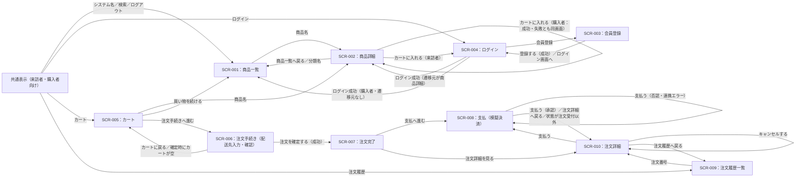
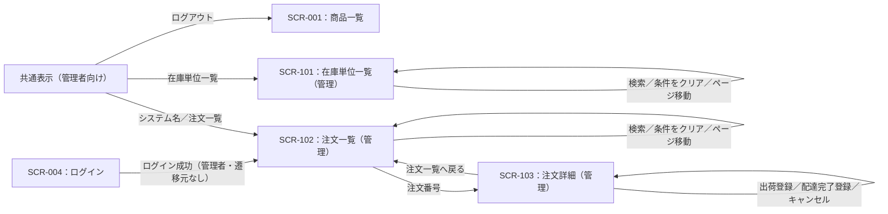
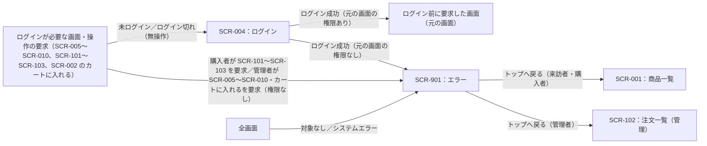

# 画面・帳票要件レイアウト/一覧：MiniCommerce

## 0. 文書管理

### 0.1 改訂履歴

| 版数 | 日付 | 改訂内容 | 作成・改訂者 |
|---|---|---|---|
| 1.0 | 2026-10-09 | 初版作成 | MiniCommerce 要件定義チーム |
| 1.1 | 2026-11-09 | 設計情報（API物理仕様・物理名・実装方式・画面配置等）を削除し要件表現に整理 | MiniCommerce 要件定義チーム |
| 1.2 | 2026-11-19 | 2.1 UI-02 の対象OSを、非機能要件の正本 NFR-US-06（PC の Windows 11）に一致させた（要件レビューの指摘対応）。ブラウザ・画面幅・画面の項目・操作は変更しない | Requirements Agent（RUN-AOBA-EC-1118） |

## 1. 本書の目的と適用範囲

### 1.1 目的

本書は、MiniCommerce が利用者に提供する画面、帳票、およびメール・通知のその他出力について、利用目的、利用者、主な表示・入力項目、操作、遷移、出力条件の要求を一覧化し定義するものである。

MiniCommerce は、株式会社あおば雑貨（以下「当社」）が会員向けに提供する自社ECサイトであり、商品閲覧、カート、クーポン適用、注文確定、支払（模擬決済）、注文照会・キャンセル、出荷登録、配達完了登録をWeb画面で提供する。

### 1.2 適用範囲

| 区分 | 内容 |
|---|---|
| 対象とする範囲 | 来訪者・購入者・管理者がPCブラウザで利用する画面14画面（SCR-001〜SCR-010、SCR-101〜SCR-103、SCR-901）。管理者向け画面（SCR-101〜SCR-103）を含む。画面内に表示するメッセージを含む |
| 対象外とする範囲 | 帳票（印刷物、PDF・CSV・Excel のファイル出力）、メール・SMS・プッシュ通知、スマートフォン専用画面、商品・商品分類・仕入先・在庫単位・クーポンの登録・更新・削除画面、入荷・在庫補充の登録画面、会員情報変更・パスワード再設定・退会の画面、「特定商取引法に基づく表記」の静的ページ、運用者が行う初期データ一括投入（FR-060。画面はない）、決済サービス（模擬）の画面（画面はない） |
| 本書で用いる利用者区分 | ACT-001 来訪者（ログインしていない閲覧者）、ACT-002 購入者（会員登録済みでログインした利用者）、ACT-003 管理者（EC運営担当・出荷担当。在庫・注文の確認、出荷登録・配達完了登録・キャンセルを行う。カート・注文確定・支払の購入機能は利用できない）。ACT-004 決済サービス（模擬）と ACT-005 運用者は画面を利用しない。本書では利用者区分を「来訪者」「購入者」「管理者」の名称で記載する |
| 本書で用いる機能ID | FR-001 会員登録／FR-002 ログイン／FR-003 ログアウト／FR-004 ログイン利用者情報照会／FR-010 商品分類一覧照会／FR-011 商品一覧検索／FR-012 商品詳細照会／FR-020 カート照会／FR-021 カート明細追加／FR-022 カート明細数量変更／FR-023 カート明細削除／FR-024 クーポン適用／FR-025 クーポン解除／FR-026 注文金額計算／FR-030 注文確定／FR-031 支払（模擬決済）／FR-032 注文履歴一覧照会／FR-033 注文詳細照会（購入者）／FR-034 注文キャンセル（購入者）／FR-040 在庫単位一覧照会／FR-041 注文一覧検索（管理者）／FR-042 注文詳細照会（管理者）／FR-043 出荷登録／FR-044 配達完了登録／FR-045 注文キャンセル（管理者） |

### 1.3 本書で定義しない事項

| 事項 | 本書での扱い |
|---|---|
| 画面デザインの詳細（配色値、余白、フォントサイズ、部品の詳細配置） | 本書では記載しない（設計工程で定義する） |
| 入力規則の全量（全項目の入力チェック仕様、チェック順序）、業務チェック | 本書では記載しない。画面要件として必要な主な制約のみ記載する |
| メッセージ文言の全量 | 本書では記載しない |
| 帳票の詳細レイアウト（座標、罫線、印字位置） | 本書では記載しない（設計工程で定義する） |
| 項目の型・桁・コード値 | 本書では記載しない |
| Web API の要求・応答の形式、画面の実装方式（画面部品の実装手段） | 本書では記載しない |
| 業務ルールの判定・計算の内容（数量上限、クーポン判定、金額計算、在庫引当、状態遷移） | 本書では記載しない。画面に表示する値と、判定結果の表示方法のみ記載する |

## 2. 共通UI要件

### 2.1 対象デバイス・ブラウザ・画面サイズ

| ID | 項目 | 要件 |
|---|---|---|
| UI-01 | 対象デバイス | PC |
| UI-02 | 対象OS・ブラウザ | ブラウザ：Google Chrome 最新版、Microsoft Edge 最新版（いずれもリリース判定時点の最新の安定版）。OS：PC の Windows 11（非機能要件 NFR-US-06。互換性・操作性の確認も Windows 11 の PC で行う） |
| UI-03 | 想定画面サイズ | 最小画面幅 1280px 〜 最大画面幅 制限なし。画面幅1280px以上で横スクロールなく表示する |
| UI-04 | レスポンシブ対応 | 不要 |

### 2.2 全画面共通の表示内容・操作

| ID | 区分 | 表示内容・操作 | 表示対象画面 |
|---|---|---|---|
| UI-05 | 来訪者・購入者向けの共通表示 | システム名「MiniCommerce」（選ぶと SCR-001 へ遷移する）、キーワードを入力して検索する操作（SCR-001 で商品を検索する）、「カート」（SCR-005 へ遷移する。購入者には利用中カートの合計点数を「カート（n点）」の形式で併記。来訪者には点数を表示しない）、「注文履歴」（SCR-009 へ遷移する）、来訪者には「ログイン」（SCR-004 へ遷移する）、購入者にはログイン中の氏名（「○○さん」の形式）と「ログアウト」の操作 | 管理者がログインしていない状態で表示する全画面（SCR-001〜SCR-010、および来訪者・購入者が表示する SCR-901） |
| UI-06 | 管理者向けの共通表示 | システム名「MiniCommerce」（選ぶと SCR-102 へ遷移する）、「在庫単位一覧」（SCR-101 へ遷移する）、「注文一覧」（SCR-102 へ遷移する）、「ログアウト」の操作 | 管理者がログイン中に表示する全画面（SCR-101〜SCR-103、管理者が表示する SCR-001〜SCR-004・SCR-901） |
| UI-07 | 画面間の移動 | 画面間の移動は共通表示（UI-05、UI-06）の操作と、5章の各画面の操作で行う。来訪者・購入者には UI-05、管理者には UI-06 の操作を表示する | 全画面 |
| UI-08 | メッセージ | 業務エラー、完了メッセージ、遷移理由の案内を表示する。表示するメッセージがない場合は何も表示しない | 全画面 |
| UI-09 | 各画面固有の内容 | 各画面の表示項目・入力項目・操作（5章） | 全画面 |
| UI-10 | 該当なし | 該当なし（上記以外に全画面共通の表示内容・操作はない） | 該当なし |

### 2.3 共通操作

| ID | 操作 | 要件 | 適用範囲 |
|---|---|---|---|
| UI-11 | 戻る | 画面内の戻る操作（「商品一覧へ戻る」「カートに戻る」「注文履歴へ戻る」「注文一覧へ戻る」「注文詳細へ戻る」）は5章の各画面に記載した遷移先へ遷移する。ブラウザの戻る操作は禁止しない。ブラウザの戻る操作で表示した画面から更新操作を行った場合も、操作した時点のデータに基づく結果となり、状態不正・在庫不足の場合は各画面の失敗時の表示を行う | 全画面 |
| UI-12 | 確定前の確認 | 注文確定（SCR-006）、注文キャンセル（SCR-010、SCR-103）、出荷登録（SCR-103）、配達完了登録（SCR-103）、カート明細の削除（SCR-005）の実行前に、実行する操作と対象（注文番号または商品名・規格名）を示して確認を求める。利用者が承諾した場合のみ実行し、取り消した場合は実行せずに元の画面に留まる（入力値は保持する）。上記以外の操作では確認を求めない | SCR-005、SCR-006、SCR-010、SCR-103 |
| UI-13 | 一覧の分割表示 | 1ページの表示件数は SCR-001・SCR-009・SCR-102 が20件、SCR-101 が50件とする。表示中のページから、前のページ・次のページ、前後2ページ以内の各ページ、先頭ページ・最終ページへ移動できる。表示中のページが何ページ目かを文字で識別できること。総ページ数が1以下の場合はページ移動の操作を表示しない。ページ移動時は検索条件・並び順を保持する。検索条件を変更して検索した場合は1ページ目を表示する。総ページ数を超えるページを指定した場合は0件として表示し（UI-30）、1未満または整数でないページを指定した場合は各画面の 5.x.2（条件を満たさない場合の振る舞い）による | SCR-001、SCR-009、SCR-101、SCR-102 |
| UI-14 | ソート | 利用者が並び順を変更できるのは SCR-001 の「並び順」の選択のみとする。列見出しの選択による並べ替えは行わない。その他の一覧は5章に記載した固定の並び順で表示する | 一覧を表示する全画面 |
| UI-15 | 二重操作時の扱い | 更新操作（会員登録の「登録する」、「ログイン」、「ログアウト」、「カートに入れる」、「数量を変更」、「削除」、クーポンの「適用する」「解除する」、「注文を確定する」、「支払う」、「キャンセルする」、「出荷登録」、「配達完了登録」、「キャンセル」）は、処理が完了するまでの間に同じ操作を繰り返しても、登録・更新は1回分だけ反映される（二重に登録・更新されない。処理の完了後に行った操作は新たな操作として扱う）。「支払う」は、処理が完了するまでの間に繰り返し操作しても決済要求は1回分だけ送信され、否認・連携エラーの後に行った操作は新たな支払として扱う（FR-031） | 更新操作を持つ全画面 |
| UI-16 | セッションタイムアウト時 | 無操作によりログイン状態が切れた後に、ログインが必要な画面の表示・操作を行った場合は SCR-004 へ遷移し、「ログインが必要です。ログインしていないか、30分間操作がなかったためログインが切れています。」を表示する。ログイン状態が切れる前に入力中の内容は保持しない。再ログイン後は表示・操作しようとした画面へ戻る（更新操作は実行せず、その画面を表示する）。ログインが不要な画面（SCR-001〜SCR-004、SCR-901）は来訪者として表示する | 全画面 |
| UI-17 | 未ログイン時の表示要求 | 来訪者がログインが必要な画面（SCR-005〜SCR-010、SCR-101〜SCR-103）を表示しようとした場合、または SCR-002 で「カートに入れる」を操作した場合は SCR-004 へ遷移し、UI-16 と同じメッセージを表示する。ログイン成功後は元の画面（「カートに入れる」の場合は SCR-002）へ戻る。元の画面の権限がない利用者区分でログインした場合は SCR-901（権限なし）を表示する | SCR-002、SCR-004〜SCR-010、SCR-101〜SCR-103 |
| UI-18 | 権限なし・対象なし・システムエラー | 購入者が管理者向け画面（SCR-101〜SCR-103）を、管理者が購入者向け画面（SCR-005〜SCR-010）または購入機能（SCR-002 の「カートに入れる」）を要求した場合は SCR-901（権限なし）を表示する。存在しない・非公開の商品、存在しない注文、他の購入者の注文、存在しないカート明細を指定した場合は SCR-901（対象なし）を表示する。システムエラーが発生した場合は SCR-901（システムエラー）を表示する | 全画面 |
| UI-19 | 入力エラー時の入力値保持 | 入力エラー・業務エラーで同じ画面に留まる場合、入力値を保持して再表示する。ただしパスワード・パスワード（確認）は保持せず空欄に戻す | 入力項目を持つ全画面 |
| UI-20 | ログアウト | 共通表示（UI-05、UI-06）の「ログアウト」を操作するとログアウトし（FR-003）、SCR-001 へ遷移し、「ログアウトしました。」を表示する。確定前の確認は求めない | 購入者・管理者がログイン中の全画面 |
| UI-21 | 未保存時の離脱警告 | 表示しない。入力中に他の画面へ遷移した場合、入力内容は保持しない | 入力項目を持つ全画面 |

### 2.4 表示規約

| ID | 対象 | 規約 | 適用範囲 |
|---|---|---|---|
| UI-23 | 日付・時刻 | 日時は「YYYY/MM/DD HH:MM」（24時間制、秒は表示しない）、日付のみの場合は「YYYY/MM/DD」で表示する。タイムゾーンは日本時間とし、タイムゾーン名は表示しない | 全画面 |
| UI-24 | 数値・金額 | 金額は整数の円とし、3桁ごとにカンマで区切り末尾に「円」を付ける（例「1,234円」「0円」）。小数点以下は表示しない。割引額は符号を付けずに表示する。数量・在庫数量は整数で表示し、在庫数量には「個」、合計点数には「点」を付ける。定率の割引値は「10%」の形式で表示する | 全画面 |
| UI-25 | 商品価格（総額表示） | 商品価格（在庫単位の価格・単価）は、税込価格を主表示し税抜価格を併記する（例「1,100円（税込）／1,000円（税抜）」）。管理者向けの在庫単位一覧（SCR-101）のみ税抜価格だけを表示する | SCR-001、SCR-002、SCR-005、SCR-006、SCR-010、SCR-103 |
| UI-26 | 金額内訳 | カート・注文の金額は、小計、割引額、割引後小計、送料、消費税額、合計（税込）の6項目をこの順に表示する。明細金額は税抜で表示し「（税抜）」を付ける | SCR-005、SCR-006、SCR-010、SCR-103 |
| UI-27 | 状態・区分の表示名 | コード値は表示せず表示名で表示する。注文状態：注文受付／支払済／出荷済／配達完了／キャンセル済。決済結果：承認／否認／連携エラー。割引方式：定額／定率。実行者の利用者区分：購入者／管理者。公開状態：公開／非公開。在庫状況：在庫あり（在庫数量1以上）／在庫切れ（在庫数量0）。都道府県：都道府県名 | 全画面 |
| UI-28 | 必須項目の識別 | 必須の入力項目は、必須項目であることが入力前に識別できること | 入力項目を持つ全画面 |
| UI-29 | エラーの対象項目の識別 | 入力エラーは、エラーの対象項目が識別できるように理由を表示し、複数項目のエラーは全項目分を同時に表示する。業務エラー・完了メッセージは UI-08 のメッセージとして表示する。業務エラーのメッセージには理由と利用者に求める操作を含める。権限なし・対象なし・システムエラーは SCR-901 に表示する | 全画面 |
| UI-30 | 0件時の表示 | 一覧の表示対象が0件の場合（総ページ数を超えるページを指定した場合を含む）、一覧に代えて画面ごとのメッセージを表示する（SCR-001「該当する商品はありません。」、SCR-005「カートに商品がありません。」、SCR-009「注文履歴はありません。」、SCR-101「該当する在庫単位はありません。」、SCR-102「該当する注文はありません。」、SCR-103 の決済記録「決済記録はありません。」） | 一覧を表示する全画面 |
| UI-31 | 長い文字列 | 文字列は省略せず、表示領域の幅で折り返して全文を表示する。商品説明は入力時の改行を保持して表示する | 全画面 |
| UI-32 | 未設定値の表示 | 値が未設定の項目（未発生の日時、未登録の配送伝票番号、未入力の住所2、取引参照番号のない決済記録、注文確定時の変更前状態）は「－」と表示する | 全画面 |
| UI-33 | 郵便番号・電話番号の表示 | 郵便番号は「123-4567」の形式（3桁目の後にハイフン）で表示する。電話番号は登録された数字のみで表示する（ハイフンを付けない） | SCR-010、SCR-103 |

### 2.5 デザイン・ブランドの制約

| ID | 制約 | 内容 | 根拠・参照資料 |
|---|---|---|---|
| UI-35 | 外部サイトへの非依存 | 外部サイトに接続できない環境でも、全画面が欠けなく表示され、全操作を行えること（外部サイトのWebフォント・画像・スクリプトを表示に用いない） | 外部インターネットに接続しない環境で利用できるようにするため |
| UI-37 | デザインガイドライン・ロゴ | 遵守すべき当社のデザインガイドライン・ロゴ画像の指定はない。システム名「MiniCommerce」は文字で表示する | 該当なし（指定する資料はない） |
| UI-38 | 画像 | 商品画像は表示しない | 商品画像は本リリースの対象外 |

### 2.6 アクセシビリティ

| ID | 要件 |
|---|---|
| UI-39 | JIS X 8341-3:2016 の適合レベルA に準拠する（優先度：推奨） |
| UI-40 | 全画面の操作（検索、カート操作、注文確定、支払、キャンセル、出荷登録、配達完了登録、ログイン・ログアウト）をキーボードのみで完了できる（優先度：推奨） |
| UI-41 | 全入力項目に項目名のラベルを表示し、ラベルと入力項目の対応を支援技術が判別できる（優先度：推奨） |
| UI-42 | 状態（注文状態、在庫切れ、低在庫、選択中の分類）、必須項目、エラーを色のみで示さず、文字でも表示する（優先度：推奨） |
| UI-43 | 各画面のページタイトルに画面名とシステム名を含める（例「商品一覧｜MiniCommerce」）（優先度：推奨） |

## 3. 画面一覧

| ID | 画面名 | 利用目的 | 利用者区分 | 画面種別 | 主な遷移元 | 主な遷移先 | 優先度 |
|---|---|---|---|---|---|---|---|
| SCR-001 | 商品一覧 | 商品分類・キーワードで公開中の商品を探し、一覧で確認する（来訪者・購入者のトップ画面） | 来訪者、購入者、管理者（閲覧のみ） | 一覧 | 共通表示（UI-05、UI-06）、SCR-002、SCR-004、SCR-005、SCR-901 | SCR-002 | 必須 |
| SCR-002 | 商品詳細 | 商品の説明と規格（在庫単位）ごとの税込価格・在庫を確認し、カートに入れる | 来訪者、購入者、管理者（閲覧のみ。「カートに入れる」は表示しない） | 詳細 | SCR-001、SCR-005、SCR-004（ログイン後の復帰） | SCR-001、SCR-004 | 必須 |
| SCR-003 | 会員登録 | 会員情報を入力して購入者として登録する | 来訪者（ログイン中の購入者・管理者も利用可） | 入力 | SCR-004 | SCR-004 | 必須 |
| SCR-004 | ログイン | メールアドレスとパスワードでログインする（購入者・管理者共通） | 来訪者 | ログイン | 共通表示（UI-05）、SCR-002、SCR-003、ログインが必要な画面（SCR-005〜SCR-010、SCR-101〜SCR-103） | SCR-001、SCR-102、SCR-003、ログイン前に要求した画面、SCR-901 | 必須 |
| SCR-005 | カート | カートの内容と金額内訳を確認し、数量変更・削除・クーポン適用・解除を行う | 購入者 | 一覧 | 共通表示（UI-05）、SCR-006、SCR-004（ログイン後の復帰） | SCR-006、SCR-002、SCR-001 | 必須 |
| SCR-006 | 注文手続き（配送先入力・確認） | 配送先を入力し、注文内容と金額を確認して注文を確定する | 購入者 | 入力 | SCR-005、SCR-004（ログイン後の復帰） | SCR-007、SCR-005 | 必須 |
| SCR-007 | 注文完了 | 注文の受付結果（注文番号・合計金額）を確認し、支払へ進む | 購入者 | 完了 | SCR-006、SCR-004（ログイン後の復帰） | SCR-008、SCR-010 | 必須 |
| SCR-008 | 支払（模擬決済） | 注文の代金を模擬決済で支払う | 購入者 | 入力 | SCR-007、SCR-010、SCR-004（ログイン後の復帰） | SCR-010 | 必須 |
| SCR-009 | 注文履歴一覧 | 自分の注文の一覧と状態を確認する | 購入者 | 一覧 | 共通表示（UI-05）、SCR-010、SCR-004（ログイン後の復帰） | SCR-010 | 必須 |
| SCR-010 | 注文詳細 | 自分の注文の内容・状態・状態履歴を確認し、支払・キャンセルを行う | 購入者 | 詳細 | SCR-009、SCR-007、SCR-008、SCR-004（ログイン後の復帰） | SCR-008、SCR-009 | 必須 |
| SCR-101 | 在庫単位一覧（管理） | 在庫単位ごとの在庫数量と低在庫を確認する | 管理者 | 一覧 | 共通表示（UI-06）、SCR-004（ログイン後の復帰） | 該当なし（同画面内の検索・ページ移動のみ） | 必須 |
| SCR-102 | 注文一覧（管理） | 全購入者の注文を検索し、状態を確認する（管理者のログイン後のトップ画面） | 管理者 | 一覧 | 共通表示（UI-06）、SCR-004、SCR-103、SCR-901 | SCR-103 | 必須 |
| SCR-103 | 注文詳細（管理） | 注文の内容・決済記録・状態履歴を確認し、出荷登録・配達完了登録・キャンセルを行う | 管理者 | 詳細 | SCR-102、SCR-004（ログイン後の復帰） | SCR-102 | 必須 |
| SCR-901 | エラー | 対象なし・権限なし・システムエラーの発生を利用者に示す | 来訪者、購入者、管理者 | エラー | 全画面、SCR-004 | SCR-001、SCR-102 | 必須 |

## 4. 画面遷移の概要

来訪者・購入者の主な遷移を図1、管理者の主な遷移を図2、ログイン要否と権限による遷移（全利用者区分共通）を図3に示す。

図1：来訪者・購入者の画面遷移

図2：管理者の画面遷移

図3：ログイン要否・権限による遷移（全利用者区分共通）

## 5. 画面別要件

各表の行IDは「画面ID-記号連番」とし、記号は V（表示項目）、IN（入力項目）、OP（操作）、SC（検索条件）、NT（特記事項）とする。各操作の失敗時の表示のうち、未ログイン・ログイン切れは UI-16・UI-17、権限なし・対象なし・システムエラーは UI-18 に従い、各表には画面固有の表示を記載する。

### 5.1 SCR-001：商品一覧

#### 5.1.1 基本情報

| 項目 | 内容 |
|---|---|
| 画面ID | SCR-001 |
| 画面名 | 商品一覧 |
| 利用目的 | 商品分類・キーワードで公開中の商品を探し、並び順を選んで一覧で確認し、商品詳細へ進む。来訪者・購入者のトップ画面とする |
| 利用者区分 | 来訪者、購入者、管理者（閲覧のみ） |
| 画面種別 | 一覧 |

#### 5.1.2 表示条件・アクセス条件

| 項目 | 内容 |
|---|---|
| ログイン要否 | 不要 |
| 表示可能な状態・期間 | 該当なし（常時表示する） |
| 条件を満たさない場合の振る舞い | 検索条件に誤りがある場合（存在しない商品分類・範囲外の並び順・1未満または整数でないページの指定）は商品一覧を表示せず、入力値を保持して「検索条件に誤りがあります。条件を指定し直してください。」と、条件を満たさない全項目の項目名（商品分類・並び順・ページ）とその理由を表示する。キーワードが文字数の上限を超える場合は SCR-001-OP01 の失敗時の表示を行う |

#### 5.1.3 主な表示項目

| ID | 項目名 | 内容 | 表示条件 |
|---|---|---|---|
| SCR-001-V01 | 商品分類一覧 | 全商品分類の分類名を、親子関係（最大3階層）が識別できるように表示する。分類名を選ぶとその分類で絞り込める。「すべての商品」を選ぶと分類の指定を解除できる | 常時 |
| SCR-001-V02 | 選択中の分類 | 絞り込み中の分類名の後に「（選択中）」を文字で表示する | 商品分類を指定しているとき |
| SCR-001-V03 | 指定中のキーワード | 「キーワード：○○」の形式で表示する | キーワードを指定しているとき |
| SCR-001-V04 | 検索結果件数 | 「全n件（a〜b件目を表示）」の形式で表示する | 検索結果が1件以上のとき |
| SCR-001-V05 | 商品名 | 商品の名称。選ぶと商品詳細（SCR-002）へ遷移する | 検索結果が1件以上のとき |
| SCR-001-V06 | 商品コード | 商品を識別するコード | 検索結果が1件以上のとき |
| SCR-001-V07 | 最低価格 | 商品が持つ在庫単位の税抜価格の最小値と、その税込価格を UI-25 の形式で表示する | 検索結果が1件以上のとき |
| SCR-001-V08 | 在庫状況 | 在庫数量1以上の在庫単位が1件以上ある場合は「在庫あり」、ない場合は「在庫切れ」 | 検索結果が1件以上のとき |
| SCR-001-V09 | 所属分類 | 商品が所属する分類名を「、」区切りで表示する。所属がない場合は「－」 | 検索結果が1件以上のとき |
| SCR-001-V10 | ページ移動 | UI-13 の形式 | 総ページ数が2以上のとき |
| SCR-001-V11 | 0件時メッセージ | 「該当する商品はありません。」 | 検索結果が0件のとき、または総ページ数を超えるページを指定したとき |

#### 5.1.4 主な入力項目

| ID | 項目名 | 必須 | 入力の形態 | 主な制約 |
|---|---|---|---|---|
| SCR-001-IN01 | キーワード | 任意 | 自由入力 | 共通表示（UI-05）で入力する。空欄は条件なし。初期値：空欄（検索後は指定中のキーワードを表示する） |
| SCR-001-IN02 | 並び順 | 任意 | 選択肢から1つ選択 | 選択肢：新着順／価格の安い順／価格の高い順／商品名順。初期値：新着順 |
| SCR-001-IN03 | 商品分類 | 任意 | 選択肢から1つ選択 | 商品分類一覧（SCR-001-V01）の分類名を選んで指定する。初期値：指定なし（すべての商品） |

#### 5.1.5 操作

| ID | 操作名 | 実行条件 | 結果・遷移先 |
|---|---|---|---|
| SCR-001-OP01 | キーワード検索 | 常時 | 【機能】FR-011 商品一覧検索【確定前の確認】なし【成功時】入力したキーワードと、本画面で指定中の商品分類・並び順で SCR-001 の1ページ目を表示する（SCR-001 以外の画面から検索した場合は商品分類の指定なし・新着順）【失敗時】キーワードが文字数の上限を超える場合はキーワードの入力エラーとして「キーワードは50文字以内で入力してください。」を表示し、商品一覧は表示しない |
| SCR-001-OP02 | 分類名 | 常時 | 【機能】FR-011 商品一覧検索【確定前の確認】なし【成功時】選択した分類とその配下すべての分類に属する商品を、指定中のキーワード・並び順で1ページ目から表示する【失敗時】存在しない分類を指定した場合は「検索条件に誤りがあります。条件を指定し直してください。」と、条件を満たさない項目（商品分類）とその理由を表示する（5.1.2） |
| SCR-001-OP03 | すべての商品 | 常時 | 【機能】FR-011 商品一覧検索【確定前の確認】なし【成功時】商品分類の指定を解除し、指定中のキーワード・並び順で1ページ目から表示する【失敗時】該当なし（画面固有の失敗時の表示はない） |
| SCR-001-OP04 | 並べ替え | 常時 | 【機能】FR-011 商品一覧検索【確定前の確認】なし【成功時】「並び順」で選んだ並び順と、指定中の商品分類・キーワードで1ページ目から表示する【失敗時】範囲外の並び順を指定した場合は「検索条件に誤りがあります。条件を指定し直してください。」と、条件を満たさない項目（並び順）とその理由を表示する（5.1.2） |
| SCR-001-OP05 | 前へ／次へ／ページ番号 | 総ページ数が2以上 | 【機能】FR-011 商品一覧検索【確定前の確認】なし【成功時】指定中の条件・並び順で指定したページを表示する【失敗時】総ページ数を超えるページの場合は「該当する商品はありません。」を表示する |
| SCR-001-OP06 | 商品名 | 検索結果が1件以上 | 【機能】なし（遷移のみ）【確定前の確認】なし【成功時】SCR-002 へ遷移する【失敗時】商品が非公開になっていた場合は SCR-901（対象なし） |

#### 5.1.6 一覧表示の条件

##### 検索条件

| ID | 検索条件項目 | 条件の種類 | 必須 | 初期値 |
|---|---|---|---|---|
| SCR-001-SC01 | 商品分類 | 完全一致（指定した分類と、その配下すべての分類に属する商品を対象とする） | 任意 | 該当なし（指定なし） |
| SCR-001-SC02 | キーワード（商品名または商品説明） | 部分一致（英字の大文字・小文字を区別しない） | 任意 | 該当なし（空欄） |

##### 並び順・表示件数

| 項目 | 内容 |
|---|---|
| 初期の並び順 | 新着順：第1キー 商品登録日時 降順（同じ登録日時の場合は後に登録した商品を先に表示する） |
| 利用者によるソート | 可（「並び順」の選択による。新着順＝商品登録日時 降順／価格の安い順＝最低税抜価格 昇順／価格の高い順＝最低税抜価格 降順／商品名順＝商品名 昇順。新着順は同じ登録日時の場合は後に登録した商品を先に、その他は同じ値の場合は先に登録した商品を先に表示する）。列見出しによる並べ替えは不可 |
| 1ページの表示件数 | 20 件 |
| 表示件数の上限 | 上限なし（全件をページ移動で表示する） |
| 検索結果0件時 | 「該当する商品はありません。」を表示する（総ページ数を超えるページを指定した場合も同じ） |
| 検索条件の組合せ | 商品分類とキーワードを両方指定した場合は、両方を満たす商品を表示する（かつ） |
| 商品分類一覧の並び順・件数 | 親の分類の直後にその配下の分類を表示する。同じ親の中では表示順 昇順、名称 昇順（同じ場合は先に登録した分類を先）。全件を表示する（一覧の分割表示なし） |

#### 5.1.7 特記事項

| ID | 内容 |
|---|---|
| SCR-001-NT01 | 表示内容は FR-010（商品分類一覧照会）と FR-011（商品一覧検索）の結果による |
| SCR-001-NT02 | 来訪者・購入者のトップ画面とする。購入者のログイン成功時（ログイン前に要求した画面がない場合）とログアウト後の遷移先とする |
| SCR-001-NT03 | 商品画像は表示しない |
| SCR-001-NT04 | 管理者がログイン中に表示した場合も同じ内容を表示し、共通表示は UI-06 とする。UI-06 にはキーワードで検索する操作がないため、管理者は商品分類・並び順・ページ移動のみ操作できる |

### 5.2 SCR-002：商品詳細

#### 5.2.1 基本情報

| 項目 | 内容 |
|---|---|
| 画面ID | SCR-002 |
| 画面名 | 商品詳細 |
| 利用目的 | 商品の説明と、規格（在庫単位）ごとの税込価格・在庫数量を確認し、規格と数量を選んでカートに入れる |
| 利用者区分 | 来訪者、購入者、管理者（閲覧のみ。「カートに入れる」は表示しない） |
| 画面種別 | 詳細 |

#### 5.2.2 表示条件・アクセス条件

| 項目 | 内容 |
|---|---|
| ログイン要否 | 不要（「カートに入れる」の実行はログインが必要） |
| 表示可能な状態・期間 | 該当なし（常時表示する） |
| 条件を満たさない場合の振る舞い | 商品が存在しない・非公開・在庫単位0件の場合は SCR-901（対象なし）を表示する |

#### 5.2.3 主な表示項目

| ID | 項目名 | 内容 | 表示条件 |
|---|---|---|---|
| SCR-002-V01 | 商品名 | 商品の名称 | 常時 |
| SCR-002-V02 | 商品コード | 商品を識別するコード | 常時 |
| SCR-002-V03 | 所属分類 | 所属する分類名を「、」区切りで表示する。各分類名を選ぶと SCR-001 でその分類で絞り込んだ一覧を表示する。所属がない場合は「－」 | 常時 |
| SCR-002-V04 | 商品説明 | 改行を保持して全文を表示する。空の場合は「－」 | 常時 |
| SCR-002-V05 | 在庫単位一覧 | 規格ごとに表示する（SKU 昇順） | 常時 |
| SCR-002-V06 | SKU | 在庫単位を識別するコード | 常時 |
| SCR-002-V07 | 規格名 | 規格の名称（例「ブルー／M」） | 常時 |
| SCR-002-V08 | 価格 | UI-25 の形式（例「1,100円（税込）／1,000円（税抜）」） | 常時 |
| SCR-002-V09 | 在庫数量 | 表示時点の在庫数量を「n個」の形式で表示する | 常時 |
| SCR-002-V10 | 在庫状況 | 在庫数量1以上は「在庫あり」、0は「在庫切れ」 | 常時 |
| SCR-002-V11 | 在庫切れの案内 | 「この商品は現在すべての規格が在庫切れのため、カートに入れられません。」 | 全在庫単位の在庫数量が0のとき（管理者ログイン中を除く） |

#### 5.2.4 主な入力項目

| ID | 項目名 | 必須 | 入力の形態 | 主な制約 |
|---|---|---|---|---|
| SCR-002-IN01 | 規格 | 必須 | 選択肢から1つ選択 | 在庫単位一覧の規格から1つ選ぶ。在庫数量0の規格は選択不可。初期値：在庫数量1以上の在庫単位のうち SKU 昇順で先頭の規格。全規格が在庫切れの場合はすべて選択不可。管理者ログイン中は表示しない |
| SCR-002-IN02 | 数量 | 必須 | 自由入力 | 1以上の整数。初期値：1。全規格が在庫切れの場合は入力不可。管理者ログイン中は表示しない |

#### 5.2.5 操作

| ID | 操作名 | 実行条件 | 結果・遷移先 |
|---|---|---|---|
| SCR-002-OP01 | カートに入れる | 在庫数量1以上の在庫単位が1件以上ある（全規格が在庫切れの場合は操作できない）。管理者ログイン中は表示しない | 【機能】FR-021 カート明細追加【確定前の確認】なし【成功時】本画面に留まり、「カートに追加しました（規格名、n個）。」を表示し、共通表示（UI-05）のカート合計点数を更新する【失敗時】数量の入力エラー（未入力、0以下、整数以外）は数量の入力エラーとして「数量は1以上の整数で入力してください。」／数量上限超過は「同じ規格は1注文につき10個までです（現在のカート内数量：n個）。」／在庫不足は「在庫が不足しています（現在の在庫数量：n個）。」を表示し、本画面に留まり入力値を保持する（カートは変更しない）。商品が非公開になっていた場合は SCR-901（対象なし）【来訪者】FR-021 を実行せずに SCR-004 へ遷移し、ログイン成功後に本画面へ戻る（カートへの投入は行わないため、再度「カートに入れる」を操作する） |
| SCR-002-OP02 | 分類名 | 所属分類があるとき | 【機能】なし（遷移のみ）【確定前の確認】なし【成功時】SCR-001 へ遷移し、その分類で絞り込んだ一覧を表示する【失敗時】該当なし |
| SCR-002-OP03 | 商品一覧へ戻る | 常時 | 【機能】なし（遷移のみ）【確定前の確認】なし【成功時】SCR-001 へ遷移し、初期状態（商品分類・キーワードの指定なし、新着順、1ページ目）で表示する【失敗時】該当なし |

#### 5.2.6 一覧表示の条件

##### 検索条件

| ID | 検索条件項目 | 条件の種類 | 必須 | 初期値 |
|---|---|---|---|---|
| 該当なし | 該当なし | 該当なし | 該当なし | 該当なし |

##### 並び順・表示件数

| 項目 | 内容 |
|---|---|
| 初期の並び順 | 在庫単位一覧：第1キー SKU 昇順 |
| 利用者によるソート | 不可 |
| 1ページの表示件数 | 全件（一覧の分割表示なし） |
| 表示件数の上限 | 上限なし |
| 検索結果0件時 | 該当なし（在庫単位が0件の商品は本画面を表示せず SCR-901（対象なし）を表示する） |

#### 5.2.7 特記事項

| ID | 内容 |
|---|---|
| SCR-002-NT01 | 表示内容は FR-012（商品詳細照会）の結果による |
| SCR-002-NT02 | 在庫切れ時の表示切替：全規格の在庫数量が0の場合は、規格の選択・数量を入力不可、「カートに入れる」を操作不可とし、在庫切れの案内（SCR-002-V11）を表示する。一部の規格のみ在庫数量0の場合は、その規格のみ選択不可とする |
| SCR-002-NT03 | 表示している在庫数量は画面表示時点の値である |
| SCR-002-NT04 | 商品画像・仕入先は表示しない |

### 5.3 SCR-003：会員登録

#### 5.3.1 基本情報

| 項目 | 内容 |
|---|---|
| 画面ID | SCR-003 |
| 画面名 | 会員登録 |
| 利用目的 | メールアドレス・パスワード・氏名を入力して購入者として会員登録する |
| 利用者区分 | 来訪者（ログイン中の購入者・管理者も利用可） |
| 画面種別 | 入力 |

#### 5.3.2 表示条件・アクセス条件

| 項目 | 内容 |
|---|---|
| ログイン要否 | 不要 |
| 表示可能な状態・期間 | 該当なし（常時表示する） |
| 条件を満たさない場合の振る舞い | 該当なし（全利用者に表示する） |

#### 5.3.3 主な表示項目

| ID | 項目名 | 内容 | 表示条件 |
|---|---|---|---|
| SCR-003-V01 | 登録の案内 | 「会員登録後、ログイン画面からログインしてください。」 | 常時 |
| SCR-003-V02 | パスワードの条件 | 「8〜64文字で、英字と数字をそれぞれ1文字以上含めてください。メールアドレスと同じ文字列（英字の大文字・小文字の違いは区別しない）は使用できません。」 | 常時 |

#### 5.3.4 主な入力項目

| ID | 項目名 | 必須 | 入力の形態 | 主な制約 |
|---|---|---|---|---|
| SCR-003-IN01 | メールアドレス | 必須 | 自由入力 | メールアドレス形式。初期値：空欄 |
| SCR-003-IN02 | パスワード | 必須 | 自由入力 | パスワードの条件（SCR-003-V02）を満たすこと。入力した文字は伏せて表示する。初期値：空欄。エラー時は空欄に戻す |
| SCR-003-IN03 | パスワード（確認） | 必須 | 自由入力 | パスワードと同じ文字列。入力した文字は伏せて表示する。初期値：空欄。エラー時は空欄に戻す |
| SCR-003-IN04 | 氏名 | 必須 | 自由入力 | 初期値：空欄 |

#### 5.3.5 操作

| ID | 操作名 | 実行条件 | 結果・遷移先 |
|---|---|---|---|
| SCR-003-OP01 | 登録する | 常時（入力内容の判定は操作後に行う） | 【機能】FR-001 会員登録【確定前の確認】なし【成功時】SCR-004 へ遷移し、「会員登録が完了しました。ログインしてください。」を表示する（自動ログインしない）【失敗時】入力エラーは全項目分の理由を、対象項目が識別できるように同時に表示する／メールアドレスが登録済みの場合は「このメールアドレスは既に登録されています。」を表示する。いずれも本画面に留まり、メールアドレス・氏名の入力値を保持し、パスワード・パスワード（確認）は空欄に戻す |
| SCR-003-OP02 | ログイン画面へ | 常時 | 【機能】なし（遷移のみ）【確定前の確認】なし【成功時】SCR-004 へ遷移する（入力内容は保持しない）【失敗時】該当なし |

#### 5.3.6 一覧表示の条件

##### 検索条件

| ID | 検索条件項目 | 条件の種類 | 必須 | 初期値 |
|---|---|---|---|---|
| 該当なし | 該当なし | 該当なし | 該当なし | 該当なし |

##### 並び順・表示件数

| 項目 | 内容 |
|---|---|
| 初期の並び順 | 該当なし |
| 利用者によるソート | 該当なし |
| 1ページの表示件数 | 該当なし |
| 表示件数の上限 | 該当なし |
| 検索結果0件時 | 該当なし |

#### 5.3.7 特記事項

| ID | 内容 |
|---|---|
| SCR-003-NT02 | 登録される利用者の利用者区分は購入者とする（本画面で管理者の利用者は作成できない） |
| SCR-003-NT03 | ログイン中の利用者が本画面を表示した場合も表示する。登録してもログイン中の利用者のログイン状態は変更しない |

### 5.4 SCR-004：ログイン

#### 5.4.1 基本情報

| 項目 | 内容 |
|---|---|
| 画面ID | SCR-004 |
| 画面名 | ログイン |
| 利用目的 | メールアドレスとパスワードでログインし、購入者は購入機能、管理者は管理機能を利用できる状態にする（購入者・管理者共通） |
| 利用者区分 | 来訪者 |
| 画面種別 | ログイン |

#### 5.4.2 表示条件・アクセス条件

| 項目 | 内容 |
|---|---|
| ログイン要否 | 不要 |
| 表示可能な状態・期間 | 該当なし（常時表示する） |
| 条件を満たさない場合の振る舞い | 該当なし（全利用者に表示する） |

#### 5.4.3 主な表示項目

| ID | 項目名 | 内容 | 表示条件 |
|---|---|---|---|
| SCR-004-V01 | 会員登録完了の案内 | 「会員登録が完了しました。ログインしてください。」 | SCR-003 で登録に成功して遷移したとき |
| SCR-004-V02 | ログイン要求の案内 | 「ログインが必要です。ログインしていないか、30分間操作がなかったためログインが切れています。」 | ログインが必要な画面・操作から遷移したとき（UI-16、UI-17） |
| SCR-004-V03 | 会員登録の案内 | 「会員でない方は会員登録してください。」と、会員登録（SCR-003）へ遷移する操作 | 常時 |

#### 5.4.4 主な入力項目

| ID | 項目名 | 必須 | 入力の形態 | 主な制約 |
|---|---|---|---|---|
| SCR-004-IN01 | メールアドレス | 必須 | 自由入力 | 初期値：空欄（認証失敗時は入力値を保持する） |
| SCR-004-IN02 | パスワード | 必須 | 自由入力 | 入力した文字は伏せて表示する。初期値：空欄。認証失敗時・入力エラー時は空欄に戻す |

#### 5.4.5 操作

| ID | 操作名 | 実行条件 | 結果・遷移先 |
|---|---|---|---|
| SCR-004-OP01 | ログイン | 常時 | 【機能】FR-002 ログイン【確定前の確認】なし【成功時】ログイン状態とする。ログイン前に要求した画面がある場合はその画面へ戻る（その画面の権限がない利用者区分の場合は SCR-901（権限なし））。ない場合は購入者は SCR-001、管理者は SCR-102 へ遷移する【失敗時】未入力は該当項目の入力エラーとして「メールアドレスを入力してください。」「パスワードを入力してください。」を表示する／認証失敗は「メールアドレスまたはパスワードが正しくありません。」を表示する（どちらが誤りかを区別しない）。いずれも本画面に留まり、メールアドレスを保持し、パスワードは空欄に戻す |
| SCR-004-OP02 | 会員登録 | 常時 | 【機能】なし（遷移のみ）【確定前の確認】なし【成功時】SCR-003 へ遷移する【失敗時】該当なし |

#### 5.4.6 一覧表示の条件

##### 検索条件

| ID | 検索条件項目 | 条件の種類 | 必須 | 初期値 |
|---|---|---|---|---|
| 該当なし | 該当なし | 該当なし | 該当なし | 該当なし |

##### 並び順・表示件数

| 項目 | 内容 |
|---|---|
| 初期の並び順 | 該当なし |
| 利用者によるソート | 該当なし |
| 1ページの表示件数 | 該当なし |
| 表示件数の上限 | 該当なし |
| 検索結果0件時 | 該当なし |

#### 5.4.7 特記事項

| ID | 内容 |
|---|---|
| SCR-004-NT02 | 購入者・管理者が共通で利用するログイン画面とし、ログイン後の遷移先は利用者区分で切り替える |
| SCR-004-NT03 | ログインに失敗した回数によるアカウントのロック、ログイン試行回数の制限は行わない |
| SCR-004-NT04 | ログイン中の利用者が別のアカウントでログインに成功した場合は、新しいアカウントのログイン状態に切り替える |
| SCR-004-NT05 | 共通表示（UI-05）の「ログイン」から表示した場合は、ログイン前に要求した画面がないものとして扱う |

### 5.5 SCR-005：カート

#### 5.5.1 基本情報

| 項目 | 内容 |
|---|---|
| 画面ID | SCR-005 |
| 画面名 | カート |
| 利用目的 | カートに入れた商品と金額内訳（小計・割引額・割引後小計・送料・消費税額・合計）を確認し、数量変更・削除・クーポンの適用・解除を行って注文手続きへ進む |
| 利用者区分 | 購入者 |
| 画面種別 | 一覧 |

#### 5.5.2 表示条件・アクセス条件

| 項目 | 内容 |
|---|---|
| ログイン要否 | 要 |
| 表示可能な状態・期間 | 該当なし（常時表示する。カートに商品がない場合は空のカート（0件）として表示する） |
| 条件を満たさない場合の振る舞い | 未ログイン・ログイン切れ：SCR-004 へ遷移し、ログイン後に本画面へ戻る（UI-16、UI-17）。管理者：SCR-901（権限なし） |

#### 5.5.3 主な表示項目

| ID | 項目名 | 内容 | 表示条件 |
|---|---|---|---|
| SCR-005-V01 | カート明細一覧 | カート明細を明細ごとに表示する（カートへ追加した順） | 明細が1件以上のとき |
| SCR-005-V02 | 商品名 | 商品の名称。選ぶと SCR-002 へ遷移する | 明細が1件以上のとき |
| SCR-005-V03 | 規格名 | 規格の名称 | 明細が1件以上のとき |
| SCR-005-V04 | SKU | 在庫単位を識別するコード | 明細が1件以上のとき |
| SCR-005-V05 | 単価 | 在庫単位の現在の税抜価格と税込価格を UI-25 の形式で表示する | 明細が1件以上のとき |
| SCR-005-V06 | 明細金額 | 明細の税抜金額を「n円（税抜）」の形式で表示する | 明細が1件以上のとき |
| SCR-005-V07 | 在庫数量 | 現在の在庫数量を「n個」の形式で表示する | 明細が1件以上のとき |
| SCR-005-V08 | 在庫不足の警告 | 「在庫が不足しています（現在の在庫数量：n個）。数量を変更してください。」を該当明細に表示する | 明細の数量が現在の在庫数量を超えるとき |
| SCR-005-V09 | 合計点数 | 全明細の数量の合計を「n点」の形式で表示する | 常時 |
| SCR-005-V10 | クーポンコード | 適用中のクーポンのコード | クーポン適用中 |
| SCR-005-V11 | クーポン名 | 適用中のクーポンの表示名 | クーポン適用中 |
| SCR-005-V12 | 割引内容 | 定額は「1,000円引き」、定率は「10%引き」の形式で表示する | クーポン適用中 |
| SCR-005-V13 | 最低購入金額 | 「小計n円以上で利用可」の形式で表示する。0円の場合は「条件なし」 | クーポン適用中 |
| SCR-005-V14 | 有効期間 | 「YYYY/MM/DD HH:MM 〜 YYYY/MM/DD HH:MM」の形式で表示する | クーポン適用中 |
| SCR-005-V15 | クーポンの適用状況 | 適用条件を満たす場合は「適用中」。満たさない場合は「適用条件を満たしていません」と理由（「有効期間の開始前です」「有効期間が終了しています」「小計が最低購入金額に達していません」「カートに商品がありません」のいずれか）、および「このままでは注文を確定できません。クーポンを解除するか、条件を満たしてください。」を表示する | クーポン適用中 |
| SCR-005-V16 | 小計 | FR-026（注文金額計算）で算出した小計を「小計（税抜）」として表示する | 常時（明細0件は0円） |
| SCR-005-V17 | 割引額 | クーポンによる割引額 | 常時（クーポン未適用・適用条件を満たさない場合は0円） |
| SCR-005-V18 | 割引後小計 | FR-026 で算出した割引後小計 | 常時（明細0件は0円） |
| SCR-005-V19 | 送料 | FR-026 で算出した送料 | 常時（明細0件は0円） |
| SCR-005-V20 | 消費税額 | FR-026 で算出した消費税額 | 常時（明細0件は0円） |
| SCR-005-V21 | 合計（税込） | FR-026 で算出した合計 | 常時（明細0件は0円） |
| SCR-005-V22 | 送料の案内 | 「割引後小計が5,000円以上の場合、送料は無料です（5,000円未満は送料500円）。」 | 常時 |
| SCR-005-V23 | 注文前の案内 | 「在庫は注文確定時に確保します。価格は注文確定時点の価格で確定します。」 | 明細が1件以上のとき |
| SCR-005-V24 | 0件時メッセージ | 「カートに商品がありません。」 | 明細が0件のとき |

#### 5.5.4 主な入力項目

| ID | 項目名 | 必須 | 入力の形態 | 主な制約 |
|---|---|---|---|---|
| SCR-005-IN01 | 数量 | 必須 | 自由入力 | 明細ごとに入力する。1以上の整数（0にする変更は行わず、削除は「削除」で行う）。初期値：現在のカート内数量 |
| SCR-005-IN02 | クーポンコード | 条件付き必須（「適用する」の操作時） | 自由入力 | 英字・数字・ハイフンで入力する（英小文字での入力も可）。初期値：空欄。クーポン未適用時のみ入力できる |

#### 5.5.5 操作

| ID | 操作名 | 実行条件 | 結果・遷移先 |
|---|---|---|---|
| SCR-005-OP01 | 数量を変更 | 明細ごと、常時 | 【機能】FR-022 カート明細数量変更【確定前の確認】なし【成功時】本画面を再表示し、「数量を変更しました。」を表示し、金額内訳と共通表示（UI-05）のカート合計点数を更新する【失敗時】入力エラー（未入力、0以下、整数以外）は該当明細の数量の入力エラーとして「数量は1以上の整数で入力してください。」／数量上限超過は「同じ規格は1注文につき10個までです（現在のカート内数量：n個）。」／在庫不足は「在庫が不足しています（現在の在庫数量：n個）。」（数量を減らす変更でも在庫数量を超える場合は同じ）を表示する。いずれもカートは変更せず、入力値を保持する。明細が既に削除されていた場合は SCR-901（対象なし） |
| SCR-005-OP02 | 削除 | 明細ごと、常時 | 【機能】FR-023 カート明細削除【確定前の確認】あり（「商品名（規格名）をカートから削除します。よろしいですか？」）【成功時】本画面を再表示し、「カートから削除しました。」を表示し、金額内訳と共通表示（UI-05）のカート合計点数を更新する【失敗時】明細が既に削除されていた場合は SCR-901（対象なし） |
| SCR-005-OP03 | 適用する（クーポン） | クーポン未適用のとき | 【機能】FR-024 クーポン適用【確定前の確認】なし【成功時】本画面を再表示し、「クーポンを適用しました。」を表示し、適用中クーポンと金額内訳を更新する【失敗時】入力エラーはクーポンコードの入力エラーとして「クーポンコードは英字・数字・ハイフンの20文字以内で入力してください。」／カートが空は「カートに商品がないため、クーポンを適用できません。」／適用済みは「クーポンは1注文につき1枚までです（適用中のクーポン：クーポンコード）。別のクーポンを使う場合は、適用中のクーポンを解除してください。」／該当なしは「入力したクーポンコードは存在しません。」／開始前は「このクーポンは有効期間の開始前です（有効期間：YYYY/MM/DD HH:MM〜YYYY/MM/DD HH:MM）。」／期限切れは「このクーポンは有効期間が終了しています（有効期間：YYYY/MM/DD HH:MM〜YYYY/MM/DD HH:MM）。」／最低購入金額未達は「小計が最低購入金額に達していません（最低購入金額：n円、現在の小計：n円）。」を表示する。いずれもカートは変更せず、入力値を保持する |
| SCR-005-OP04 | 解除する（クーポン） | クーポン適用中のとき | 【機能】FR-025 クーポン解除【確定前の確認】なし【成功時】本画面を再表示し、「クーポンを解除しました。」を表示し、金額内訳を更新する【失敗時】該当なし |
| SCR-005-OP05 | 注文手続きへ進む | 明細が1件以上のとき（0件の場合は表示しない） | 【機能】なし（遷移のみ）【確定前の確認】なし【成功時】SCR-006 へ遷移する【失敗時】該当なし |
| SCR-005-OP06 | 買い物を続ける | 常時 | 【機能】なし（遷移のみ）【確定前の確認】なし【成功時】SCR-001 へ遷移し、初期状態で表示する【失敗時】該当なし |
| SCR-005-OP07 | 商品名 | 明細が1件以上のとき | 【機能】なし（遷移のみ）【確定前の確認】なし【成功時】SCR-002 へ遷移する【失敗時】商品が非公開になっていた場合は SCR-901（対象なし） |

#### 5.5.6 一覧表示の条件

##### 検索条件

| ID | 検索条件項目 | 条件の種類 | 必須 | 初期値 |
|---|---|---|---|---|
| 該当なし | 該当なし | 該当なし | 該当なし | 該当なし |

##### 並び順・表示件数

| 項目 | 内容 |
|---|---|
| 初期の並び順 | カート明細：カートへ追加した順 |
| 利用者によるソート | 不可 |
| 1ページの表示件数 | 全件（一覧の分割表示なし） |
| 表示件数の上限 | 上限なし |
| 検索結果0件時 | 「カートに商品がありません。」を表示する。「注文手続きへ進む」は表示しない |

#### 5.5.7 特記事項

| ID | 内容 |
|---|---|
| SCR-005-NT01 | 表示内容は FR-020（カート照会）の結果による。金額内訳は FR-026（注文金額計算）で算出した値を表示する |
| SCR-005-NT02 | 単価・金額は画面表示時点の在庫単位の現在の価格で表示する |
| SCR-005-NT03 | クーポンが適用条件を満たさなくなった場合も適用中のクーポンとして表示し、適用状況（SCR-005-V15）で理由を表示する |
| SCR-005-NT04 | クーポン適用中はクーポンコードを入力できず、クーポンの操作は「解除する」のみを表示する |

### 5.6 SCR-006：注文手続き（配送先入力・確認）

#### 5.6.1 基本情報

| 項目 | 内容 |
|---|---|
| 画面ID | SCR-006 |
| 画面名 | 注文手続き（配送先入力・確認） |
| 利用目的 | 配送先を入力し、注文内容（明細・クーポン・金額内訳）を確認して注文を確定する |
| 利用者区分 | 購入者 |
| 画面種別 | 入力 |

#### 5.6.2 表示条件・アクセス条件

| 項目 | 内容 |
|---|---|
| ログイン要否 | 要 |
| 表示可能な状態・期間 | 利用中カートの明細が1件以上あるとき |
| 条件を満たさない場合の振る舞い | 未ログイン・ログイン切れ：SCR-004 へ遷移し、ログイン後に本画面へ戻る（UI-16、UI-17）。管理者：SCR-901（権限なし）。カート明細が0件：SCR-005 へ遷移し、「カートに商品がありません。」を表示する |

#### 5.6.3 主な表示項目

| ID | 項目名 | 内容 | 表示条件 |
|---|---|---|---|
| SCR-006-V01 | 注文内容 | カート明細を明細ごとに表示する（カートへ追加した順）。項目は商品名、規格名、SKU、単価（UI-25 の形式）、数量、明細金額（税抜） | 常時 |
| SCR-006-V02 | 合計点数 | 「n点」の形式 | 常時 |
| SCR-006-V03 | 適用中クーポン | クーポンコード、クーポン名、割引内容（定額「1,000円引き」／定率「10%引き」）、適用状況 | クーポン適用中（未適用は「クーポンなし」） |
| SCR-006-V04 | クーポン条件不成立の警告 | 「適用中のクーポンは適用条件を満たしていません（理由）。カートでクーポンを解除するか、条件を満たしてから注文してください。」 | クーポン適用中で適用条件を満たさないとき |
| SCR-006-V05 | 金額内訳 | 小計（税抜）、割引額、割引後小計、送料、消費税額、合計（税込）を UI-26 の順に表示する | 常時 |
| SCR-006-V06 | 確定前の案内 | 「注文を確定すると在庫を確保します。金額は注文確定時点の価格で確定します。」 | 常時 |

#### 5.6.4 主な入力項目

| ID | 項目名 | 必須 | 入力の形態 | 主な制約 |
|---|---|---|---|---|
| SCR-006-IN01 | 受取人氏名 | 必須 | 自由入力 | 初期値：ログイン中の購入者の氏名 |
| SCR-006-IN02 | 郵便番号 | 必須 | 自由入力 | 「1234567」（数字7桁）または「123-4567」（数字3桁-数字4桁）の形式で入力する。初期値：空欄 |
| SCR-006-IN03 | 都道府県 | 必須 | 選択肢から1つ選択 | 選択肢と表示順は SCR-006-NT03 のとおり。初期値：未選択（「選択してください」を表示） |
| SCR-006-IN04 | 住所1（市区町村・番地） | 必須 | 自由入力 | 初期値：空欄 |
| SCR-006-IN05 | 住所2（建物名・部屋番号） | 任意 | 自由入力 | 初期値：空欄 |
| SCR-006-IN06 | 電話番号 | 必須 | 自由入力 | 数字で入力する。ハイフンを含めた入力も可（例「0312345678」「03-1234-5678」）。初期値：空欄 |

#### 5.6.5 操作

| ID | 操作名 | 実行条件 | 結果・遷移先 |
|---|---|---|---|
| SCR-006-OP01 | 注文を確定する | 常時（本画面はカート明細が1件以上のときのみ表示する） | 【機能】FR-030 注文確定【確定前の確認】あり（「合計（税込）n円で注文を確定します。よろしいですか？」）【成功時】SCR-007 へ遷移する【失敗時】入力エラーは全項目分の理由を、対象項目が識別できるように同時に表示する／カートが空（連続操作の2回目以降を含む）は SCR-005 へ遷移し「カートに商品がありません。」を表示する／販売終了は「販売を終了した商品がカートに含まれています。カートから削除してください。」と、該当するすべての明細の商品名（規格名）の一覧／数量上限超過は「同じ規格は1注文につき10個までです（対象：商品名（規格名）、カート内数量：n個）。カートで数量を変更してください。」／クーポン条件不成立は「適用中のクーポンは利用できません（理由）。カートでクーポンを解除するか、条件を満たしてから注文してください。」（理由は、有効期間の開始前・有効期間の終了の場合は「有効期間：YYYY/MM/DD HH:MM〜YYYY/MM/DD HH:MM」、最低購入金額未達の場合は「最低購入金額：n円、現在の小計：n円」を含める）／在庫不足は「在庫が不足している商品があります。カートで数量を変更してください。」と、不足するすべての規格の SKU と現在の在庫数量の一覧を表示する。カートが空の場合以外は本画面に留まり入力値を保持する。いずれの失敗でも注文は作成されず、在庫・カートは変更されない |
| SCR-006-OP02 | カートに戻る | 常時 | 【機能】なし（遷移のみ）【確定前の確認】なし【成功時】SCR-005 へ遷移する（入力中の配送先は保持しない）【失敗時】該当なし |

#### 5.6.6 一覧表示の条件

##### 検索条件

| ID | 検索条件項目 | 条件の種類 | 必須 | 初期値 |
|---|---|---|---|---|
| 該当なし | 該当なし | 該当なし | 該当なし | 該当なし |

##### 並び順・表示件数

| 項目 | 内容 |
|---|---|
| 初期の並び順 | 注文内容（カート明細）：カートへ追加した順 |
| 利用者によるソート | 不可 |
| 1ページの表示件数 | 全件（一覧の分割表示なし） |
| 表示件数の上限 | 上限なし |
| 検索結果0件時 | 本画面は表示せず SCR-005 へ遷移し「カートに商品がありません。」を表示する |

#### 5.6.7 特記事項

| ID | 内容 |
|---|---|
| SCR-006-NT01 | 表示内容は FR-020（カート照会）の結果による。金額内訳は FR-026（注文金額計算）で算出した値を表示する |
| SCR-006-NT02 | 配送先の入力と注文内容の確認を1画面で行い、別の確認画面は設けない |
| SCR-006-NT03 | 都道府県の選択肢（表示順）：北海道、青森県、岩手県、宮城県、秋田県、山形県、福島県、茨城県、栃木県、群馬県、埼玉県、千葉県、東京都、神奈川県、新潟県、富山県、石川県、福井県、山梨県、長野県、岐阜県、静岡県、愛知県、三重県、滋賀県、京都府、大阪府、兵庫県、奈良県、和歌山県、鳥取県、島根県、岡山県、広島県、山口県、徳島県、香川県、愛媛県、高知県、福岡県、佐賀県、長崎県、熊本県、大分県、宮崎県、鹿児島県、沖縄県（47件） |
| SCR-006-NT04 | 配送先は注文ごとに入力する。過去の注文の配送先を初期表示する機能、住所録の機能はない |
| SCR-006-NT05 | 配送日時の指定はできない |

### 5.7 SCR-007：注文完了

#### 5.7.1 基本情報

| 項目 | 内容 |
|---|---|
| 画面ID | SCR-007 |
| 画面名 | 注文完了 |
| 利用目的 | 注文が受け付けられたこと（注文番号・合計金額）を確認し、支払または注文詳細へ進む |
| 利用者区分 | 購入者 |
| 画面種別 | 完了 |

#### 5.7.2 表示条件・アクセス条件

| 項目 | 内容 |
|---|---|
| ログイン要否 | 要 |
| 表示可能な状態・期間 | 全状態で表示する（「支払へ進む」は状態が注文受付のときのみ表示する） |
| 条件を満たさない場合の振る舞い | 未ログイン・ログイン切れ：SCR-004 へ遷移し、ログイン後に本画面へ戻る（UI-16、UI-17）。管理者：SCR-901（権限なし）。他の購入者の注文・存在しない注文：SCR-901（対象なし） |

#### 5.7.3 主な表示項目

| ID | 項目名 | 内容 | 表示条件 |
|---|---|---|---|
| SCR-007-V01 | 完了メッセージ | 「ご注文を受け付けました。」 | 常時 |
| SCR-007-V02 | 注文番号 | 「PO-」と数字8桁の注文番号（例「PO-00000001」） | 常時 |
| SCR-007-V03 | 合計（税込） | 注文確定時に確定した合計金額 | 常時 |
| SCR-007-V04 | 注文状態 | 状態の表示名（UI-27） | 常時 |
| SCR-007-V05 | 支払の案内 | 「お支払いの完了後に出荷します。」 | 状態が注文受付のとき |

#### 5.7.4 主な入力項目

| ID | 項目名 | 必須 | 入力の形態 | 主な制約 |
|---|---|---|---|---|
| 該当なし | 該当なし | 該当なし | 該当なし | 該当なし |

#### 5.7.5 操作

| ID | 操作名 | 実行条件 | 結果・遷移先 |
|---|---|---|---|
| SCR-007-OP01 | 支払へ進む | 状態が注文受付のとき（それ以外の状態では表示しない） | 【機能】なし（遷移のみ）【確定前の確認】なし【成功時】SCR-008 へ遷移する【失敗時】該当なし（遷移先の表示条件は SCR-008 の 5.8.2 に従う） |
| SCR-007-OP02 | 注文詳細を見る | 常時 | 【機能】なし（遷移のみ）【確定前の確認】なし【成功時】SCR-010 へ遷移する【失敗時】該当なし |

#### 5.7.6 一覧表示の条件

##### 検索条件

| ID | 検索条件項目 | 条件の種類 | 必須 | 初期値 |
|---|---|---|---|---|
| 該当なし | 該当なし | 該当なし | 該当なし | 該当なし |

##### 並び順・表示件数

| 項目 | 内容 |
|---|---|
| 初期の並び順 | 該当なし |
| 利用者によるソート | 該当なし |
| 1ページの表示件数 | 該当なし |
| 表示件数の上限 | 該当なし |
| 検索結果0件時 | 該当なし |

#### 5.7.7 特記事項

| ID | 内容 |
|---|---|
| SCR-007-NT01 | 表示内容は FR-033（注文詳細照会（購入者））の結果による |
| SCR-007-NT02 | 本画面の再表示（ブラウザの再読み込み）で注文確定は再実行されない |

### 5.8 SCR-008：支払（模擬決済）

#### 5.8.1 基本情報

| 項目 | 内容 |
|---|---|
| 画面ID | SCR-008 |
| 画面名 | 支払（模擬決済） |
| 利用目的 | 注文受付の注文の代金を、模擬決済の結果（承認／否認）を選んで支払う |
| 利用者区分 | 購入者 |
| 画面種別 | 入力 |

#### 5.8.2 表示条件・アクセス条件

| 項目 | 内容 |
|---|---|
| ログイン要否 | 要 |
| 表示可能な状態・期間 | 注文の状態が注文受付のときのみ |
| 条件を満たさない場合の振る舞い | 未ログイン・ログイン切れ：SCR-004 へ遷移し、ログイン後に本画面へ戻る（UI-16、UI-17）。管理者：SCR-901（権限なし）。他の購入者の注文・存在しない注文：SCR-901（対象なし）。状態が注文受付以外：SCR-010 へ遷移し、「この注文は支払できません（現在の状態：状態の表示名）。」を表示する |

#### 5.8.3 主な表示項目

| ID | 項目名 | 内容 | 表示条件 |
|---|---|---|---|
| SCR-008-V01 | 注文番号 | 支払対象の注文番号 | 常時 |
| SCR-008-V02 | 合計（税込） | 決済金額（注文の合計金額） | 常時 |
| SCR-008-V03 | 注文状態 | 状態の表示名（UI-27） | 常時 |
| SCR-008-V04 | 模擬決済の案内 | 「本リリースの支払は模擬決済です。実際の決済・請求は行われません。」 | 常時 |

#### 5.8.4 主な入力項目

| ID | 項目名 | 必須 | 入力の形態 | 主な制約 |
|---|---|---|---|---|
| SCR-008-IN01 | 模擬決済の結果 | 必須 | 選択肢から1つ選択 | 選択肢：「承認」「否認」の2つ。初期値：「承認」 |

#### 5.8.5 操作

| ID | 操作名 | 実行条件 | 結果・遷移先 |
|---|---|---|---|
| SCR-008-OP01 | 支払う | 常時（本画面は状態が注文受付の注文のみ表示する） | 【機能】FR-031 支払（模擬決済）【確定前の確認】なし【成功時（承認）】SCR-010 へ遷移し、「支払が完了しました。」を表示する（状態は支払済）【失敗時】否認は本画面に留まり「決済が承認されませんでした。お支払いは完了していません。再度お支払いください。」を表示する（状態は注文受付のまま）／連携エラーは本画面に留まり「決済サービスとの通信でエラーが発生しました。お支払いは完了していません。時間をおいて再度お支払いください。」を表示する（状態は注文受付のまま）／状態不正（連続操作の2回目以降、キャンセル済を含む）は SCR-010 へ遷移し「この注文は支払できません（現在の状態：状態の表示名）。」を表示する／入力エラーは模擬決済の結果の入力エラーとして「模擬決済の結果を選択してください。」を表示する |
| SCR-008-OP02 | 注文詳細へ戻る | 常時 | 【機能】なし（遷移のみ）【確定前の確認】なし【成功時】SCR-010 へ遷移する【失敗時】該当なし |

#### 5.8.6 一覧表示の条件

##### 検索条件

| ID | 検索条件項目 | 条件の種類 | 必須 | 初期値 |
|---|---|---|---|---|
| 該当なし | 該当なし | 該当なし | 該当なし | 該当なし |

##### 並び順・表示件数

| 項目 | 内容 |
|---|---|
| 初期の並び順 | 該当なし |
| 利用者によるソート | 該当なし |
| 1ページの表示件数 | 該当なし |
| 表示件数の上限 | 該当なし |
| 検索結果0件時 | 該当なし |

#### 5.8.7 特記事項

| ID | 内容 |
|---|---|
| SCR-008-NT01 | 表示内容は FR-033（注文詳細照会（購入者））の結果による |
| SCR-008-NT02 | 決済サービス（模擬）の応答を待つ間（処理が完了するまでの間）に「支払う」を繰り返し操作しても、決済要求は1回分だけ送信される。否認・連携エラーの後に行った操作は新たな支払として扱う（UI-15、FR-031） |
| SCR-008-NT03 | 否認・連携エラーの後は、本画面から再度「支払う」を実行できる |
| SCR-008-NT04 | 確定前の確認は求めない（UI-12 の対象外） |

### 5.9 SCR-009：注文履歴一覧

#### 5.9.1 基本情報

| 項目 | 内容 |
|---|---|
| 画面ID | SCR-009 |
| 画面名 | 注文履歴一覧 |
| 利用目的 | 自分の注文の一覧と各注文の状態・合計金額を確認し、注文詳細へ進む |
| 利用者区分 | 購入者 |
| 画面種別 | 一覧 |

#### 5.9.2 表示条件・アクセス条件

| 項目 | 内容 |
|---|---|
| ログイン要否 | 要 |
| 表示可能な状態・期間 | 該当なし（常時表示する） |
| 条件を満たさない場合の振る舞い | 未ログイン・ログイン切れ：SCR-004 へ遷移し、ログイン後に本画面へ戻る（UI-16、UI-17）。管理者：SCR-901（権限なし）。ページの指定に誤り（1未満、整数でない）：一覧を表示せず、「検索条件に誤りがあります。条件を指定し直してください。」と、条件を満たさない項目（ページ）とその理由を表示する |

#### 5.9.3 主な表示項目

| ID | 項目名 | 内容 | 表示条件 |
|---|---|---|---|
| SCR-009-V01 | 件数 | 「全n件（a〜b件目を表示）」の形式 | 注文が1件以上のとき |
| SCR-009-V02 | 注文番号 | 注文番号。選ぶと SCR-010 へ遷移する | 注文が1件以上のとき |
| SCR-009-V03 | 注文日時 | UI-23 の形式 | 注文が1件以上のとき |
| SCR-009-V04 | 状態 | 状態の表示名（UI-27） | 注文が1件以上のとき |
| SCR-009-V05 | 合計（税込） | 注文の合計金額 | 注文が1件以上のとき |
| SCR-009-V06 | 合計点数 | 「n点」の形式 | 注文が1件以上のとき |
| SCR-009-V07 | ページ移動 | UI-13 の形式 | 総ページ数が2以上のとき |
| SCR-009-V08 | 0件時メッセージ | 「注文履歴はありません。」 | 注文が0件のとき、または総ページ数を超えるページを指定したとき |

#### 5.9.4 主な入力項目

| ID | 項目名 | 必須 | 入力の形態 | 主な制約 |
|---|---|---|---|---|
| 該当なし | 該当なし | 該当なし | 該当なし | 該当なし |

#### 5.9.5 操作

| ID | 操作名 | 実行条件 | 結果・遷移先 |
|---|---|---|---|
| SCR-009-OP01 | 注文番号 | 注文が1件以上のとき | 【機能】なし（遷移のみ）【確定前の確認】なし【成功時】SCR-010 へ遷移する【失敗時】該当なし |
| SCR-009-OP02 | 前へ／次へ／ページ番号 | 総ページ数が2以上のとき | 【機能】FR-032 注文履歴一覧照会【確定前の確認】なし【成功時】指定したページを表示する【失敗時】総ページ数を超えるページの場合は「注文履歴はありません。」を表示する |

#### 5.9.6 一覧表示の条件

##### 検索条件

| ID | 検索条件項目 | 条件の種類 | 必須 | 初期値 |
|---|---|---|---|---|
| 該当なし | 該当なし | 該当なし | 該当なし | 該当なし |

##### 並び順・表示件数

| 項目 | 内容 |
|---|---|
| 初期の並び順 | 第1キー 注文日時 降順、第2キー 注文番号 降順 |
| 利用者によるソート | 不可 |
| 1ページの表示件数 | 20 件 |
| 表示件数の上限 | 上限なし（全件をページ移動で表示する） |
| 検索結果0件時 | 「注文履歴はありません。」を表示する（総ページ数を超えるページを指定した場合も同じ） |

#### 5.9.7 特記事項

| ID | 内容 |
|---|---|
| SCR-009-NT01 | 表示内容は FR-032（注文履歴一覧照会）の結果による |
| SCR-009-NT02 | 検索条件の指定はできない。全状態の注文を注文日時の新しい順に表示する |

### 5.10 SCR-010：注文詳細

#### 5.10.1 基本情報

| 項目 | 内容 |
|---|---|
| 画面ID | SCR-010 |
| 画面名 | 注文詳細 |
| 利用目的 | 自分の注文の内容（明細・クーポン・金額内訳・配送先）、状態と状態履歴を確認し、状態に応じて支払・キャンセルを行う |
| 利用者区分 | 購入者 |
| 画面種別 | 詳細 |

#### 5.10.2 表示条件・アクセス条件

| 項目 | 内容 |
|---|---|
| ログイン要否 | 要 |
| 表示可能な状態・期間 | 全状態で表示する |
| 条件を満たさない場合の振る舞い | 未ログイン・ログイン切れ：SCR-004 へ遷移し、ログイン後に本画面へ戻る（UI-16、UI-17）。管理者：SCR-901（権限なし）。他の購入者の注文・存在しない注文：SCR-901（対象なし。両者を区別しない表示） |

#### 5.10.3 主な表示項目

| ID | 項目名 | 内容 | 表示条件 |
|---|---|---|---|
| SCR-010-V01 | 注文番号 | 注文番号 | 常時 |
| SCR-010-V02 | 状態 | 状態の表示名（UI-27） | 常時 |
| SCR-010-V03 | 注文日時 | UI-23 の形式 | 常時 |
| SCR-010-V04 | 支払日時 | 未発生は「－」 | 常時 |
| SCR-010-V05 | 出荷日時 | 未発生は「－」 | 常時 |
| SCR-010-V06 | 配達完了日時 | 未発生は「－」 | 常時 |
| SCR-010-V07 | キャンセル日時 | 未発生は「－」 | 常時 |
| SCR-010-V08 | 配送伝票番号 | 未登録は「－」 | 常時 |
| SCR-010-V09 | 注文明細 | 明細ごとに表示する（カートへ追加した順）。項目は SKU、商品名、規格名、単価（注文確定時の税抜単価と税込価格を UI-25 の形式）、数量、明細金額（税抜） | 常時 |
| SCR-010-V10 | クーポン | クーポンコードと割引内容（定額「1,000円引き」／定率「10%引き」） | 常時（未適用の注文は「クーポンなし」） |
| SCR-010-V11 | 金額内訳 | 注文確定時に確定した小計（税抜）、割引額、割引後小計、送料、消費税額、合計（税込）を UI-26 の順に表示する | 常時 |
| SCR-010-V12 | 配送先 | 受取人氏名、郵便番号（UI-33 の形式）、都道府県（都道府県名で表示）、住所1（市区町村・番地）、住所2（建物名・部屋番号。未入力は「－」）、電話番号 | 常時 |
| SCR-010-V13 | 状態履歴 | 1件ごとに表示する（変更日時 昇順。同じ変更日時の場合は記録した順）。項目は変更日時、変更前状態（注文確定時は「－」）、変更後状態、実行者の利用者区分（購入者／管理者） | 常時 |
| SCR-010-V14 | 返金の案内 | 「支払済の注文をキャンセルした場合、返金は当社が5営業日以内に行います。」 | 状態が支払済のとき、または状態がキャンセル済で支払日時があるとき |

#### 5.10.4 主な入力項目

| ID | 項目名 | 必須 | 入力の形態 | 主な制約 |
|---|---|---|---|---|
| 該当なし | 該当なし | 該当なし | 該当なし | 該当なし |

#### 5.10.5 操作

| ID | 操作名 | 実行条件 | 結果・遷移先 |
|---|---|---|---|
| SCR-010-OP01 | 支払う | 状態が注文受付のとき。支払済・出荷済・配達完了・キャンセル済では表示しない | 【機能】なし（遷移のみ）【確定前の確認】なし【成功時】SCR-008 へ遷移する【失敗時】該当なし（遷移先の表示条件は SCR-008 の 5.8.2 に従う） |
| SCR-010-OP02 | キャンセルする | 状態が注文受付または支払済のとき。出荷済・配達完了・キャンセル済では表示しない | 【機能】FR-034 注文キャンセル（購入者）【確定前の確認】あり（「注文 PO-00000001 をキャンセルします。よろしいですか？」の形式。状態が支払済の場合は「返金は当社が5営業日以内に行います。」を併記）【成功時】本画面を最新の内容で再表示し、「注文をキャンセルしました。」（支払済だった場合は「返金は当社が5営業日以内に行います。」を併記）を表示する。状態はキャンセル済となり、「支払う」「キャンセルする」は表示しない【失敗時】状態不正（出荷済になっていた場合、連続操作の2回目以降を含む）は本画面を最新の内容で再表示し、「この注文はキャンセルできません（現在の状態：状態の表示名）。」を表示する |
| SCR-010-OP03 | 注文履歴へ戻る | 常時 | 【機能】なし（遷移のみ）【確定前の確認】なし【成功時】SCR-009 の1ページ目へ遷移する【失敗時】該当なし |

#### 5.10.6 一覧表示の条件

##### 検索条件

| ID | 検索条件項目 | 条件の種類 | 必須 | 初期値 |
|---|---|---|---|---|
| 該当なし | 該当なし | 該当なし | 該当なし | 該当なし |

##### 並び順・表示件数

| 項目 | 内容 |
|---|---|
| 初期の並び順 | 注文明細：カートへ追加した順。状態履歴：第1キー 変更日時 昇順（同じ変更日時の場合は記録した順） |
| 利用者によるソート | 不可 |
| 1ページの表示件数 | 全件（一覧の分割表示なし） |
| 表示件数の上限 | 上限なし |
| 検索結果0件時 | 該当なし（注文明細と状態履歴は注文ごとに必ず1件以上ある） |

#### 5.10.7 特記事項

| ID | 内容 |
|---|---|
| SCR-010-NT01 | 表示内容は FR-033（注文詳細照会（購入者））の結果による |
| SCR-010-NT02 | 状態による操作の表示切替：注文受付＝「支払う」「キャンセルする」を表示／支払済＝「キャンセルする」のみ表示／出荷済・配達完了・キャンセル済＝「支払う」「キャンセルする」を表示しない |
| SCR-010-NT03 | 決済記録は購入者に表示しない |
| SCR-010-NT04 | 単価・金額は注文確定時点で確定した値を表示する（在庫単位の現在の価格は反映しない） |

### 5.11 SCR-101：在庫単位一覧（管理）

#### 5.11.1 基本情報

| 項目 | 内容 |
|---|---|
| 画面ID | SCR-101 |
| 画面名 | 在庫単位一覧（管理） |
| 利用目的 | 在庫単位ごとの在庫数量・税抜価格・仕入先・公開状態を確認し、在庫数量5以下の低在庫を把握する |
| 利用者区分 | 管理者 |
| 画面種別 | 一覧 |

#### 5.11.2 表示条件・アクセス条件

| 項目 | 内容 |
|---|---|
| ログイン要否 | 要 |
| 表示可能な状態・期間 | 該当なし（常時表示する） |
| 条件を満たさない場合の振る舞い | 未ログイン・ログイン切れ：SCR-004 へ遷移し、ログイン後に本画面へ戻る（UI-16、UI-17）。購入者：SCR-901（権限なし）。検索条件の誤り（存在しない仕入先、1未満または整数でないページの指定）：一覧を表示せず、入力値を保持して「検索条件に誤りがあります。条件を指定し直してください。」と、条件を満たさない全項目の項目名（仕入先・ページ）とその理由を表示する |

#### 5.11.3 主な表示項目

| ID | 項目名 | 内容 | 表示条件 |
|---|---|---|---|
| SCR-101-V01 | 件数 | 「全n件（a〜b件目を表示）」の形式 | 検索結果が1件以上のとき |
| SCR-101-V02 | SKU | 在庫単位を識別するコード | 検索結果が1件以上のとき |
| SCR-101-V03 | 商品コード | 商品を識別するコード | 検索結果が1件以上のとき |
| SCR-101-V04 | 商品名 | 商品の名称 | 検索結果が1件以上のとき |
| SCR-101-V05 | 規格名 | 規格の名称 | 検索結果が1件以上のとき |
| SCR-101-V06 | 公開状態 | 「公開」または「非公開」 | 検索結果が1件以上のとき |
| SCR-101-V07 | 仕入先名 | 在庫単位の仕入先の名称 | 検索結果が1件以上のとき |
| SCR-101-V08 | 税抜価格 | 税抜価格を UI-24 の形式で表示する（税込価格は表示しない） | 検索結果が1件以上のとき |
| SCR-101-V09 | 在庫数量 | 「n個」の形式 | 検索結果が1件以上のとき |
| SCR-101-V10 | 低在庫 | 在庫数量5以下の場合は「低在庫」と文字で表示する。6以上は「－」 | 検索結果が1件以上のとき |
| SCR-101-V11 | ページ移動 | UI-13 の形式 | 総ページ数が2以上のとき |
| SCR-101-V12 | 0件時メッセージ | 「該当する在庫単位はありません。」 | 検索結果が0件のとき、または総ページ数を超えるページを指定したとき |

#### 5.11.4 主な入力項目

| ID | 項目名 | 必須 | 入力の形態 | 主な制約 |
|---|---|---|---|---|
| SCR-101-IN01 | SKU | 任意 | 自由入力 | 空欄は条件なし。初期値：空欄 |
| SCR-101-IN02 | 商品名 | 任意 | 自由入力 | 空欄は条件なし。初期値：空欄 |
| SCR-101-IN03 | 仕入先 | 任意 | 選択肢から1つ選択 | 選択肢：「指定なし」と、登録済みの全仕入先（仕入先名を仕入先コード昇順で表示）。初期値：指定なし |
| SCR-101-IN04 | 低在庫のみ | 任意 | 選択肢から1つ選択 | 選択肢：指定する／指定しない。「指定する」の場合は在庫数量5以下の在庫単位のみを表示する。初期値：指定しない |

#### 5.11.5 操作

| ID | 操作名 | 実行条件 | 結果・遷移先 |
|---|---|---|---|
| SCR-101-OP01 | 検索 | 常時 | 【機能】FR-040 在庫単位一覧照会【確定前の確認】なし【成功時】入力した条件で本画面の1ページ目を表示する（入力した条件を保持して表示する）【失敗時】入力エラーは、対象項目が識別できるように理由を表示する／存在しない仕入先の指定は「検索条件に誤りがあります。条件を指定し直してください。」と、条件を満たさない項目（仕入先）とその理由を表示する。いずれも入力値を保持する |
| SCR-101-OP02 | 条件をクリア | 常時 | 【機能】FR-040 在庫単位一覧照会【確定前の確認】なし【成功時】検索条件を初期値に戻し、条件なしで本画面の1ページ目を表示する【失敗時】該当なし |
| SCR-101-OP03 | 前へ／次へ／ページ番号 | 総ページ数が2以上のとき | 【機能】FR-040 在庫単位一覧照会【確定前の確認】なし【成功時】指定中の条件で指定したページを表示する【失敗時】総ページ数を超えるページの場合は「該当する在庫単位はありません。」を表示する |

#### 5.11.6 一覧表示の条件

##### 検索条件

| ID | 検索条件項目 | 条件の種類 | 必須 | 初期値 |
|---|---|---|---|---|
| SCR-101-SC01 | SKU | 前方一致（英字の大文字・小文字を区別しない） | 任意 | 該当なし（空欄） |
| SCR-101-SC02 | 商品名 | 部分一致（英字の大文字・小文字を区別しない） | 任意 | 該当なし（空欄） |
| SCR-101-SC03 | 仕入先 | 完全一致 | 任意 | 該当なし（指定なし） |
| SCR-101-SC04 | 低在庫のみ（在庫数量） | 範囲指定（在庫数量5以下） | 任意 | 該当なし（指定しない） |

##### 並び順・表示件数

| 項目 | 内容 |
|---|---|
| 初期の並び順 | 第1キー SKU 昇順 |
| 利用者によるソート | 不可 |
| 1ページの表示件数 | 50 件 |
| 表示件数の上限 | 上限なし（全件をページ移動で表示する） |
| 検索結果0件時 | 「該当する在庫単位はありません。」を表示する（総ページ数を超えるページを指定した場合も同じ） |
| 検索条件の組合せ | 指定した条件をすべて満たす在庫単位を表示する（かつ） |

#### 5.11.7 特記事項

| ID | 内容 |
|---|---|
| SCR-101-NT01 | 表示内容は FR-040（在庫単位一覧照会）の結果による（初期表示は条件なし・1ページ目） |
| SCR-101-NT02 | 低在庫のしきい値は在庫数量5個の固定値とし、画面から変更できない |
| SCR-101-NT03 | 本画面は参照のみとする。在庫数量・価格の変更、在庫補充の登録の操作はない |
| SCR-101-NT04 | 本画面から他の画面への遷移はない（共通表示（UI-06）の操作を除く） |

### 5.12 SCR-102：注文一覧（管理）

#### 5.12.1 基本情報

| 項目 | 内容 |
|---|---|
| 画面ID | SCR-102 |
| 画面名 | 注文一覧（管理） |
| 利用目的 | 全購入者の注文を注文番号・状態・注文日・購入者メールアドレスで検索し、状態を確認して注文詳細（管理）へ進む。管理者のログイン後のトップ画面とする |
| 利用者区分 | 管理者 |
| 画面種別 | 一覧 |

#### 5.12.2 表示条件・アクセス条件

| 項目 | 内容 |
|---|---|
| ログイン要否 | 要 |
| 表示可能な状態・期間 | 該当なし（常時表示する） |
| 条件を満たさない場合の振る舞い | 未ログイン・ログイン切れ：SCR-004 へ遷移し、ログイン後に本画面へ戻る（UI-16、UI-17）。購入者：SCR-901（権限なし）。入力した検索条件に誤りがある場合：一覧を表示せず、対象項目が識別できるように理由を表示する（SCR-102-OP01）。ページの指定の誤り（1未満、整数でない）は、一覧を表示せず、「検索条件に誤りがあります。条件を指定し直してください。」と、条件を満たさない項目（ページ）とその理由を表示する |

#### 5.12.3 主な表示項目

| ID | 項目名 | 内容 | 表示条件 |
|---|---|---|---|
| SCR-102-V01 | 件数 | 「全n件（a〜b件目を表示）」の形式 | 検索結果が1件以上のとき |
| SCR-102-V02 | 注文番号 | 注文番号。選ぶと SCR-103 へ遷移する | 検索結果が1件以上のとき |
| SCR-102-V03 | 注文日時 | UI-23 の形式 | 検索結果が1件以上のとき |
| SCR-102-V04 | 購入者メールアドレス | 注文した購入者のメールアドレス | 検索結果が1件以上のとき |
| SCR-102-V05 | 購入者氏名 | 注文した購入者の氏名 | 検索結果が1件以上のとき |
| SCR-102-V06 | 状態 | 状態の表示名（UI-27） | 検索結果が1件以上のとき |
| SCR-102-V07 | 合計（税込） | 注文の合計金額 | 検索結果が1件以上のとき |
| SCR-102-V08 | 合計点数 | 「n点」の形式 | 検索結果が1件以上のとき |
| SCR-102-V09 | ページ移動 | UI-13 の形式 | 総ページ数が2以上のとき |
| SCR-102-V10 | 0件時メッセージ | 「該当する注文はありません。」 | 検索結果が0件のとき、または総ページ数を超えるページを指定したとき |

#### 5.12.4 主な入力項目

| ID | 項目名 | 必須 | 入力の形態 | 主な制約 |
|---|---|---|---|---|
| SCR-102-IN01 | 注文番号 | 任意 | 自由入力 | 空欄は条件なし。初期値：空欄 |
| SCR-102-IN02 | 状態 | 任意 | 選択肢から複数選択 | 選択肢：注文受付／支払済／出荷済／配達完了／キャンセル済。未選択は全状態を対象とする。初期値：すべて未選択 |
| SCR-102-IN03 | 注文日（開始） | 任意 | 日付の指定 | 空欄は開始日の指定なし。初期値：空欄 |
| SCR-102-IN04 | 注文日（終了） | 任意 | 日付の指定 | 空欄は終了日の指定なし。注文日（開始）より前の日付は入力エラー。初期値：空欄 |
| SCR-102-IN05 | 購入者メールアドレス | 任意 | 自由入力 | 空欄は条件なし。初期値：空欄 |

#### 5.12.5 操作

| ID | 操作名 | 実行条件 | 結果・遷移先 |
|---|---|---|---|
| SCR-102-OP01 | 検索 | 常時 | 【機能】FR-041 注文一覧検索（管理者）【確定前の確認】なし【成功時】入力した条件で本画面の1ページ目を表示する（入力した条件を保持して表示する）【失敗時】注文日（開始）が注文日（終了）より後の場合は注文日の入力エラーとして「注文日（開始）には注文日（終了）以前の日付を指定してください。」、日付の形式誤りは該当する日付の入力エラーとして「日付を正しく入力してください。」、注文番号の形式誤りは注文番号の入力エラーとして「注文番号は「PO-」と数字8桁で入力してください。」を表示し、入力値を保持する |
| SCR-102-OP02 | 条件をクリア | 常時 | 【機能】FR-041 注文一覧検索（管理者）【確定前の確認】なし【成功時】検索条件を初期値に戻し、条件なしで本画面の1ページ目を表示する【失敗時】該当なし |
| SCR-102-OP03 | 注文番号 | 検索結果が1件以上のとき | 【機能】なし（遷移のみ）【確定前の確認】なし【成功時】SCR-103 へ遷移する【失敗時】該当なし |
| SCR-102-OP04 | 前へ／次へ／ページ番号 | 総ページ数が2以上のとき | 【機能】FR-041 注文一覧検索（管理者）【確定前の確認】なし【成功時】指定中の条件で指定したページを表示する【失敗時】総ページ数を超えるページの場合は「該当する注文はありません。」を表示する |

#### 5.12.6 一覧表示の条件

##### 検索条件

| ID | 検索条件項目 | 条件の種類 | 必須 | 初期値 |
|---|---|---|---|---|
| SCR-102-SC01 | 注文番号 | 完全一致 | 任意 | 該当なし（空欄） |
| SCR-102-SC02 | 状態 | 複数選択（選択した状態のいずれかに該当する注文。未選択は全状態） | 任意 | 該当なし（すべて未選択） |
| SCR-102-SC03 | 注文日（注文日時の日付部分、日本時間） | 範囲指定（開始日・終了日の両端の日を含む。片方のみの指定も可） | 任意 | 該当なし（開始・終了とも空欄） |
| SCR-102-SC04 | 購入者メールアドレス | 部分一致（英字の大文字・小文字を区別しない） | 任意 | 該当なし（空欄） |

##### 並び順・表示件数

| 項目 | 内容 |
|---|---|
| 初期の並び順 | 第1キー 注文日時 降順、第2キー 注文番号 降順 |
| 利用者によるソート | 不可 |
| 1ページの表示件数 | 20 件 |
| 表示件数の上限 | 上限なし（全件をページ移動で表示する） |
| 検索結果0件時 | 「該当する注文はありません。」を表示する（総ページ数を超えるページを指定した場合も同じ） |
| 検索条件の組合せ | 項目間は指定した条件をすべて満たす注文を表示する（かつ）。状態の複数選択は選択した状態のいずれか（または） |

#### 5.12.7 特記事項

| ID | 内容 |
|---|---|
| SCR-102-NT01 | 表示内容は FR-041（注文一覧検索（管理者））の結果による（初期表示は条件なし・1ページ目） |
| SCR-102-NT02 | 管理者のログイン後のトップ画面とする（ログイン前に要求した画面がない場合のログイン成功時の遷移先、管理者向けの共通表示（UI-06）のシステム名の遷移先） |
| SCR-102-NT03 | SCR-103 の「注文一覧へ戻る」で表示する場合は、直前に本画面で指定していた検索条件・ページで表示する。本画面を経由せずに SCR-103 を表示していた場合は初期表示とする |

### 5.13 SCR-103：注文詳細（管理）

#### 5.13.1 基本情報

| 項目 | 内容 |
|---|---|
| 画面ID | SCR-103 |
| 画面名 | 注文詳細（管理） |
| 利用目的 | 注文の内容（購入者・明細・クーポン・金額内訳・配送先）、決済記録、状態履歴を確認し、状態に応じて出荷登録・配達完了登録・キャンセルを行う |
| 利用者区分 | 管理者 |
| 画面種別 | 詳細 |

#### 5.13.2 表示条件・アクセス条件

| 項目 | 内容 |
|---|---|
| ログイン要否 | 要 |
| 表示可能な状態・期間 | 全状態で表示する |
| 条件を満たさない場合の振る舞い | 未ログイン・ログイン切れ：SCR-004 へ遷移し、ログイン後に本画面へ戻る（UI-16、UI-17）。購入者：SCR-901（権限なし）。存在しない注文：SCR-901（対象なし） |

#### 5.13.3 主な表示項目

| ID | 項目名 | 内容 | 表示条件 |
|---|---|---|---|
| SCR-103-V01 | 注文番号 | 注文番号 | 常時 |
| SCR-103-V02 | 状態 | 状態の表示名（UI-27） | 常時 |
| SCR-103-V03 | 注文日時・支払日時・出荷日時・配達完了日時・キャンセル日時 | UI-23 の形式。未発生は「－」 | 常時 |
| SCR-103-V04 | 配送伝票番号 | 未登録は「－」 | 常時 |
| SCR-103-V05 | 購入者 | 利用者ID、氏名、メールアドレス | 常時 |
| SCR-103-V06 | 注文明細 | SCR-010-V09 と同じ項目・形式 | 常時 |
| SCR-103-V07 | クーポン | SCR-010-V10 と同じ項目・形式 | 常時（未適用の注文は「クーポンなし」） |
| SCR-103-V08 | 金額内訳 | SCR-010-V11 と同じ項目・形式 | 常時 |
| SCR-103-V09 | 配送先 | SCR-010-V12 と同じ項目・形式 | 常時 |
| SCR-103-V10 | 決済記録一覧 | 1件ごとに表示する（処理日時 昇順。同じ処理日時の場合は記録した順）。項目は処理日時、決済結果（承認／否認／連携エラー）、金額、取引参照番号（ない場合は「－」） | 常時（0件は「決済記録はありません。」） |
| SCR-103-V11 | 状態履歴 | 1件ごとに表示する（変更日時 昇順。同じ変更日時の場合は記録した順）。項目は変更日時、変更前状態（注文確定時は「－」）、変更後状態、実行者の利用者区分（購入者／管理者）、実行者の利用者ID | 常時 |
| SCR-103-V12 | 返金の注意 | 「支払済の注文です。キャンセルした場合、返金は本システム外で5営業日以内に行ってください。」 | 状態が支払済のとき |

#### 5.13.4 主な入力項目

| ID | 項目名 | 必須 | 入力の形態 | 主な制約 |
|---|---|---|---|---|
| SCR-103-IN01 | 配送伝票番号 | 任意 | 自由入力 | 英数字とハイフンで入力する。空欄の場合は配送伝票番号なしで出荷登録する。初期値：空欄。状態が支払済のときのみ入力できる |

#### 5.13.5 操作

| ID | 操作名 | 実行条件 | 結果・遷移先 |
|---|---|---|---|
| SCR-103-OP01 | 出荷登録 | 状態が支払済のとき。それ以外の状態では表示しない | 【機能】FR-043 出荷登録【確定前の確認】あり（「注文 PO-00000001 を出荷済にします。よろしいですか？」の形式）【成功時】本画面を最新の内容で再表示し、「出荷登録しました。」を表示する。状態は出荷済となり、出荷日時・配送伝票番号を表示し、操作は「配達完了登録」のみを表示する【失敗時】入力エラーは配送伝票番号の入力エラーとして「配送伝票番号は英数字とハイフンの30文字以内で入力してください。」を表示し、入力値を保持する／状態不正（キャンセル済になっていた場合、連続操作の2回目以降を含む）は本画面を最新の内容で再表示し、「この注文は出荷登録できません（現在の状態：状態の表示名）。」を表示する |
| SCR-103-OP02 | 配達完了登録 | 状態が出荷済のとき。それ以外の状態では表示しない | 【機能】FR-044 配達完了登録【確定前の確認】あり（「注文 PO-00000001 を配達完了にします。よろしいですか？」の形式）【成功時】本画面を最新の内容で再表示し、「配達完了を登録しました。」を表示する。状態は配達完了となり、操作は表示しない（「注文一覧へ戻る」を除く）【失敗時】状態不正（連続操作の2回目以降を含む）は本画面を最新の内容で再表示し、「この注文は配達完了登録できません（現在の状態：状態の表示名）。」を表示する |
| SCR-103-OP03 | キャンセル | 状態が注文受付または支払済のとき。出荷済・配達完了・キャンセル済では表示しない | 【機能】FR-045 注文キャンセル（管理者）【確定前の確認】あり（「注文 PO-00000001 をキャンセルし、在庫を戻します。よろしいですか？」の形式。状態が支払済の場合は「返金は本システム外で5営業日以内に行ってください。」を併記）【成功時】本画面を最新の内容で再表示し、「注文をキャンセルしました。在庫を戻しました。」を表示する。状態はキャンセル済となり、操作は表示しない（「注文一覧へ戻る」を除く）【失敗時】状態不正（購入者が先にキャンセルした場合、出荷済になっていた場合、連続操作の2回目以降を含む）は本画面を最新の内容で再表示し、「この注文はキャンセルできません（現在の状態：状態の表示名）。」を表示する |
| SCR-103-OP04 | 注文一覧へ戻る | 常時 | 【機能】なし（遷移のみ）【確定前の確認】なし【成功時】SCR-102 へ遷移する（直前の検索条件・ページを保持。SCR-102-NT03）【失敗時】該当なし |

#### 5.13.6 一覧表示の条件

##### 検索条件

| ID | 検索条件項目 | 条件の種類 | 必須 | 初期値 |
|---|---|---|---|---|
| 該当なし | 該当なし | 該当なし | 該当なし | 該当なし |

##### 並び順・表示件数

| 項目 | 内容 |
|---|---|
| 初期の並び順 | 注文明細：カートへ追加した順。決済記録：第1キー 処理日時 昇順（同じ処理日時の場合は記録した順）。状態履歴：第1キー 変更日時 昇順（同じ変更日時の場合は記録した順） |
| 利用者によるソート | 不可 |
| 1ページの表示件数 | 全件（一覧の分割表示なし） |
| 表示件数の上限 | 上限なし |
| 検索結果0件時 | 決済記録が0件の場合は「決済記録はありません。」を表示する。注文明細と状態履歴は注文ごとに必ず1件以上ある |

#### 5.13.7 特記事項

| ID | 内容 |
|---|---|
| SCR-103-NT01 | 表示内容は FR-042（注文詳細照会（管理者））の結果による |
| SCR-103-NT02 | 状態による操作の表示切替：注文受付＝「キャンセル」のみ表示／支払済＝配送伝票番号の入力、「出荷登録」「キャンセル」を表示／出荷済＝「配達完了登録」のみ表示／配達完了・キャンセル済＝操作を表示しない（「注文一覧へ戻る」は全状態で表示） |
| SCR-103-NT03 | 配送伝票番号は出荷登録時にのみ入力でき、出荷登録後に修正する操作はない |
| SCR-103-NT04 | 購入者の個人情報（氏名、メールアドレス、配送先）を表示する画面は、管理者向けには本画面と SCR-102 に限る |

### 5.14 SCR-901：エラー

#### 5.14.1 基本情報

| 項目 | 内容 |
|---|---|
| 画面ID | SCR-901 |
| 画面名 | エラー |
| 利用目的 | 対象なし・権限なし・システムエラーの発生と、利用者に求める操作を示す |
| 利用者区分 | 来訪者、購入者、管理者 |
| 画面種別 | エラー |

#### 5.14.2 表示条件・アクセス条件

| 項目 | 内容 |
|---|---|
| ログイン要否 | 不要 |
| 表示可能な状態・期間 | 対象なし・権限なし・システムエラーが発生したとき（UI-18） |
| 条件を満たさない場合の振る舞い | 該当なし（全利用者に表示する） |

#### 5.14.3 主な表示項目

| ID | 項目名 | 内容 | 表示条件 |
|---|---|---|---|
| SCR-901-V01 | エラー種別（対象なし） | 見出し「お探しのページ・データが見つかりません」と、メッセージ「指定されたページまたはデータは存在しないか、表示できません。一覧から選び直してください。」 | 対象なしのとき（存在しない・非公開の商品、存在しない注文、他の購入者の注文、存在しないカート明細） |
| SCR-901-V02 | エラー種別（権限なし） | 見出し「この画面・操作を利用する権限がありません」と、メッセージ「権限のある利用者でログインしてください。」 | 権限なしのとき（購入者による管理者向け画面の要求、管理者による購入者向け画面・購入機能の要求） |
| SCR-901-V03 | エラー種別（システムエラー） | 見出し「システムエラーが発生しました」と、メッセージ「時間をおいて再度操作してください。解消しない場合は当社までお問い合わせください。」 | システムエラーのとき |

#### 5.14.4 主な入力項目

| ID | 項目名 | 必須 | 入力の形態 | 主な制約 |
|---|---|---|---|---|
| 該当なし | 該当なし | 該当なし | 該当なし | 該当なし |

#### 5.14.5 操作

| ID | 操作名 | 実行条件 | 結果・遷移先 |
|---|---|---|---|
| SCR-901-OP01 | トップへ戻る | 常時 | 【機能】なし（遷移のみ）【確定前の確認】なし【成功時】来訪者・購入者は SCR-001、管理者は SCR-102 へ遷移する【失敗時】該当なし |

#### 5.14.6 一覧表示の条件

##### 検索条件

| ID | 検索条件項目 | 条件の種類 | 必須 | 初期値 |
|---|---|---|---|---|
| 該当なし | 該当なし | 該当なし | 該当なし | 該当なし |

##### 並び順・表示件数

| 項目 | 内容 |
|---|---|
| 初期の並び順 | 該当なし |
| 利用者によるソート | 該当なし |
| 1ページの表示件数 | 該当なし |
| 表示件数の上限 | 該当なし |
| 検索結果0件時 | 該当なし |

#### 5.14.7 特記事項

| ID | 内容 |
|---|---|
| SCR-901-NT03 | 対象なしでは、存在しない場合と他の購入者の注文の場合を区別せず、同じ見出し・メッセージを表示する |
| SCR-901-NT04 | 共通表示はログイン状態に応じて表示し（UI-05、UI-06）、権限なしの場合は利用者が共通表示の「ログアウト」から別の利用者でログインし直せる |

## 6. 帳票一覧

本リリースでは帳票（印刷物、PDF・CSV・Excel のファイル出力）を提供しない。注文・在庫の内容は一覧画面（SCR-009、SCR-101、SCR-102）で確認し、帳票の出力は本リリースの対象外とする。

| ID | 帳票名 | 利用目的 | 利用者・配布先 | 出力契機 | 出力条件 | 出力形式 | 頻度・部数 | 優先度 |
|---|---|---|---|---|---|---|---|---|
| 該当なし | 該当なし | 該当なし | 該当なし | 該当なし | 該当なし | 該当なし | 該当なし | 該当なし |

## 7. 帳票別要件

該当なし

## 8. メール・通知等のその他出力

本リリースではメール・SMS・プッシュ通知による通知を行わない。利用者への連絡は画面内のメッセージ（UI-08 のメッセージ、入力エラーの表示）のみで行い、注文の状態は購入者が SCR-009・SCR-010 で確認する。

### 8.1 通知一覧

| ID | 名称 | 通知手段 | 送信契機 | 宛先 | 主な記載内容 |
|---|---|---|---|---|---|
| 該当なし | 該当なし | 該当なし | 該当なし | 該当なし | 該当なし |

### 8.2 通知の共通要件

| ID | 項目 | 内容 |
|---|---|---|
| 該当なし | 該当なし | 該当なし |

## 9. 前提条件・制約事項

| ID | 区分 | 内容 | 影響範囲 | 関連ID |
|---|---|---|---|---|
| SCN-01 | 前提条件 | 利用者はPCで Google Chrome または Microsoft Edge の最新版を使用し、画面幅1280px以上で表示する | 全画面 | UI-01、UI-02、UI-03、UI-04 |
| SCN-02 | 制約事項 | 画面上の表示切替（操作の表示・非表示、選択不可の表示）は操作の補助であり、画面での表示内容にかかわらず、数量上限・クーポン条件・在庫・状態は操作の実行時点のデータで判定される。画面の表示時点と実行時点でデータが変わった場合は、実行時点の判定結果を各画面の失敗時の表示で示す | 全画面 | UI-11、UI-15、SCR-002、SCR-005、SCR-006、SCR-008、SCR-010、SCR-103 |
| SCN-04 | 前提条件 | 本リリースの支払は本システム内の模擬決済で行い、実際の決済・請求は発生しない | SCR-008 | SCR-008-IN01、SCR-008-OP01 |
| SCN-05 | 前提条件 | 商品・商品分類・仕入先・在庫単位・クーポン・管理者アカウントは、運用者が初期データ一括投入で登録する。画面からの登録・更新・削除の手段はない | SCR-001、SCR-002、SCR-101 | 該当なし |
| SCN-06 | 制約事項 | 管理者はカート・注文確定・支払の購入機能を利用できない。購入者は管理者向け画面を利用できない | SCR-002、SCR-005〜SCR-010、SCR-101〜SCR-103 | UI-18 |
| SCN-07 | 前提条件 | 支払済の注文をキャンセルした場合の返金は、EC運営担当が本システム外で5営業日以内に行う。画面では返金の案内のみを表示する | SCR-010、SCR-103 | SCR-010-V14、SCR-103-V12 |
| SCN-08 | 制約事項 | 帳票（ファイル出力）とメール・通知は本リリースの対象外とする | 6章、7章、8章 | 該当なし |
| SCN-09 | 前提条件 | 表示言語は日本語のみ、通貨は日本円のみ、配送先は国内のみとする | 全画面 | UI-24、SCR-006-IN03 |
| SCN-11 | 前提条件 | 会員情報の変更、パスワード再設定、退会の画面はない。利用者からの問い合わせにEC運営担当が本システム外で個別に対応する | SCR-003、SCR-004 | 該当なし |

## 10. 未決事項・確認事項

以下はいずれも後続フェーズで扱う事項であり、本リリースの要件には影響しない。

| ID | 内容 | 影響範囲 | 担当 | 期限 | 状態 |
|---|---|---|---|---|---|
| SOQ-01 | スマートフォン専用画面の要否と、対応する場合の対象画面・全操作を行える画面幅 | 2.1（UI-03、UI-04）、全画面 | EC運営担当（EC事業部） | 2027-09-30 | 未着手 |
| SOQ-02 | 実決済サービスの選定後の支払画面の表示・入力項目（模擬決済の結果の選択の廃止を含む） | SCR-008 | EC運営担当（EC事業部） | 2027-09-30 | 未着手 |
| SOQ-03 | 注文一覧・在庫単位一覧の帳票（CSV・PDF のファイル出力）の要否 | 6章、7章、SCR-101、SCR-102 | EC運営担当（EC事業部） | 2027-09-30 | 未着手 |
| SOQ-04 | 注文確認メール・出荷通知メールの要否と記載内容 | 8章 | EC運営担当（EC事業部） | 2027-09-30 | 未着手 |
| SOQ-05 | 会員情報変更・パスワード再設定・退会の画面の要否 | 3章、SCR-003、SCR-004 | EC運営担当（EC事業部） | 2027-09-30 | 未着手 |
