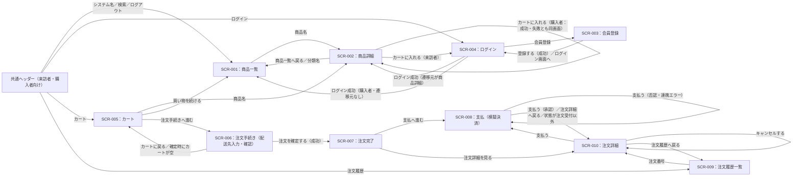
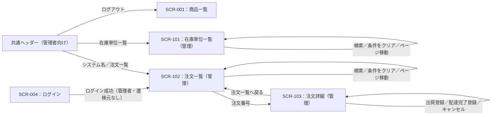
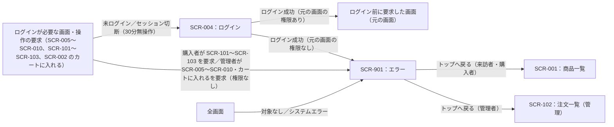

# 画面・帳票要件レイアウト/一覧：MiniCommerce

## 0. 文書管理

### 0.1 改訂履歴

| 版数 | 日付 | 改訂内容 | 作成・改訂者 |
|---|---|---|---|
| 1.0 | 2026-10-09 | 初版作成 | MiniCommerce 要件定義チーム |

## 1. 本書の目的と適用範囲

### 1.1 目的

本書は、MiniCommerce が利用者に提供する画面、帳票、およびメール・通知のその他出力について、利用目的、利用者、主な表示・入力項目、操作、遷移、出力条件の要求を一覧化し定義するものである。

MiniCommerce は、株式会社あおば雑貨（以下「当社」）が会員向けに提供する自社ECサイトであり、商品閲覧、カート、クーポン適用、注文確定、支払（模擬決済）、注文照会・キャンセル、出荷登録、配達完了登録をWeb画面で提供する。

### 1.2 適用範囲

| 区分 | 内容 |
|---|---|
| 対象とする範囲 | 来訪者・購入者・管理者がPCブラウザで利用する画面14画面（SCR-001〜SCR-010、SCR-101〜SCR-103、SCR-901）。管理者向け画面（SCR-101〜SCR-103）を含む。画面内に表示するメッセージを含む |
| 対象外とする範囲 | 帳票（印刷物、PDF・CSV・Excel のファイル出力）、メール・SMS・プッシュ通知、スマートフォン専用画面、商品・商品分類・仕入先・在庫単位・クーポンの登録・更新・削除画面、入荷・在庫補充の登録画面、会員情報変更・パスワード再設定・退会の画面、「特定商取引法に基づく表記」の静的ページ、運用者が行う初期データ一括投入（FR-060。サーバー上のコマンド実行で行い画面はない）、決済サービス（模擬）の画面（画面はない） |
| 本書で用いる利用者区分 | ACT-001 来訪者（ログインしていない閲覧者）、ACT-002 購入者（会員登録済みでログインした利用者）、ACT-003 管理者（EC運営担当・出荷担当。在庫・注文の確認、出荷登録・配達完了登録・キャンセルを行う。カート・注文確定・支払の購入機能は利用できない）。ACT-004 決済サービス（模擬）と ACT-005 運用者は画面を利用しない。本書では利用者区分を「来訪者」「購入者」「管理者」の名称で記載する |
| 本書で用いる機能ID | FR-001 会員登録／FR-002 ログイン／FR-003 ログアウト／FR-004 ログイン利用者情報照会／FR-010 商品分類一覧照会／FR-011 商品一覧検索／FR-012 商品詳細照会／FR-020 カート照会／FR-021 カート明細追加／FR-022 カート明細数量変更／FR-023 カート明細削除／FR-024 クーポン適用／FR-025 クーポン解除／FR-026 注文金額計算（カートの照会・操作と注文確定の実行時に内部で起動）／FR-030 注文確定／FR-031 支払（模擬決済）／FR-032 注文履歴一覧照会／FR-033 注文詳細照会（購入者）／FR-034 注文キャンセル（購入者）／FR-040 在庫単位一覧照会／FR-041 注文一覧検索（管理者）／FR-042 注文詳細照会（管理者）／FR-043 出荷登録／FR-044 配達完了登録／FR-045 注文キャンセル（管理者） |

### 1.3 本書で定義しない事項

| 事項 | 本書での扱い |
|---|---|
| 画面デザインの詳細（配色値、余白、フォントサイズ、部品の詳細配置） | 本書では記載しない。領域の配置関係のみ各画面のレイアウト概略に記載する |
| 入力規則の全量（全項目の入力チェック仕様、チェック順序）、業務チェック | 本書では記載しない。画面要件として必要な主な制約のみ記載する |
| メッセージ文言の全量 | 本書では記載しない |
| 帳票の詳細レイアウト（座標、罫線、印字位置） | 本書では記載しない。領域の配置関係のみ各帳票のレイアウト概略に記載する |
| 項目の型・桁・コード値 | 本書では記載しない |
| Web API の要求・応答の形式、画面の実装方式（画面部品の実装手段） | 本書では記載しない |
| 業務ルールの判定・計算の内容（数量上限、クーポン判定、金額計算、在庫引当、状態遷移） | 本書では記載しない。画面に表示する値と、判定結果の表示方法のみ記載する |

## 2. 共通UI要件

### 2.1 対象デバイス・ブラウザ・画面サイズ

| ID | 項目 | 要件 |
|---|---|---|
| UI-01 | 対象デバイス | PC |
| UI-02 | 対象OS・ブラウザ | ブラウザ：Google Chrome 最新版、Microsoft Edge 最新版（いずれもリリース判定時点の最新の安定版）。OS：限定しない（左記ブラウザが動作するPC用OS） |
| UI-03 | 想定画面サイズ | 最小画面幅 1280px 〜 最大画面幅 制限なし。画面幅1280px以上で横スクロールなく表示する |
| UI-04 | レスポンシブ対応 | 不要（切替境界値なし）。画面幅1280px未満は対象外とし、横スクロールの発生を許容する |

### 2.2 共通レイアウト構成

| ID | 領域 | 表示内容 | 表示対象画面 |
|---|---|---|---|
| UI-05 | ヘッダ（来訪者・購入者向け） | システム名「MiniCommerce」（SCR-001へのリンク）、キーワード検索欄と「検索」ボタン（SCR-001 の商品一覧検索を実行）、「カート」（SCR-005へのリンク。購入者には利用中カートの合計点数を「カート（n点）」の形式で併記。来訪者には点数を表示しない）、「注文履歴」（SCR-009へのリンク）、来訪者には「ログイン」（SCR-004へのリンク）、購入者にはログイン中の氏名（「○○さん」の形式。FR-004 で取得）と「ログアウト」ボタン | 管理者がログインしていない状態で表示する全画面（SCR-001〜SCR-010、および来訪者・購入者が表示する SCR-901） |
| UI-06 | ヘッダ（管理者向け） | システム名「MiniCommerce」（SCR-102へのリンク）、「在庫単位一覧」（SCR-101へのリンク）、「注文一覧」（SCR-102へのリンク）、「ログアウト」ボタン | 管理者がログイン中に表示する全画面（SCR-101〜SCR-103、管理者が表示する SCR-001〜SCR-004・SCR-901） |
| UI-07 | メニュー（ナビゲーション） | 独立したメニュー領域は設けず、ヘッダ内のリンクをメニューとする。来訪者・購入者はUI-05、管理者はUI-06のリンクを表示する | 全画面 |
| UI-08 | メッセージ領域 | ヘッダの直下に配置し、業務エラー、完了メッセージ、遷移理由の案内を表示する。表示するメッセージがない場合は領域を表示しない | 全画面 |
| UI-09 | メイン領域 | 各画面の表示項目・入力項目・操作（5章） | 全画面 |
| UI-10 | フッタ | 該当なし（フッタ領域は設けない） | 該当なし |

### 2.3 共通操作

| ID | 操作 | 要件 | 適用範囲 |
|---|---|---|---|
| UI-11 | 戻る | 画面内の戻る操作（「商品一覧へ戻る」「カートに戻る」「注文履歴へ戻る」「注文一覧へ戻る」「注文詳細へ戻る」）は5章の各画面に記載した遷移先へ遷移する。ブラウザの戻る操作は禁止しない。ブラウザの戻る操作で表示した画面から更新操作を行った場合も、その時点のデータで判定し、状態不正・在庫不足の場合は各画面の失敗時の表示を行う | 全画面 |
| UI-12 | 確認ダイアログ | 注文確定（SCR-006）、注文キャンセル（SCR-010、SCR-103）、出荷登録（SCR-103）、配達完了登録（SCR-103）、カート明細の削除（SCR-005）の実行前に確認ダイアログを表示する。ダイアログには実行する操作と対象（注文番号または商品名・規格名）を表示し、選択肢は「OK」と「キャンセル」の2つとする。「OK」で実行し、「キャンセル」で実行せずに元の画面に留まる（入力値は保持する）。上記以外の操作では確認ダイアログを表示しない | SCR-005、SCR-006、SCR-010、SCR-103 |
| UI-13 | ページング | 1ページの表示件数は SCR-001・SCR-009・SCR-102 が20件、SCR-101 が50件とする。一覧の下部に「前へ」「次へ」とページ番号のリンクを表示する。ページ番号は現在ページの前後2ページ以内と、先頭ページ・最終ページを表示し、現在ページは文字で区別して表示する（リンクにしない）。1ページ目では「前へ」、最終ページでは「次へ」を表示しない。総ページ数が1以下の場合はページ移動を表示しない。ページ移動時は検索条件・並び順を保持する。検索条件を変更して検索した場合は1ページ目を表示する | SCR-001、SCR-009、SCR-101、SCR-102 |
| UI-14 | ソート | 利用者が並び順を変更できるのは SCR-001 の「並び順」の選択のみとする。列見出しの選択による並べ替えは行わない。その他の一覧は5章に記載した固定の並び順で表示する | 一覧を表示する全画面 |
| UI-15 | 二重送信防止 | 更新操作のボタン（会員登録の「登録する」、「ログイン」、「ログアウト」、「カートに入れる」、「数量を変更」、「削除」、クーポンの「適用する」「解除する」、「注文を確定する」、「支払う」、「キャンセルする」、「出荷登録」、「配達完了登録」、「キャンセル」）は、押下後、処理結果の画面が表示されるまで無効表示とし再押下できない。サーバー側でも同じ操作の二重送信で注文・決済・状態変更が2回以上行われないこと（注文確定の2回目以降はカートが空の業務エラー、支払・状態変更の2回目以降は状態不正の業務エラーとして各画面の失敗時の表示を行う） | 更新操作を持つ全画面 |
| UI-16 | セッションタイムアウト時 | ログインセッションは最後の操作から30分間操作がない場合に切断する。切断後にログインが必要な画面の表示・操作を行った場合は SCR-004 へ遷移し、メッセージ領域に「ログインが必要です。ログインしていないか、30分間操作がなかったためログインが切れています。」を表示する。切断前に入力中の内容は保持しない。再ログイン後は表示・操作しようとした画面へ戻る（更新操作は実行せず、その画面を表示する）。ログインが不要な画面（SCR-001〜SCR-004、SCR-901）は来訪者として表示する | 全画面 |
| UI-17 | 未ログイン時の表示要求 | 来訪者がログインが必要な画面（SCR-005〜SCR-010、SCR-101〜SCR-103）を表示しようとした場合、または SCR-002 で「カートに入れる」を押下した場合は SCR-004 へ遷移し、UI-16 と同じメッセージを表示する。ログイン成功後は元の画面（「カートに入れる」の場合は SCR-002）へ戻る。元の画面の権限がない利用者区分でログインした場合は SCR-901（権限なし）を表示する | SCR-002、SCR-004〜SCR-010、SCR-101〜SCR-103 |
| UI-18 | 権限なし・対象なし・システムエラー | 購入者が管理者向け画面（SCR-101〜SCR-103）を、管理者が購入者向け画面（SCR-005〜SCR-010）または購入機能（SCR-002 の「カートに入れる」）を要求した場合は SCR-901（権限なし）を表示する。存在しない・非公開の商品、存在しない注文、他の購入者の注文、存在しないカート明細を指定した場合は SCR-901（対象なし）を表示する。システムエラーが発生した場合は SCR-901（システムエラー）を表示する | 全画面 |
| UI-19 | 入力エラー時の入力値保持 | 入力エラー・業務エラーで同じ画面に留まる場合、入力値を保持して再表示する。ただしパスワード・パスワード（確認）は保持せず空欄に戻す | 入力項目を持つ全画面 |
| UI-20 | ログアウト | ヘッダの「ログアウト」押下で FR-003（ログアウト）を実行し、ログインセッションを終了して SCR-001 へ遷移し、メッセージ領域に「ログアウトしました。」を表示する。確認ダイアログは表示しない | 購入者・管理者がログイン中の全画面 |
| UI-21 | 未保存時の離脱警告 | 表示しない。入力中に他の画面へ遷移した場合、入力内容は保持しない | 入力項目を持つ全画面 |
| UI-22 | 入力値の前後空白 | 入力値の前後の空白は除去してから判定・登録する。パスワード・パスワード（確認）は除去しない | 入力項目を持つ全画面 |

### 2.4 表示規約

| ID | 対象 | 規約 | 適用範囲 |
|---|---|---|---|
| UI-23 | 日付・時刻 | 日時は「YYYY/MM/DD HH:MM」（24時間制、秒は表示しない）、日付のみの場合は「YYYY/MM/DD」で表示する。タイムゾーンは日本時間（JST, Asia/Tokyo）とし、タイムゾーン名は表示しない | 全画面 |
| UI-24 | 数値・金額 | 金額は整数の円とし、3桁ごとにカンマで区切り末尾に「円」を付ける（例「1,234円」「0円」）。小数点以下は表示しない。割引額は符号を付けずに表示する。数量・在庫数量は整数で表示し、在庫数量には「個」、合計点数には「点」を付ける。定率の割引値は「10%」の形式で表示する | 全画面 |
| UI-25 | 商品価格（総額表示） | 商品価格（在庫単位の価格・単価）は、税込価格を主表示し税抜価格を併記する（例「1,100円（税込）／1,000円（税抜）」）。税込価格は税抜価格×110÷100 の1円未満切り捨ての値とする。管理者向けの在庫単位一覧（SCR-101）のみ税抜価格だけを表示する | SCR-001、SCR-002、SCR-005、SCR-006、SCR-010、SCR-103 |
| UI-26 | 金額内訳 | カート・注文の金額は、小計、割引額、割引後小計、送料、消費税額、合計（税込）の6項目をこの順に縦に並べて表示する。明細金額は税抜で表示し「（税抜）」を付ける | SCR-005、SCR-006、SCR-010、SCR-103 |
| UI-27 | 状態・区分の表示名 | コード値は表示せず表示名で表示する。注文状態：注文受付／支払済／出荷済／配達完了／キャンセル済。決済結果：承認／否認／連携エラー。割引方式：定額／定率。実行者区分：購入者／管理者。公開状態：公開／非公開。在庫状況：在庫あり（在庫数量1以上）／在庫切れ（在庫数量0）。都道府県：都道府県名 | 全画面 |
| UI-28 | 必須項目の表示 | 必須の入力項目は項目名の直後に「必須」の文字ラベルを表示する。任意の項目にはラベルを表示しない | 入力項目を持つ全画面 |
| UI-29 | エラー表示位置 | 入力エラーは該当項目の近傍（入力欄の直下）に理由を表示し、複数項目のエラーは全項目分を同時に表示する。業務エラー・完了メッセージはメッセージ領域（UI-08）に表示する。業務エラーのメッセージには理由と利用者に求める操作を含める。権限なし・対象なし・システムエラーは SCR-901 に表示する | 全画面 |
| UI-30 | 0件時の表示 | 一覧の表示対象が0件の場合（総ページ数を超えるページを指定した場合を含む）、一覧の表示位置に画面ごとのメッセージを表示する（SCR-001「該当する商品はありません。」、SCR-005「カートに商品がありません。」、SCR-009「注文履歴はありません。」、SCR-101「該当する在庫単位はありません。」、SCR-102「該当する注文はありません。」、SCR-103 の決済記録「決済記録はありません。」） | 一覧を表示する全画面 |
| UI-31 | 長い文字列 | 文字列は省略せず、表示領域の幅で折り返して全文を表示する。商品説明（最大2,000文字）は入力時の改行を保持して表示する | 全画面 |
| UI-32 | 未設定値の表示 | 値が未設定の項目（未発生の日時、未登録の配送伝票番号、未入力の住所2、取引参照番号のない決済記録、注文確定時の変更前状態）は「－」と表示する | 全画面 |
| UI-33 | 郵便番号・電話番号の表示 | 郵便番号は「123-4567」の形式（3桁目の後にハイフン）で表示する。電話番号は登録された数字のみで表示する（ハイフンを付けない） | SCR-010、SCR-103 |
| UI-34 | エラー表示の内容 | 画面にスタックトレース、SQL、内部のエラー詳細を表示しない | 全画面 |

### 2.5 デザイン・ブランドの制約

| ID | 制約 | 内容 | 根拠・参照資料 |
|---|---|---|---|
| UI-35 | 外部CDN・外部フォントの不使用 | 画面の表示に外部のCDN、外部のWebフォント、外部サイトの画像・スクリプトを使用しない。画面の表示に必要なファイルはすべて本システムから配信する | 本システムは外部インターネットに接続せずに起動・動作すること（コンテナイメージ・依存パッケージの取得時を除く） |
| UI-36 | JavaScript の利用範囲 | JavaScript の利用は、確認ダイアログの表示（UI-12）と更新ボタンの二重押下防止（UI-15）に限る。画面の表示内容はサーバー側で生成する | 画面はサーバーサイドで生成する方式とし、フロントエンドのビルド工程を設けない技術方針 |
| UI-37 | デザインガイドライン・ロゴ | 遵守すべき当社のデザインガイドライン・ロゴ画像の指定はない。システム名「MiniCommerce」は文字で表示する | 該当なし（指定する資料はない） |
| UI-38 | 画像 | 商品画像は表示しない | 商品画像は本リリースの対象外 |

### 2.6 アクセシビリティ

| ID | 要件 |
|---|---|
| UI-39 | JIS X 8341-3:2016 の適合レベルA に準拠する（優先度：推奨） |
| UI-40 | 全画面の操作（検索、カート操作、注文確定、支払、キャンセル、出荷登録、配達完了登録、ログイン・ログアウト）をキーボードのみで完了できる（優先度：推奨） |
| UI-41 | 全入力項目に項目名のラベルを表示し、ラベルと入力欄の対応を支援技術が判別できる（優先度：推奨） |
| UI-42 | 状態（注文状態、在庫切れ、低在庫、選択中の分類）、必須項目、エラーを色のみで示さず、文字でも表示する（優先度：推奨） |
| UI-43 | 各画面のページタイトルに画面名とシステム名を含める（例「商品一覧｜MiniCommerce」）（優先度：推奨） |

## 3. 画面一覧

| ID | 画面名 | 利用目的 | 利用者区分 | 画面種別 | 主な遷移元 | 主な遷移先 | 優先度 |
|---|---|---|---|---|---|---|---|
| SCR-001 | 商品一覧 | 商品分類・キーワードで公開中の商品を探し、一覧で確認する（来訪者・購入者のトップ画面） | 来訪者、購入者、管理者（閲覧のみ） | 一覧 | メニュー、SCR-002、SCR-004、SCR-005、SCR-901 | SCR-002 | 必須 |
| SCR-002 | 商品詳細 | 商品の説明と規格（在庫単位）ごとの税込価格・在庫を確認し、カートに入れる | 来訪者、購入者、管理者（閲覧のみ。「カートに入れる」は表示しない） | 詳細 | SCR-001、SCR-005、SCR-004（ログイン後の復帰） | SCR-001、SCR-004 | 必須 |
| SCR-003 | 会員登録 | 会員情報を入力して購入者として登録する | 来訪者（ログイン中の購入者・管理者も利用可） | 入力 | SCR-004 | SCR-004 | 必須 |
| SCR-004 | ログイン | メールアドレスとパスワードでログインする（購入者・管理者共通） | 来訪者 | ログイン | メニュー、SCR-002、SCR-003、ログインが必要な画面（SCR-005〜SCR-010、SCR-101〜SCR-103） | SCR-001、SCR-102、SCR-003、ログイン前に要求した画面、SCR-901 | 必須 |
| SCR-005 | カート | カートの内容と金額内訳を確認し、数量変更・削除・クーポン適用・解除を行う | 購入者 | 一覧 | メニュー、SCR-006、SCR-004（ログイン後の復帰） | SCR-006、SCR-002、SCR-001 | 必須 |
| SCR-006 | 注文手続き（配送先入力・確認） | 配送先を入力し、注文内容と金額を確認して注文を確定する | 購入者 | 入力 | SCR-005、SCR-004（ログイン後の復帰） | SCR-007、SCR-005 | 必須 |
| SCR-007 | 注文完了 | 注文の受付結果（注文番号・合計金額）を確認し、支払へ進む | 購入者 | 完了 | SCR-006、SCR-004（ログイン後の復帰） | SCR-008、SCR-010 | 必須 |
| SCR-008 | 支払（模擬決済） | 注文の代金を模擬決済で支払う | 購入者 | 入力 | SCR-007、SCR-010、SCR-004（ログイン後の復帰） | SCR-010 | 必須 |
| SCR-009 | 注文履歴一覧 | 自分の注文の一覧と状態を確認する | 購入者 | 一覧 | メニュー、SCR-010、SCR-004（ログイン後の復帰） | SCR-010 | 必須 |
| SCR-010 | 注文詳細 | 自分の注文の内容・状態・状態履歴を確認し、支払・キャンセルを行う | 購入者 | 詳細 | SCR-009、SCR-007、SCR-008、SCR-004（ログイン後の復帰） | SCR-008、SCR-009 | 必須 |
| SCR-101 | 在庫単位一覧（管理） | 在庫単位ごとの在庫数量と低在庫を確認する | 管理者 | 一覧 | メニュー、SCR-004（ログイン後の復帰） | 該当なし（同画面内の検索・ページ移動のみ） | 必須 |
| SCR-102 | 注文一覧（管理） | 全購入者の注文を検索し、状態を確認する（管理者のログイン後のトップ画面） | 管理者 | 一覧 | メニュー、SCR-004、SCR-103、SCR-901 | SCR-103 | 必須 |
| SCR-103 | 注文詳細（管理） | 注文の内容・決済記録・状態履歴を確認し、出荷登録・配達完了登録・キャンセルを行う | 管理者 | 詳細 | SCR-102、SCR-004（ログイン後の復帰） | SCR-102 | 必須 |
| SCR-901 | エラー | 対象なし・権限なし・システムエラーの発生を利用者に示す | 来訪者、購入者、管理者 | エラー | 全画面、SCR-004 | SCR-001、SCR-102 | 必須 |

## 4. 画面遷移の概要

来訪者・購入者の主な遷移を図1、管理者の主な遷移を図2、ログイン要否と権限による遷移（全利用者区分共通）を図3に示す。

図1：来訪者・購入者の画面遷移



図2：管理者の画面遷移



図3：ログイン要否・権限による遷移（全利用者区分共通）



## 5. 画面別要件

各表の行IDは「画面ID-記号連番」とし、記号は V（表示項目）、IN（入力項目）、OP（操作）、SC（検索条件）、NT（特記事項）とする。各操作の失敗時の表示のうち、未ログイン・セッション切断は UI-16・UI-17、権限なし・対象なし・システムエラーは UI-18 に従い、各表には画面固有の表示を記載する。

### 5.1 SCR-001：商品一覧

#### 5.1.1 基本情報

| 項目 | 内容 |
|---|---|
| 画面ID | SCR-001 |
| 画面名 | 商品一覧 |
| 利用目的 | 商品分類・キーワードで公開中の商品を探し、並び順を選んで一覧で確認し、商品詳細へ進む。来訪者・購入者のトップ画面とする |
| 利用者区分 | 来訪者、購入者、管理者（閲覧のみ） |
| 画面種別 | 一覧 |

#### 5.1.2 表示条件・アクセス条件

| 項目 | 内容 |
|---|---|
| ログイン要否 | 不要 |
| 必要な権限 | なし（来訪者・購入者が利用する。管理者がログイン中に表示した場合も同じ内容を表示し、ヘッダは UI-06 とする。UI-06 にはキーワード検索欄がないため、管理者は商品分類・並び順・ページ移動のみ操作できる） |
| 表示可能なデータ範囲 | 商品：公開状態が「公開」かつ在庫単位を1件以上持つ商品。商品分類：全件 |
| 表示可能な状態・期間 | 該当なし（常時表示する） |
| 条件を満たさない場合の振る舞い | 該当なし（表示条件なし）。ただし検索条件に誤りがある場合（キーワードが50文字を超える、存在しない商品分類・範囲外の並び順・1未満または整数でないページの指定）は商品一覧を表示せず、キーワードの誤りはキーワード検索欄の近傍に、その他の誤りはメッセージ領域に「検索条件に誤りがあります。条件を指定し直してください。」を表示する |

#### 5.1.3 主な表示項目

| ID | 項目名 | 内容 | 表示条件 |
|---|---|---|---|
| SCR-001-V01 | 商品分類一覧 | 全商品分類の分類名（name）を木構造で表示する。深さ（depth）1〜3 に応じて字下げする。各分類名は分類による絞り込みのリンクとする。先頭に「すべての商品」のリンクを表示する | 常時 |
| SCR-001-V02 | 選択中の分類 | 絞り込み中の分類名の後に「（選択中）」を文字で表示する | 商品分類を指定しているとき |
| SCR-001-V03 | 指定中のキーワード | 「キーワード：○○」の形式で表示する | キーワードを指定しているとき |
| SCR-001-V04 | 検索結果件数（total_count） | 「全n件（a〜b件目を表示）」の形式で表示する | 検索結果が1件以上のとき |
| SCR-001-V05 | 商品名（name） | 商品詳細（SCR-002）へのリンク | 検索結果が1件以上のとき |
| SCR-001-V06 | 商品コード（item_code） | 商品を識別するコード | 検索結果が1件以上のとき |
| SCR-001-V07 | 最低価格（min_price_incl_tax、min_price） | 商品が持つ在庫単位の税抜価格の最小値と、その税込価格を UI-25 の形式で表示する | 検索結果が1件以上のとき |
| SCR-001-V08 | 在庫状況（in_stock） | 在庫数量1以上の在庫単位が1件以上ある場合は「在庫あり」、ない場合は「在庫切れ」 | 検索結果が1件以上のとき |
| SCR-001-V09 | 所属分類（collections） | 商品が所属する分類名を「、」区切りで表示する。所属がない場合は「－」 | 検索結果が1件以上のとき |
| SCR-001-V10 | ページ移動 | UI-13 の形式 | 総ページ数が2以上のとき |
| SCR-001-V11 | 0件時メッセージ | 「該当する商品はありません。」 | 検索結果が0件のとき、または総ページ数を超えるページを指定したとき |

#### 5.1.4 主な入力項目

| ID | 項目名 | 必須 | 入力方式 | 主な制約 |
|---|---|---|---|---|
| SCR-001-IN01 | キーワード（keyword） | 任意 | テキスト | 共通ヘッダーのキーワード検索欄で入力する。前後空白除去後0〜50文字。空欄は条件なし。初期値：空欄（検索後は指定中のキーワードを表示する） |
| SCR-001-IN02 | 並び順（sort） | 任意 | 選択（単一） | 選択肢：新着順／価格の安い順／価格の高い順／商品名順。初期値：新着順 |
| SCR-001-IN03 | 商品分類（collection_id） | 任意 | 選択（単一） | 商品分類一覧（SCR-001-V01）の分類名のリンクを選んで指定する。初期値：指定なし（すべての商品） |

#### 5.1.5 操作

| ID | 操作名（ボタン等） | 実行条件 | 結果・遷移先 |
|---|---|---|---|
| SCR-001-OP01 | 検索（共通ヘッダー） | 常時 | 【機能】FR-011 商品一覧検索【確認ダイアログ】なし【成功時】入力したキーワードと、本画面で指定中の商品分類・並び順で SCR-001 の1ページ目を表示する（SCR-001 以外の画面から検索した場合は商品分類の指定なし・新着順）【失敗時】キーワードが50文字を超える場合はキーワード検索欄の近傍に「キーワードは50文字以内で入力してください。」を表示し、商品一覧は表示しない |
| SCR-001-OP02 | 分類名（リンク） | 常時 | 【機能】FR-011 商品一覧検索【確認ダイアログ】なし【成功時】選択した分類とその配下すべての分類に属する商品を、指定中のキーワード・並び順で1ページ目から表示する【失敗時】存在しない分類を指定した場合はメッセージ領域に「検索条件に誤りがあります。条件を指定し直してください。」を表示する |
| SCR-001-OP03 | すべての商品（リンク） | 常時 | 【機能】FR-011 商品一覧検索【確認ダイアログ】なし【成功時】商品分類の指定を解除し、指定中のキーワード・並び順で1ページ目から表示する【失敗時】該当なし（画面固有の失敗時の表示はない） |
| SCR-001-OP04 | 並べ替え | 常時 | 【機能】FR-011 商品一覧検索【確認ダイアログ】なし【成功時】「並び順」で選んだ並び順と、指定中の商品分類・キーワードで1ページ目から表示する【失敗時】範囲外の並び順を指定した場合はメッセージ領域に「検索条件に誤りがあります。条件を指定し直してください。」を表示する |
| SCR-001-OP05 | 前へ／次へ／ページ番号 | 総ページ数が2以上 | 【機能】FR-011 商品一覧検索【確認ダイアログ】なし【成功時】指定中の条件・並び順で指定したページを表示する【失敗時】総ページ数を超えるページの場合は「該当する商品はありません。」を表示する |
| SCR-001-OP06 | 商品名（リンク） | 検索結果が1件以上 | 【機能】なし（遷移のみ）【確認ダイアログ】なし【成功時】SCR-002 へ遷移する【失敗時】商品が非公開になっていた場合は SCR-901（対象なし） |

#### 5.1.6 一覧表示の条件

##### 検索条件

| ID | 検索条件項目 | 条件の種類 | 必須 | 初期値 |
|---|---|---|---|---|
| SCR-001-SC01 | 商品分類 | 完全一致（指定した分類と、その配下すべての分類に属する商品を対象とする） | 任意 | 該当なし（指定なし） |
| SCR-001-SC02 | キーワード（商品名または商品説明） | 部分一致（英字の大文字・小文字を区別しない） | 任意 | 該当なし（空欄） |

##### 並び順・表示件数

| 項目 | 内容 |
|---|---|
| 初期の並び順 | 新着順：第1キー 商品登録日時 降順、第2キー 商品ID 降順 |
| 利用者によるソート | 可（「並び順」の選択による。新着順＝商品登録日時 降順・商品ID 降順／価格の安い順＝最低税抜価格 昇順・商品ID 昇順／価格の高い順＝最低税抜価格 降順・商品ID 昇順／商品名順＝商品名 昇順・商品ID 昇順）。列見出しによる並べ替えは不可 |
| 1ページの表示件数 | 20 件 |
| 表示件数の上限 | 上限なし（全件をページ移動で表示する） |
| 検索結果0件時 | 「該当する商品はありません。」を表示する（総ページ数を超えるページを指定した場合も同じ） |
| 検索条件の組合せ | 商品分類とキーワードを両方指定した場合は、両方を満たす商品を表示する（AND） |
| 商品分類一覧の並び順・件数 | 木構造の深さ優先順。同じ親の中では表示順（sort_order） 昇順、名称 昇順、分類ID 昇順。全件を表示する（ページングなし） |

#### 5.1.7 レイアウト概略

```text
+----------------------------------------------------------------------------------+
| 共通ヘッダー（来訪者・購入者向け：UI-05。管理者ログイン中は UI-06）              |
| 　MiniCommerce　［キーワード検索欄］［検索］                                     |
| 　カート（n点）　注文履歴　ログイン（来訪者）／氏名さん［ログアウト］（購入者）  |
+----------------------------------------------------------------------------------+
| メッセージ領域（UI-08）                                                          |
+------------------------------+---------------------------------------------------+
| ［分類領域］                 | ［検索条件・並び順領域］                          |
| 　すべての商品               | 　キーワード：指定中のキーワード                  |
| 　分類名（深さ1）            | 　並び順［選択］［並べ替え］                      |
| 　　分類名（深さ2）          | 　全n件（a〜b件目を表示）                         |
| 　　　分類名（深さ3）        | ［商品一覧領域］（20件／ページ）                  |
| 　（選択中の分類に           | 　商品名／商品コード／最低価格／                  |
| 　　「（選択中）」）         | 　在庫状況／所属分類                              |
|                              | 　（0件時：該当する商品はありません。）           |
|                              | ［ページ移動］［前へ］ 1 2 3 ［次へ］             |
+------------------------------+---------------------------------------------------+
```

#### 5.1.8 特記事項

| ID | 内容 |
|---|---|
| SCR-001-NT01 | 画面表示時に FR-010（商品分類一覧照会）と FR-011（商品一覧検索）を実行する |
| SCR-001-NT02 | 来訪者・購入者のトップ画面とする。購入者のログイン成功時（ログイン前に要求した画面がない場合）とログアウト後の遷移先とする |
| SCR-001-NT03 | 商品画像は表示しない |

### 5.2 SCR-002：商品詳細

#### 5.2.1 基本情報

| 項目 | 内容 |
|---|---|
| 画面ID | SCR-002 |
| 画面名 | 商品詳細 |
| 利用目的 | 商品の説明と、規格（在庫単位）ごとの税込価格・在庫数量を確認し、規格と数量を選んでカートに入れる |
| 利用者区分 | 来訪者、購入者、管理者（閲覧のみ。「カートに入れる」は表示しない） |
| 画面種別 | 詳細 |

#### 5.2.2 表示条件・アクセス条件

| 項目 | 内容 |
|---|---|
| ログイン要否 | 不要（「カートに入れる」の実行はログインが必要） |
| 必要な権限 | 表示：なし。カートへの投入：購入者のみ（管理者がログイン中に表示した場合は、規格の選択・数量・「カートに入れる」を表示せず、ヘッダは UI-06 とする） |
| 表示可能なデータ範囲 | 公開状態が「公開」かつ在庫単位を1件以上持つ商品。仕入先は表示しない |
| 表示可能な状態・期間 | 該当なし（上記の範囲の商品は常時表示する） |
| 条件を満たさない場合の振る舞い | 商品が存在しない・非公開・在庫単位0件の場合は SCR-901（対象なし）を表示する |

#### 5.2.3 主な表示項目

| ID | 項目名 | 内容 | 表示条件 |
|---|---|---|---|
| SCR-002-V01 | 商品名（name） | 商品の名称 | 常時 |
| SCR-002-V02 | 商品コード（item_code） | 商品を識別するコード | 常時 |
| SCR-002-V03 | 所属分類（collections） | 所属する分類名を「、」区切りで表示する。各分類名は SCR-001 の分類絞り込みへのリンク。所属がない場合は「－」 | 常時 |
| SCR-002-V04 | 商品説明（description） | 改行を保持して全文を表示する。空の場合は「－」 | 常時 |
| SCR-002-V05 | 在庫単位一覧（stock_units） | 規格ごとに1行で表示する（SKU 昇順） | 常時 |
| SCR-002-V06 | SKU（sku） | 在庫単位を識別するコード | 常時 |
| SCR-002-V07 | 規格名（variant_name） | 規格の名称（例「ブルー／M」） | 常時 |
| SCR-002-V08 | 価格（price_incl_tax、price） | UI-25 の形式（例「1,100円（税込）／1,000円（税抜）」） | 常時 |
| SCR-002-V09 | 在庫数量（quantity） | 表示時点の在庫数量を「n個」の形式で表示する | 常時 |
| SCR-002-V10 | 在庫状況（in_stock） | 在庫数量1以上は「在庫あり」、0は「在庫切れ」 | 常時 |
| SCR-002-V11 | 在庫切れの案内 | 「この商品は現在すべての規格が在庫切れのため、カートに入れられません。」 | 全在庫単位の在庫数量が0のとき（管理者ログイン中を除く） |

#### 5.2.4 主な入力項目

| ID | 項目名 | 必須 | 入力方式 | 主な制約 |
|---|---|---|---|---|
| SCR-002-IN01 | 規格（stock_unit_id） | 必須 | 選択（単一） | 在庫単位一覧の各行から1つ選ぶ。在庫数量0の行は選択不可。初期値：在庫数量1以上の在庫単位のうち SKU 昇順で先頭の行。全規格が在庫切れの場合は全行選択不可。管理者ログイン中は表示しない |
| SCR-002-IN02 | 数量（quantity） | 必須 | 数値 | 数字1〜2桁の整数で、1以上。初期値：1。全規格が在庫切れの場合は入力不可。管理者ログイン中は表示しない |

#### 5.2.5 操作

| ID | 操作名（ボタン等） | 実行条件 | 結果・遷移先 |
|---|---|---|---|
| SCR-002-OP01 | カートに入れる | 在庫数量1以上の在庫単位が1件以上ある（全規格が在庫切れの場合は無効表示とし押下できない）。管理者ログイン中は表示しない | 【機能】FR-021 カート明細追加【確認ダイアログ】なし【成功時】本画面に留まり、メッセージ領域に「カートに追加しました（規格名、n個）。」を表示し、ヘッダのカート合計点数を更新する【失敗時】数量の入力エラー（未入力、0以下、整数以外）は数量欄の近傍に「数量は1以上の整数で入力してください。」／数量上限超過（QUANTITY_LIMIT_EXCEEDED）はメッセージ領域に「同じ規格は1注文につき10個までです（現在のカート内数量：n個）。」／在庫不足（INSUFFICIENT_STOCK）はメッセージ領域に「在庫が不足しています（現在の在庫数量：n個）。」を表示し、本画面に留まり入力値を保持する（カートは変更しない）。商品が非公開になっていた場合は SCR-901（対象なし）【来訪者】FR-021 を実行せずに SCR-004 へ遷移し、ログイン成功後に本画面へ戻る（カートへの投入は行わないため、再度押下する） |
| SCR-002-OP02 | 分類名（リンク） | 所属分類があるとき | 【機能】なし（遷移のみ）【確認ダイアログ】なし【成功時】SCR-001 へ遷移し、その分類で絞り込んだ一覧を表示する【失敗時】該当なし |
| SCR-002-OP03 | 商品一覧へ戻る | 常時 | 【機能】なし（遷移のみ）【確認ダイアログ】なし【成功時】SCR-001 へ遷移し、初期状態（商品分類・キーワードの指定なし、新着順、1ページ目）で表示する【失敗時】該当なし |

#### 5.2.6 一覧表示の条件

##### 検索条件

| ID | 検索条件項目 | 条件の種類 | 必須 | 初期値 |
|---|---|---|---|---|
| 該当なし | 該当なし | 該当なし | 該当なし | 該当なし |

##### 並び順・表示件数

| 項目 | 内容 |
|---|---|
| 初期の並び順 | 在庫単位一覧：第1キー SKU 昇順 |
| 利用者によるソート | 不可 |
| 1ページの表示件数 | 全件（ページングなし） |
| 表示件数の上限 | 上限なし |
| 検索結果0件時 | 該当なし（在庫単位が0件の商品は本画面を表示せず SCR-901（対象なし）を表示する） |

#### 5.2.7 レイアウト概略

```text
+----------------------------------------------------------------------------------+
| 共通ヘッダー（来訪者・購入者向け：UI-05。管理者ログイン中は UI-06）              |
+----------------------------------------------------------------------------------+
| メッセージ領域（UI-08）                                                          |
+----------------------------------------------------------------------------------+
| ［商品情報領域］                                                                 |
| 　商品名　　商品コード                                                           |
| 　所属分類（分類名リンク）                                                       |
| 　商品説明                                                                       |
+----------------------------------------------------------------------------------+
| ［在庫単位一覧・カート投入領域］                                                 |
| 　選択　SKU　規格名　価格（税込／税抜）　在庫数量　在庫状況                      |
| 　（○）　…　…　…　…　…                                                     |
| 　（在庫切れの案内）                                                             |
| 　数量［　1］　［カートに入れる］                                                |
+----------------------------------------------------------------------------------+
| ［商品一覧へ戻る］                                                               |
+----------------------------------------------------------------------------------+
```

#### 5.2.8 特記事項

| ID | 内容 |
|---|---|
| SCR-002-NT01 | 画面表示時に FR-012（商品詳細照会）を実行する |
| SCR-002-NT02 | 在庫切れ時の表示切替：全規格の在庫数量が0の場合は、規格の選択・数量を入力不可、「カートに入れる」を無効表示とし、在庫切れの案内（SCR-002-V11）を表示する。一部の規格のみ在庫数量0の場合は、その規格の行のみ選択不可とする |
| SCR-002-NT03 | カートに入れた時点では在庫を確保しない。表示している在庫数量は画面表示時点の値である |
| SCR-002-NT04 | 商品画像は表示しない |

### 5.3 SCR-003：会員登録

#### 5.3.1 基本情報

| 項目 | 内容 |
|---|---|
| 画面ID | SCR-003 |
| 画面名 | 会員登録 |
| 利用目的 | メールアドレス・パスワード・氏名を入力して購入者として会員登録する |
| 利用者区分 | 来訪者（ログイン中の購入者・管理者も利用可） |
| 画面種別 | 入力 |

#### 5.3.2 表示条件・アクセス条件

| 項目 | 内容 |
|---|---|
| ログイン要否 | 不要 |
| 必要な権限 | なし |
| 表示可能なデータ範囲 | 該当なし（表示する登録済みデータはない） |
| 表示可能な状態・期間 | 該当なし（常時表示する） |
| 条件を満たさない場合の振る舞い | 該当なし（全利用者に表示する） |

#### 5.3.3 主な表示項目

| ID | 項目名 | 内容 | 表示条件 |
|---|---|---|---|
| SCR-003-V01 | 登録の案内 | 「会員登録後、ログイン画面からログインしてください。」 | 常時 |
| SCR-003-V02 | パスワードの条件 | 「8〜64文字で、英字と数字をそれぞれ1文字以上含めてください。メールアドレスと同じ文字列（英字の大文字・小文字の違いは区別しない）は使用できません。」 | 常時 |

#### 5.3.4 主な入力項目

| ID | 項目名 | 必須 | 入力方式 | 主な制約 |
|---|---|---|---|---|
| SCR-003-IN01 | メールアドレス（email） | 必須 | テキスト | 最大254文字。メールアドレス形式。英大文字は英小文字に置き換えて登録する。初期値：空欄 |
| SCR-003-IN02 | パスワード（password） | 必須 | テキスト（入力文字を伏せ字で表示） | 8〜64文字。英字と数字をそれぞれ1文字以上含む。英小文字に置き換えた値が、英小文字に置き換えたメールアドレスと一致する文字列は不可。初期値：空欄。エラー時は空欄に戻す |
| SCR-003-IN03 | パスワード（確認）（password_confirmation） | 必須 | テキスト（入力文字を伏せ字で表示） | パスワードと同じ文字列。初期値：空欄。エラー時は空欄に戻す |
| SCR-003-IN04 | 氏名（full_name） | 必須 | テキスト | 前後空白除去後1〜50文字。初期値：空欄 |

#### 5.3.5 操作

| ID | 操作名（ボタン等） | 実行条件 | 結果・遷移先 |
|---|---|---|---|
| SCR-003-OP01 | 登録する | 常時（入力内容の判定は押下後に行う） | 【機能】FR-001 会員登録【確認ダイアログ】なし【成功時】SCR-004 へ遷移し、メッセージ領域に「会員登録が完了しました。ログインしてください。」を表示する（自動ログインしない）【失敗時】入力エラーは全項目分を各項目の近傍に同時に表示する／メールアドレスが登録済み（EMAIL_ALREADY_REGISTERED）の場合はメッセージ領域に「このメールアドレスは既に登録されています。」を表示する。いずれも本画面に留まり、メールアドレス・氏名の入力値を保持し、パスワード・パスワード（確認）は空欄に戻す |
| SCR-003-OP02 | ログイン画面へ（リンク） | 常時 | 【機能】なし（遷移のみ）【確認ダイアログ】なし【成功時】SCR-004 へ遷移する（入力内容は保持しない）【失敗時】該当なし |

#### 5.3.6 一覧表示の条件

##### 検索条件

| ID | 検索条件項目 | 条件の種類 | 必須 | 初期値 |
|---|---|---|---|---|
| 該当なし | 該当なし | 該当なし | 該当なし | 該当なし |

##### 並び順・表示件数

| 項目 | 内容 |
|---|---|
| 初期の並び順 | 該当なし |
| 利用者によるソート | 該当なし |
| 1ページの表示件数 | 該当なし |
| 表示件数の上限 | 該当なし |
| 検索結果0件時 | 該当なし |

#### 5.3.7 レイアウト概略

```text
+----------------------------------------------------------------------------------+
| 共通ヘッダー（来訪者・購入者向け：UI-05。管理者ログイン中は UI-06）              |
+----------------------------------------------------------------------------------+
| メッセージ領域（UI-08）                                                          |
+----------------------------------------------------------------------------------+
| ［入力領域］                                                                     |
| 　登録の案内                                                                     |
| 　メールアドレス　必須［　　　　　　］（入力エラー表示）                         |
| 　パスワード　必須［　　　　　　］（入力エラー表示）                             |
| 　　パスワードの条件                                                             |
| 　パスワード（確認）　必須［　　　　　　］（入力エラー表示）                     |
| 　氏名　必須［　　　　　　］（入力エラー表示）                                   |
+----------------------------------------------------------------------------------+
| ［登録する］　［ログイン画面へ］                                                 |
+----------------------------------------------------------------------------------+
```

#### 5.3.8 特記事項

| ID | 内容 |
|---|---|
| SCR-003-NT01 | 画面表示時に実行する機能はない。「登録する」押下時に FR-001（会員登録）を実行する |
| SCR-003-NT02 | 登録される利用者の利用者区分は購入者とする（本画面で管理者の利用者は作成できない） |
| SCR-003-NT03 | ログイン中の利用者が本画面を表示した場合も表示する。登録してもログイン中の利用者のログイン状態は変更しない |

### 5.4 SCR-004：ログイン

#### 5.4.1 基本情報

| 項目 | 内容 |
|---|---|
| 画面ID | SCR-004 |
| 画面名 | ログイン |
| 利用目的 | メールアドレスとパスワードでログインし、購入者は購入機能、管理者は管理機能を利用できる状態にする（購入者・管理者共通） |
| 利用者区分 | 来訪者 |
| 画面種別 | ログイン |

#### 5.4.2 表示条件・アクセス条件

| 項目 | 内容 |
|---|---|
| ログイン要否 | 不要 |
| 必要な権限 | なし |
| 表示可能なデータ範囲 | 該当なし（表示する登録済みデータはない） |
| 表示可能な状態・期間 | 該当なし（常時表示する） |
| 条件を満たさない場合の振る舞い | 該当なし（全利用者に表示する） |

#### 5.4.3 主な表示項目

| ID | 項目名 | 内容 | 表示条件 |
|---|---|---|---|
| SCR-004-V01 | 会員登録完了の案内 | 「会員登録が完了しました。ログインしてください。」（メッセージ領域） | SCR-003 で登録に成功して遷移したとき |
| SCR-004-V02 | ログイン要求の案内 | 「ログインが必要です。ログインしていないか、30分間操作がなかったためログインが切れています。」（メッセージ領域） | ログインが必要な画面・操作から遷移したとき（UI-16、UI-17） |
| SCR-004-V03 | 会員登録の案内 | 「会員でない方は会員登録してください。」と会員登録へのリンク | 常時 |

#### 5.4.4 主な入力項目

| ID | 項目名 | 必須 | 入力方式 | 主な制約 |
|---|---|---|---|---|
| SCR-004-IN01 | メールアドレス（email） | 必須 | テキスト | 最大254文字。英大文字は英小文字に置き換えて照合する。入力エラーは未入力の場合のみとし、メールアドレスの形式は判定しない（照合できない場合は認証失敗）。初期値：空欄（認証失敗時は入力値を保持する） |
| SCR-004-IN02 | パスワード（password） | 必須 | テキスト（入力文字を伏せ字で表示） | 最大64文字。初期値：空欄。認証失敗時・入力エラー時は空欄に戻す |

#### 5.4.5 操作

| ID | 操作名（ボタン等） | 実行条件 | 結果・遷移先 |
|---|---|---|---|
| SCR-004-OP01 | ログイン | 常時 | 【機能】FR-002 ログイン【確認ダイアログ】なし【成功時】ログインセッションを開始する。ログイン前に要求した画面がある場合はその画面へ戻る（その画面の権限がない利用者区分の場合は SCR-901（権限なし））。ない場合は購入者は SCR-001、管理者は SCR-102 へ遷移する【失敗時】未入力は該当項目の近傍に「メールアドレスを入力してください。」「パスワードを入力してください。」を表示する／認証失敗（INVALID_CREDENTIALS）はメッセージ領域に「メールアドレスまたはパスワードが正しくありません。」を表示する（どちらが誤りかを区別しない）。いずれも本画面に留まり、メールアドレスを保持し、パスワードは空欄に戻す |
| SCR-004-OP02 | 会員登録（リンク） | 常時 | 【機能】なし（遷移のみ）【確認ダイアログ】なし【成功時】SCR-003 へ遷移する【失敗時】該当なし |

#### 5.4.6 一覧表示の条件

##### 検索条件

| ID | 検索条件項目 | 条件の種類 | 必須 | 初期値 |
|---|---|---|---|---|
| 該当なし | 該当なし | 該当なし | 該当なし | 該当なし |

##### 並び順・表示件数

| 項目 | 内容 |
|---|---|
| 初期の並び順 | 該当なし |
| 利用者によるソート | 該当なし |
| 1ページの表示件数 | 該当なし |
| 表示件数の上限 | 該当なし |
| 検索結果0件時 | 該当なし |

#### 5.4.7 レイアウト概略

```text
+----------------------------------------------------------------------------------+
| 共通ヘッダー（来訪者・購入者向け：UI-05。管理者ログイン中は UI-06）              |
+----------------------------------------------------------------------------------+
| メッセージ領域（UI-08）：会員登録完了の案内／ログイン要求の案内／認証失敗        |
+----------------------------------------------------------------------------------+
| ［入力領域］                                                                     |
| 　メールアドレス　必須［　　　　　　］（入力エラー表示）                         |
| 　パスワード　必須［　　　　　　］（入力エラー表示）                             |
| 　［ログイン］                                                                   |
+----------------------------------------------------------------------------------+
| ［会員登録の案内］　会員でない方は会員登録してください。［会員登録］             |
+----------------------------------------------------------------------------------+
```

#### 5.4.8 特記事項

| ID | 内容 |
|---|---|
| SCR-004-NT01 | 画面表示時に実行する機能はない。「ログイン」押下時に FR-002（ログイン）を実行する |
| SCR-004-NT02 | 購入者・管理者が共通で利用するログイン画面とし、ログイン後の遷移先は利用者区分で切り替える |
| SCR-004-NT03 | ログインに失敗した回数によるアカウントのロック、ログイン試行回数の制限は行わない |
| SCR-004-NT04 | ログイン中の利用者が別のアカウントでログインに成功した場合は、新しいアカウントのログインセッションに切り替える |
| SCR-004-NT05 | ヘッダの「ログイン」から表示した場合は、ログイン前に要求した画面がないものとして扱う |

### 5.5 SCR-005：カート

#### 5.5.1 基本情報

| 項目 | 内容 |
|---|---|
| 画面ID | SCR-005 |
| 画面名 | カート |
| 利用目的 | カートに入れた商品と金額内訳（小計・割引額・割引後小計・送料・消費税額・合計）を確認し、数量変更・削除・クーポンの適用・解除を行って注文手続きへ進む |
| 利用者区分 | 購入者 |
| 画面種別 | 一覧 |

#### 5.5.2 表示条件・アクセス条件

| 項目 | 内容 |
|---|---|
| ログイン要否 | 要 |
| 必要な権限 | 購入者 |
| 表示可能なデータ範囲 | ログイン中の購入者自身の利用中カートのみ（利用中カートがない場合は空のカートを作成して表示する） |
| 表示可能な状態・期間 | 該当なし（常時表示する） |
| 条件を満たさない場合の振る舞い | 未ログイン・セッション切断：SCR-004 へ遷移し、ログイン後に本画面へ戻る（UI-16、UI-17）。管理者：SCR-901（権限なし） |

#### 5.5.3 主な表示項目

| ID | 項目名 | 内容 | 表示条件 |
|---|---|---|---|
| SCR-005-V01 | カート明細一覧（lines） | カート明細を1明細1行で表示する（追加日時 昇順） | 明細が1件以上のとき |
| SCR-005-V02 | 商品名（item_name） | SCR-002 へのリンク | 明細が1件以上のとき |
| SCR-005-V03 | 規格名（variant_name） | 規格の名称 | 明細が1件以上のとき |
| SCR-005-V04 | SKU（sku） | 在庫単位を識別するコード | 明細が1件以上のとき |
| SCR-005-V05 | 単価（unit_price） | 在庫単位の現在の税抜価格と税込価格を UI-25 の形式で表示する | 明細が1件以上のとき |
| SCR-005-V06 | 明細金額（line_amount） | 税抜の単価×数量を「n円（税抜）」の形式で表示する | 明細が1件以上のとき |
| SCR-005-V07 | 在庫数量（stock_quantity） | 現在の在庫数量を「n個」の形式で表示する | 明細が1件以上のとき |
| SCR-005-V08 | 在庫不足の警告 | 「在庫が不足しています（現在の在庫数量：n個）。数量を変更してください。」を該当明細の行に表示する | 明細の数量が現在の在庫数量を超えるとき |
| SCR-005-V09 | 合計点数（total_quantity） | 全明細の数量の合計を「n点」の形式で表示する | 常時 |
| SCR-005-V10 | クーポンコード（coupon.code） | 適用中のクーポンのコード | クーポン適用中 |
| SCR-005-V11 | クーポン名（coupon.name） | 適用中のクーポンの表示名 | クーポン適用中 |
| SCR-005-V12 | 割引内容（coupon.discount_type、coupon.discount_value） | 定額は「1,000円引き」、定率は「10%引き」の形式で表示する | クーポン適用中 |
| SCR-005-V13 | 最低購入金額（coupon.min_spend） | 「小計n円以上で利用可」の形式で表示する。0円の場合は「条件なし」 | クーポン適用中 |
| SCR-005-V14 | 有効期間（coupon.valid_from、coupon.valid_until） | 「YYYY/MM/DD HH:MM 〜 YYYY/MM/DD HH:MM」の形式で表示する | クーポン適用中 |
| SCR-005-V15 | クーポンの適用状況（coupon.is_applicable、coupon.not_applicable_reason） | 適用条件を満たす場合は「適用中」。満たさない場合は「適用条件を満たしていません」と理由（「有効期間の開始前です」「有効期間が終了しています」「小計が最低購入金額に達していません」「カートに商品がありません」のいずれか）、および「このままでは注文を確定できません。クーポンを解除するか、条件を満たしてください。」を表示する | クーポン適用中 |
| SCR-005-V16 | 小計（amounts.subtotal） | 税抜価格×数量の合計を「小計（税抜）」として表示する | 常時（明細0件は0円） |
| SCR-005-V17 | 割引額（amounts.discount_amount） | クーポンによる割引額 | 常時（クーポン未適用・適用条件を満たさない場合は0円） |
| SCR-005-V18 | 割引後小計（amounts.discounted_subtotal） | 小計から割引額を引いた額 | 常時（明細0件は0円） |
| SCR-005-V19 | 送料（amounts.shipping_fee） | 0円または500円 | 常時（明細0件は0円） |
| SCR-005-V20 | 消費税額（amounts.tax_amount） | 割引後小計と送料に対する消費税額 | 常時（明細0件は0円） |
| SCR-005-V21 | 合計（税込）（amounts.total） | 割引後小計、送料、消費税額の合計 | 常時（明細0件は0円） |
| SCR-005-V22 | 送料の案内 | 「割引後小計が5,000円以上の場合、送料は無料です（5,000円未満は送料500円）。」 | 常時 |
| SCR-005-V23 | 注文前の案内 | 「在庫は注文確定時に確保します。価格は注文確定時点の価格で確定します。」 | 明細が1件以上のとき |
| SCR-005-V24 | 0件時メッセージ | 「カートに商品がありません。」 | 明細が0件のとき |

#### 5.5.4 主な入力項目

| ID | 項目名 | 必須 | 入力方式 | 主な制約 |
|---|---|---|---|---|
| SCR-005-IN01 | 数量（quantity） | 必須 | 数値 | 明細ごとに入力する。数字1〜2桁の整数で、1以上（0にする変更は行わず、削除は「削除」で行う）。初期値：現在のカート内数量 |
| SCR-005-IN02 | クーポンコード（code） | 条件付き必須（「適用する」押下時） | テキスト | 前後空白を除去し英字を大文字に置き換えた後、英大文字・数字・ハイフンの1〜20文字。英小文字での入力も可。初期値：空欄。クーポン未適用時のみ表示する |

#### 5.5.5 操作

| ID | 操作名（ボタン等） | 実行条件 | 結果・遷移先 |
|---|---|---|---|
| SCR-005-OP01 | 数量を変更 | 明細ごと、常時 | 【機能】FR-022 カート明細数量変更【確認ダイアログ】なし【成功時】本画面を再表示し、メッセージ領域に「数量を変更しました。」を表示し、金額内訳とヘッダのカート合計点数を更新する【失敗時】入力エラー（未入力、0以下、整数以外）は該当明細の数量欄の近傍に「数量は1以上の整数で入力してください。」／数量上限超過（QUANTITY_LIMIT_EXCEEDED）はメッセージ領域に「同じ規格は1注文につき10個までです（現在のカート内数量：n個）。」／在庫不足（INSUFFICIENT_STOCK）はメッセージ領域に「在庫が不足しています（現在の在庫数量：n個）。」（数量を減らす変更でも在庫数量を超える場合は同じ）を表示する。いずれもカートは変更せず、入力値を保持する。明細が既に削除されていた場合は SCR-901（対象なし） |
| SCR-005-OP02 | 削除 | 明細ごと、常時 | 【機能】FR-023 カート明細削除【確認ダイアログ】あり（「商品名（規格名）をカートから削除します。よろしいですか？」）【成功時】本画面を再表示し、メッセージ領域に「カートから削除しました。」を表示し、金額内訳とヘッダのカート合計点数を更新する。全明細を削除してもクーポンの適用は解除しない【失敗時】明細が既に削除されていた場合は SCR-901（対象なし） |
| SCR-005-OP03 | 適用する（クーポン） | クーポン未適用のとき | 【機能】FR-024 クーポン適用【確認ダイアログ】なし【成功時】本画面を再表示し、メッセージ領域に「クーポンを適用しました。」を表示し、適用中クーポンと金額内訳を更新する【失敗時】入力エラーはクーポンコード欄の近傍に「クーポンコードは英字・数字・ハイフンの20文字以内で入力してください。」／カートが空（CART_EMPTY）は「カートに商品がないため、クーポンを適用できません。」／適用済み（COUPON_ALREADY_APPLIED）は「クーポンは1注文につき1枚までです（適用中のクーポン：クーポンコード）。別のクーポンを使う場合は、適用中のクーポンを解除してください。」／該当なし（COUPON_NOT_FOUND）は「入力したクーポンコードは存在しません。」／開始前（COUPON_NOT_YET_VALID）は「このクーポンは有効期間の開始前です（有効期間：YYYY/MM/DD HH:MM〜YYYY/MM/DD HH:MM）。」／期限切れ（COUPON_EXPIRED）は「このクーポンは有効期間が終了しています（有効期間：YYYY/MM/DD HH:MM〜YYYY/MM/DD HH:MM）。」／最低購入金額未達（COUPON_MIN_SPEND_NOT_MET）は「小計が最低購入金額に達していません（最低購入金額：n円、現在の小計：n円）。」をメッセージ領域に表示する。いずれもカートは変更せず、入力値を保持する |
| SCR-005-OP04 | 解除する（クーポン） | クーポン適用中のとき | 【機能】FR-025 クーポン解除【確認ダイアログ】なし【成功時】本画面を再表示し、メッセージ領域に「クーポンを解除しました。」を表示し、金額内訳を更新する【失敗時】該当なし（未適用の状態で実行しても正常に終了し、表示は変わらない） |
| SCR-005-OP05 | 注文手続きへ進む | 明細が1件以上のとき（0件の場合は表示しない） | 【機能】なし（遷移のみ）【確認ダイアログ】なし【成功時】SCR-006 へ遷移する【失敗時】該当なし |
| SCR-005-OP06 | 買い物を続ける | 常時 | 【機能】なし（遷移のみ）【確認ダイアログ】なし【成功時】SCR-001 へ遷移し、初期状態で表示する【失敗時】該当なし |
| SCR-005-OP07 | 商品名（リンク） | 明細が1件以上のとき | 【機能】なし（遷移のみ）【確認ダイアログ】なし【成功時】SCR-002 へ遷移する【失敗時】商品が非公開になっていた場合は SCR-901（対象なし） |

#### 5.5.6 一覧表示の条件

##### 検索条件

| ID | 検索条件項目 | 条件の種類 | 必須 | 初期値 |
|---|---|---|---|---|
| 該当なし | 該当なし | 該当なし | 該当なし | 該当なし |

##### 並び順・表示件数

| 項目 | 内容 |
|---|---|
| 初期の並び順 | カート明細：第1キー 追加日時 昇順 |
| 利用者によるソート | 不可 |
| 1ページの表示件数 | 全件（ページングなし） |
| 表示件数の上限 | 上限なし |
| 検索結果0件時 | 「カートに商品がありません。」を表示する。「注文手続きへ進む」は表示しない |

#### 5.5.7 レイアウト概略

```text
+----------------------------------------------------------------------------------+
| 共通ヘッダー（来訪者・購入者向け：UI-05）                                        |
+----------------------------------------------------------------------------------+
| メッセージ領域（UI-08）                                                          |
+----------------------------------------------------------------------------------+
| ［カート明細領域］                                                               |
| 　商品名　規格名　SKU　単価（税込／税抜）　数量　明細金額（税抜）　在庫数量      |
| 　…　…　…　…　［ 2］［数量を変更］　…　…　［削除］                         |
| 　（在庫不足の警告）                                                             |
| 　（0件時：カートに商品がありません。）                                          |
| 　合計点数：n点                                                                  |
+------------------------------+---------------------------------------------------+
| ［クーポン領域］             | ［金額内訳領域］                                  |
| 　未適用時：                 | 　小計（税抜）                                    |
| 　クーポンコード［　　　］   | 　割引額                                          |
| 　［適用する］               | 　割引後小計                                      |
| 　適用中：                   | 　送料                                            |
| 　コード／クーポン名／       | 　消費税額                                        |
| 　割引内容／最低購入金額／   | 　合計（税込）                                    |
| 　有効期間／適用状況         | 　送料の案内                                      |
| 　［解除する］               | 　注文前の案内                                    |
+------------------------------+---------------------------------------------------+
| ［買い物を続ける］　　　　　　　　　　　［注文手続きへ進む］                     |
+----------------------------------------------------------------------------------+
```

#### 5.5.8 特記事項

| ID | 内容 |
|---|---|
| SCR-005-NT01 | 画面表示時に FR-020（カート照会）を実行する。金額内訳は FR-026（注文金額計算）で算出した値を表示する |
| SCR-005-NT02 | 単価・金額は画面表示時点の在庫単位の現在の価格で表示する。注文の価格は注文確定時点で確定する |
| SCR-005-NT03 | クーポンが適用条件を満たさなくなった場合も、クーポンは自動では解除しない。適用状況（SCR-005-V15）で理由を表示する |
| SCR-005-NT04 | クーポンは1注文につき1枚のみ適用できる。クーポン適用中はクーポンコードの入力欄を表示せず、「解除する」のみを表示する |

### 5.6 SCR-006：注文手続き（配送先入力・確認）

#### 5.6.1 基本情報

| 項目 | 内容 |
|---|---|
| 画面ID | SCR-006 |
| 画面名 | 注文手続き（配送先入力・確認） |
| 利用目的 | 配送先を入力し、注文内容（明細・クーポン・金額内訳）を確認して注文を確定する |
| 利用者区分 | 購入者 |
| 画面種別 | 入力 |

#### 5.6.2 表示条件・アクセス条件

| 項目 | 内容 |
|---|---|
| ログイン要否 | 要 |
| 必要な権限 | 購入者 |
| 表示可能なデータ範囲 | ログイン中の購入者自身の利用中カートのみ |
| 表示可能な状態・期間 | 利用中カートの明細が1件以上あるとき |
| 条件を満たさない場合の振る舞い | 未ログイン・セッション切断：SCR-004 へ遷移し、ログイン後に本画面へ戻る（UI-16、UI-17）。管理者：SCR-901（権限なし）。カート明細が0件：SCR-005 へ遷移し、「カートに商品がありません。」を表示する |

#### 5.6.3 主な表示項目

| ID | 項目名 | 内容 | 表示条件 |
|---|---|---|---|
| SCR-006-V01 | 注文内容（lines） | カート明細を1明細1行で表示する（追加日時 昇順）。項目は商品名（item_name）、規格名（variant_name）、SKU（sku）、単価（unit_price：UI-25 の形式）、数量（quantity）、明細金額（line_amount：税抜） | 常時 |
| SCR-006-V02 | 合計点数（total_quantity） | 「n点」の形式 | 常時 |
| SCR-006-V03 | 適用中クーポン（coupon） | クーポンコード、クーポン名、割引内容（定額「1,000円引き」／定率「10%引き」）、適用状況 | クーポン適用中（未適用は「クーポンなし」） |
| SCR-006-V04 | クーポン条件不成立の警告 | 「適用中のクーポンは適用条件を満たしていません（理由）。カートでクーポンを解除するか、条件を満たしてから注文してください。」 | クーポン適用中で適用条件を満たさないとき |
| SCR-006-V05 | 金額内訳（amounts） | 小計（税抜）、割引額、割引後小計、送料、消費税額、合計（税込）を UI-26 の順に表示する | 常時 |
| SCR-006-V06 | 確定前の案内 | 「注文を確定すると在庫を確保します。金額は注文確定時点の価格で確定します。」 | 常時 |

#### 5.6.4 主な入力項目

| ID | 項目名 | 必須 | 入力方式 | 主な制約 |
|---|---|---|---|---|
| SCR-006-IN01 | 受取人氏名（recipient_name） | 必須 | テキスト | 前後空白除去後1〜50文字。初期値：ログイン中の購入者の氏名 |
| SCR-006-IN02 | 郵便番号（postal_code） | 必須 | テキスト | 「1234567」（数字7桁）または「123-4567」（数字3桁-数字4桁）の形式のみ受け付ける（それ以外の位置のハイフンは入力エラー）。初期値：空欄 |
| SCR-006-IN03 | 都道府県（prefecture_code） | 必須 | 選択（単一） | 選択肢は47都道府県（北海道〜沖縄県）を JIS X 0401 の都道府県コード順に表示する（全件は SCR-006-NT03）。初期値：未選択（「選択してください」を表示） |
| SCR-006-IN04 | 住所1（市区町村・番地） | 必須 | テキスト | 前後空白除去後1〜100文字。初期値：空欄 |
| SCR-006-IN05 | 住所2（建物名・部屋番号） | 任意 | テキスト | 0〜100文字。初期値：空欄 |
| SCR-006-IN06 | 電話番号（phone_number） | 必須 | テキスト | ハイフンを含めた入力も可（ハイフンを除いた数字が10〜11桁であること。例「0312345678」「03-1234-5678」）。初期値：空欄 |

#### 5.6.5 操作

| ID | 操作名（ボタン等） | 実行条件 | 結果・遷移先 |
|---|---|---|---|
| SCR-006-OP01 | 注文を確定する | 常時（本画面はカート明細が1件以上のときのみ表示する） | 【機能】FR-030 注文確定【確認ダイアログ】あり（「合計（税込）n円で注文を確定します。よろしいですか？」）【成功時】SCR-007 へ遷移する【失敗時】入力エラーは全項目分を各項目の近傍に同時に表示する／カートが空（CART_EMPTY。二重送信の2回目以降を含む）は SCR-005 へ遷移し「カートに商品がありません。」を表示する／販売終了（ITEM_NOT_AVAILABLE）は「販売を終了した商品がカートに含まれています。カートから削除してください。」と、該当するすべての明細の商品名（規格名）の一覧／数量上限超過（QUANTITY_LIMIT_EXCEEDED）は「同じ規格は1注文につき10個までです（対象：商品名（規格名）、カート内数量：n個）。カートで数量を変更してください。」／クーポン条件不成立（COUPON_NOT_YET_VALID、COUPON_EXPIRED、COUPON_MIN_SPEND_NOT_MET）は「適用中のクーポンは利用できません（理由）。カートでクーポンを解除するか、条件を満たしてから注文してください。」（理由は、有効期間の開始前・有効期間の終了の場合は「有効期間：YYYY/MM/DD HH:MM〜YYYY/MM/DD HH:MM」、最低購入金額未達の場合は「最低購入金額：n円、現在の小計：n円」を含める）／在庫不足（INSUFFICIENT_STOCK）は「在庫が不足している商品があります。カートで数量を変更してください。」と、不足するすべての規格の SKU と現在の在庫数量の一覧をメッセージ領域に表示する。CART_EMPTY 以外は本画面に留まり入力値を保持する。いずれの失敗でも注文は作成されず、在庫・カートは変更されない |
| SCR-006-OP02 | カートに戻る | 常時 | 【機能】なし（遷移のみ）【確認ダイアログ】なし【成功時】SCR-005 へ遷移する（入力中の配送先は保持しない）【失敗時】該当なし |

#### 5.6.6 一覧表示の条件

##### 検索条件

| ID | 検索条件項目 | 条件の種類 | 必須 | 初期値 |
|---|---|---|---|---|
| 該当なし | 該当なし | 該当なし | 該当なし | 該当なし |

##### 並び順・表示件数

| 項目 | 内容 |
|---|---|
| 初期の並び順 | 注文内容（カート明細）：第1キー 追加日時 昇順 |
| 利用者によるソート | 不可 |
| 1ページの表示件数 | 全件（ページングなし） |
| 表示件数の上限 | 上限なし |
| 検索結果0件時 | 本画面は表示せず SCR-005 へ遷移し「カートに商品がありません。」を表示する |

#### 5.6.7 レイアウト概略

```text
+----------------------------------------------------------------------------------+
| 共通ヘッダー（来訪者・購入者向け：UI-05）                                        |
+----------------------------------------------------------------------------------+
| メッセージ領域（UI-08）：業務エラー・クーポン条件不成立の警告                    |
+----------------------------------------------------------------------------------+
| ［注文内容領域］                                                                 |
| 　商品名　規格名　SKU　単価（税込／税抜）　数量　明細金額（税抜）                |
| 　合計点数：n点                                                                  |
+------------------------------+---------------------------------------------------+
| ［配送先入力領域］           | ［クーポン・金額内訳領域］                        |
| 　受取人氏名　必須［　　］   | 　適用中クーポン（クーポンなし）                  |
| 　郵便番号　必須［　　］     | 　小計（税抜）                                    |
| 　都道府県　必須［選択］     | 　割引額                                          |
| 　住所1　必須［　　］        | 　割引後小計                                      |
| 　住所2［　　］              | 　送料                                            |
| 　電話番号　必須［　　］     | 　消費税額                                        |
| 　（各項目の入力エラー表示） | 　合計（税込）                                    |
|                              | 　確定前の案内                                    |
+------------------------------+---------------------------------------------------+
| ［カートに戻る］　　　　　　　　　　　　［注文を確定する］                       |
+----------------------------------------------------------------------------------+
```

#### 5.6.8 特記事項

| ID | 内容 |
|---|---|
| SCR-006-NT01 | 画面表示時に FR-020（カート照会）を実行する。金額内訳は FR-026（注文金額計算）で算出した値を表示する |
| SCR-006-NT02 | 配送先の入力と注文内容の確認を1画面で行い、別の確認画面は設けない |
| SCR-006-NT03 | 都道府県の選択肢（表示順）：北海道、青森県、岩手県、宮城県、秋田県、山形県、福島県、茨城県、栃木県、群馬県、埼玉県、千葉県、東京都、神奈川県、新潟県、富山県、石川県、福井県、山梨県、長野県、岐阜県、静岡県、愛知県、三重県、滋賀県、京都府、大阪府、兵庫県、奈良県、和歌山県、鳥取県、島根県、岡山県、広島県、山口県、徳島県、香川県、愛媛県、高知県、福岡県、佐賀県、長崎県、熊本県、大分県、宮崎県、鹿児島県、沖縄県（47件） |
| SCR-006-NT04 | 配送先は注文ごとに入力する。過去の注文の配送先を初期表示する機能、住所録の機能はない |
| SCR-006-NT05 | 配送日時の指定はできない。送料は全国一律（割引後小計5,000円以上は0円、5,000円未満は500円）とする |

### 5.7 SCR-007：注文完了

#### 5.7.1 基本情報

| 項目 | 内容 |
|---|---|
| 画面ID | SCR-007 |
| 画面名 | 注文完了 |
| 利用目的 | 注文が受け付けられたこと（注文番号・合計金額）を確認し、支払または注文詳細へ進む |
| 利用者区分 | 購入者 |
| 画面種別 | 完了 |

#### 5.7.2 表示条件・アクセス条件

| 項目 | 内容 |
|---|---|
| ログイン要否 | 要 |
| 必要な権限 | 購入者 |
| 表示可能なデータ範囲 | ログイン中の購入者自身の注文のみ |
| 表示可能な状態・期間 | 全状態で表示する（「支払へ進む」は状態が注文受付のときのみ表示する） |
| 条件を満たさない場合の振る舞い | 未ログイン・セッション切断：SCR-004 へ遷移し、ログイン後に本画面へ戻る（UI-16、UI-17）。管理者：SCR-901（権限なし）。他の購入者の注文・存在しない注文：SCR-901（対象なし） |

#### 5.7.3 主な表示項目

| ID | 項目名 | 内容 | 表示条件 |
|---|---|---|---|
| SCR-007-V01 | 完了メッセージ | 「ご注文を受け付けました。」 | 常時 |
| SCR-007-V02 | 注文番号（order_number） | 「PO-」と数字8桁の注文番号（例「PO-00000001」） | 常時 |
| SCR-007-V03 | 合計（税込）（amounts.total） | 注文確定時に確定した合計金額 | 常時 |
| SCR-007-V04 | 注文状態（status） | 状態の表示名（UI-27） | 常時 |
| SCR-007-V05 | 支払の案内 | 「お支払いの完了後に出荷します。」 | 状態が注文受付のとき |

#### 5.7.4 主な入力項目

| ID | 項目名 | 必須 | 入力方式 | 主な制約 |
|---|---|---|---|---|
| 該当なし | 該当なし | 該当なし | 該当なし | 該当なし |

#### 5.7.5 操作

| ID | 操作名（ボタン等） | 実行条件 | 結果・遷移先 |
|---|---|---|---|
| SCR-007-OP01 | 支払へ進む | 状態が注文受付のとき（それ以外の状態では表示しない） | 【機能】なし（遷移のみ）【確認ダイアログ】なし【成功時】SCR-008 へ遷移する【失敗時】該当なし（遷移先の表示条件は SCR-008 の 5.8.2 に従う） |
| SCR-007-OP02 | 注文詳細を見る | 常時 | 【機能】なし（遷移のみ）【確認ダイアログ】なし【成功時】SCR-010 へ遷移する【失敗時】該当なし |

#### 5.7.6 一覧表示の条件

##### 検索条件

| ID | 検索条件項目 | 条件の種類 | 必須 | 初期値 |
|---|---|---|---|---|
| 該当なし | 該当なし | 該当なし | 該当なし | 該当なし |

##### 並び順・表示件数

| 項目 | 内容 |
|---|---|
| 初期の並び順 | 該当なし |
| 利用者によるソート | 該当なし |
| 1ページの表示件数 | 該当なし |
| 表示件数の上限 | 該当なし |
| 検索結果0件時 | 該当なし |

#### 5.7.7 レイアウト概略

```text
+----------------------------------------------------------------------------------+
| 共通ヘッダー（来訪者・購入者向け：UI-05）                                        |
+----------------------------------------------------------------------------------+
| メッセージ領域（UI-08）                                                          |
+----------------------------------------------------------------------------------+
| ［完了領域］                                                                     |
| 　ご注文を受け付けました。                                                       |
| 　注文番号：PO-00000001                                                          |
| 　合計（税込）：n円                                                              |
| 　注文状態：注文受付                                                             |
| 　お支払いの完了後に出荷します。                                                 |
+----------------------------------------------------------------------------------+
| ［注文詳細を見る］　　　　　　　　　　　　［支払へ進む］                         |
+----------------------------------------------------------------------------------+
```

#### 5.7.8 特記事項

| ID | 内容 |
|---|---|
| SCR-007-NT01 | 画面表示時に FR-033（注文詳細照会（購入者））を実行する |
| SCR-007-NT02 | 本画面の再表示（ブラウザの再読み込み）で注文確定は再実行されない |

### 5.8 SCR-008：支払（模擬決済）

#### 5.8.1 基本情報

| 項目 | 内容 |
|---|---|
| 画面ID | SCR-008 |
| 画面名 | 支払（模擬決済） |
| 利用目的 | 注文受付の注文の代金を、模擬決済の結果（承認／否認）を選んで支払う |
| 利用者区分 | 購入者 |
| 画面種別 | 入力 |

#### 5.8.2 表示条件・アクセス条件

| 項目 | 内容 |
|---|---|
| ログイン要否 | 要 |
| 必要な権限 | 購入者 |
| 表示可能なデータ範囲 | ログイン中の購入者自身の注文のみ |
| 表示可能な状態・期間 | 注文の状態が注文受付のときのみ |
| 条件を満たさない場合の振る舞い | 未ログイン・セッション切断：SCR-004 へ遷移し、ログイン後に本画面へ戻る（UI-16、UI-17）。管理者：SCR-901（権限なし）。他の購入者の注文・存在しない注文：SCR-901（対象なし）。状態が注文受付以外：SCR-010 へ遷移し、メッセージ領域に「この注文は支払できません（現在の状態：状態の表示名）。」を表示する |

#### 5.8.3 主な表示項目

| ID | 項目名 | 内容 | 表示条件 |
|---|---|---|---|
| SCR-008-V01 | 注文番号（order_number） | 支払対象の注文番号 | 常時 |
| SCR-008-V02 | 合計（税込）（amounts.total） | 決済金額（注文の合計金額） | 常時 |
| SCR-008-V03 | 注文状態（status） | 状態の表示名（UI-27） | 常時 |
| SCR-008-V04 | 模擬決済の案内 | 「本リリースの支払は模擬決済です。実際の決済・請求は行われません。」 | 常時 |

#### 5.8.4 主な入力項目

| ID | 項目名 | 必須 | 入力方式 | 主な制約 |
|---|---|---|---|---|
| SCR-008-IN01 | 模擬決済の結果（mock_result） | 必須 | 選択（単一）（ラジオボタン） | 選択肢：「承認」「否認」の2つ。初期値：「承認」 |

#### 5.8.5 操作

| ID | 操作名（ボタン等） | 実行条件 | 結果・遷移先 |
|---|---|---|---|
| SCR-008-OP01 | 支払う | 常時（本画面は状態が注文受付の注文のみ表示する） | 【機能】FR-031 支払（模擬決済）【確認ダイアログ】なし【成功時（承認）】SCR-010 へ遷移し、メッセージ領域に「支払が完了しました。」を表示する（状態は支払済）【失敗時】否認（PAYMENT_DECLINED）は本画面に留まり「決済が承認されませんでした。お支払いは完了していません。再度お支払いください。」を表示する（状態は注文受付のまま）／連携エラー（PAYMENT_SERVICE_ERROR）は本画面に留まり「決済サービスとの通信でエラーが発生しました。お支払いは完了していません。時間をおいて再度お支払いください。」を表示する（状態は注文受付のまま）／状態不正（INVALID_STATUS_TRANSITION。二重送信の2回目以降、キャンセル済を含む）は SCR-010 へ遷移し「この注文は支払できません（現在の状態：状態の表示名）。」を表示する／入力エラーは模擬決済の結果の近傍に「模擬決済の結果を選択してください。」を表示する |
| SCR-008-OP02 | 注文詳細へ戻る | 常時 | 【機能】なし（遷移のみ）【確認ダイアログ】なし【成功時】SCR-010 へ遷移する【失敗時】該当なし |

#### 5.8.6 一覧表示の条件

##### 検索条件

| ID | 検索条件項目 | 条件の種類 | 必須 | 初期値 |
|---|---|---|---|---|
| 該当なし | 該当なし | 該当なし | 該当なし | 該当なし |

##### 並び順・表示件数

| 項目 | 内容 |
|---|---|
| 初期の並び順 | 該当なし |
| 利用者によるソート | 該当なし |
| 1ページの表示件数 | 該当なし |
| 表示件数の上限 | 該当なし |
| 検索結果0件時 | 該当なし |

#### 5.8.7 レイアウト概略

```text
+----------------------------------------------------------------------------------+
| 共通ヘッダー（来訪者・購入者向け：UI-05）                                        |
+----------------------------------------------------------------------------------+
| メッセージ領域（UI-08）：否認・連携エラーのメッセージ                            |
+----------------------------------------------------------------------------------+
| ［支払内容領域］                                                                 |
| 　注文番号：PO-00000001                                                          |
| 　合計（税込）：n円                                                              |
| 　注文状態：注文受付                                                             |
| 　模擬決済の案内                                                                 |
+----------------------------------------------------------------------------------+
| ［入力領域］                                                                     |
| 　模擬決済の結果　必須　（●）承認　（○）否認                                   |
+----------------------------------------------------------------------------------+
| ［注文詳細へ戻る］　　　　　　　　　　　　［支払う］                             |
+----------------------------------------------------------------------------------+
```

#### 5.8.8 特記事項

| ID | 内容 |
|---|---|
| SCR-008-NT01 | 画面表示時に FR-033（注文詳細照会（購入者））を実行する。「支払う」押下時に FR-031（支払（模擬決済））を実行する |
| SCR-008-NT02 | 決済サービス（模擬）の応答待ちは最大10秒とする。応答待ちの間「支払う」は再押下できない（UI-15）。応答がない場合も自動で再送しない |
| SCR-008-NT03 | 否認・連携エラーの後は、本画面から再度「支払う」を実行できる |
| SCR-008-NT04 | 確認ダイアログは表示しない（UI-12 の対象外） |

### 5.9 SCR-009：注文履歴一覧

#### 5.9.1 基本情報

| 項目 | 内容 |
|---|---|
| 画面ID | SCR-009 |
| 画面名 | 注文履歴一覧 |
| 利用目的 | 自分の注文の一覧と各注文の状態・合計金額を確認し、注文詳細へ進む |
| 利用者区分 | 購入者 |
| 画面種別 | 一覧 |

#### 5.9.2 表示条件・アクセス条件

| 項目 | 内容 |
|---|---|
| ログイン要否 | 要 |
| 必要な権限 | 購入者 |
| 表示可能なデータ範囲 | ログイン中の購入者自身の注文のみ（全状態。キャンセル済を含む） |
| 表示可能な状態・期間 | 該当なし（常時表示する） |
| 条件を満たさない場合の振る舞い | 未ログイン・セッション切断：SCR-004 へ遷移し、ログイン後に本画面へ戻る（UI-16、UI-17）。管理者：SCR-901（権限なし）。ページの指定に誤り（1未満、整数でない）：一覧を表示せず、メッセージ領域に「ページの指定に誤りがあります。」を表示する |

#### 5.9.3 主な表示項目

| ID | 項目名 | 内容 | 表示条件 |
|---|---|---|---|
| SCR-009-V01 | 件数（total_count） | 「全n件（a〜b件目を表示）」の形式 | 注文が1件以上のとき |
| SCR-009-V02 | 注文番号（order_number） | SCR-010 へのリンク | 注文が1件以上のとき |
| SCR-009-V03 | 注文日時（ordered_at） | UI-23 の形式 | 注文が1件以上のとき |
| SCR-009-V04 | 状態（status） | 状態の表示名（UI-27） | 注文が1件以上のとき |
| SCR-009-V05 | 合計（税込）（total） | 注文の合計金額 | 注文が1件以上のとき |
| SCR-009-V06 | 合計点数（total_quantity） | 「n点」の形式 | 注文が1件以上のとき |
| SCR-009-V07 | ページ移動 | UI-13 の形式 | 総ページ数が2以上のとき |
| SCR-009-V08 | 0件時メッセージ | 「注文履歴はありません。」 | 注文が0件のとき、または総ページ数を超えるページを指定したとき |

#### 5.9.4 主な入力項目

| ID | 項目名 | 必須 | 入力方式 | 主な制約 |
|---|---|---|---|---|
| 該当なし | 該当なし | 該当なし | 該当なし | 該当なし |

#### 5.9.5 操作

| ID | 操作名（ボタン等） | 実行条件 | 結果・遷移先 |
|---|---|---|---|
| SCR-009-OP01 | 注文番号（リンク） | 注文が1件以上のとき | 【機能】なし（遷移のみ）【確認ダイアログ】なし【成功時】SCR-010 へ遷移する【失敗時】該当なし |
| SCR-009-OP02 | 前へ／次へ／ページ番号 | 総ページ数が2以上のとき | 【機能】FR-032 注文履歴一覧照会【確認ダイアログ】なし【成功時】指定したページを表示する【失敗時】総ページ数を超えるページの場合は「注文履歴はありません。」を表示する |

#### 5.9.6 一覧表示の条件

##### 検索条件

| ID | 検索条件項目 | 条件の種類 | 必須 | 初期値 |
|---|---|---|---|---|
| 該当なし | 該当なし | 該当なし | 該当なし | 該当なし |

##### 並び順・表示件数

| 項目 | 内容 |
|---|---|
| 初期の並び順 | 第1キー 注文日時 降順、第2キー 注文ID 降順 |
| 利用者によるソート | 不可 |
| 1ページの表示件数 | 20 件 |
| 表示件数の上限 | 上限なし（全件をページ移動で表示する） |
| 検索結果0件時 | 「注文履歴はありません。」を表示する（総ページ数を超えるページを指定した場合も同じ） |

#### 5.9.7 レイアウト概略

```text
+----------------------------------------------------------------------------------+
| 共通ヘッダー（来訪者・購入者向け：UI-05）                                        |
+----------------------------------------------------------------------------------+
| メッセージ領域（UI-08）                                                          |
+----------------------------------------------------------------------------------+
| ［注文履歴一覧領域］　全n件（a〜b件目を表示）                                    |
| 　注文番号　注文日時　状態　合計（税込）　合計点数                               |
| 　PO-00000002　YYYY/MM/DD HH:MM　支払済　n円　n点                                |
| 　…（20件／ページ）                                                             |
| 　（0件時：注文履歴はありません。）                                              |
+----------------------------------------------------------------------------------+
| ［ページ移動］［前へ］ 1 2 3 ［次へ］                                            |
+----------------------------------------------------------------------------------+
```

#### 5.9.8 特記事項

| ID | 内容 |
|---|---|
| SCR-009-NT01 | 画面表示時に FR-032（注文履歴一覧照会）を実行する |
| SCR-009-NT02 | 検索条件の指定はできない。全状態の注文を注文日時の新しい順に表示する |

### 5.10 SCR-010：注文詳細

#### 5.10.1 基本情報

| 項目 | 内容 |
|---|---|
| 画面ID | SCR-010 |
| 画面名 | 注文詳細 |
| 利用目的 | 自分の注文の内容（明細・クーポン・金額内訳・配送先）、状態と状態履歴を確認し、状態に応じて支払・キャンセルを行う |
| 利用者区分 | 購入者 |
| 画面種別 | 詳細 |

#### 5.10.2 表示条件・アクセス条件

| 項目 | 内容 |
|---|---|
| ログイン要否 | 要 |
| 必要な権限 | 購入者 |
| 表示可能なデータ範囲 | ログイン中の購入者自身の注文のみ |
| 表示可能な状態・期間 | 全状態で表示する |
| 条件を満たさない場合の振る舞い | 未ログイン・セッション切断：SCR-004 へ遷移し、ログイン後に本画面へ戻る（UI-16、UI-17）。管理者：SCR-901（権限なし）。他の購入者の注文・存在しない注文：SCR-901（対象なし。両者を区別しない表示） |

#### 5.10.3 主な表示項目

| ID | 項目名 | 内容 | 表示条件 |
|---|---|---|---|
| SCR-010-V01 | 注文番号（order_number） | 注文番号 | 常時 |
| SCR-010-V02 | 状態（status） | 状態の表示名（UI-27） | 常時 |
| SCR-010-V03 | 注文日時（ordered_at） | UI-23 の形式 | 常時 |
| SCR-010-V04 | 支払日時（paid_at） | 未発生は「－」 | 常時 |
| SCR-010-V05 | 出荷日時（shipped_at） | 未発生は「－」 | 常時 |
| SCR-010-V06 | 配達完了日時（delivered_at） | 未発生は「－」 | 常時 |
| SCR-010-V07 | キャンセル日時（cancelled_at） | 未発生は「－」 | 常時 |
| SCR-010-V08 | 配送伝票番号（tracking_number） | 未登録は「－」 | 常時 |
| SCR-010-V09 | 注文明細（lines） | 1明細1行で表示する。項目は SKU（sku）、商品名（item_name）、規格名（variant_name）、単価（unit_price：注文確定時の税抜単価と税込価格を UI-25 の形式）、数量（quantity）、明細金額（line_amount：税抜） | 常時 |
| SCR-010-V10 | クーポン（coupon） | クーポンコード（code）と割引内容（discount_type、discount_value：定額「1,000円引き」／定率「10%引き」） | 常時（未適用の注文は「クーポンなし」） |
| SCR-010-V11 | 金額内訳（amounts） | 注文確定時に確定した小計（税抜）、割引額、割引後小計、送料、消費税額、合計（税込）を UI-26 の順に表示する | 常時 |
| SCR-010-V12 | 配送先 | 受取人氏名（recipient_name）、郵便番号（postal_code：UI-33 の形式）、都道府県（prefecture_code：都道府県名で表示）、住所1（市区町村・番地）、住所2（建物名・部屋番号。未入力は「－」）、電話番号（phone_number） | 常時 |
| SCR-010-V13 | 状態履歴（status_history） | 1件1行で表示する（変更日時 昇順）。項目は変更日時（changed_at）、変更前状態（from_status：注文確定時は「－」）、変更後状態（to_status）、実行者区分（actor_role：購入者／管理者） | 常時 |
| SCR-010-V14 | 返金の案内 | 「支払済の注文をキャンセルした場合、返金は当社が5営業日以内に行います。」 | 状態が支払済のとき、または状態がキャンセル済で支払日時があるとき |

#### 5.10.4 主な入力項目

| ID | 項目名 | 必須 | 入力方式 | 主な制約 |
|---|---|---|---|---|
| 該当なし | 該当なし | 該当なし | 該当なし | 該当なし |

#### 5.10.5 操作

| ID | 操作名（ボタン等） | 実行条件 | 結果・遷移先 |
|---|---|---|---|
| SCR-010-OP01 | 支払う | 状態が注文受付のとき（can_pay）。支払済・出荷済・配達完了・キャンセル済では表示しない | 【機能】なし（遷移のみ）【確認ダイアログ】なし【成功時】SCR-008 へ遷移する【失敗時】該当なし（遷移先の表示条件は SCR-008 の 5.8.2 に従う） |
| SCR-010-OP02 | キャンセルする | 状態が注文受付または支払済のとき（can_cancel）。出荷済・配達完了・キャンセル済では表示しない | 【機能】FR-034 注文キャンセル（購入者）【確認ダイアログ】あり（「注文 PO-00000001 をキャンセルします。よろしいですか？」の形式。状態が支払済の場合は「返金は当社が5営業日以内に行います。」を併記）【成功時】本画面を最新の内容で再表示し、メッセージ領域に「注文をキャンセルしました。」（支払済だった場合は「返金は当社が5営業日以内に行います。」を併記）を表示する。状態はキャンセル済となり、「支払う」「キャンセルする」は表示しない【失敗時】状態不正（INVALID_STATUS_TRANSITION。出荷済になっていた場合、二重送信の2回目以降を含む）は本画面を最新の内容で再表示し、メッセージ領域に「この注文はキャンセルできません（現在の状態：状態の表示名）。」を表示する |
| SCR-010-OP03 | 注文履歴へ戻る | 常時 | 【機能】なし（遷移のみ）【確認ダイアログ】なし【成功時】SCR-009 の1ページ目へ遷移する【失敗時】該当なし |

#### 5.10.6 一覧表示の条件

##### 検索条件

| ID | 検索条件項目 | 条件の種類 | 必須 | 初期値 |
|---|---|---|---|---|
| 該当なし | 該当なし | 該当なし | 該当なし | 該当なし |

##### 並び順・表示件数

| 項目 | 内容 |
|---|---|
| 初期の並び順 | 注文明細：第1キー 注文明細ID 昇順。状態履歴：第1キー 変更日時 昇順 |
| 利用者によるソート | 不可 |
| 1ページの表示件数 | 全件（ページングなし） |
| 表示件数の上限 | 上限なし |
| 検索結果0件時 | 該当なし（注文明細と状態履歴は注文ごとに必ず1件以上ある） |

#### 5.10.7 レイアウト概略

```text
+----------------------------------------------------------------------------------+
| 共通ヘッダー（来訪者・購入者向け：UI-05）                                        |
+----------------------------------------------------------------------------------+
| メッセージ領域（UI-08）                                                          |
+----------------------------------------------------------------------------------+
| ［注文情報領域］                                                                 |
| 　注文番号　状態　注文日時　支払日時　出荷日時　配達完了日時                     |
| 　キャンセル日時　配送伝票番号                                                   |
| 　返金の案内（表示条件あり）                                                     |
+----------------------------------------------------------------------------------+
| ［注文明細領域］                                                                 |
| 　SKU　商品名　規格名　単価（税込／税抜）　数量　明細金額（税抜）                |
+------------------------------+---------------------------------------------------+
| ［配送先領域］               | ［クーポン・金額内訳領域］                        |
| 　受取人氏名                 | 　クーポン（クーポンなし）                        |
| 　郵便番号                   | 　小計（税抜）／割引額                            |
| 　都道府県　住所1            | 　割引後小計／送料                                |
| 　住所2　電話番号            | 　消費税額／合計（税込）                          |
+------------------------------+---------------------------------------------------+
| ［状態履歴領域］                                                                 |
| 　変更日時　変更前状態　変更後状態　実行者区分                                   |
+----------------------------------------------------------------------------------+
| ［注文履歴へ戻る］　　　　　　　　［キャンセルする］　［支払う］                 |
+----------------------------------------------------------------------------------+
```

#### 5.10.8 特記事項

| ID | 内容 |
|---|---|
| SCR-010-NT01 | 画面表示時に FR-033（注文詳細照会（購入者））を実行する |
| SCR-010-NT02 | 状態による操作の表示切替：注文受付＝「支払う」「キャンセルする」を表示／支払済＝「キャンセルする」のみ表示／出荷済・配達完了・キャンセル済＝「支払う」「キャンセルする」を表示しない |
| SCR-010-NT03 | 決済記録は購入者に表示しない |
| SCR-010-NT04 | 単価・金額は注文確定時点で確定した値を表示し、在庫単位の現在の価格では再計算しない |

### 5.11 SCR-101：在庫単位一覧（管理）

#### 5.11.1 基本情報

| 項目 | 内容 |
|---|---|
| 画面ID | SCR-101 |
| 画面名 | 在庫単位一覧（管理） |
| 利用目的 | 在庫単位ごとの在庫数量・税抜価格・仕入先・公開状態を確認し、在庫数量5以下の低在庫を把握する |
| 利用者区分 | 管理者 |
| 画面種別 | 一覧 |

#### 5.11.2 表示条件・アクセス条件

| 項目 | 内容 |
|---|---|
| ログイン要否 | 要 |
| 必要な権限 | 管理者 |
| 表示可能なデータ範囲 | 全在庫単位（非公開の商品の在庫単位を含む） |
| 表示可能な状態・期間 | 該当なし（常時表示する） |
| 条件を満たさない場合の振る舞い | 未ログイン・セッション切断：SCR-004 へ遷移し、ログイン後に本画面へ戻る（UI-16、UI-17）。購入者：SCR-901（権限なし）。検索条件の誤り（存在しない仕入先、1未満または整数でないページの指定）：一覧を表示せず、メッセージ領域に「検索条件に誤りがあります。条件を指定し直してください。」を表示する |

#### 5.11.3 主な表示項目

| ID | 項目名 | 内容 | 表示条件 |
|---|---|---|---|
| SCR-101-V01 | 件数（total_count） | 「全n件（a〜b件目を表示）」の形式 | 検索結果が1件以上のとき |
| SCR-101-V02 | SKU（sku） | 在庫単位を識別するコード | 検索結果が1件以上のとき |
| SCR-101-V03 | 商品コード（item_code） | 商品を識別するコード | 検索結果が1件以上のとき |
| SCR-101-V04 | 商品名（item_name） | 商品の名称 | 検索結果が1件以上のとき |
| SCR-101-V05 | 規格名（variant_name） | 規格の名称 | 検索結果が1件以上のとき |
| SCR-101-V06 | 公開状態（item_is_public） | 「公開」または「非公開」 | 検索結果が1件以上のとき |
| SCR-101-V07 | 仕入先名（supplier_name） | 在庫単位の仕入先の名称 | 検索結果が1件以上のとき |
| SCR-101-V08 | 税抜価格（price） | 税抜価格を UI-24 の形式で表示する（税込価格は表示しない） | 検索結果が1件以上のとき |
| SCR-101-V09 | 在庫数量（quantity） | 「n個」の形式 | 検索結果が1件以上のとき |
| SCR-101-V10 | 低在庫（is_low_stock） | 在庫数量5以下の場合は「低在庫」と文字で表示する。6以上は「－」 | 検索結果が1件以上のとき |
| SCR-101-V11 | ページ移動 | UI-13 の形式 | 総ページ数が2以上のとき |
| SCR-101-V12 | 0件時メッセージ | 「該当する在庫単位はありません。」 | 検索結果が0件のとき、または総ページ数を超えるページを指定したとき |

#### 5.11.4 主な入力項目

| ID | 項目名 | 必須 | 入力方式 | 主な制約 |
|---|---|---|---|---|
| SCR-101-IN01 | SKU（sku） | 任意 | テキスト | 0〜32文字。空欄は条件なし。初期値：空欄 |
| SCR-101-IN02 | 商品名（item_name） | 任意 | テキスト | 0〜100文字。空欄は条件なし。初期値：空欄 |
| SCR-101-IN03 | 仕入先（supplier_id） | 任意 | 選択（単一） | 選択肢：「指定なし」と、登録済みの全仕入先（仕入先名を仕入先コード昇順で表示）。初期値：指定なし |
| SCR-101-IN04 | 低在庫のみ（low_stock_only） | 任意 | チェックボックス | チェックありの場合は在庫数量5以下の在庫単位のみを表示する。初期値：チェックなし |

#### 5.11.5 操作

| ID | 操作名（ボタン等） | 実行条件 | 結果・遷移先 |
|---|---|---|---|
| SCR-101-OP01 | 検索 | 常時 | 【機能】FR-040 在庫単位一覧照会【確認ダイアログ】なし【成功時】入力した条件で本画面の1ページ目を表示する（入力した条件は入力欄に保持する）【失敗時】入力エラーは該当項目の近傍に理由を表示する／存在しない仕入先の指定はメッセージ領域に「検索条件に誤りがあります。条件を指定し直してください。」を表示する |
| SCR-101-OP02 | 条件をクリア | 常時 | 【機能】FR-040 在庫単位一覧照会【確認ダイアログ】なし【成功時】入力欄を初期値に戻し、条件なしで本画面の1ページ目を表示する【失敗時】該当なし |
| SCR-101-OP03 | 前へ／次へ／ページ番号 | 総ページ数が2以上のとき | 【機能】FR-040 在庫単位一覧照会【確認ダイアログ】なし【成功時】指定中の条件で指定したページを表示する【失敗時】総ページ数を超えるページの場合は「該当する在庫単位はありません。」を表示する |

#### 5.11.6 一覧表示の条件

##### 検索条件

| ID | 検索条件項目 | 条件の種類 | 必須 | 初期値 |
|---|---|---|---|---|
| SCR-101-SC01 | SKU | 前方一致（英字の大文字・小文字を区別しない） | 任意 | 該当なし（空欄） |
| SCR-101-SC02 | 商品名 | 部分一致（英字の大文字・小文字を区別しない） | 任意 | 該当なし（空欄） |
| SCR-101-SC03 | 仕入先 | 完全一致 | 任意 | 該当なし（指定なし） |
| SCR-101-SC04 | 低在庫のみ（在庫数量） | 範囲指定（在庫数量5以下） | 任意 | 該当なし（チェックなし） |

##### 並び順・表示件数

| 項目 | 内容 |
|---|---|
| 初期の並び順 | 第1キー SKU 昇順 |
| 利用者によるソート | 不可 |
| 1ページの表示件数 | 50 件 |
| 表示件数の上限 | 上限なし（全件をページ移動で表示する） |
| 検索結果0件時 | 「該当する在庫単位はありません。」を表示する（総ページ数を超えるページを指定した場合も同じ） |
| 検索条件の組合せ | 指定した条件をすべて満たす在庫単位を表示する（AND） |

#### 5.11.7 レイアウト概略

```text
+----------------------------------------------------------------------------------+
| 共通ヘッダー（管理者向け：UI-06）                                                |
+----------------------------------------------------------------------------------+
| メッセージ領域（UI-08）                                                          |
+----------------------------------------------------------------------------------+
| ［検索条件領域］                                                                 |
| 　SKU［　　　］　商品名［　　　］　仕入先［選択］　□低在庫のみ                  |
| 　［検索］［条件をクリア］                                                       |
+----------------------------------------------------------------------------------+
| ［在庫単位一覧領域］　全n件（a〜b件目を表示）                                    |
| 　SKU　商品コード　商品名　規格名　公開状態　仕入先名                            |
| 　税抜価格　在庫数量　低在庫                                                     |
| 　…（50件／ページ）                                                             |
| 　（0件時：該当する在庫単位はありません。）                                      |
+----------------------------------------------------------------------------------+
| ［ページ移動］［前へ］ 1 2 3 ［次へ］                                            |
+----------------------------------------------------------------------------------+
```

#### 5.11.8 特記事項

| ID | 内容 |
|---|---|
| SCR-101-NT01 | 画面表示時に FR-040（在庫単位一覧照会）を実行する（初期表示は条件なし・1ページ目） |
| SCR-101-NT02 | 低在庫のしきい値は在庫数量5個の固定値とし、画面から変更できない |
| SCR-101-NT03 | 本画面は参照のみとする。在庫数量・価格の変更、在庫補充の登録の操作はない |
| SCR-101-NT04 | 本画面から他の画面への遷移はない（ヘッダのリンクを除く） |

### 5.12 SCR-102：注文一覧（管理）

#### 5.12.1 基本情報

| 項目 | 内容 |
|---|---|
| 画面ID | SCR-102 |
| 画面名 | 注文一覧（管理） |
| 利用目的 | 全購入者の注文を注文番号・状態・注文日・購入者メールアドレスで検索し、状態を確認して注文詳細（管理）へ進む。管理者のログイン後のトップ画面とする |
| 利用者区分 | 管理者 |
| 画面種別 | 一覧 |

#### 5.12.2 表示条件・アクセス条件

| 項目 | 内容 |
|---|---|
| ログイン要否 | 要 |
| 必要な権限 | 管理者 |
| 表示可能なデータ範囲 | 全購入者の全注文 |
| 表示可能な状態・期間 | 該当なし（常時表示する） |
| 条件を満たさない場合の振る舞い | 未ログイン・セッション切断：SCR-004 へ遷移し、ログイン後に本画面へ戻る（UI-16、UI-17）。購入者：SCR-901（権限なし）。検索条件の誤り：一覧を表示せず、該当項目の近傍に理由を表示する（ページの指定の誤りはメッセージ領域に「検索条件に誤りがあります。条件を指定し直してください。」） |

#### 5.12.3 主な表示項目

| ID | 項目名 | 内容 | 表示条件 |
|---|---|---|---|
| SCR-102-V01 | 件数（total_count） | 「全n件（a〜b件目を表示）」の形式 | 検索結果が1件以上のとき |
| SCR-102-V02 | 注文番号（order_number） | SCR-103 へのリンク | 検索結果が1件以上のとき |
| SCR-102-V03 | 注文日時（ordered_at） | UI-23 の形式 | 検索結果が1件以上のとき |
| SCR-102-V04 | 購入者メールアドレス（buyer_email） | 注文した購入者のメールアドレス | 検索結果が1件以上のとき |
| SCR-102-V05 | 購入者氏名（buyer_name） | 注文した購入者の氏名 | 検索結果が1件以上のとき |
| SCR-102-V06 | 状態（status） | 状態の表示名（UI-27） | 検索結果が1件以上のとき |
| SCR-102-V07 | 合計（税込）（total） | 注文の合計金額 | 検索結果が1件以上のとき |
| SCR-102-V08 | 合計点数（total_quantity） | 「n点」の形式 | 検索結果が1件以上のとき |
| SCR-102-V09 | ページ移動 | UI-13 の形式 | 総ページ数が2以上のとき |
| SCR-102-V10 | 0件時メッセージ | 「該当する注文はありません。」 | 検索結果が0件のとき、または総ページ数を超えるページを指定したとき |

#### 5.12.4 主な入力項目

| ID | 項目名 | 必須 | 入力方式 | 主な制約 |
|---|---|---|---|---|
| SCR-102-IN01 | 注文番号（order_number） | 任意 | テキスト | 0〜11文字（注文番号の形式は「PO-」と数字8桁）。空欄は条件なし。初期値：空欄 |
| SCR-102-IN02 | 状態（status） | 任意 | 選択（複数） | チェックボックスで複数選択する。選択肢：注文受付／支払済／出荷済／配達完了／キャンセル済。未選択は全状態を対象とする。初期値：すべて未選択 |
| SCR-102-IN03 | 注文日（開始）（ordered_from） | 任意 | 日付 | 年月日（YYYY-MM-DD）。空欄は開始日の指定なし。初期値：空欄 |
| SCR-102-IN04 | 注文日（終了）（ordered_to） | 任意 | 日付 | 年月日（YYYY-MM-DD）。空欄は終了日の指定なし。注文日（開始）より前の日付は入力エラー。初期値：空欄 |
| SCR-102-IN05 | 購入者メールアドレス（buyer_email） | 任意 | テキスト | 0〜254文字。空欄は条件なし。初期値：空欄 |

#### 5.12.5 操作

| ID | 操作名（ボタン等） | 実行条件 | 結果・遷移先 |
|---|---|---|---|
| SCR-102-OP01 | 検索 | 常時 | 【機能】FR-041 注文一覧検索（管理者）【確認ダイアログ】なし【成功時】入力した条件で本画面の1ページ目を表示する（入力した条件は入力欄に保持する）【失敗時】注文日（開始）が注文日（終了）より後の場合は注文日欄の近傍に「注文日（開始）には注文日（終了）以前の日付を指定してください。」、日付の形式誤りは該当欄の近傍に「日付を正しく入力してください。」、注文番号の形式誤りは注文番号欄の近傍に「注文番号は「PO-」と数字8桁で入力してください。」を表示し、入力値を保持する |
| SCR-102-OP02 | 条件をクリア | 常時 | 【機能】FR-041 注文一覧検索（管理者）【確認ダイアログ】なし【成功時】入力欄を初期値に戻し、条件なしで本画面の1ページ目を表示する【失敗時】該当なし |
| SCR-102-OP03 | 注文番号（リンク） | 検索結果が1件以上のとき | 【機能】なし（遷移のみ）【確認ダイアログ】なし【成功時】SCR-103 へ遷移する【失敗時】該当なし |
| SCR-102-OP04 | 前へ／次へ／ページ番号 | 総ページ数が2以上のとき | 【機能】FR-041 注文一覧検索（管理者）【確認ダイアログ】なし【成功時】指定中の条件で指定したページを表示する【失敗時】総ページ数を超えるページの場合は「該当する注文はありません。」を表示する |

#### 5.12.6 一覧表示の条件

##### 検索条件

| ID | 検索条件項目 | 条件の種類 | 必須 | 初期値 |
|---|---|---|---|---|
| SCR-102-SC01 | 注文番号 | 完全一致 | 任意 | 該当なし（空欄） |
| SCR-102-SC02 | 状態 | 複数選択（選択した状態のいずれかに該当する注文。未選択は全状態） | 任意 | 該当なし（すべて未選択） |
| SCR-102-SC03 | 注文日（注文日時の日付部分、JST） | 範囲指定（開始日・終了日の両端の日を含む。片方のみの指定も可） | 任意 | 該当なし（開始・終了とも空欄） |
| SCR-102-SC04 | 購入者メールアドレス | 部分一致（英字の大文字・小文字を区別しない） | 任意 | 該当なし（空欄） |

##### 並び順・表示件数

| 項目 | 内容 |
|---|---|
| 初期の並び順 | 第1キー 注文日時 降順、第2キー 注文ID 降順 |
| 利用者によるソート | 不可 |
| 1ページの表示件数 | 20 件 |
| 表示件数の上限 | 上限なし（全件をページ移動で表示する） |
| 検索結果0件時 | 「該当する注文はありません。」を表示する（総ページ数を超えるページを指定した場合も同じ） |
| 検索条件の組合せ | 項目間は指定した条件をすべて満たす注文を表示する（AND）。状態の複数選択は選択した状態のいずれか（OR） |

#### 5.12.7 レイアウト概略

```text
+----------------------------------------------------------------------------------+
| 共通ヘッダー（管理者向け：UI-06）                                                |
+----------------------------------------------------------------------------------+
| メッセージ領域（UI-08）                                                          |
+----------------------------------------------------------------------------------+
| ［検索条件領域］                                                                 |
| 　注文番号［　　　］　購入者メールアドレス［　　　　　］                         |
| 　状態　□注文受付　□支払済　□出荷済　□配達完了　□キャンセル済               |
| 　注文日［YYYY-MM-DD］〜［YYYY-MM-DD］                                           |
| 　［検索］［条件をクリア］                                                       |
+----------------------------------------------------------------------------------+
| ［注文一覧領域］　全n件（a〜b件目を表示）                                        |
| 　注文番号　注文日時　購入者メールアドレス　購入者氏名                           |
| 　状態　合計（税込）　合計点数                                                   |
| 　…（20件／ページ）                                                             |
| 　（0件時：該当する注文はありません。）                                          |
+----------------------------------------------------------------------------------+
| ［ページ移動］［前へ］ 1 2 3 ［次へ］                                            |
+----------------------------------------------------------------------------------+
```

#### 5.12.8 特記事項

| ID | 内容 |
|---|---|
| SCR-102-NT01 | 画面表示時に FR-041（注文一覧検索（管理者））を実行する（初期表示は条件なし・1ページ目） |
| SCR-102-NT02 | 管理者のログイン後のトップ画面とする（ログイン前に要求した画面がない場合のログイン成功時の遷移先、管理者向けヘッダのシステム名の遷移先） |
| SCR-102-NT03 | SCR-103 の「注文一覧へ戻る」で表示する場合は、直前に本画面で指定していた検索条件・ページで表示する。本画面を経由せずに SCR-103 を表示していた場合は初期表示とする |

### 5.13 SCR-103：注文詳細（管理）

#### 5.13.1 基本情報

| 項目 | 内容 |
|---|---|
| 画面ID | SCR-103 |
| 画面名 | 注文詳細（管理） |
| 利用目的 | 注文の内容（購入者・明細・クーポン・金額内訳・配送先）、決済記録、状態履歴を確認し、状態に応じて出荷登録・配達完了登録・キャンセルを行う |
| 利用者区分 | 管理者 |
| 画面種別 | 詳細 |

#### 5.13.2 表示条件・アクセス条件

| 項目 | 内容 |
|---|---|
| ログイン要否 | 要 |
| 必要な権限 | 管理者 |
| 表示可能なデータ範囲 | 全購入者の全注文 |
| 表示可能な状態・期間 | 全状態で表示する |
| 条件を満たさない場合の振る舞い | 未ログイン・セッション切断：SCR-004 へ遷移し、ログイン後に本画面へ戻る（UI-16、UI-17）。購入者：SCR-901（権限なし）。存在しない注文：SCR-901（対象なし） |

#### 5.13.3 主な表示項目

| ID | 項目名 | 内容 | 表示条件 |
|---|---|---|---|
| SCR-103-V01 | 注文番号（order_number） | 注文番号 | 常時 |
| SCR-103-V02 | 状態（status） | 状態の表示名（UI-27） | 常時 |
| SCR-103-V03 | 注文日時・支払日時・出荷日時・配達完了日時・キャンセル日時（ordered_at、paid_at、shipped_at、delivered_at、cancelled_at） | UI-23 の形式。未発生は「－」 | 常時 |
| SCR-103-V04 | 配送伝票番号（tracking_number） | 未登録は「－」 | 常時 |
| SCR-103-V05 | 購入者（buyer） | 利用者ID（user_id）、氏名（full_name）、メールアドレス（email） | 常時 |
| SCR-103-V06 | 注文明細（lines） | SCR-010-V09 と同じ項目・形式 | 常時 |
| SCR-103-V07 | クーポン（coupon） | SCR-010-V10 と同じ項目・形式 | 常時（未適用の注文は「クーポンなし」） |
| SCR-103-V08 | 金額内訳（amounts） | SCR-010-V11 と同じ項目・形式 | 常時 |
| SCR-103-V09 | 配送先 | SCR-010-V12 と同じ項目・形式 | 常時 |
| SCR-103-V10 | 決済記録一覧（payment_records） | 1件1行で表示する（処理日時 昇順）。項目は処理日時（processed_at）、決済結果（result：承認／否認／連携エラー）、金額（amount）、取引参照番号（transaction_ref：ない場合は「－」） | 常時（0件は「決済記録はありません。」） |
| SCR-103-V11 | 状態履歴（status_history） | 1件1行で表示する（変更日時 昇順）。項目は変更日時（changed_at）、変更前状態（from_status：注文確定時は「－」）、変更後状態（to_status）、実行者区分（actor_role：購入者／管理者）、実行者の利用者ID（actor_user_id） | 常時 |
| SCR-103-V12 | 返金の注意 | 「支払済の注文です。キャンセルした場合、返金は本システム外で5営業日以内に行ってください。」 | 状態が支払済のとき |

#### 5.13.4 主な入力項目

| ID | 項目名 | 必須 | 入力方式 | 主な制約 |
|---|---|---|---|---|
| SCR-103-IN01 | 配送伝票番号（tracking_number） | 任意 | テキスト | 英数字とハイフンの1〜30文字。空欄の場合は配送伝票番号なしで出荷登録する。初期値：空欄。状態が支払済のときのみ表示する |

#### 5.13.5 操作

| ID | 操作名（ボタン等） | 実行条件 | 結果・遷移先 |
|---|---|---|---|
| SCR-103-OP01 | 出荷登録 | 状態が支払済のとき（can_ship）。それ以外の状態では表示しない | 【機能】FR-043 出荷登録【確認ダイアログ】あり（「注文 PO-00000001 を出荷済にします。よろしいですか？」の形式）【成功時】本画面を最新の内容で再表示し、メッセージ領域に「出荷登録しました。」を表示する。状態は出荷済となり、出荷日時・配送伝票番号を表示し、操作は「配達完了登録」のみを表示する【失敗時】入力エラーは配送伝票番号欄の近傍に「配送伝票番号は英数字とハイフンの30文字以内で入力してください。」を表示し、入力値を保持する／状態不正（INVALID_STATUS_TRANSITION。キャンセル済になっていた場合、二重送信の2回目以降を含む）は本画面を最新の内容で再表示し、メッセージ領域に「この注文は出荷登録できません（現在の状態：状態の表示名）。」を表示する |
| SCR-103-OP02 | 配達完了登録 | 状態が出荷済のとき（can_deliver）。それ以外の状態では表示しない | 【機能】FR-044 配達完了登録【確認ダイアログ】あり（「注文 PO-00000001 を配達完了にします。よろしいですか？」の形式）【成功時】本画面を最新の内容で再表示し、メッセージ領域に「配達完了を登録しました。」を表示する。状態は配達完了となり、操作ボタンは表示しない【失敗時】状態不正（INVALID_STATUS_TRANSITION。二重送信の2回目以降を含む）は本画面を最新の内容で再表示し、メッセージ領域に「この注文は配達完了登録できません（現在の状態：状態の表示名）。」を表示する |
| SCR-103-OP03 | キャンセル | 状態が注文受付または支払済のとき（can_cancel）。出荷済・配達完了・キャンセル済では表示しない | 【機能】FR-045 注文キャンセル（管理者）【確認ダイアログ】あり（「注文 PO-00000001 をキャンセルし、在庫を戻します。よろしいですか？」の形式。状態が支払済の場合は「返金は本システム外で5営業日以内に行ってください。」を併記）【成功時】本画面を最新の内容で再表示し、メッセージ領域に「注文をキャンセルしました。在庫を戻しました。」を表示する。状態はキャンセル済となり、操作ボタンは表示しない【失敗時】状態不正（INVALID_STATUS_TRANSITION。購入者が先にキャンセルした場合、出荷済になっていた場合、二重送信の2回目以降を含む）は本画面を最新の内容で再表示し、メッセージ領域に「この注文はキャンセルできません（現在の状態：状態の表示名）。」を表示する |
| SCR-103-OP04 | 注文一覧へ戻る | 常時 | 【機能】なし（遷移のみ）【確認ダイアログ】なし【成功時】SCR-102 へ遷移する（直前の検索条件・ページを保持。SCR-102-NT03）【失敗時】該当なし |

#### 5.13.6 一覧表示の条件

##### 検索条件

| ID | 検索条件項目 | 条件の種類 | 必須 | 初期値 |
|---|---|---|---|---|
| 該当なし | 該当なし | 該当なし | 該当なし | 該当なし |

##### 並び順・表示件数

| 項目 | 内容 |
|---|---|
| 初期の並び順 | 注文明細：第1キー 注文明細ID 昇順。決済記録：第1キー 処理日時 昇順。状態履歴：第1キー 変更日時 昇順 |
| 利用者によるソート | 不可 |
| 1ページの表示件数 | 全件（ページングなし） |
| 表示件数の上限 | 上限なし |
| 検索結果0件時 | 決済記録が0件の場合は「決済記録はありません。」を表示する。注文明細と状態履歴は注文ごとに必ず1件以上ある |

#### 5.13.7 レイアウト概略

```text
+----------------------------------------------------------------------------------+
| 共通ヘッダー（管理者向け：UI-06）                                                |
+----------------------------------------------------------------------------------+
| メッセージ領域（UI-08）                                                          |
+----------------------------------------------------------------------------------+
| ［注文情報領域］                                                                 |
| 　注文番号　状態　注文日時　支払日時　出荷日時　配達完了日時                     |
| 　キャンセル日時　配送伝票番号                                                   |
| 　購入者：利用者ID　氏名　メールアドレス                                         |
| 　返金の注意（状態が支払済のとき）                                               |
+----------------------------------------------------------------------------------+
| ［注文明細領域］                                                                 |
| 　SKU　商品名　規格名　単価（税込／税抜）　数量　明細金額（税抜）                |
+------------------------------+---------------------------------------------------+
| ［配送先領域］               | ［クーポン・金額内訳領域］                        |
| 　受取人氏名                 | 　クーポン（クーポンなし）                        |
| 　郵便番号                   | 　小計（税抜）／割引額                            |
| 　都道府県　住所1            | 　割引後小計／送料                                |
| 　住所2　電話番号            | 　消費税額／合計（税込）                          |
+------------------------------+---------------------------------------------------+
| ［決済記録領域］                                                                 |
| 　処理日時　決済結果　金額　取引参照番号                                         |
+----------------------------------------------------------------------------------+
| ［状態履歴領域］                                                                 |
| 　変更日時　変更前状態　変更後状態　実行者区分　実行者の利用者ID                 |
+----------------------------------------------------------------------------------+
| ［操作領域］（状態により表示を切り替える：SCR-103-NT02）                         |
| 　配送伝票番号［　　　　］［出荷登録］　［配達完了登録］　［キャンセル］         |
| 　［注文一覧へ戻る］                                                             |
+----------------------------------------------------------------------------------+
```

#### 5.13.8 特記事項

| ID | 内容 |
|---|---|
| SCR-103-NT01 | 画面表示時に FR-042（注文詳細照会（管理者））を実行する |
| SCR-103-NT02 | 状態による操作の表示切替：注文受付＝「キャンセル」のみ表示／支払済＝配送伝票番号の入力欄、「出荷登録」「キャンセル」を表示／出荷済＝「配達完了登録」のみ表示／配達完了・キャンセル済＝操作ボタンを表示しない（「注文一覧へ戻る」は全状態で表示） |
| SCR-103-NT03 | 配送伝票番号は出荷登録時にのみ入力でき、出荷登録後に修正する操作はない |
| SCR-103-NT04 | 購入者の個人情報（氏名、メールアドレス、配送先）を表示する画面は、管理者向けには本画面と SCR-102 に限る |

### 5.14 SCR-901：エラー

#### 5.14.1 基本情報

| 項目 | 内容 |
|---|---|
| 画面ID | SCR-901 |
| 画面名 | エラー |
| 利用目的 | 対象なし・権限なし・システムエラーの発生と、利用者に求める操作を示す |
| 利用者区分 | 来訪者、購入者、管理者 |
| 画面種別 | エラー |

#### 5.14.2 表示条件・アクセス条件

| 項目 | 内容 |
|---|---|
| ログイン要否 | 不要 |
| 必要な権限 | なし |
| 表示可能なデータ範囲 | 該当なし（表示する業務データはない） |
| 表示可能な状態・期間 | 対象なし・権限なし・システムエラーが発生したとき（UI-18） |
| 条件を満たさない場合の振る舞い | 該当なし（全利用者に表示する） |

#### 5.14.3 主な表示項目

| ID | 項目名 | 内容 | 表示条件 |
|---|---|---|---|
| SCR-901-V01 | エラー種別（対象なし） | 見出し「お探しのページ・データが見つかりません」と、メッセージ「指定されたページまたはデータは存在しないか、表示できません。一覧から選び直してください。」 | 対象なしのとき（存在しない・非公開の商品、存在しない注文、他の購入者の注文、存在しないカート明細） |
| SCR-901-V02 | エラー種別（権限なし） | 見出し「この画面・操作を利用する権限がありません」と、メッセージ「権限のある利用者でログインしてください。」 | 権限なしのとき（購入者による管理者向け画面の要求、管理者による購入者向け画面・購入機能の要求） |
| SCR-901-V03 | エラー種別（システムエラー） | 見出し「システムエラーが発生しました」と、メッセージ「時間をおいて再度操作してください。解消しない場合は当社までお問い合わせください。」 | システムエラーのとき |

#### 5.14.4 主な入力項目

| ID | 項目名 | 必須 | 入力方式 | 主な制約 |
|---|---|---|---|---|
| 該当なし | 該当なし | 該当なし | 該当なし | 該当なし |

#### 5.14.5 操作

| ID | 操作名（ボタン等） | 実行条件 | 結果・遷移先 |
|---|---|---|---|
| SCR-901-OP01 | トップへ戻る | 常時 | 【機能】なし（遷移のみ）【確認ダイアログ】なし【成功時】来訪者・購入者は SCR-001、管理者は SCR-102 へ遷移する【失敗時】該当なし |

#### 5.14.6 一覧表示の条件

##### 検索条件

| ID | 検索条件項目 | 条件の種類 | 必須 | 初期値 |
|---|---|---|---|---|
| 該当なし | 該当なし | 該当なし | 該当なし | 該当なし |

##### 並び順・表示件数

| 項目 | 内容 |
|---|---|
| 初期の並び順 | 該当なし |
| 利用者によるソート | 該当なし |
| 1ページの表示件数 | 該当なし |
| 表示件数の上限 | 該当なし |
| 検索結果0件時 | 該当なし |

#### 5.14.7 レイアウト概略

```text
+----------------------------------------------------------------------------------+
| 共通ヘッダー（ログイン状態に応じて UI-05 または UI-06）                          |
+----------------------------------------------------------------------------------+
| ［エラー領域］                                                                   |
| 　エラー種別の見出し（対象なし／権限なし／システムエラー）                       |
| 　メッセージ（理由と利用者に求める操作）                                         |
+----------------------------------------------------------------------------------+
| ［トップへ戻る］                                                                 |
+----------------------------------------------------------------------------------+
```

#### 5.14.8 特記事項

| ID | 内容 |
|---|---|
| SCR-901-NT01 | 画面表示時に実行する機能はない |
| SCR-901-NT02 | スタックトレース、SQL、内部のエラー詳細を表示しない（UI-34） |
| SCR-901-NT03 | 対象なしでは、存在しない場合と他の購入者の注文の場合を区別せず、同じ見出し・メッセージを表示する |
| SCR-901-NT04 | 共通ヘッダーはログイン状態に応じて表示し（UI-05、UI-06）、権限なしの場合は利用者がヘッダの「ログアウト」から別の利用者でログインし直せる |

## 6. 帳票一覧

本リリースでは帳票（印刷物、PDF・CSV・Excel のファイル出力）を提供しない。注文・在庫の内容は一覧画面（SCR-009、SCR-101、SCR-102）で確認し、帳票の出力は本リリースの対象外とする。

| ID | 帳票名 | 利用目的 | 利用者・配布先 | 出力契機 | 出力条件 | 出力形式 | 頻度・部数 | 優先度 |
|---|---|---|---|---|---|---|---|---|
| 該当なし | 該当なし | 該当なし | 該当なし | 該当なし | 該当なし | 該当なし | 該当なし | 該当なし |

## 7. 帳票別要件

該当なし

## 8. メール・通知等のその他出力

本リリースではメール・SMS・プッシュ通知による通知を行わない。利用者への連絡は画面内のメッセージ（メッセージ領域 UI-08、入力項目近傍のエラー表示）のみで行い、注文の状態は購入者が SCR-009・SCR-010 で確認する。

### 8.1 通知一覧

| ID | 名称 | 通知手段 | 送信契機 | 宛先 | 主な記載内容 |
|---|---|---|---|---|---|
| 該当なし | 該当なし | 該当なし | 該当なし | 該当なし | 該当なし |

### 8.2 通知の共通要件

| ID | 項目 | 内容 |
|---|---|---|
| 該当なし | 該当なし | 該当なし |

## 9. 前提条件・制約事項

| ID | 区分 | 内容 | 影響範囲 | 関連ID |
|---|---|---|---|---|
| SCN-01 | 前提条件 | 利用者はPCで Google Chrome または Microsoft Edge の最新版を使用し、画面幅1280px以上で表示する | 全画面 | UI-01、UI-02、UI-03、UI-04 |
| SCN-02 | 制約事項 | 画面とWeb APIは同一の業務ルールに従う。画面上の表示切替（ボタンの表示・非表示、選択不可の表示）は操作の補助であり、数量上限・クーポン条件・在庫・状態の判定は操作の実行時にサーバー側で行う。画面の表示時点と実行時点でデータが変わった場合は、実行時点の判定結果を各画面の失敗時の表示で示す | 全画面 | UI-11、UI-15、SCR-002、SCR-005、SCR-006、SCR-008、SCR-010、SCR-103 |
| SCN-03 | 制約事項 | 本システムは外部インターネットに接続せずに起動・動作する。画面は外部CDN・外部フォントを使用しない | 全画面 | UI-35 |
| SCN-04 | 前提条件 | 本リリースの支払は本システム内の模擬決済で行い、実際の決済・請求は発生しない。決済サービス（模擬）の応答待ちは最大10秒とする | SCR-008 | SCR-008-IN01、SCR-008-OP01 |
| SCN-05 | 前提条件 | 商品・商品分類・仕入先・在庫単位・クーポン・管理者アカウントは、運用者が初期データ一括投入で登録する。画面からの登録・更新・削除の手段はない | SCR-001、SCR-002、SCR-101 | 該当なし |
| SCN-06 | 制約事項 | 管理者はカート・注文確定・支払の購入機能を利用できない。購入者は管理者向け画面を利用できない | SCR-002、SCR-005〜SCR-010、SCR-101〜SCR-103 | UI-18 |
| SCN-07 | 前提条件 | 支払済の注文をキャンセルした場合の返金は、EC運営担当が本システム外で5営業日以内に行う。画面では返金の案内のみを表示する | SCR-010、SCR-103 | SCR-010-V14、SCR-103-V12 |
| SCN-08 | 制約事項 | 帳票（ファイル出力）とメール・通知は本リリースの対象外とする | 6章、7章、8章 | 該当なし |
| SCN-09 | 前提条件 | 表示言語は日本語のみ、通貨は日本円のみ、配送先は国内のみとする | 全画面 | UI-24、SCR-006-IN03 |
| SCN-10 | 制約事項 | 画面の表示完了時間は、ピーク時の同時利用者150人（購入者・来訪者）と管理者5人、3年後のデータ量（注文110,000件、商品600件、在庫単位1,600件）の条件で、95パーセンタイル2.0秒以内とする | 全画面 | 該当なし |
| SCN-11 | 前提条件 | 会員情報の変更、パスワード再設定、退会の画面はない。利用者からの問い合わせにEC運営担当が本システム外で個別に対応する | SCR-003、SCR-004 | 該当なし |

## 10. 未決事項・確認事項

本リリースの実装内容に影響する未決事項はない。以下はいずれも後続フェーズで扱う事項である。

| ID | 内容 | 影響範囲 | 担当 | 期限 | 状態 |
|---|---|---|---|---|---|
| SOQ-01 | スマートフォン専用画面の要否と、対応する場合の対象画面・画面幅の切替境界値（後続フェーズで検討。本リリースの実装に影響しない） | 2.1（UI-03、UI-04）、全画面 | EC運営担当（EC事業部） | 2027-09-30 | 未着手 |
| SOQ-02 | 実決済サービスの選定後の支払画面の表示・入力項目（模擬決済の結果の選択欄の廃止を含む）（後続フェーズで検討。本リリースの実装に影響しない） | SCR-008 | EC運営担当（EC事業部） | 2027-09-30 | 未着手 |
| SOQ-03 | 注文一覧・在庫単位一覧の帳票（CSV・PDF のファイル出力）の要否（後続フェーズで検討。本リリースの実装に影響しない） | 6章、7章、SCR-101、SCR-102 | EC運営担当（EC事業部） | 2027-09-30 | 未着手 |
| SOQ-04 | 注文確認メール・出荷通知メールの要否と記載内容（後続フェーズで検討。本リリースの実装に影響しない） | 8章 | EC運営担当（EC事業部） | 2027-09-30 | 未着手 |
| SOQ-05 | 会員情報変更・パスワード再設定・退会の画面の要否（後続フェーズで検討。本リリースの実装に影響しない） | 3章、SCR-003、SCR-004 | EC運営担当（EC事業部） | 2027-09-30 | 未着手 |
